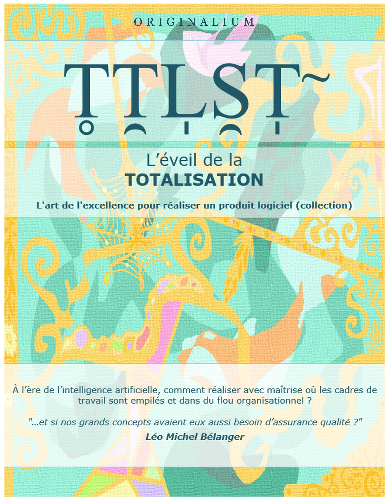

<!-- ===================== COUVERTURE (RECTO) ===================== -->
<!-- Zone réservée à l’illustration de couverture (image à insérer ici). -->

Logotype : T̥T̯L̩S̯T̩˜
Titre : L’éveil de la TOTALISATION
Sous-titre / accroche : La prise de conscience - le commencement
Auteur : Léo Michel Bélanger · Maison d’édition : ORIGINALIUM

---

<!-- ===================== PAGE DE TITRE ===================== -->

# T̥T̯L̩S̯T̩˜ ❖ L’éveil de la TOTALISATION

Collection : L’art de l’excellence pour réaliser un produit logiciel.

À l’ère de l’intelligence artificielle, comment réaliser avec maîtrise où les cadres de travail sont empilés et dans du flou organisationnel ?

"…et si nos grands concepts avaient eux aussi besoin d’assurance qualité ?"

Léo Michel Bélanger

---

©️ Copyright

Auteur : Léo Michel Bélanger

Illustrateur/couverture : Soléane Bélanger

Québec, Canada · Édition 2026 · ORIGINALIUM

## Sous-titre

**La prise de conscience - le commencement**

Michel Bélanger, fondateur d’ORIGINALIUM et créateur de BEASTEST, accompagne les organisations dans l'accompagnement entre vitesse, profitabilité et qualité. Il est l’auteur de la collection TOTALISATION.

Ce livre n’a pas été créé par l’IA : elle a été un outil de transformation, j’ai dû, à de nombreuses reprises, tout refaire pour garantir/préserver l’intégrité, l’intention et l’exactitude. Par contre, sans elle, je n’aurais jamais cru pouvoir écrire : je suis dysphasique (neurodivergence), et donc le langage, l’écriture, l’orthographe et la lecture me semblaient insurmontables. J’ai commencé avec une fausse promesse sur ce que l’IA m’apporterait ; elle ne m’a pas donné ce que j’attendais (écrire à ma place), mais bien plus. Parfois, on cherche une solution à ses limites pour découvrir que ces limites n’existaient pas vraiment.

[Emplacements : code-barres / ISBN · prix · logo ORIGINALIUM · www.totalisation.com]

---

Crédits visuels - Les images et la couverture de ce livre sont des chefs-d’œuvre réalisés par Soléane Bélanger.
## Table des matières
Repères de lecture TOTALISATION
Prologue personnel - Le premier bug que personne ne voulait croire
Prologue - La question qui a tout déclenché
Introduction - Pourquoi rien ne suffit, et pourquoi cela s’aggrave malgré tout
Partie 1 - Le chaos que les organisations ont appris à normaliser
Partie 2 - L’assurance qualité des grands concepts
Partie 3 - Clarté → qualité → confiance → excellence durable
Partie 4 - Le modèle TOTALISATION dans le cycle de vie produit
Partie 5 - L’IA, l’amplification et le potentiel de la qualité
Épilogue - Revenir au premier signal
Conclusion - De la lucidité à l’excellence durable
Annexes - Glossaire, références, distinctions clés et ressources avancées
## Note éditoriale - garder le lecteur captivé jusqu’à la fin
Pour que ce livre reste captivant, chaque partie doit faire avancer une découverte. Le lecteur ne doit pas seulement recevoir des explications sur TOTALISATION ; il doit sentir une progression : d’abord reconnaître un malaise, ensuite comprendre ce qui le produit, puis découvrir une chaîne de maîtrise, voir cette chaîne prendre forme dans le cycle produit et, enfin, mesurer ce que l’intelligence artificielle amplifie lorsque la clarté ou le flou sont déjà présents.
Le rôle d’ORIGINALIUM (organisation), DREAM-TEAM (équipe) et BEASTEST (produit) est donc essentiel : ils ne doivent pas être seulement des exemples ponctuels. Ils doivent devenir la tension narrative du livre. Au début, l’équipe subit le flou. Ensuite, elle apprend à le nommer. Puis elle transforme les mots en décisions, les décisions en critères, les critères en signaux et les signaux en apprentissages réinjectés. À la fin, le lecteur doit pouvoir dire : “j’ai vu une organisation passer de l’activité à la maîtrise”.
La suite logique de complétion doit donc respecter un rythme précis : une idée forte, une tension concrète, une scène ou un carnet de terrain, un repère pratique, puis une question qui ouvre le chapitre suivant. Ce rythme évite que les notions de clarté, qualité, confiance, signaux et apprentissage deviennent répétitives. Chaque retour à ces mots doit révéler une couche nouvelle : d’abord le symptôme, ensuite le mécanisme, puis l’usage, puis la transformation durable.
La complétion finale du livre doit conduire le lecteur vers une promesse simple : TOTALISATION n’est pas une méthode de plus, mais une manière de rendre la réalisation plus lucide, plus digne de confiance et plus habitable. La fin doit revenir au premier signal - le bug que personne ne voulait croire - pour boucler le parcours : apprendre à écouter les signaux avant qu’ils deviennent incidents, conflits, fatigue ou fausses certitudes amplifiées par l’IA.

## Comment lire ce livre
Ce livre n’est pas un guide pratique complet ni un mode d’emploi d’implantation. Il se lit d’abord comme un ouvrage de fond : une invitation à mieux voir les pertes de maîtrise, à clarifier les concepts qui orientent le travail logiciel et à comprendre pourquoi la chaîne clarté → qualité → confiance → excellence durable devient essentielle. Les scènes ORIGINALIUM (organisation), DREAM-TEAM (équipe) et BEASTEST (produit) servent de miroirs narratifs inspirés du réel ; elles illustrent des tensions fréquentes sans prétendre fournir une démarche d’implantation étape par étape, et surtout un partage de mon expérience mais aussi l’expérience de l’évolution de la communauté de réalisation de produit logiciel.
Si vous lisez ce livre seul, cherchez les phrases qui décrivent exactement votre réalité. Si vous le lisez avec une équipe, utilisez les scènes comme déclencheurs de conversation : “où voyons-nous cela chez nous ?”. La valeur du livre apparaît lorsque la lecture permet une meilleure lucidité, pas lorsqu’elle impose une recette.
Pour comprendre le diagnostic : lire l’introduction et la partie 1.
Pour travailler les mots et les concepts : lire les chapitres 5 et 6.
Pour relier TOTALISATION à vos conversations d’équipe : revenir aux repères de lecture et aux questions de réflexion.
Pour préparer la réflexion sur l’IA : lire les chapitres 20 et 21, puis utiliser les questions proposées comme points de vigilance.
Pour rendre le livre vivant : revenir aux scènes ORIGINALIUM (organisation) / DREAM-TEAM (équipe).
## Convention de lecture - parenthèses et vocabulaire logiciel
Le livre privilégie le français. Lorsque le vocabulaire logiciel anglais est utile ou largement reconnu sur le terrain, la règle éditoriale est la suivante : employer d’abord le terme français, puis ajouter le terme anglais entre parenthèses à la première mention ou lorsque la précision évite une ambiguïté. Par exemple : carnet de produit (backlog), chaîne de livraison (pipeline), soutien (support), livraison (release), diffuser (diffuse), terminé (done).
Cette convention ne cherche pas à angliciser le texte. Elle sert de passerelle : le lecteur francophone garde un langage clair, tout en reconnaissant les mots utilisés dans les outils, les cadres de travail et les conversations professionnelles. Après la première clarification, le texte privilégie la fluidité et évite de répéter inutilement le terme anglais.
## Posture de lecture - rester vivant sur le terrain
Les repères proposés dans ce livre ne sont pas des consignes absolues. Ils servent à mieux voir, mieux clarifier, mieux décider et mieux apprendre. Sur le terrain, chaque organisation, chaque équipe, chaque produit et même chaque journée possède sa propre réalité humaine.
Un coach d’excellence TOTALISATION ne cherche donc pas à appliquer mécaniquement une grille. Il écoute le moment, observe les personnes, ajuste le rythme, choisit la bonne question et garde l’objectif de maîtrise sans devenir rigide.
La discipline TOTALISATION demande de la clarté, mais pas du dogmatisme. Elle demande de la structure, mais pas de la fermeture. Elle demande des signaux, mais pas l’illusion que tout peut être prévu.
Être fidèle à TOTALISATION, ce n’est pas suivre chaque outil à la lettre. C’est rester ingénieux, lucide et utile : adapter la forme sans perdre l’intention, improviser sans perdre le cap, et aider le système à transformer la clarté en qualité, la qualité en confiance, et la confiance en excellence durable.
Repère de posture : rester ingénieux sans improviser au hasard, structuré sans devenir rigide, et lucide sans devenir dogmatique.
## Le parcours du livre
Le livre avance en cinq mouvements. D’abord, reconnaître le chaos normalisé : les outils existent, mais la maîtrise ne suit pas toujours. Ensuite, comprendre que les grands concepts doivent eux aussi être clarifiés, éprouvés et améliorés. Puis, relier ces concepts à la chaîne clarté → qualité → confiance → excellence durable. Ensuite seulement, le modèle TOTALISATION est présenté comme une carte de lecture du cycle produit. Enfin, l’IA apparaît comme un révélateur final : elle amplifie soit la lucidité, soit le flou.
ORIGINALIUM (organisation), DREAM-TEAM (équipe) et BEASTEST (produit) forment le cas conducteur du livre. Ils servent de miroir tout au long du parcours. Les scènes ne sont pas là pour illustrer après coup ; elles rendent visible ce que TOTALISATION cherche à transformer : un flou accepté en maîtrise praticable.
Le Centre d’excellence TOTALISATION apparaît plus tard comme mécanisme de pérennité : il soutient les réflexes TOTALISATION lorsque la pression quotidienne risque de ramener l’organisation vers ses anciennes habitudes.
Le Centre d’excellence TOTALISATION n’est pas une police de méthode. Il agit comme gardien de la maîtrise, mémoire vivante, assistance, formation, coaching, catalyse, veille et rappel utile. Il peut réunir coach qualité, coach Agile, gestionnaire de changement, facilitateur, entraîneur, formateur, responsable technologique, responsable IT, expert DevOps, analyste, spécialiste en analyse de données, architecte et responsable produit. À l’échelle personnelle, il peut prendre la forme de rappels, de sources d’information, d’un suivi d’objectifs, d’un journal d’apprentissage, d’un mentor, d’une communauté, d’un ami critique ou d’un soutien par les pairs.
## TOTALISATION, l’art de réaliser avec maîtrise
TOTALISATION est l’art de réaliser avec maîtrise appliqué ici au produit logiciel : clarifier ce qui guide le travail, qualifier ce qui oriente les décisions, livrer avec confiance et apprendre durablement du réel.
Le produit logiciel donne une incarnation concrète de TOTALISATION, mais la même discipline peut éclairer d’autres formes de réalisation : une décision, une transformation, un service, une expérience ou un système plus digne de ce qu’il promet.
Plus largement, TOTALISATION prolonge un mouvement très ancien : améliorer ce qui existe en clarifiant, en apprenant et en élevant la qualité de ce que l’on réalise.
La proposition centrale est simple : TOTALISATION est l’art de réaliser avec maîtrise.
Dans le produit logiciel, cet art consiste à donner forme à une idée, à un service ou à une capacité utile sans perdre la clarté, la qualité, la confiance et l’apprentissage.
## Le cas conducteur - ORIGINALIUM (organisation), DREAM-TEAM (équipe) et BEASTEST (produit)
Pour rendre TOTALISATION concret, ce livre suit un cas conducteur inspiré du réel et volontairement fictionnalisé.
ORIGINALIUM (organisation) désigne l’organisation qui sert de miroir narratif. DREAM-TEAM (équipe) désigne l’équipe produit mise en scène pour incarner les situations du livre. BEASTEST (produit) désigne le produit logiciel autour duquel les exemples sont racontés.
Ces scènes ne prétendent pas documenter un cas réel dans tous ses détails. Elles condensent des situations fréquentes que beaucoup d’organisations peuvent reconnaître : demandes floues, carnet de produit (backlog) plein mais valeur incertaine, tests tardifs, livraisons anxieuses, intelligence artificielle utilisée avant clarification et apprentissages non réinjectés.
BEASTEST a une double présence assumée : dans le cas conducteur, il sert de produit logiciel autour duquel les scènes prennent forme ; dans l’écosystème TOTALISATION, il peut aussi représenter une incarnation technologique possible de la discipline. La discipline TOTALISATION demeure première ; l’outil vient après pour la soutenir.
# Prologue personnel - Le premier bug que personne ne voulait croire
Très jeune, je me glissais dans le bureau de mon père pour faire de l’ordinateur. Je n’avais pas encore le vocabulaire pour expliquer ce que je faisais. Je fouinais. J’essayais. Je cliquais. Je testais des choses improbables. Je découvrais les premières formes d’Internet comme on découvre un territoire immense, encore mal cartographié, où chaque écran pouvait cacher une surprise.
Mais ce dont je me souviens le plus, ce n’est pas l’émerveillement. C’est la frustration. Je chicanais l’ordinateur. Je lui en voulais de faire des choses incohérentes, d’afficher des comportements qui ne tenaient pas debout, de produire des erreurs que je sentais réelles sans pouvoir les nommer. Mon père trouvait cela drôle. Pour lui, l’ordinateur ne pouvait pas se tromper. S’il y avait une erreur, elle venait forcément de moi.
Pendant des années, cette scène est devenue une blague : l’enfant qui accusait la machine. L’enfant qui prétendait voir des erreurs dans un système supposé parfait. Avec le recul, je peux sourire. Mais je sais aussi autre chose : je n’étais pas fou. Il y avait réellement des bugs. Je n’avais ni l’autorité, ni l’expérience, ni les bons mots, mais j’avais déjà rencontré une vérité qui allait me suivre toute ma vie professionnelle : un problème réel peut rester invisible lorsque ceux qui regardent le système croient déjà qu’il ne peut pas se tromper.
Mon père avait raison sur une chose : l’ordinateur ne décidait pas, par lui-même, de faire une erreur. Mais il avait tort sur une autre : une machine peut exposer les erreurs d’un système humain. Elle peut révéler une logique incomplète, une conception fragile, une programmation imparfaite, une configuration mal comprise ou une attente mal définie.
Cette première injustice - voir quelque chose de réel sans être cru - a laissé une trace. Plus tard, je l’ai revue partout sous d’autres formes. Des utilisateurs voyaient des irritants que le système appelait des exceptions. Des personnes qualité voyaient des risques que les projets traitaient comme des détails. Des équipes voyaient le flou avant qu’il devienne une crise, mais on leur demandait d’avancer quand même.
Aujourd’hui, nous répétons parfois avec l’intelligence artificielle ce que certains croyaient hier avec l’ordinateur : la machine impressionne, donc elle doit avoir raison. Mais l’IA, comme l’ordinateur de mon enfance, amplifie surtout la qualité du système qui la nourrit. Si le besoin est flou, elle peut générer du flou avec élégance. Si les critères sont faibles, elle peut produire une réponse convaincante mais fragile. Si la décision est mal comprise, elle peut accélérer une mauvaise direction.
TOTALISATION vient en partie de cette scène fondatrice : avant le code, avant le test, avant l’outil, avant l’automatisation et avant l’IA, il y a quelqu’un qui ose dire : quelque chose n’est pas clair, quelque chose ne tient pas, quelque chose mérite d’être regardé avant d’être amplifié.
# Prologue - La question qui a tout déclenché
L’Eureka TOTALISATION est né d’une question simple : et si nos grands concepts avaient eux aussi besoin d’assurance qualité ?
Cette question n’est pas apparue dans un moment calme, devant un tableau blanc parfaitement organisé. Elle est apparue devant le désordre ordinaire d’une organisation logicielle moderne : beaucoup d’efforts, beaucoup d’outils, beaucoup de bonne volonté, mais une confiance qui ne suivait pas toujours.
Les personnes travaillaient fort. Les équipes voulaient réussir. Les gestionnaires voulaient mieux livrer. Les spécialistes qualité voulaient prévenir les défauts. Les développeurs voulaient construire proprement. Les responsables produit voulaient créer de la valeur. Pourtant, les mêmes symptômes revenaient.
Les besoins étaient parfois mal compris. Les priorités changeaient sans apprentissage clair. Les tests arrivaient trop tard pour révéler des conversations qui auraient dû avoir lieu plus tôt. Les livraisons demandaient encore de l’héroïsme. Les tableaux de bord donnaient une impression de contrôle, mais ne changeaient pas toujours les décisions.
Pendant longtemps, il aurait été facile d’expliquer cela par des causes visibles : manque de discipline, mauvais processus, mauvaise communication, dette technique, pression de livraison ou résistance au changement. Ces causes existent parfois. Mais quelque chose d’autre semblait passer sous le radar.
Ce quelque chose était plus discret : les concepts eux-mêmes. Les mots que nous utilisons pour travailler ensemble - valeur, produit, qualité, test, terminé (done), livraison, stratégie, Agile, DevOps, transformation, intelligence artificielle - semblaient communs, mais ils ne guidaient pas toujours les mêmes décisions.
Un mot peut sembler partagé et produire pourtant plusieurs réalités. Une organisation peut dire “qualité” et parler à la fois de conformité, stabilité, expérience utilisateur, sécurité, rapidité de correction, absence de défauts visibles ou capacité d’évolution. Aucune de ces dimensions n’est fausse. Mais lorsqu’elles ne sont pas clarifiées, elles entrent en collision.
C’est là que la question est devenue évidente : nous parlons beaucoup d’assurance qualité sur le logiciel, mais très peu d’assurance qualité sur les concepts qui permettent de le penser, de le définir, de le construire, de le tester, de le livrer et de l’améliorer.
TOTALISATION est né de cette intuition : non pas comme une méthode de plus à empiler, mais comme une discipline de lucidité pour relier les mots, les décisions, les pratiques, les signaux et l’apprentissage.
Avant d’assurer la qualité de ce que nous construisons, nous devons apprendre à assurer la qualité de ce avec quoi nous construisons.
#### À retenir
Le chaos ne vient pas toujours d’une mauvaise volonté individuelle.
Les grands concepts peuvent être utilisés sans être réellement testés.
TOTALISATION commence par une question de qualité appliquée aux concepts.
#### Symptômes à observer
Les mêmes malentendus reviennent malgré les efforts.
Les mots semblent partagés, mais les décisions divergent.
Les équipes travaillent fort, mais la maîtrise ne progresse pas.
#### Questions de réflexion
Quels concepts supposons-nous compris ?
Quel mot guide nos décisions sans avoir été clarifié ?
Où voyons-nous un angle mort récurrent ?
#### Repères de réflexion
Choisir un concept clé et demander à trois personnes de le définir.
Identifier une décision récente affectée par une ambiguïté.
Ouvrir une courte conversation sur la qualité des concepts.
#### Signal de vigilance
Si trois personnes donnent trois définitions différentes d’un mot clé, le problème n’est pas linguistique : il est potentiellement qualité.
# Introduction - Pourquoi rien ne suffit, et pourquoi cela s’aggrave malgré tout
Les organisations logicielles modernes n’ont jamais eu autant de moyens pour mieux livrer. Elles ont adopté Agile, Scrum, SAFe ou d’autres cadres de travail. Elles ont investi dans DevOps, les chaînes de livraison (pipelines), les tests automatisés, les plateformes infonuagiques (cloud), les tableaux de bord (dashboards), les métriques, l’automatisation et maintenant l’intelligence artificielle.
Sur papier, tout semble là. En pratique, beaucoup d’organisations sentent pourtant que quelque chose résiste. Elles livrent davantage, mais ne font pas toujours mieux confiance à ce qu’elles livrent. Elles mesurent plus, mais décident parfois moins clairement. Elles automatisent, mais découvrent que l’automatisation accélère aussi les ambiguïtés.
Certaines organisations ont accéléré plus vite qu’elles n’ont appris à se maîtriser. D’autres n’ont jamais vraiment réussi à accélérer, prises dans le patrimoine existant (legacy), les silos, les validations tardives et les dépendances. D’autres encore ont décéléré après plusieurs transformations, parce que chaque nouvelle couche a ajouté plus de coordination que de clarté.
Dans les trois cas, le problème n’est pas seulement la vitesse. Le problème est la maîtrise. Une organisation peut aller vite dans le brouillard. Elle peut aussi rester immobile dans le brouillard. Elle peut même ralentir parce qu’elle ne sait plus comment sortir du brouillard. TOTALISATION s’intéresse à ce brouillard.
ORIGINALIUM (organisation) servira de cas conducteur inspiré du réel et volontairement fictionnalisé. L’organisation a investi dans les pratiques modernes. L’équipe DREAM-TEAM (équipe) travaille sur BEASTEST (produit), une plateforme interne utilisée par plusieurs équipes métiers. L’équipe livre régulièrement, mais la confiance diminue. Les demandes sont floues, les critères changent, les incidents reviennent et les métriques rassurent plus qu’elles n’éclairent.
Lorsque ORIGINALIUM (organisation) introduit l’IA, le problème ne disparaît pas. Il devient plus rapide. Les exigences ambiguës génèrent plus vite des solutions ambiguës. Les critères faibles produisent plus vite des validations faibles. Les résumés, propositions et automatisations se multiplient, mais les décisions restent fragiles.
Ce livre propose donc une chaîne simple : clarté → qualité → confiance → excellence durable. Sans clarté, la qualité devient une interprétation. Sans qualité, la confiance devient fragile. Sans confiance, l’excellence ne dure pas.
TOTALISATION ne demande pas d’abandonner Agile, DevOps, les tests, l’automatisation ou l’IA. Il demande de mieux voir ce que ces approches supposent : quelle clarté est nécessaire, quelle qualité voulons-nous assurer, quelle confiance cherchons-nous à construire et quels signaux nous permettront d’apprendre sans nous mentir.
L’IA rend cette discipline urgente. L’IA n’élimine pas le flou ; elle amplifie ce qui existe déjà. Dans un système clair, elle peut accélérer l’apprentissage et l’excellence. Dans un système confus, elle peut accélérer les erreurs, les fausses certitudes et la souffrance organisationnelle.
#### Respiration TOTALISATION - avant d’utiliser l’intelligence artificielle
Demandez simplement : qu’allons-nous amplifier exactement ? Si la réponse est floue, l’usage de l’IA doit d’abord devenir une occasion de clarification.
Ce livre propose donc une discipline de lucidité appliquée au système produit logiciel : il parle de qualité, de tests et d’IA, mais surtout de la manière dont une organisation peut mieux voir, mieux clarifier et mieux construire une confiance durable.
### Vitesse durable, économie réelle et qualité
Les organisations cherchent souvent la rapidité et l’économie. C’est légitime. Mais la vitesse durable et le retour sur investissement réel ne viennent pas d’abord de la pression, de la compression des étapes ou de l’automatisation du flou. Ils viennent de la qualité : qualité des concepts, qualité des décisions, qualité des critères, qualité des signaux et qualité de l’apprentissage.
Une mauvaise qualité coûte cher parce qu’elle crée des reprises, des clarifications tardives, des défauts, des tests inutiles, des livraisons anxieuses, des incidents et de la perte de confiance. À l’inverse, une qualité bien placée accélère parce qu’elle réduit le gaspillage invisible.
Dans TOTALISATION, la qualité n’est donc pas l’ennemie de la vitesse. Elle est la condition d’une vitesse saine. La vraie économie ne consiste pas à faire moins de qualité ; elle consiste à éviter de payer plusieurs fois le prix du flou.
### Avant TOTALISATION - le brouillard d’ORIGINALIUM (organisation)
Avant que TOTALISATION entre dans la conversation, ORIGINALIUM (organisation) ne se décrirait pas comme une organisation en crise. Les équipes livrent. Les réunions existent. Les tableaux de bord sont consultés. Les incidents sont traités. Les transformations sont connues. Vu de loin, l’organisation ressemble à une organisation moderne.
Le problème apparaît dans les moments de décision. Lorsqu’il faut prioriser, la valeur se déplace selon l’interlocuteur. Lorsqu’il faut livrer, la confiance se fragilise malgré des tests verts. Lorsqu’il faut expliquer un incident, les discussions reviennent aux mêmes mots : qualité, risque, urgence, responsabilité, terminé (done). Tout le monde reconnaît ces mots. Personne n’est certain qu’ils produisent les mêmes décisions.
DREAM-TEAM (équipe) ressent cette fatigue particulière des organisations qui ont déjà essayé beaucoup de choses. Une partie de l’équipe veut ajouter de l’automatisation. Une autre veut mieux définir les besoins. Une autre veut réduire les dépendances. Une autre veut utiliser l’IA pour accélérer les analyses. Toutes ces pistes sont raisonnables. Pourtant, chacune risque d’amplifier le même problème si le système ne sait pas d’abord ce qu’il doit clarifier.
Dans une réunion de planification, BEASTEST (produit) paraît maîtrisé parce que les colonnes sont pleines, les billets de travail (tickets) sont classés et les dépendances sont visibles. Mais lorsqu’une personne demande ce que cette livraison rendra vraiment plus fiable pour les utilisateurs, la réponse devient plus lente. Ce ralentissement est précieux. Il révèle que l’activité est organisée, mais que la maîtrise n’est pas encore acquise.
C’est ce brouillard qui rend TOTALISATION nécessaire. Pas un chaos spectaculaire. Pas une organisation incapable. Plutôt une accumulation de petites ambiguïtés acceptées, de décisions fragiles, de signaux mal reliés et de concepts supposés compris. TOTALISATION commence là : au moment où une équipe cesse de normaliser ce qu’elle devrait apprendre à clarifier.
### Scène ORIGINALIUM (organisation) / DREAM-TEAM (équipe) - La réunion de direction
La réunion de direction d’ORIGINALIUM (organisation) commence avec des chiffres rassurants. Le tableau de bord BEASTEST (produit) montre des livraisons régulières, une vélocité stable, une disponibilité acceptable et une couverture de tests qui progresse. Sur l’écran, l’organisation semble maîtriser son produit.
Pourtant, lorsque la discussion quitte les indicateurs pour revenir aux décisions, la confiance devient moins nette. Une personne demande si la prochaine livraison améliorera réellement la vie des équipes métiers. Une autre demande si les incidents récents sont des exceptions ou les symptômes d’un problème plus profond. Une troisième propose d’accélérer avec l’IA pour produire plus vite les analyses et les critères manquants.
DREAM-TEAM (équipe) écoute. L’équipe connaît déjà cette sensation : beaucoup d’activité, beaucoup de données, mais une difficulté à dire ce que tout cela prouve. Les indicateurs décrivent le mouvement du système, mais ils ne disent pas encore si les décisions deviennent meilleures.
La conversation change lorsqu’une question simple est posée : “Quel signal nous ferait réellement changer de décision ?” Le silence qui suit n’est pas un échec. Il révèle que plusieurs métriques existaient sans être reliées à une décision de maîtrise.
La direction ne décide pas d’abandonner ses tableaux de bord. Elle décide de les relire autrement. Pour chaque indicateur important, ORIGINALIUM (organisation) veut maintenant savoir quelle décision il éclaire, quel risque il rend visible et quel apprentissage il permet de réinjecter.
Cette réunion devient une première fissure dans l’illusion de contrôle. ORIGINALIUM (organisation) ne manque pas seulement de données. L’organisation manque d’une meilleure relation entre les données, les décisions et la confiance.
# Partie 1 - Le chaos que les organisations ont appris à normaliser
Cette première partie ne cherche pas à accuser les organisations. Elle cherche à nommer un phénomène que beaucoup vivent déjà : un chaos discret, devenu presque normal, qui se cache derrière les outils, les tableaux de bord, les rituels, les transformations et les livraisons régulières. Le lecteur est invité à reconnaître les symptômes avant de chercher une solution.
Le fil de cette partie est simple : lorsque l’activité augmente mais que la confiance ne suit pas, il faut cesser de regarder seulement les personnes, les outils ou les processus. Il faut apprendre à voir le système : ses ambiguïtés, ses signaux faibles, ses décisions fragiles et les habitudes que l’organisation a fini par considérer comme normales.
## Chapitre 1 - Le paradoxe des organisations modernes
Une équipe peut avoir tout ce qu’il faut en apparence : un carnet de produit (backlog), des itérations (sprints), des chaînes de livraison (pipelines), des tests automatisés, des tableaux de bord, des environnements, des cérémonies agiles, des métriques et même des assistants IA. Pourtant, cette même équipe peut manquer de confiance.
Elle peut livrer régulièrement, mais se demander si elle livre la bonne chose. Elle peut mesurer beaucoup, mais décider peu. Elle peut tester davantage, mais découvrir trop tard les vraies ambiguïtés. Elle peut automatiser, mais automatiser des comportements mal compris.
C’est le paradoxe des organisations modernes : elles n’ont jamais eu autant de moyens pour contrôler le travail logiciel, mais elles n’ont pas toujours plus de maîtrise. Les outils donnent une capacité. Ils ne garantissent pas la lucidité.
Chez ORIGINALIUM (organisation), DREAM-TEAM (équipe) a des outils modernes. La chaîne de livraison (pipeline) fonctionne. Les tableaux de bord existent. Les réunions sont au calendrier. Mais lorsqu’une livraison BEASTEST (produit) approche, les mêmes questions reviennent : sommes-nous certains que c’est la bonne valeur ? Que prouve ce test ? Quel signal devons-nous surveiller ? Qui décide si le risque est acceptable ?
Le problème n’est pas l’absence de pratiques. Le problème est que ces pratiques ne sont pas toujours reliées par une compréhension partagée. Un carnet de produit peut contenir des éléments, une itération produire un incrément, un test passer et un tableau de bord être vert ; aucun de ces signes ne garantit à lui seul que le produit devient plus digne de confiance.
Une organisation peut donc confondre activité et maîtrise. Elle voit des billets de travail (tickets) bouger, des compilations (builds) réussir, des cérémonies se tenir, des indicateurs se mettre à jour. Pourtant, lorsqu’il faut prendre une décision difficile, la confiance n’est pas au rendez-vous.
TOTALISATION part de ce paradoxe. Les outils sont utiles, mais ils amplifient la qualité du système dans lequel ils entrent. Dans un système clair, ils aident. Dans un système flou, ils produisent plus vite du flou.
La première question n’est donc pas : quel outil manque ? La première question est : quelle maîtrise manque malgré les outils déjà présents ?
#### À retenir
Plus d’outils ne signifie pas automatiquement plus de maîtrise.
La maîtrise vient des liens entre intentions, décisions, pratiques, signaux et apprentissages.
Un outil puissant amplifie le système dans lequel il entre.
#### Symptômes à observer
Beaucoup d’outils, mais peu de confiance.
Livraisons régulières, mais valeur incertaine.
Automatisation sans compréhension suffisante.
#### Questions de maîtrise
Quel outil avons-nous ajouté récemment ?
Quelle clarté cet outil suppose-t-il ?
Quel signal prouve que cet outil améliore une décision ?
#### Repères de réflexion
Choisir un outil ou rituel et vérifier la décision qu’il améliore.
Lister les zones où la maîtrise reste faible malgré l’outillage.
Identifier un signal qui manque pour décider.
#### Signal de vigilance
Si un outil n’éclaire aucune décision, il devient une décoration opérationnelle.
### Cas ORIGINALIUM (organisation) / DREAM-TEAM (équipe) - La réunion produit floue
La réunion commence avec une demande simple en apparence : “Il faut améliorer le suivi dans BEASTEST (produit).” La phrase semble raisonnable. Tout le monde comprend les mots. Le responsable produit voit une amélioration attendue depuis longtemps. Le développement pense déjà à une modification d’écran. La qualité imagine les scénarios à couvrir. Les opérations anticipent les impacts sur les notifications et les permissions.
Pendant les premières minutes, la réunion donne l’impression d’avancer. Des solutions apparaissent rapidement. Quelqu’un propose un nouveau tableau de bord. Quelqu’un d’autre propose une recherche plus puissante. Une personne évoque l’utilisation de l’IA pour résumer automatiquement l’état des dossiers. Les idées sont nombreuses, mais personne n’a encore formulé précisément le problème.
Une question TOTALISATION interrompt le mouvement : “Qu’est-ce qui est flou ici ? Le besoin ? La valeur ? Le critère de qualité ? Le risque ? Le signal de succès ? La responsabilité ?” La salle ralentit. La demande n’est plus seulement une tâche à planifier. Elle devient une situation à comprendre.
DREAM-TEAM (équipe) découvre alors que le mot “suivi” cache plusieurs attentes. Pour certains, le suivi signifie savoir où se trouve un dossier. Pour d’autres, le suivi signifie prédire les retards. Pour d’autres encore, le suivi signifie réduire les demandes de statut envoyées aux équipes. Une seule demande porte trois problèmes différents.
La réunion change de nature. L’équipe cesse de comparer des solutions et commence à clarifier la valeur. Quel problème veut-on réduire en premier ? Quelle décision doit devenir plus facile ? Quel signal montrera que le suivi s’améliore réellement ? À la fin, DREAM-TEAM (équipe) ne sort pas avec une solution complète, mais avec une demande mieux formulée : réduire l’incertitude des équipes métiers sur l’état des dossiers critiques, mesurée par une diminution des demandes manuelles de statut et par une meilleure visibilité des risques de retard.
La clarté n’a pas ralenti DREAM-TEAM (équipe). Elle a évité que l’équipe accélère dans trois directions à la fois.
Cette scène devient le premier point de bascule pour DREAM-TEAM (équipe) : la maîtrise ne commence pas par une meilleure solution, mais par une meilleure formulation du problème. Le flou cesse d’être accepté comme une matière normale du travail.
#### Questions de réflexion
Quel mot de la demande semble évident, mais cache probablement plusieurs attentes ?
Quelle décision devrait devenir plus facile après la clarification ?
Quel signal permettrait de savoir que la valeur attendue apparaît vraiment ?
## Chapitre 2 - Accélérer, stagner ou décélérer
Certaines organisations ont accéléré plus vite qu’elles n’ont appris à se maîtriser. Elles livrent plus souvent, automatisent davantage et utilisent plus d’indicateurs, mais la confiance reste fragile. Ce constat est fréquent, mais il ne couvre pas tout le réel.
D’autres organisations stagnent. Elles veulent changer, mais restent prises dans les dépendances, le patrimoine existant (legacy), les silos, les validations tardives et les habitudes défensives. Elles n’accélèrent pas parce que chaque évolution semble risquée.
D’autres encore décélèrent. Elles ont essayé d’accélérer. Elles ont adopté des cadres, des rôles, des rituels, des outils et des transformations. Avec le temps, la complexité a repris le dessus. Les processus se sont alourdis. Les équipes ont perdu confiance dans les transformations elles-mêmes.
ORIGINALIUM (organisation) connaît ces trois réalités en même temps. Certains flux autour de BEASTEST (produit) sont très rapides. D’autres sont bloqués par des dépendances anciennes. Certaines équipes ont tellement vécu de transformations qu’elles attendent la prochaine avec prudence plutôt qu’avec confiance.
Ces trois situations semblent différentes. Pourtant, elles révèlent souvent le même problème : la difficulté à transformer la clarté en qualité, la qualité en confiance, et la confiance en excellence durable.
L’accélération sans maîtrise produit un système nerveux. La stagnation sans maîtrise produit un système défensif. La décélération sans maîtrise produit un système fatigué. Dans les trois cas, l’organisation doit retrouver une capacité à voir, clarifier, décider et apprendre.
TOTALISATION s’adresse donc aux organisations qui accélèrent, stagnent ou décélèrent. Le point commun n’est pas leur vitesse. Le point commun est leur besoin de développer une maîtrise qui ne dépend pas seulement d’outils, de rituels ou d’héroïsme.
La question utile devient : notre problème est-il la lenteur, la vitesse, ou l’absence de clarté sur ce que cette vitesse devrait rendre meilleur ?
### Le faux remède : ajouter des ressources au mauvais goulot
Lorsqu’une organisation ralentit, un réflexe naturel apparaît souvent : ajouter des ressources. Si le développement semble bloqué, on ajoute des développeurs. Si la validation s’accumule, on ajoute des personnes en assurance qualité (QA). Si le carnet de produit (backlog) grossit, on ajoute des analystes, des responsables produit ou des outils d’automatisation.
Ce réflexe est compréhensible. Il part souvent d’une bonne intention : aider l’équipe, réduire la pression, augmenter la capacité et livrer plus vite. Mais il peut aussi devenir un faux remède.
Un goulot d’étranglement (bottleneck) n’est pas toujours causé par un manque de personnes. Il peut venir d’un flux mal compris, d’une définition trop floue, de décisions qui arrivent trop tard, de dépendances invisibles, de critères faibles, de validations accumulées, de priorités instables ou d’un bruit informationnel que l’équipe doit constamment filtrer.
Ajouter des ressources dans un système flou peut donc augmenter le problème. Plus de personnes signifie plus de coordination, plus de conversations, plus de synchronisation, plus d’interprétations et parfois plus de reprises. L’organisation croit augmenter la capacité, mais elle augmente surtout la complexité du système.
Dans TOTALISATION, la question n’est donc pas seulement : avons-nous assez de personnes ? La question devient : qu’est-ce qui crée réellement la surcharge ? Est-ce un manque de capacité, ou un manque de clarté ? Est-ce un manque de développeurs, ou trop de décisions floues qui arrivent en développement ? Est-ce un manque de personnes qualité, ou trop de critères faibles à rattraper trop tard ?
Ajouter une personne au mauvais goulot peut soulager temporairement la pression visible, mais aggraver la pression invisible. L’équipe doit intégrer, expliquer, coordonner, synchroniser et parfois corriger davantage. À long terme, ce mauvais diagnostic peut contribuer au surmenage, à l’épuisement professionnel (burnout), à la perte de confiance, au désengagement et au départ de personnes clés.
Signal de vigilance : si l’ajout de ressources augmente surtout les réunions, les reprises, les validations et la coordination, le problème n’était probablement pas seulement la capacité.
Repère TOTALISATION : lorsqu’un goulot apparaît, ne demandez pas seulement qui manque. Demandez quelle clarté, quelle décision, quel signal ou quelle qualité manque au système.
#### À retenir
TOTALISATION ne concerne pas seulement les organisations qui vont trop vite.
Accélération, stagnation et décélération peuvent révéler le même manque de maîtrise.
Le point commun est le besoin de transformer clarté en qualité et confiance.
#### Symptômes à observer
Vitesse sans confiance.
Stagnation sous la lourdeur et le patrimoine existant (legacy).
Décélération après transformations épuisantes.
#### Questions de réflexion
Quel est notre profil actuel ?
Qu’est-ce que ce profil révèle sur notre maîtrise ?
Où la clarté manque-t-elle le plus ?
#### Repères de réflexion
Nommer honnêtement le profil actuel.
Identifier le coût principal de ce profil.
Choisir un levier de clarté adapté.
#### Signal de vigilance
Si l’organisation accélère, demander ce qui devient meilleur. Si elle stagne, demander ce qui est trop risqué. Si elle décélère, demander ce qui a perdu sa clarté.
### Cas ORIGINALIUM (organisation) / DREAM-TEAM (équipe) - Le carnet de produit (backlog) plein mais la valeur incertaine
Le carnet de produit (backlog) BEASTEST (produit) est rempli. Les colonnes sont organisées. Les priorités ont été revues. Les dépendances sont visibles. Pourtant, lorsqu’une personne demande quelle valeur sera créée au prochain trimestre, les réponses deviennent vagues.
Le carnet de produit (backlog) donne une impression de maîtrise parce qu’il contient beaucoup d’éléments (items). Mais TOTALISATION invite à distinguer activité et maîtrise. Un carnet de produit (backlog) plein peut cacher une valeur floue. Une liste bien ordonnée peut donner l’impression que l’organisation sait où elle va, alors qu’elle sait surtout ce qu’elle va faire.
DREAM-TEAM (équipe) décide de relire les dix premiers éléments (items) avec une question simple : “Quelle décision, quel risque ou quelle valeur cet élément améliore-t-il ?” Les réponses révèlent trois catégories. Certains éléments protègent une valeur claire. Certains réduisent un risque réel. D’autres existent parce qu’ils ont été demandés plusieurs fois, sans que leur impact soit encore clair.
L’équipe ne supprime pas brutalement ces éléments. Elle les transforme en hypothèses. Une demande devient : “Nous croyons que cette amélioration réduira les demandes de soutien (support) liées au statut des dossiers.” Une autre devient : “Nous croyons que cette automatisation réduira le délai de traitement, mais nous devons confirmer que le goulot est bien là.”
Le carnet de produit (backlog) cesse alors d’être seulement une file de production. Il devient une carte d’apprentissage. Chaque élément (item) important porte une valeur attendue, un risque ou une hypothèse. Les discussions deviennent moins politiques, parce qu’elles ne portent plus seulement sur qui a demandé quoi, mais sur ce que l’organisation veut apprendre ou sécuriser.
DREAM-TEAM (équipe) n’a pas réduit son ambition. L’équipe a réduit le flou qui entourait son ambition.
Pour DREAM-TEAM (équipe), cette scène transforme le carnet de produit (backlog) en objet de lucidité. Le carnet de produit (backlog) n’est plus seulement une réserve de travail ; il devient une carte de ce que l’organisation croit savoir, de ce qu’elle veut sécuriser et de ce qu’elle doit encore apprendre. C’est une différence majeure entre gérer de l’activité et réaliser avec maîtrise.
#### Questions de réflexion
Quels éléments (items) du carnet de produit (backlog) représentent une valeur confirmée, et lesquels sont seulement des hypothèses ?
Quel élément (item) important devrait être reformulé en hypothèse testable ?
Quel signal permettrait de distinguer activité et maîtrise ?
## Chapitre 3 - Le chaos n’est pas seulement de la mauvaise volonté
Devant le chaos, la tentation est forte de chercher un coupable : le mauvais processus, la mauvaise équipe, le mauvais gestionnaire, le mauvais outil, le mauvais carnet de produit (backlog), le mauvais test ou le mauvais comportement.
Parfois, il existe effectivement des problèmes de compétence, de discipline ou de décision. Mais réduire le chaos logiciel à la mauvaise volonté des personnes empêche souvent de voir le système.
Dans beaucoup d’organisations, les personnes travaillent fort. Elles essaient de livrer, de protéger les utilisateurs, de respecter les priorités, de satisfaire les parties prenantes et de réduire les risques. Mais elles travaillent dans un environnement où les mots sont flous et les signaux arrivent trop tard.
Chez DREAM-TEAM (équipe), les tensions autour de BEASTEST (produit) ne viennent pas d’un manque d’effort. Les développeurs veulent construire proprement. Le produit veut répondre aux utilisateurs. Les opérations veulent éviter les incidents. L’assurance qualité (QA) veut rendre les risques visibles. Le conflit apparaît parce que chacun agit à partir d’une définition différente de la qualité et de ce que signifie terminé (done).
Le chaos devient alors un symptôme de système. Ce n’est pas seulement une personne qui échoue. C’est une organisation qui ne voit pas assez tôt ce qu’elle devrait clarifier.
Blâmer est souvent plus rapide que comprendre. Mais le blâme ferme les boucles d’apprentissage. Il force les personnes à se protéger, alors que le système aurait besoin de mieux voir.
TOTALISATION adopte une posture différente : au lieu de commencer par accuser, il commence par chercher ce qui passe sous le radar. Qu’avons-nous supposé clair ? Quel signal est arrivé trop tard ? Quelle ambiguïté a été transformée en conflit ?
Cette posture ne retire pas la responsabilité. Elle la rend plus utile. Elle transforme le jugement en diagnostic et le diagnostic en apprentissage.
#### À retenir
Le chaos doit être analysé comme un système avant d’être attribué aux personnes.
Le blâme ferme souvent l’apprentissage.
TOTALISATION cherche ce qui passe sous le radar.
#### Symptômes à observer
Blâme récurrent.
Même problème qui revient malgré les corrections.
Incompréhensions persistantes entre rôles.
#### Questions de réflexion
Qu’avons-nous supposé clair ?
Quel signal est arrivé trop tard ?
Quelle ambiguïté a été transformée en conflit ?
#### Repères de réflexion
Remplacer une conversation de blâme par une cartographie des ambiguïtés.
Documenter une hypothèse non validée.
Identifier un signal qui aurait dû apparaître plus tôt.
#### Signal de vigilance
Avant de demander “qui a causé le problème ?”, demander “quelle compréhension manquait au système ?”.
## Chapitre 4 - Quand les transformations s’ajoutent sans se clarifier
Les organisations ajoutent souvent des solutions pour résoudre leurs problèmes : Agile, Scrum, SAFe, DevOps, tests automatisés, métriques, plateformes ou IA. Chacune de ces approches peut apporter de la valeur. Mais ajoutée sans clarification, une transformation peut devenir une couche de confusion.
Une organisation peut dire “nous faisons Agile” sans avoir clarifié ce que signifie apprendre, livrer de la valeur ou réduire le risque. Elle peut dire “nous faisons DevOps” sans avoir clarifié la responsabilité de bout en bout. Elle peut dire “nous avons des tests” sans avoir clarifié ce que ces tests prouvent réellement.
ORIGINALIUM (organisation) ajoute Agile, DevOps, tableaux de bord (dashboards) et IA sans toujours clarifier ce que ces concepts doivent améliorer. Les équipes disposent de plus de vocabulaire, de plus de réunions et de plus d’outils, mais certaines décisions restent aussi floues qu’avant.
Le danger n’est pas que ces approches soient mauvaises. Le danger est qu’elles soient appliquées comme des signes extérieurs de maturité. Une organisation peut ressembler à une organisation moderne sans avoir clarifié ses concepts essentiels.
TOTALISATION ne remplace pas ces approches. Il pose une question de qualité sur leur compréhension locale et leur application réelle : que voulons-nous améliorer, comment le saurons-nous et quels signaux nous obligeront à apprendre ?
Un concept puissant mal compris peut produire une illusion de maîtrise. Cette illusion est dangereuse parce qu’elle retarde la conversation nécessaire.
Dans la pratique, l’attention se déplace : ne plus seulement demander quelle solution ajouter, mais quelle clarté manque pour que les solutions existantes deviennent réellement utiles.
#### À retenir
Une transformation non clarifiée peut devenir une couche de confusion.
TOTALISATION ne remplace pas les cadres de travail ; il questionne leur qualité d’application.
Un concept puissant mal compris peut créer une illusion de maîtrise.
#### Symptômes à observer
Rituels sans apprentissage.
Cadres adoptés sans décisions améliorées.
IA introduite sans critères de confiance.
#### Questions de maîtrise
Quelle transformation utilisons-nous sans définition locale ?
Quel concept amplifie actuellement le flou ?
Comment saurons-nous que cette transformation améliore la qualité ?
#### Repères de réflexion
Écrire la promesse réelle d’une transformation.
Définir les signaux de succès et d’échec.
Identifier les mots flous qui l’entourent.
#### Signal de vigilance
Si une transformation ne change aucune décision, elle risque d’être surtout décorative.
### Scène ORIGINALIUM (organisation) / DREAM-TEAM (équipe) - La fatigue transformationnelle
Quand TOTALISATION est mentionné pour la première fois chez ORIGINALIUM (organisation), la réaction n’est pas immédiatement enthousiaste. Plusieurs personnes ont déjà vécu trop de transformations. Elles ont connu des affiches, des formations, des rituels, des rôles renommés, des tableaux de maturité et des promesses de simplification qui ont parfois ajouté de la complexité.
Une personne résume la fatigue de l’équipe avec une phrase courte : “Est-ce encore une méthode de plus ?” La question est légitime. Elle ne vient pas d’une résistance irrationnelle. Elle vient d’une mémoire organisationnelle. ORIGINALIUM (organisation) a déjà essayé d’améliorer son système, et chaque tentative a laissé des traces.
Le gestionnaire de changement du Centre d’excellence TOTALISATION propose alors de ralentir. Il ne présente pas TOTALISATION comme une nouvelle couche. Il demande plutôt : “Quelle conversation voulons-nous rendre meilleure cette semaine ?” Cette question déplace la tension. Il ne s’agit plus d’adopter un vocabulaire complet. Il s’agit d’améliorer une décision réelle.
DREAM-TEAM (équipe) choisit une seule zone : le mot valeur dans le carnet de produit (backlog) BEASTEST (produit). L’équipe ne lance pas un programme. Elle organise une clarification courte avec produit, qualité, développement, opérations et analyse de données (analytics). Chacun écrit ce que valeur veut dire dans la prochaine livraison.
Les écarts apparaissent rapidement. Pour certains, la valeur est l’usage. Pour d’autres, la réduction de risque. Pour d’autres, la diminution des demandes de soutien (support). L’équipe ne cherche pas immédiatement à harmoniser tout le vocabulaire d’ORIGINALIUM (organisation). Elle cherche seulement à rendre une décision plus claire.
La fatigue ne disparaît pas. Mais elle devient moins lourde, parce que TOTALISATION ne demande pas d’y croire avant de l’utiliser. TOTALISATION demande de tester une meilleure question dans une situation réelle.
Une adoption durable commence souvent lorsqu’une équipe cesse de débattre d’une méthode et améliore une conversation concrète.
### Carnet de terrain - Quand le flou ouvre la porte au sabotage
J’ai vu des initiatives presque prêtes à réussir : une équipe motivée, une vision qui se précise, des pratiques qui commencent à se relier, des personnes prêtes à apprendre. Puis, parfois, le système se dérègle. Un doute est semé au mauvais endroit. Une conversation se déplace hors du lieu où elle devrait avoir lieu. Une responsabilité devient ambiguë. La confiance, qui avait demandé des semaines à construire, commence à se fissurer.
Je ne raconte pas ce type d’expérience pour accuser des personnes ou documenter des organisations. Je le raconte parce que le sabotage, volontaire ou non, est un risque qualité réel. Il peut faire échouer une bonne stratégie plus vite qu’un mauvais outil. Et il se nourrit souvent de la même matière : mandat flou, rôles mal situés, critères de succès absents, décisions implicites et confiance non protégée.
Ce que le terrain m’a appris : une organisation protège sa qualité lorsqu’elle réduit l’espace où le flou permet au sabotage de se cacher.
Dans ces moments, j’ai aussi compris qu’une bonne idée ne suffit pas. Une initiative peut avoir du sens, une équipe peut être prête, une solution peut être pertinente, et pourtant tout basculer si le mandat, les rôles, les décisions et la confiance ne sont pas protégés. C’est une des racines humaines de TOTALISATION : la maîtrise ne sert pas seulement à mieux produire ; elle sert aussi à empêcher que le flou devienne un espace où la peur, le pouvoir, les malentendus ou le sabotage peuvent détruire ce qui était en train de naître.
J’ai vécu, dans une grande organisation, une situation qui a marqué durablement ma manière de penser la qualité, la confiance et la responsabilité. Le contexte, au départ, n’avait rien d’un drame annoncé : une initiative d’automatisation prenait forme, des personnes compétentes s’impliquaient, une communauté interne commençait à partager, des équipes voyaient enfin la possibilité de sortir de pratiques fragiles et répétitives. Il y avait de l’élan. Il y avait de la bonne volonté. Il y avait même, pendant un moment, cette impression rare que quelque chose de vraiment utile pouvait naître.
Puis le système a montré une autre face.
Ce qui a commencé comme un désaccord de vision s’est transformé en perte de confiance organisée. Des conversations ont quitté les lieux où elles auraient dû avoir lieu. Des jugements ont circulé sans clarification directe. Des intentions ont été prêtées. Des rôles ont été redéfinis après coup. Des attentes ont été évaluées selon des critères qui ne correspondaient pas au mandat réel. Une initiative construite pour aider l’organisation a été relue comme si elle devait prouver autre chose. Et peu à peu, la personne qui portait l’effort est devenue le problème à éliminer plutôt que le signal à écouter.
Je ne raconte pas cela pour régler des comptes. Je le raconte parce que ce genre de dérive existe dans les systèmes humains, même dans des organisations qui affichent de belles valeurs. Lorsqu’un mandat est flou, lorsqu’un rôle n’est pas protégé, lorsqu’un gestionnaire ne clarifie pas les tensions, lorsqu’un dossier se construit dans l’ombre, lorsqu’une personne influente peut déplacer la perception d’un groupe, la qualité n’est plus seulement menacée techniquement. Elle est menacée humainement.
Dans ces moments-là, le produit n’est plus le seul à se fragiliser. La personne aussi se fragilise. La confiance en soi s’érode. Le plaisir de contribuer disparaît. Le courage de parler diminue. L’expertise devient suspecte. L’énergie qui devait servir à construire sert maintenant à se défendre, à survivre, à documenter, à comprendre ce qui se passe, à anticiper la prochaine interprétation défavorable. Une organisation peut alors perdre beaucoup plus qu’une initiative : elle peut perdre la contribution d’une personne qui voulait profondément l’aider.
Ce vécu a laissé une trace directe dans TOTALISATION. TOTALISATION n’est pas seulement né d’un désir de mieux livrer des produits logiciels. Il est aussi né d’un refus : refuser que le flou devienne un espace où la peur, l’ego, le pouvoir, la politique interne ou l’intimidation peuvent détruire la maîtrise. Refuser que l’on transforme un signal de qualité en menace personnelle. Refuser que l’on demande à une personne d’assurer l’excellence sans lui donner le mandat, la protection, la reconnaissance et la clarté nécessaires pour le faire.
C’est pour cela que TOTALISATION parle autant de clarté, de rôles, de décisions, de signaux, de responsabilités et de réinjection de l’apprentissage. Ce ne sont pas seulement des notions de méthode. Ce sont des protections. Une organisation qui clarifie mieux ses mandats protège mieux ses personnes. Une organisation qui rend les décisions observables réduit les jeux d’interprétation. Une organisation qui relie les signaux aux apprentissages évite de transformer les porteurs de mauvaises nouvelles en coupables. Une organisation qui documente les responsabilités réelles empêche qu’un rôle soit jugé selon une mission qu’il n’a jamais eue.
TOTALISATION ne peut pas empêcher toute violence organisationnelle. Aucun modèle ne le peut. Mais TOTALISATION peut réduire l’espace où cette violence se cache. Il peut forcer les conversations à revenir vers les faits, les décisions, les mandats, les signaux et les apprentissages. Il peut aider une organisation à voir plus tôt lorsqu’une tension devient personnelle, lorsqu’un désaccord devient sabotage, lorsqu’un problème de clarté devient un dossier contre une personne.
Cette expérience m’a appris une chose difficile : une organisation peut parler de qualité tout en détruisant les conditions humaines qui rendent la qualité possible. TOTALISATION existe aussi pour cela. Pour rappeler qu’une excellence durable ne peut pas être construite sur la peur, l’ambiguïté, le silence ou la mise à l’écart de ceux qui voient les risques avant les autres.
Ce que le terrain m’a appris : la qualité d’un produit dépend aussi de la qualité du système humain qui permet aux personnes de dire la vérité sans être détruites pour l’avoir dite.
Derrière TOTALISATION, il y a des années de terrain, de succès, de blessures, d’essais, de détours et de reconstructions. Il y a des équipes formidables qui ont prouvé que l’entraide peut sauver une livraison impossible. Il y a des gestionnaires qui ont su écouter et redonner confiance. Il y a aussi des situations où le flou, le pouvoir et la peur ont fait plus de dégâts qu’un mauvais outil, qu’un mauvais test ou qu’un mauvais processus.
C’est pourquoi TOTALISATION porte une intention humaine forte : créer des systèmes où la qualité peut émerger sans dépendre de héros silencieux, sans broyer les personnes qui voient les risques, sans faire porter à un seul rôle l’anxiété de toute l’organisation. La maîtrise n’est pas seulement une affaire de méthode. C’est une manière de rendre le travail plus juste, plus lisible et plus habitable.
Une organisation qui veut vraiment l’excellence doit apprendre à protéger les conditions de l’excellence. Elle doit protéger la clarté. Elle doit protéger la parole utile. Elle doit protéger les signaux faibles. Elle doit protéger les personnes qui relient les morceaux du système lorsque tout le monde regarde seulement son morceau. Elle doit aussi reconnaître que la qualité n’est pas seulement ce que l’on exige des autres : c’est ce que l’organisation accepte de devenir elle-même.
Si TOTALISATION a une identité humaine forte, elle est là : aider les organisations à réaliser avec maîtrise, mais aussi avec dignité. Éviter que le flou devienne un refuge pour les mauvaises décisions. Éviter que la qualité soit utilisée comme une pression sans protection. Éviter que les personnes qui portent la lucidité soient isolées, jugées ou sacrifiées. Et permettre, lorsque c’est encore possible, que l’énergie humaine retourne vers ce qu’elle aurait toujours dû servir : construire quelque chose de meilleur, ensemble.
Ce premier mouvement du livre sert donc à reconnaître le chaos sans le réduire à des coupables. Une fois ce chaos nommé, la question suivante devient inévitable : avec quels mots pensons-nous ce chaos ? Le livre passe alors du système visible aux mots invisibles qui l’organisent.
# Partie 2 - L’assurance qualité des grands concepts
Après avoir reconnu le chaos normalisé, cette deuxième partie descend d’un niveau : elle regarde les mots qui organisent les décisions. Beaucoup de tensions ne viennent pas d’un manque d’effort, mais de concepts trop grands, trop flous ou trop différents selon les rôles. Valeur, qualité, risque, produit, terminé (done), livraison ou intelligence artificielle peuvent sembler partagés tout en produisant des décisions incompatibles.
Cette partie propose donc une idée fondatrice : les concepts eux-mêmes méritent une assurance qualité. Non pas pour les figer, mais pour les rendre assez clairs, partagés, observables et améliorables afin qu’ils puissent soutenir de meilleures décisions. C’est ici que TOTALISATION commence à transformer le langage en matière de maîtrise.
Le but n’est pas de produire un glossaire décoratif. Le but est de réduire les collisions invisibles qui coûtent cher : attentes divergentes, tests tardifs, priorités instables, livraisons anxieuses et confiance fragile.
## Chapitre 5 - Et si nos concepts avaient besoin d’assurance qualité ?
Dans le logiciel, l’assurance qualité est souvent associée au produit final : le code, les tests, les anomalies, les scénarios ou les livraisons. Cette association est compréhensible, mais elle arrive souvent trop tard dans l’histoire.
Avant qu’un produit logiciel existe, il y a déjà quelque chose qui influence tout : les concepts avec lesquels les personnes pensent, décident et travaillent. Une équipe parle de valeur, de vélocité, de qualité, de terminé (done), de produit, de risque, de livraison, d’incident, de transformation ou d’intelligence artificielle. Ces mots semblent familiers. Ils donnent l’impression d’être compris.
Pourtant, dans la pratique, ces mots ne veulent pas toujours dire la même chose pour tout le monde. Chez DREAM-TEAM (équipe), le mot “qualité” signifie stabilité pour certains, conformité pour d’autres, expérience utilisateur pour un autre groupe, et rapidité de correction pour les opérations. Le mot est le même, mais les décisions divergent.
Quand un concept est flou, les décisions deviennent floues. Quand les décisions sont floues, les pratiques deviennent incohérentes. Quand les pratiques deviennent incohérentes, la qualité devient difficile à construire. Et quand la qualité devient difficile à construire, la confiance devient fragile.
Faire l’assurance qualité d’un concept, ce n’est pas le rendre rigide. C’est vérifier s’il est assez clair pour guider les décisions, assez partagé pour aligner les personnes, assez observable pour être évalué, et assez vivant pour être amélioré.
Cette idée change la conversation. Au lieu de demander seulement si le produit est conforme, TOTALISATION demande si les concepts qui orientent le produit sont dignes de confiance. Le mot “valeur” produit-il des priorités cohérentes ? Le mot “qualité” produit-il des critères observables ? Le mot terminé (done) produit-il une confiance partagée ?
Avant d’assurer la qualité de ce que nous construisons, nous devons apprendre à assurer la qualité de ce avec quoi nous construisons.
#### À retenir
Les concepts guident les décisions avant même que le produit existe.
Un bon concept peut perdre sa puissance s’il est utilisé sans clarté.
Assurer la qualité d’un concept, c’est le rendre clair, partagé, observable et améliorable.
#### Symptômes à observer
Mêmes mots, attentes différentes.
Décisions floues autour de valeur, produit, terminé (done) ou qualité.
Concepts populaires appliqués mécaniquement.
#### Questions de réflexion
Ce concept est-il clair ?
Est-il partagé ?
Est-il observable ?
Peut-il être amélioré ?
#### Repères de réflexion
Écrire une définition opérationnelle.
Créer un exemple et un contre-exemple.
Valider cette définition avec plusieurs rôles.
#### Signal de vigilance
Un concept est prêt à guider l’action lorsqu’il réduit les décisions ambiguës.
### Approfondissement - Faire l’assurance qualité des concepts
L’idée d’assurance qualité des concepts peut sembler inhabituelle au premier contact. Pourtant, les organisations font déjà quelque chose de comparable lorsqu’elles clarifient des définitions, établissent des critères d’acceptation, alignent des parties prenantes ou transforment une intention en exemple testable. TOTALISATION ne crée pas ce besoin ; il lui donne un nom, une structure et une discipline.
Un concept devient dangereux lorsqu’il est assez populaire pour être utilisé partout, mais pas assez clair pour guider les décisions. “Valeur”, “qualité”, “agilité”, “terminé (done)”, “risque” et “IA” sont des exemples typiques. Ces mots circulent dans les conversations, les présentations, les objectifs et les transformations. Leur présence donne une impression d’alignement. Mais l’alignement réel n’apparaît qu’au moment où il faut décider, prioriser, tester, livrer ou apprendre.
Faire l’assurance qualité d’un concept, ce n’est pas chercher une définition universelle parfaite. Une organisation n’a pas toujours besoin d’une définition académique. Elle a besoin d’une définition opérationnelle suffisante pour décider mieux dans un contexte donné. La question n’est donc pas seulement “que signifie ce mot ?” mais “ce mot produit-il des décisions cohérentes et observables ?”.
Chez ORIGINALIUM (organisation), le mot “valeur” a longtemps servi à justifier des demandes très différentes. Une demande était “valeur” parce qu’un client important l’avait mentionnée. Une autre était “valeur” parce qu’elle réduisait un risque technique. Une autre encore était “valeur” parce qu’elle permettait de fermer un irritant opérationnel. Toutes ces raisons pouvaient être légitimes. Le problème était que le même mot cachait des arbitrages différents.
DREAM-TEAM (équipe) a donc cessé de demander seulement “quelle est la valeur ?”. L’équipe a commencé à demander : valeur pour qui ? valeur observable comment ? valeur maintenant ou plus tard ? valeur directe ou réduction de risque ? valeur confirmée ou hypothèse de valeur ? Cette série de questions a transformé la conversation.
Un concept de qualité TOTALISATION possède cinq caractéristiques : il est clair, partagé, observable, actionnable et améliorable. Clair, parce qu’il peut être expliqué simplement. Partagé, parce que les rôles clés peuvent l’utiliser sans se contredire. Observable, parce qu’on peut voir s’il est respecté. Actionnable, parce qu’il aide à décider. Améliorable, parce qu’il évolue avec l’apprentissage.
Cette grille donne une manière très pratique de tester les grands concepts. Si un concept ne peut pas être observé, il risque de rester décoratif. Si un concept n’aide pas à décider, il risque de devenir rhétorique. Si un concept ne peut pas s’améliorer, il risque de devenir dogmatique.
TOTALISATION cherche donc à rendre les concepts vivants. Un concept vivant n’est pas flou. Il évolue parce que l’organisation apprend. Il garde une mémoire des décisions, des erreurs, des signaux et des usages réels.
### Repère de réflexion - assurance qualité (QA) d’un concept en 15 minutes
Choisir un concept qui crée des décisions ambiguës.
Demander à trois rôles de le définir sans se consulter.
Comparer les différences sans chercher immédiatement un consensus.
Écrire une définition opérationnelle adaptée au contexte.
Ajouter un exemple, un contre-exemple et une décision que cette définition doit aider à prendre.
Revoir la définition après une livraison, un incident ou un apprentissage.
### Exemple complet - Qualifier le concept de valeur
Pour rendre l’assurance qualité des concepts moins abstraite, prenons le concept de valeur. Chez ORIGINALIUM (organisation), la valeur est un mot très présent. Il apparaît dans les objectifs trimestriels, les priorités du carnet de produit (backlog), les discussions de direction et les arbitrages de livraison. Pourtant, plus le mot circule, plus il risque de cacher des décisions différentes.
DREAM-TEAM (équipe) découvre que valeur veut parfois dire revenu potentiel, parfois réduction de risque, parfois satisfaction utilisateur, parfois conformité, parfois économie opérationnelle, parfois visibilité politique. Chaque sens peut être légitime. Le problème apparaît lorsque tous ces sens utilisent le même mot sans préciser la décision qu’ils doivent éclairer.
TOTALISATION ne demande pas de choisir une définition universelle et définitive de la valeur. TOTALISATION demande de rendre le concept assez clair pour décider dans un contexte donné. Une valeur n’est pas seulement quelque chose que quelqu’un désire. Dans un système produit, une valeur doit pouvoir orienter un choix, soutenir un arbitrage, produire un signal et permettre un apprentissage.
DREAM-TEAM (équipe) transforme donc le mot valeur en objet de qualification. L’équipe ne demande plus seulement : “quelle est la valeur ?”. Elle demande : valeur pour qui ? valeur observable comment ? valeur directe ou réduction de risque ? valeur confirmée ou hypothèse ? valeur maintenant ou valeur future ? valeur métier, technique, opérationnelle ou relationnelle ?
Cette série de questions ralentit la conversation pendant quelques minutes, mais elle évite des semaines de réalisation ambiguë. Un élément (item) du carnet de produit (backlog) qui semblait prioritaire devient une hypothèse. Une demande urgente devient une réduction de risque. Une amélioration interne devient une valeur de soutenabilité. Le mot valeur cesse d’être un argument général et devient un instrument de décision.
Le changement est subtil, mais puissant. Lorsqu’un concept est qualifié, les conversations deviennent moins politiques. Les personnes ne défendent plus seulement leur interprétation du mot. Elles explicitent le type de valeur recherché, le signal attendu et le risque si l’hypothèse est fausse.
Cette table n’est pas un formulaire à remplir mécaniquement. C’est une manière d’empêcher un mot noble de devenir une zone de brouillard. Plus un concept est important, plus il mérite d’être qualifié avec soin.
Dans l’Art TOTALISATION, réaliser avec maîtrise commence souvent par ce geste : transformer un mot supposé évident en concept capable de guider une décision réelle.
## Chapitre 6 - Les collisions terminologiques
Une collision terminologique survient lorsque deux personnes utilisent le même mot, mais ne parlent pas réellement de la même chose. C’est l’un des problèmes les plus fréquents et les moins visibles dans les organisations logicielles.
Dans une réunion, tout peut sembler aligné. Tout le monde dit “qualité”, “valeur”, “test” ou “livraison”. Mais au moment de décider, de construire, de valider ou de mesurer, les différences apparaissent.
Chez ORIGINALIUM (organisation), le mot terminé (done) devient le révélateur d’une dette invisible dans BEASTEST (produit). Pour le développement, terminé signifie que le code est intégré. Pour l’assurance qualité (QA), terminé signifie que les scénarios critiques sont vérifiés. Pour les opérations, terminé signifie que la diffusion peut être prise en charge. Pour le produit, terminé signifie que la valeur attendue peut être observée. Pour les utilisateurs, terminé signifie que le problème est réellement résolu.
Personne n’a entièrement tort. Mais tant que ces significations coexistent sans clarification, chaque livraison transporte une ambiguïté. Cette ambiguïté finit par se transformer en défaut, en attente déçue, en friction ou en perte de confiance.
Les collisions terminologiques créent des dettes invisibles. Elles ne produisent pas toujours une erreur immédiate. Elles produisent des attentes différentes, des décisions ambiguës, des tests tardifs et des frustrations récurrentes.
TOTALISATION propose de traiter ces collisions comme des signaux de qualité. Un mot flou peut devenir une dette organisationnelle. Le corriger ne demande pas nécessairement un grand programme. Cela commence souvent par une conversation simple : que voulons-nous dire exactement par ce mot, ici, maintenant, dans ce contexte ?
Une définition utile n’est pas seulement une phrase dans un glossaire. Elle doit produire de meilleures décisions, de meilleurs exemples, de meilleurs tests, de meilleurs signaux et une meilleure confiance.
#### À retenir
Une collision terminologique est un risque qualité.
Les mots flous créent des dettes invisibles.
Clarifier localement les mots sensibles améliore les décisions.
#### Symptômes à observer
Débats répétitifs sur les mêmes mots.
Attentes divergentes malgré l’accord apparent.
Tests ou livraisons qui révèlent des interprétations différentes.
#### Questions de réflexion
Quels mots déclenchent des malentendus ?
Quel mot crée le plus de décisions ambiguës ?
Avons-nous des exemples et contre-exemples ?
#### Repères de réflexion
Créer une table mot / définition / exemple / contre-exemple.
Ajouter les mots sensibles au glossaire local.
Réviser un critère de terminé (done) ou de valeur.
#### Signal de vigilance
Un mot critique sans exemple concret reste vulnérable à l’interprétation.
#### Respiration TOTALISATION - en réunion
Quel mot utilisons-nous comme s’il était clair, alors qu’il guide peut-être des décisions différentes ?
### Approfondissement - Les collisions terminologiques comme dette invisible
Une dette technique est souvent visible à travers le code, l’architecture, la performance ou la maintenabilité. Une dette terminologique est plus discrète. Elle ne se voit pas toujours dans les outils. Elle se manifeste dans les retards, les reprises, les conflits de priorité, les tests tardifs, les attentes déçues et les décisions qui se contredisent.
La dette terminologique apparaît lorsqu’un mot permet d’éviter une clarification nécessaire. Le mot donne une impression d’accord, alors qu’il transporte plusieurs interprétations. Plus le mot est utilisé souvent, plus la dette peut grossir sans être nommée.
Chez ORIGINALIUM (organisation), “prioritaire” semblait simple. Une demande prioritaire devait passer avant les autres. Mais prioritaire pour qui ? Pour le client ? Pour le risque opérationnel ? Pour la conformité ? Pour la promesse de livraison ? Pour la direction ? Pour l’équipe qui subit le plus de pression ? Tant que cette question restait implicite, les priorités changeaient selon l’interlocuteur le plus présent dans la conversation.
Une collision terminologique ne signifie pas que les personnes communiquent mal. Elle signifie souvent que le système utilise des mots trop grands pour des décisions trop précises. TOTALISATION ne cherche pas à appauvrir le langage. Il cherche à rendre les mots capables de soutenir l’action.
Le premier signe d’une collision est la répétition. Si la même discussion revient toutes les semaines avec les mêmes mots, il faut suspecter une collision. Le deuxième signe est le déplacement. Si un désaccord semble résolu en réunion mais réapparaît en test, en livraison ou en soutien (support), le mot n’était probablement pas assez clarifié. Le troisième signe est la personnalisation. Si le problème est attribué aux personnes plutôt qu’aux définitions, la collision devient politique.
Traiter une collision terminologique demande une posture simple : ralentir assez longtemps pour clarifier, mais pas assez longtemps pour bureaucratiser. Une table mot / définition / exemple / contre-exemple suffit souvent à changer la qualité d’une décision.
La valeur de ce travail n’est pas le glossaire lui-même. La valeur est la réduction des malentendus coûteux. Un bon glossaire TOTALISATION n’est pas un dictionnaire décoratif. C’est une mémoire de décisions utiles.
### Repère de réflexion - Détecter une collision terminologique
Le même mot déclenche des discussions répétitives.
Les rôles disent être alignés, mais les livrables ne correspondent pas aux attentes.
Les tests révèlent des interprétations différentes.
La définition change selon la personne qui parle.
Le mot est utilisé dans des objectifs, mais personne ne sait comment l’observer.
### Cas ORIGINALIUM (organisation) / DREAM-TEAM (équipe) - Le mot terminé (done) qui ne veut pas dire la même chose
La tension apparaît lors d’une démonstration. Le développement annonce que la fonctionnalité est terminée (done). La qualité répond que certains scénarios critiques restent à valider. Le produit dit que la valeur ne sera pas réelle tant que les utilisateurs pilotes ne l’auront pas utilisée. Les opérations ajoutent que le plan de surveillance n’est pas prêt.
Personne ne ment. Personne ne cherche à bloquer. Le problème est plus simple et plus profond : le même mot ne signifie pas la même chose. Terminé (done) est devenu une collision terminologique.
TOTALISATION propose de traiter cette collision comme un risque qualité. DREAM-TEAM (équipe) écrit quatre colonnes : mot, définition, exemple, contre-exemple. Le mot est terminé (done). La première définition est “le code est terminé et intégré”. Elle est utile, mais insuffisante pour décider d’une livraison. Une deuxième définition ajoute les scénarios critiques. Une troisième ajoute l’acceptation produit. Une quatrième ajoute la préparation opérationnelle.
L’équipe comprend alors que terminé (done) n’est pas un point unique. C’est une progression de confiance. Terminé pour développer. Terminé pour vérifier. Terminé pour livrer. Terminé pour apprendre. Chaque niveau répond à une décision différente.
Cette clarification réduit les tensions. La prochaine fois qu’une personne dit terminé (done), l’équipe demande : terminé pour quelle décision ? Terminé pour continuer le développement ? Terminé pour accepter ? Terminé pour diffuser ? Terminé pour considérer que la valeur est confirmée ?
Le mot n’est plus un piège. Il devient un outil de décision.
Le mot terminé (done) devient un révélateur. Ce n’est plus un simple désaccord de vocabulaire ; c’est une preuve que la confiance n’est pas située au même endroit pour tous les rôles. En clarifiant terminé, DREAM-TEAM (équipe) ne clarifie pas seulement une définition : l’équipe clarifie les décisions que ce mot devait soutenir.
#### Questions de réflexion
Dans votre contexte, terminé (done) sert-il à décider de développer, accepter, livrer ou apprendre ?
Quels rôles utilisent ce mot avec des attentes différentes ?
Quel exemple et contre-exemple rendraient la définition de terminé (done) observable ?
### Carte de lecture - Concept, risque, décision, signal
Une collision terminologique devient réellement traitable lorsqu’elle est reliée à une décision. Beaucoup d’équipes tentent de corriger les mots en créant un glossaire. C’est utile, mais insuffisant si le glossaire ne change aucune décision. TOTALISATION propose de relier chaque concept sensible à quatre éléments : le risque qu’il transporte, la décision qu’il influence, le signal qui l’observe et l’apprentissage qu’il doit permettre.
Cette carte aide DREAM-TEAM (équipe) à éviter deux pièges. Le premier piège consiste à discuter longtemps d’une définition sans savoir quelle décision elle doit améliorer. Le second consiste à croire qu’une définition écrite suffit. Une définition utile doit devenir visible dans les critères, les tests, les conversations de livraison et les signaux après diffusion.
Chez ORIGINALIUM (organisation), le mot prioritaire illustre bien cette logique. Tant que prioritaire veut seulement dire “important”, le mot alimente des débats. Lorsqu’il est relié à une décision - quel item passe avant un autre lorsque la capacité est limitée - le concept devient testable. Lorsqu’il est relié à un signal - quel risque augmente si cet élément (item) attend - il devient observable.
Cette carte transforme une discussion linguistique en diagnostic qualité. Le but n’est pas d’avoir des mots parfaits. Le but est d’éviter que des mots imparfaits guident des décisions critiques sans être observés.
Un concept sensible est mûr lorsqu’une équipe peut dire : voici le risque s’il reste flou, voici la décision qu’il influence, voici le signal qui nous dira si notre compréhension tient dans le réel.
## Chapitre 7 - La qualité avant les tests
Les tests sont essentiels. Ils révèlent des écarts, protègent contre des régressions, documentent des comportements, soutiennent la confiance et rendent certains risques visibles. TOTALISATION ne diminue pas les tests. Il les replace dans un système plus large.
Mais les tests ne peuvent pas tout réparer. Si l’attente elle-même était floue, si la valeur n’était pas comprise, si la décision n’était pas claire, le test arrive déjà tard dans l’histoire.
Un test automatisé révèle une conversation produit qui aurait dû avoir lieu avant la réalisation. Chez DREAM-TEAM (équipe), un scénario BEASTEST (produit) échoue. Techniquement, le test fait son travail. Mais l’analyse montre que deux équipes n’avaient pas la même compréhension du comportement attendu. Le défaut n’a pas commencé dans le code. Il a commencé dans une ambiguïté non clarifiée.
C’est pourquoi TOTALISATION place la qualité avant, pendant et après les tests au sens strict. La qualité commence dans la clarté du besoin. Elle continue dans la définition du produit. Elle se renforce dans les critères, les exemples, les hypothèses, les décisions et les conversations. Elle circule ensuite dans toute la réalisation : code, exemples, vérifications, validations, revues, signaux de livraison, usage réel et apprentissage. Ces formes de test et de confirmation ne viennent pas après coup ; elles accompagnent la réalisation et construisent progressivement la confiance.
Dire que la qualité commence avant les tests ne diminue pas les tests. Au contraire, cela leur donne plus de valeur. Dans TOTALISATION, un test devient plus puissant lorsqu’il vérifie, valide ou confirme quelque chose qui a été clairement pensé, formulé et partagé, et lorsqu’il intervient au bon moment dans la réalisation plutôt qu’en simple étape tardive.
La question utile n’est pas seulement : pourquoi le test a-t-il échoué ? La question utile est aussi : quelle clarté manquait pour que ce test devienne une preuve plutôt qu’une découverte tardive ?
Un test tardif révèle parfois une conversation qui aurait dû avoir lieu plus tôt ; une validation holistique cherche à faire émerger cette conversation au moment où elle peut encore guider la réalisation.
### Repère TOTALISATION - Les tests ne viennent pas après le code
Dans TOTALISATION, le mot test doit être compris largement. Il inclut les tests automatisés, mais aussi les exemples, les contre-exemples, les validations, les vérifications, les revues, les approbations, les observations, les signaux et la confirmation dans le réel.
Tester ne signifie donc pas attendre que le code soit terminé pour vérifier. Tester signifie construire progressivement la confiance : avant le code par la clarification, pendant le code par les exemples, les validations et les vérifications, au moment de la diffusion par les signaux, et après la diffusion par l’usage réel et l’apprentissage.
Une organisation qui n’a pas encore intégré TOTALISATION peut encore découvrir trop tard, en test, qu’une conversation aurait dû avoir lieu plus tôt. C’est ce que montrent certaines scènes ORIGINALIUM (organisation) / DREAM-TEAM (équipe). Mais la cible TOTALISATION est différente : rendre la validation continue, distribuée et holistique.
Repère : dans TOTALISATION, les tests ne forment pas une étape après le développement. Ils forment un système de confiance qui accompagne toute la réalisation.
Phrase repère : tester ne veut pas dire vérifier après avoir construit. Tester veut dire construire la confiance tout au long de la réalisation.
### Carnet de terrain - L’outil personnel qui révélait le besoin d’un système
Dans une expérience de terrain où l’équipe qualité devait porter beaucoup avec très peu de personnes, j’ai commencé à me construire un outil personnel. Au départ, il servait à aller plus vite. En réalité, il me servait surtout à mieux voir : retrouver l’information, suivre les versions, préparer les environnements, structurer les vérifications, valider les anomalies et garder une mémoire de travail.
Ce n’était pas encore BEASTEST. C’était un outil de survie devenu laboratoire. À chaque contexte, je le reconstruisais autrement. Chaque organisation ajoutait une leçon : les tests seuls ne suffisent pas, les données comptent, les environnements comptent, les versions comptent, les décisions comptent, les preuves comptent, et la capacité de relier tout cela compte encore davantage.
Ce que le terrain m’a appris : l’efficacité durable ne vient pas seulement d’automatiser des tests, mais de relier attentes, preuves, environnements, données, risques et apprentissages dans un même système de maîtrise.
Ce vécu explique aussi pourquoi TOTALISATION insiste autant sur les liens. Lorsque peu de personnes portent beaucoup de responsabilités, l’efficacité ne vient pas seulement du talent individuel. Elle vient de la capacité à garder ensemble les versions, les anomalies, les environnements, les données, les validations, les décisions et les apprentissages. Sans ce fil, le système dépend trop de héros silencieux. Avec ce fil, l’expérience individuelle peut devenir une capacité collective.
### Carnet de terrain - Les héros silencieux ne devraient pas porter le système seuls
Dans plusieurs organisations, j’ai rencontré des personnes capables de tenir ensemble des morceaux entiers du système. Elles connaissaient les versions, les anomalies, les dépendances, les environnements, les clients, les habitudes de livraison, les risques cachés, les personnes à contacter, les chemins de contournement, les tests qui comptent vraiment et les parties du produit que personne ne documentait correctement.
Ces personnes deviennent rapidement indispensables. On les consulte quand tout bloque. On les appelle quand la livraison chauffe. On leur demande de trouver ce qui ne marche pas, de se souvenir de l’historique, de rassurer, d’expliquer, de corriger, de valider, parfois même de sauver une situation que le système aurait dû prévenir.
J’ai moi-même été cette personne à certains moments. Pas par désir d’être indispensable. Souvent par nécessité. Quand les liens n’existent pas dans le système, quelqu’un finit par les porter dans sa tête, dans ses notes, dans ses outils personnels, dans ses habitudes et dans sa mémoire. Cela peut donner une impression d’efficacité. Mais ce n’est pas une vraie maîtrise collective.
Une organisation ne devrait pas confondre talent individuel et système de qualité. Le talent est précieux. Il faut le respecter, le protéger et l’utiliser comme catalyseur. Mais lorsqu’une organisation dépend trop d’une personne pour comprendre son produit, elle n’a pas seulement une personne forte : elle a aussi une fragilité structurelle.
Le rôle de TOTALISATION n’est pas de retirer la valeur des experts. Au contraire, TOTALISATION permet de transformer leur expérience en capacité collective. Ce que l’expert voit doit pouvoir devenir un signal. Ce qu’il sait doit pouvoir devenir une mémoire. Ce qu’il répète doit pouvoir devenir une pratique. Ce qu’il protège seul doit pouvoir devenir une responsabilité partagée.
C’est aussi pour cela que BEASTEST existe dans mon imaginaire TOTALISATION : non pas comme un simple outil, mais comme l’idée d’un système qui relie ce que les héros silencieux portent trop souvent seuls. Les attentes, les preuves, les versions, les environnements, les risques, les anomalies, les signaux et les apprentissages ne devraient pas vivre seulement dans la tête des meilleurs. Ils devraient vivre dans un système que l’organisation peut comprendre, améliorer et transmettre.
Ce que le terrain m’a appris : une personne exceptionnelle peut sauver une livraison ; un système maîtrisé évite d’avoir besoin de la sauver chaque fois.
### Repère TOTALISATION - les tests comme expression de la spécification
Dans TOTALISATION, un test n’est pas une entité séparée de la spécification. Il est une manière d’exprimer, d’exécuter, de vérifier ou de confirmer une attente spécifiée. Plus la spécification est claire, plus le test devient simple, utile et réutilisable.
La question n’est donc pas seulement : quels tests devons-nous écrire ? Elle devient : quelles attentes devons-nous spécifier pour que leur validation soit naturelle, observable et utile à une décision ?
#### À retenir
Les tests sont essentiels, mais la qualité commence avant eux et se poursuit pendant toute la réalisation.
Un test tardif révèle parfois une conversation absente ; TOTALISATION cherche à rendre cette validation plus continue.
Plus la définition est claire, plus les tests deviennent puissants.
#### Symptômes à observer
Tests découvrant surtout des ambiguïtés.
Critères incomplets ou interprétables.
Défauts fonctionnels liés à des décisions non clarifiées.
#### Questions de réflexion
Quelle clarté manquait avant le test ?
Quelle conversation aurait évité ce défaut ?
Le test prouve-t-il un comportement ou une hypothèse fragile ?
#### Repères de réflexion
Analyser une anomalie par cause technique, fonctionnelle, décisionnelle, conceptuelle.
Ajouter un exemple concret à une exigence.
Clarifier les critères avant automatisation.
#### Signal de vigilance
Quand un test découvre une ambiguïté, le défaut a probablement commencé avant le test.
### Cas ORIGINALIUM (organisation) / DREAM-TEAM (équipe) - Le test qui arrive trop tard
Un test automatisé échoue sur BEASTEST (produit). Le comportement attendu semblait simple : afficher l’état prioritaire d’un dossier lorsque plusieurs statuts existent. Le test indique que le système affiche le mauvais statut. La première réaction est technique : il faut corriger la règle.
Mais l’analyse révèle autre chose. Deux équipes n’avaient pas la même compréhension de “prioritaire”. Pour l’équipe métier, prioritaire signifie le statut qui demande une action immédiate. Pour l’équipe technique, prioritaire signifie le statut le plus récent dans la séquence. Pour les opérations, prioritaire signifie le statut qui augmente le risque de non-respect d’un engagement.
Le test a raison d’échouer. Mais le défaut n’a pas commencé dans le code. Le défaut a commencé dans une conversation absente. Le test révèle une ambiguïté qui aurait dû être clarifiée au moment de définir le comportement attendu.
DREAM-TEAM (équipe) transforme l’échec en apprentissage. L’équipe ajoute trois exemples à la règle : un cas attendu, un cas limite, un cas à ne pas faire. Elle ajoute aussi une question dans ses repères de validation : “Quel mot de la règle peut avoir plusieurs interprétations ?”
Le test automatisé devient plus utile après cette clarification. Il ne sert plus seulement à attraper une erreur. Il protège une compréhension partagée.
La qualité n’a pas commencé avec le test. Le test a rendu visible l’endroit où la qualité aurait dû commencer.
Cette scène aide DREAM-TEAM (équipe) à reclasser certains échecs. Un test rouge n’est pas seulement une alerte technique ; il peut être la trace d’une conversation absente. Le test ne perd pas de valeur. Au contraire, il devient plus utile parce qu’il montre où la qualité aurait dû commencer.
#### Questions de réflexion
Quel test récent a révélé une conversation qui aurait dû avoir lieu plus tôt ?
Quel mot ou critère aurait dû être clarifié avant la réalisation ?
Quel exemple ajouter pour éviter que le même flou revienne ?
## Chapitre 8 - Les erreurs, bugs et signaux comme matière d’apprentissage
Une erreur dérange parce qu’elle expose une fragilité. Un bug interrompt. Un incident coûte du temps, de la confiance et parfois de la crédibilité. Dans le quotidien, ces éléments sont souvent perçus comme des problèmes à faire disparaître le plus vite possible.
Il faut évidemment corriger ce qui doit l’être. Mais TOTALISATION invite à regarder plus loin. Un bug n’est pas seulement une anomalie à corriger. C’est une information sur ce que l’organisation n’a pas encore compris, clarifié ou appris.
Un incident BEASTEST (produit) cesse d’être une exception et devient une source de lucidité lorsque DREAM-TEAM (équipe) le relie à une décision, un concept ou un signal. Le problème n’est plus seulement “qui a cassé ?” mais “qu’est-ce que ce signal révèle ?”.
Si l’erreur sert à blâmer, l’apprentissage se ferme. Si l’erreur sert à voir, elle devient une source de qualité. Cette différence change profondément la culture d’une organisation. Elle ne retire pas l’exigence ; elle rend l’exigence plus intelligente.
La question n’est donc pas seulement “comment corriger ?” mais “qu’est-ce que ce signal révèle et où devons-nous réinjecter l’apprentissage ?”. Certains apprentissages doivent retourner vers la compréhension du besoin, parce que la situation était mal comprise. D’autres vers la définition du comportement, parce que les exemples étaient insuffisants. D’autres vers la réalisation, parce que la construction ou l’intégration a révélé une fragilité. D’autres vers la diffusion ou l’observation du réel, parce que l’usage a parlé après la livraison.
Une organisation qui apprend de ses erreurs devient plus digne de confiance. Une organisation qui corrige sans apprendre prépare souvent la répétition.
Une erreur bien comprise devient une information de qualité.
### Carnet de terrain - Le bug avant les mots
Avant même de connaître les mots “assurance qualité”, “test”, “anomalie” ou “défaut”, j’avais déjà vécu la sensation du signal faible ignoré. Je voyais une incohérence, mais le système autour de moi me disait qu’elle ne pouvait pas exister. Je n’avais pas encore le vocabulaire, mais je reconnaissais déjà une vérité de terrain : un signal peut être réel avant d’être reconnu.
Dans le logiciel, plusieurs bugs commencent ainsi. Un utilisateur contourne une fonction. Une personne qualité pose une question inconfortable. Un développeur voit une règle fragile. Le signal existe, mais il n’a pas encore d’espace pour être entendu. Si le système écoute trop tard, le signal devient incident. S’il écoute assez tôt, le signal devient apprentissage.
Ce que le terrain m’a appris : un bug n’est pas seulement une erreur à corriger ; c’est parfois une vérité que le système n’a pas encore appris à entendre.
#### À retenir
Une erreur bien comprise devient une information de qualité.
Les signaux faibles doivent alimenter l’apprentissage.
Corriger sans comprendre prépare souvent la répétition.
#### Symptômes à observer
Même défaut qui revient.
Incidents corrigés mais non appris.
Retour d’usage (feedback) utilisateur traité comme bruit.
#### Questions de réflexion
Que révèle ce signal ?
Où l’apprentissage doit-il être réinjecté ?
Quel concept ou décision était fragile ?
#### Repères de réflexion
Ajouter une colonne “apprentissage à réinjecter” dans l’analyse de bug.
Relier chaque incident à l’endroit où l’apprentissage doit retourner : compréhension du besoin, définition, réalisation, diffusion ou observation du réel.
Identifier un signal faible ignoré récemment.
#### Signal de vigilance
Un incident corrigé mais non appris est une dette qui attend son prochain déclencheur.
### Cas ORIGINALIUM (organisation) / DREAM-TEAM (équipe) - La rétro TOTALISATION après incident
Un incident survient après une livraison BEASTEST (produit). Une règle de priorité produit un résultat inattendu pour un groupe d’utilisateurs. Le correctif technique est rapide. La tentation est grande de fermer l’incident dès que le comportement est corrigé.
DREAM-TEAM (équipe) décide pourtant de faire une rétro TOTALISATION de 45 minutes. La première question est volontairement sans blâme : que s’est-il passé ? La deuxième question va plus loin : qu’est-ce qui était flou avant l’événement ?
L’équipe découvre que le risque avait été mentionné, mais jamais transformé en signal. La règle avait été testée dans des cas standards, mais pas dans un cas limite pourtant connu par les opérations. Le mot “prioritaire” avait été clarifié pour le produit, mais pas pour tous les contextes opérationnels.
La rétro produit trois apprentissages à réinjecter : ajouter un contre-exemple dans la définition, ajouter un signal de surveillance dans la diffusion, et préciser ce que terminé (done) doit inclure pour certains cas limites opérationnels.
L’incident n’est plus seulement une erreur corrigée. Il devient un apprentissage réinjecté. Le système devient légèrement plus intelligent.
C’est cela, apprendre sans se mentir : ne pas s’arrêter au correctif lorsque le système peut devenir plus clair.
Après cette rétro, ORIGINALIUM (organisation) ne voit plus l’incident seulement comme une parenthèse à refermer. L’incident devient un matériau d’apprentissage. La vraie question n’est plus seulement de savoir si le correctif est livré, mais si le système est devenu légèrement plus clair après l’événement.
#### Questions de réflexion
Quel signal était présent avant l’incident, mais n’a pas été écouté ou transformé en décision ?
Quel apprentissage doit retourner vers la compréhension, la définition, la réalisation, la diffusion ou l’observation du réel ?
Quelle définition, règle ou repère de validation doit changer après cet incident ?
### Point de bascule - DREAM-TEAM (équipe) commence à voir
Après les premières clarifications, DREAM-TEAM (équipe) ne travaille pas moins. L’équipe travaille autrement. Les mêmes réunions existent, mais les questions changent. Une demande n’est plus automatiquement transformée en solution. Un test rouge n’est plus seulement une faute technique. Un incident n’est plus seulement une urgence à refermer.
Cette évolution reste fragile : certains y voient un ralentissement, d’autres reconnaissent déjà que ce ralentissement apparent évite de longues reprises. La différence apparaît d’abord dans la qualité des conversations.
Le produit BEASTEST (produit) devient un laboratoire de maîtrise. DREAM-TEAM (équipe) commence à relier les mots aux décisions, les décisions aux critères, les critères aux tests, les tests aux signaux, et les signaux à l’apprentissage. C’est à ce moment que la chaîne clarté → qualité → confiance → excellence durable cesse d’être une formule et devient une pratique.
À ce stade, DREAM-TEAM (équipe) commence à voir autrement : les mots influencent les décisions, les tests révèlent des conversations absentes, les incidents deviennent des apprentissages possibles. Il reste alors à relier ces découvertes dans une chaîne simple : clarté → qualité → confiance → excellence durable.
# Partie 3 - Clarté → qualité → confiance → excellence durable
Après avoir nommé le chaos et clarifié les concepts, cette troisième partie présente la chaîne qui soutient tout le livre : clarté → qualité → confiance → excellence durable. Elle sert de colonne vertébrale. Elle permet de comprendre pourquoi une organisation peut travailler fort sans devenir plus fiable, et pourquoi la confiance ne peut pas être déclarée si la clarté et la qualité ne la soutiennent pas.
La progression est volontairement simple : lorsqu’une confiance est fragile, il faut demander quelle qualité manque ; lorsqu’une qualité manque, il faut demander quelle clarté aurait dû la rendre possible. Cette partie donne au lecteur une manière de remonter la source des tensions sans réduire le problème à un outil, un rôle ou une étape.
## Chapitre 9 - Clarté : le premier actif qualité
La clarté est souvent traitée comme une étape préalable. On clarifie pour commencer, pour écrire une exigence, pour alimenter un carnet de produit (backlog) ou pour permettre à une équipe d’avancer. Dans TOTALISATION, la clarté est plus qu’un préalable. Elle est le premier actif qualité.
Sans clarté, les équipes peuvent travailler fort dans des directions légèrement différentes. Le produit peut avancer, mais l’apprentissage reste faible. Les tests peuvent vérifier des interprétations différentes. Les métriques peuvent mesurer des choses qui ne soutiennent pas les décisions.
La clarté ne veut pas dire tout savoir à l’avance. Elle signifie que l’organisation sait suffisamment ce qu’elle cherche à apprendre, pourquoi cela compte, quels risques elle accepte, quels signaux elle observera et comment elle ajustera sa trajectoire.
Chez ORIGINALIUM (organisation), DREAM-TEAM (équipe) utilise la chaîne clarté → qualité → confiance comme diagnostic sur BEASTEST (produit). L’équipe croyait manquer de vélocité. En réalité, elle manquait surtout de clarté sur la valeur attendue et les signaux de succès.
Cette prise de conscience transforme la réunion de planification. Au lieu de commencer par la solution, DREAM-TEAM (équipe) commence par cinq questions : quel besoin voulons-nous comprendre ? Quelle valeur voulons-nous sécuriser ? Quel risque voulons-nous réduire ? Quel signal nous dira que nous avons appris ? Quelle décision deviendra plus facile après cette livraison ?
La clarté devient alors un accélérateur sain. Elle ne ralentit pas le système. Elle évite simplement d’accélérer dans le brouillard. Elle transforme l’énergie de l’équipe en direction partagée.
Sans clarté, la qualité devient une interprétation. Avec une clarté suffisante, la qualité peut devenir une propriété observable du système de réalisation.
#### À retenir
La clarté est le premier actif qualité.
Clarté ne signifie pas tout prédire.
La clarté permet d’agir et d’apprendre sans se mentir.
#### Symptômes à observer
Beaucoup d’activité, peu d’alignement.
Valeur difficile à expliquer.
Risques ou hypothèses implicites.
#### Questions de maîtrise
Que voulons-nous apprendre ?
Quelle valeur voulons-nous sécuriser ?
Quel risque voulons-nous réduire ?
Quel signal observerons-nous ?
#### Repères de réflexion
Écrire trois preuves attendues avant une livraison.
Identifier les hypothèses critiques.
Clarifier une décision avant de la planifier.
#### Signal de vigilance
Si l’équipe ne peut pas nommer le signal de succès, la demande est probablement encore trop floue.
## Chapitre 10 - Qualité : rendre le produit et les décisions dignes de confiance
La qualité est souvent réduite à la conformité d’un produit ou à l’absence de défauts visibles. Cette vision est utile, mais insuffisante. Un produit peut fonctionner techniquement et ne pas répondre à la bonne valeur. Une fonctionnalité peut être livrée selon la demande initiale et ne pas soutenir l’usage réel.
Dans TOTALISATION, la qualité est holistique. Elle concerne le produit, mais aussi le besoin, la valeur, les décisions, les hypothèses, les interactions, les données, les signaux, les apprentissages et la capacité du produit à rester digne de confiance dans son contexte.
La qualité holistique ne signifie pas tout contrôler. Elle signifie relier ce qui doit l’être pour éviter que chaque partie optimise son morceau pendant que le système perd de la cohérence. Une décision a une qualité. Une définition a une qualité. Une conversation a une qualité. Un critère a une qualité.
Pour BEASTEST (produit), DREAM-TEAM (équipe) comprend que la qualité ne se limite pas aux tests passés. Certains tests sont verts, mais les utilisateurs contournent la fonctionnalité. Certains indicateurs sont positifs, mais les équipes métiers n’ont pas plus confiance dans le résultat.
TOTALISATION aide DREAM-TEAM (équipe) à reformuler la question : quelle qualité voulons-nous réellement assurer ici ? Est-ce la qualité du comportement ? La qualité de la décision ? La qualité de la donnée ? La qualité de l’usage ? La qualité du signal ? La qualité de l’apprentissage ?
Cette question rend la qualité moins abstraite. Elle permet d’éviter une opposition stérile entre qualité technique et valeur métier. Le produit hérite des deux. Il hérite même de la qualité des décisions qui ont permis de le construire.
La qualité d’un produit logiciel dépend aussi de la qualité du système qui le réalise.
### La qualité appliquée aux pratiques de réalisation
Dire qu’il existe une “pratique qualité” peut sembler anodin. Pourtant, cette formulation crée souvent un effet dangereux : elle isole la qualité comme si elle était une pratique séparée des pratiques réelles de réalisation du logiciel.
On voit alors apparaître des silos : la pratique R&D, la pratique développement, la pratique Agile, la pratique DevOps, puis la “pratique qualité”. Chaque pratique semble avoir son territoire, son vocabulaire, ses priorités et ses responsabilités. La qualité devient alors une chose à part, presque étrangère au travail quotidien : une intrusion, un contrôle externe, quelque chose qu’il faut tolérer plutôt qu’une propriété naturelle de la réalisation.
Dans TOTALISATION, cette séparation est une erreur de lecture. La qualité n’est pas une pratique additionnelle. Elle est une qualité appliquée aux pratiques de réalisation du logiciel. Elle s’applique à la manière de comprendre, de définir, de planifier, de développer, de tester, de livrer, d’observer, d’exploiter et d’apprendre.
Il n’y a donc pas, d’un côté, les pratiques de réalisation et, de l’autre, une qualité séparée. Il y a des pratiques de réalisation du logiciel auxquelles on applique plus ou moins de clarté, de qualité, de confiance et d’apprentissage.
Une pratique Agile peut être de faible qualité si elle produit des rituels sans décision. Une pratique DevOps peut être de faible qualité si elle automatise le flou. Une pratique de développement peut être de faible qualité si elle perd le lien avec la valeur. Une pratique de test peut être de faible qualité si elle arrive trop tard pour protéger une compréhension. Le sujet n’est donc pas d’ajouter une pratique qualité. Le sujet est d’élever la qualité de toutes les pratiques qui réalisent le produit logiciel.
C’est une raison profonde du nom TOTALISATION : la qualité ne doit pas être isolée dans une zone spécialisée du système. Elle doit circuler dans l’ensemble. Elle devient totale lorsqu’elle relie les concepts, les décisions, les pratiques, les signaux et les apprentissages.
Phrase repère : la qualité n’est pas une pratique de plus. Elle est ce qui rend les pratiques de réalisation dignes de confiance.
Autre repère : isoler la qualité, c’est déjà commencer à la perdre.
### Repère TOTALISATION - La qualité comme portrait partagé de maîtrise
Dans beaucoup d’organisations, la qualité se retrouve malgré elle dans une posture difficile. Elle arrive avec des standards, des matrices, des modèles, des pyramides de tests, des pratiques de décalage à gauche (shift-left), des approches BDD, des référentiels, des critères ou des exigences. Plusieurs de ces repères peuvent être utiles. Le problème n’est pas leur existence. Le problème apparaît lorsqu’ils sont reçus comme une force d’imposition.
La qualité devient alors le groupe qui demande plus, qui ralentit, qui signale les mauvaises nouvelles, qui rappelle les règles ou qui impose une façon de faire. Elle peut aussi devenir la douane de la décision de livraison (go / no-go) : celle qui approuve, bloque, signe ou porte seule l’anxiété de la livraison.
TOTALISATION propose une autre posture. La qualité n’a pas besoin d’imposer par force brute lorsqu’elle peut éclairer par maîtrise. Elle aide à rendre visible ce que le système doit comprendre : quelles attentes sont claires, quels critères sont testables, quels risques sont acceptés, quels signaux sont utiles, quelles décisions restent fragiles et quels apprentissages doivent être réinjectés.
Dans cette lecture, la qualité ne porte pas seule la responsabilité de corriger ou d’autoriser le système. Elle expose un portrait. Ce portrait peut être construit à partir des spécifications, des exemples, des contre-exemples, des validations, des incidents, des retours d’usage, des signaux et de la qualimétrie.
Dans TOTALISATION, la qualimétrie désigne l’ensemble des mesures, signaux et observations qui rendent visible l’état de clarté, de qualité, de confiance et d’apprentissage du système produit. Elle ne sert pas à punir ni à décorer un tableau de bord. Elle sert à éclairer une décision.
Ensuite, l’organisation décide. Diffuser, retarder, réduire la portée, accepter un risque, renforcer une validation ou changer de solution relève d’une responsabilité organisationnelle. La qualité aide à voir ; elle ne doit pas être forcée de décider seule à la place du système.
La qualité ne dit plus seulement : “voici le standard à respecter”. Elle aide à dire : “voici ce que nous voyons ; quelle décision voulons-nous prendre ?”.
Cette posture réduit la friction entre qualité, produit, développement, Agile, architecture et opérations. Elle réduit aussi le sabotage possible, parce que les personnes se sentent moins contraintes par une autorité extérieure et davantage invitées à regarder un portrait partagé. TOTALISATION ne retire pas l’exigence. Il la rend plus intelligente, plus observable et plus utile à la décision.
Le rôle qualité change alors de nature. Les personnes qualité ne sont plus seulement gardiennes de standards, porteuses de mauvaises nouvelles ou douanières de la décision de livraison (go / no-go). Elles deviennent des aidants, des assistants, des facilitateurs, des éclaireurs et des catalyseurs de maîtrise.
Phrase repère : la qualité TOTALISATION n’est pas une douane. Elle est un portrait partagé de maîtrise.
Autre repère : la qualité TOTALISATION n’utilise pas la force brute du contrôle ; elle utilise la force intelligente du portrait partagé.
Questions de réflexion : quel standard essayons-nous d’imposer sans avoir clarifié le problème qu’il doit résoudre ? Quel portrait qualité pouvons-nous exposer avant de proposer une solution ? Quelle décision ce portrait doit-il éclairer ? Quels signaux rendent la situation observable sans blâmer les personnes ? Comment le rôle qualité peut-il aider, faciliter ou éclairer plutôt qu’imposer ?
### Carnet de terrain - Quand le rôle qualité absorbe l’anxiété du système
Avec les années, j’ai vu le mot QA porter trop de responsabilités contradictoires. On demande parfois à une même personne d’être testeur manuel, automaticien, analyste fonctionnel, soutien, gardien des environnements, rédacteur de tests, juge de livraison, coach de pratiques et conscience qualité de toute l’équipe. Cette accumulation peut produire de la performance à court terme, mais elle brouille profondément la responsabilité réelle.
Ce flou m’a amené à distinguer plus clairement les responsabilités : analyste qualité, spécialiste qualité, coach qualité, ambassadeur qualité, utilisateur qualité, centre d’excellence et responsabilités propres au produit, au développement, aux opérations et aux utilisateurs. TOTALISATION ne cherche pas à retirer la qualité des équipes. Il cherche à arrêter de déposer toute l’anxiété du système sur un rôle mal défini.
Ce que le terrain m’a appris : dire que la qualité est l’affaire de tous ne suffit pas ; il faut aussi préciser qui assure quoi, quand, avec quels signaux et quelle responsabilité réelle.
Cette distinction vient de situations très concrètes où le mot “QA” servait à désigner presque tout : tester, analyser, automatiser, documenter, soutenir, surveiller et parfois absorber l’anxiété de l’organisation. À force de voir ce rôle étiré jusqu’à l’absurde, j’ai compris qu’il fallait séparer les responsabilités sans séparer la qualité. TOTALISATION cherche exactement cet équilibre : la qualité appartient à tous, mais elle ne peut pas rester une formule vague.
### Carnet de terrain - Quand “la qualité est l’affaire de tous” devient l’affaire de personne
J’ai souvent entendu cette phrase : “La qualité est l’affaire de tous.” Sur le fond, je suis d’accord. Une organisation saine ne peut pas déléguer la qualité à une seule personne ou à une seule équipe. Le produit hérite des décisions de tout le monde : produit, développement, opérations, architecture, soutien, gestion, utilisateurs et partenaires.
Mais sur le terrain, cette phrase devient parfois dangereuse. Elle peut servir à responsabiliser tout le monde, oui. Mais elle peut aussi servir à ne plus responsabiliser personne.
J’ai vu des contextes où l’on retirait progressivement les personnes qualité au nom de cette idée. Au début, l’élan restant suffisait. Les équipes continuaient, les habitudes tenaient, les anciens réflexes compensaient. Puis, lentement, les signaux ont commencé à se dégrader. Les tests étaient moins pensés. Les critères devenaient plus faibles. Les responsabilités se diluaient. Les anomalies revenaient plus tard. Les décisions de livraison devenaient plus anxieuses. Et lorsque les problèmes devenaient visibles, l’organisation découvrait qu’elle avait retiré non seulement des personnes, mais aussi une capacité de lecture du système.
Le problème n’était pas d’avoir voulu responsabiliser les équipes. Le problème était d’avoir confondu responsabilisation et disparition de la compétence qualité. Dire que la qualité appartient à tous ne veut pas dire que l’expertise qualité devient inutile. Cela veut dire qu’elle doit changer de posture : moins contrôler à la fin, plus aider le système à devenir capable de voir, décider, vérifier et apprendre par lui-même.
C’est une des raisons pour lesquelles TOTALISATION refuse l’image du QA comme personne à tout faire. Le QA ne devrait pas être le dépanneur universel des ambiguïtés, le testeur de tout ce que les autres n’ont pas vérifié, le rédacteur de tous les cas, le propriétaire implicite des environnements, le responsable des notes de livraison, le gardien anxieux de la décision de livraison (go / no-go) et le dernier rempart avant l’incident. Cette accumulation peut fonctionner un temps grâce à des personnes très fortes. Mais elle crée une dépendance fragile et injuste.
TOTALISATION cherche une autre voie : distribuer la qualité sans la dissoudre. Le développement doit porter la qualité de ce qu’il construit. Le produit doit porter la qualité de la valeur et des décisions. Les opérations doivent porter la qualité de l’exposition au réel. Le soutien doit faire remonter les signaux. Les utilisateurs doivent pouvoir exprimer ce que le réel révèle. Et les personnes qualité doivent aider le système à relier tout cela.
Dans cette lecture, l’expertise qualité ne disparaît pas. Elle devient plus stratégique. Elle ne remplace pas la responsabilité des autres ; elle la rend plus claire, plus observable et plus durable.
Ce que le terrain m’a appris : quand la qualité est partout sans être située nulle part, elle finit souvent par disparaître dans le bruit du quotidien.
Signal de vigilance : si la qualité porte seule la décision de livraison (go / no-go), l’organisation délègue peut-être son anxiété plutôt que d’assumer ses décisions. Si une pratique qualité déclenche surtout de la défense, du contournement ou du rejet, le problème n’est peut-être pas seulement la pratique ; c’est peut-être la posture d’introduction de cette pratique.
#### Respiration TOTALISATION - si vous retenez une seule chose sur la qualité
La qualité n’est pas une étape après la réalisation ; elle est ce qui rend chaque pratique de réalisation digne de confiance.
### Qualité, vitesse et retour sur investissement réel
La qualité est parfois présentée comme un frein : trop de critères, trop de tests, trop de validations, trop de discussions. Cette perception apparaît surtout lorsque la qualité arrive tard, lorsqu’elle devient défensive ou lorsqu’elle n’est pas reliée à une décision utile.
Pourtant, la vitesse durable vient rarement de la réduction aveugle de la qualité. Elle vient d’une qualité mieux placée. Une exigence clarifiée plus tôt évite une reprise. Un exemple concret évite une interprétation. Un signal utile évite un tableau de bord décoratif. Un risque nommé évite une livraison anxieuse. Une décision mieux formulée évite plusieurs semaines de réalisation mal orientée.
Le retour sur investissement réel apparaît lorsque la qualité réduit les coûts invisibles : attentes mal comprises, corrections répétées, incidents, retests, réunions de réalignement, fatigue d’équipe, perte de confiance et automatisation d’ambiguïtés. Dans TOTALISATION, la qualité devient donc un levier économique : elle permet d’aller plus vite parce qu’elle évite de refaire, de rassurer, de réparer et de réexpliquer inutilement.
La qualité n’est pas ce qui ralentit l’organisation ; c’est ce qui lui évite de payer plusieurs fois le prix du flou.
### Le mythe de la sur-qualité
Les organisations qui cherchent la rapidité et l’économie finissent parfois par dire : “On fait trop de qualité. Cela nous coûte trop cher et nous ralentit.” La phrase semble pragmatique. Elle peut même paraître courageuse : réduire ce qui ralentit, simplifier les contrôles, enlever ce qui paraît superflu.
Mais TOTALISATION invite à regarder cette phrase avec prudence. Très souvent, le problème n’est pas une sur-qualité. Le problème est une qualité mal placée, mal comprise ou mal reliée à la décision.
On peut tester trop tard. On peut documenter sans clarifier. On peut valider sans apprendre. On peut mesurer sans décider. On peut ajouter des contrôles qui protègent surtout l’organisation contre l’anxiété, sans augmenter la confiance réelle dans le produit. Tout cela peut donner l’impression que la qualité coûte trop cher, alors que c’est surtout une mauvaise manière de faire qualité.
La qualité n’est pas le perfectionnisme. Elle n’est pas l’accumulation de preuves inutiles. Elle n’est pas la recherche d’un zéro risque abstrait. Dans TOTALISATION, la qualité est ce qui rend une décision, un produit, un signal ou un apprentissage plus digne de confiance.
Il existe donc une mauvaise qualité : qualité décorative, qualité tardive, qualité défensive, qualité bureaucratique, qualité déconnectée de la valeur. Cette mauvaise qualité peut effectivement ralentir. Mais ce ralentissement ne prouve pas qu’il faut moins de qualité. Il prouve qu’il faut une meilleure qualité.
La bonne qualité est proportionnée au risque, reliée à la valeur, située au bon moment et utile à une décision. Elle réduit les reprises, les ambiguïtés, les incidents, les livraisons anxieuses et l’automatisation du flou. Elle accélère parce qu’elle évite de payer plusieurs fois le prix du même malentendu.
Dans TOTALISATION, la vraie économie ne vient donc pas de la réduction aveugle de la qualité. Elle vient d’une qualité plus intelligente : claire, observable, actionnable et améliorable.
Repère TOTALISATION : on ne cherche pas plus de qualité partout. On cherche la bonne qualité, au bon endroit, au bon moment, pour construire la bonne confiance.
### À retenir - Sur-qualité ou mauvaise qualité ?
Quand une organisation dit qu’elle fait trop de qualité, demander : cette qualité protège-t-elle une décision réelle ? Est-elle reliée à une valeur, un risque ou une confiance attendue ? Arrive-t-elle assez tôt pour éviter les reprises ? Produit-elle un apprentissage utile ? Est-elle proportionnée au risque ? Sert-elle le produit, ou seulement l’anxiété du système ?
Si la réponse est non, le problème n’est probablement pas la sur-qualité. C’est une qualité mal orientée.
Phrase repère : la sur-qualité est souvent le nom donné à une qualité mal comprise. La solution n’est pas moins de qualité, mais une qualité mieux placée.
#### À retenir
La qualité holistique dépasse l’absence de défauts visibles.
Les décisions, conversations, critères et métriques ont aussi une qualité.
Le produit hérite de la qualité du système qui le réalise.
#### Symptômes à observer
Tests verts mais utilisateurs insatisfaits.
Décisions non validées.
Métriques positives mais confiance fragile.
#### Questions de maîtrise
Quelle qualité voulons-nous assurer ici ?
Quelle décision doit devenir digne de confiance ?
Quelle qualité du système influence le produit ?
#### Repères de réflexion
Lister les qualités attendues au-delà du fonctionnement technique.
Associer une décision importante à une preuve.
Réviser une métrique de qualité.
#### Signal de vigilance
Si la qualité ne change aucune confiance, il faut clarifier quelle qualité est réellement visée.
## Chapitre 11 - Confiance : ce que la qualité rend possible
La confiance est parfois traitée comme une perception. On sent qu’une livraison est prête. On pense qu’un produit est stable. On croit que la valeur sera au rendez-vous. Mais dans un produit logiciel, la confiance durable ne peut pas reposer seulement sur une impression.
La confiance se construit lorsque les décisions sont claires, les hypothèses explicites, les tests utiles, les signaux fiables, les risques visibles et les apprentissages réinjectés. Elle ne supprime pas l’incertitude. Elle rend l’incertitude plus habitable.
Une équipe n’a pas confiance parce qu’elle a tout contrôlé. Elle a confiance parce qu’elle sait ce qu’elle sait, ce qu’elle ne sait pas encore, ce qu’elle surveille et comment elle réagira si le réel contredit ses hypothèses.
Chez ORIGINALIUM (organisation), les tableaux de bord (dashboards) de BEASTEST (produit) donnaient une impression de contrôle. Beaucoup de choses étaient mesurées : vélocité, incidents, temps de cycle, couverture de tests, disponibilité. Pourtant, au moment de décider si une livraison était prête, les mêmes hésitations revenaient.
TOTALISATION aide DREAM-TEAM (équipe) à distinguer métriques et signaux. Une métrique mesure. Un signal devient utile lorsqu’il éclaire une décision. Une métrique peut être exacte et inutile. Un signal peut être simple et décisif.
Pour une livraison BEASTEST (produit), DREAM-TEAM (équipe) choisit trois signaux de confiance : un comportement critique vérifié par exemples, un risque opérationnel surveillé dès la diffusion, et un indicateur d’usage permettant de savoir si la valeur attendue apparaît réellement.
La confiance augmente lorsque les signaux deviennent utiles aux décisions.
#### À retenir
La confiance est construite, pas déclarée.
Elle repose sur des signaux utiles aux décisions.
La confiance durable accepte l’incertitude sans se mentir.
#### Symptômes à observer
Décisions basées sur impressions.
Tableaux de bord peu utilisés.
Confiance qui s’effondre à chaque incident.
#### Questions de maîtrise
Sur quoi repose notre confiance ?
Quels signaux changent réellement nos décisions ?
Que savons-nous et que ne savons-nous pas encore ?
#### Repères de réflexion
Choisir une décision récurrente et définir trois signaux utiles.
Retirer une métrique décorative.
Identifier un risque accepté explicitement.
#### Signal de vigilance
Si un tableau de bord ne change jamais une décision, il ne construit probablement pas la confiance.
## Chapitre 12 - Excellence durable : apprendre sans se mentir
L’excellence est souvent associée à une performance visible : livrer vite, réduire les défauts, satisfaire les utilisateurs, stabiliser les opérations, automatiser davantage ou produire plus efficacement. Ces résultats comptent. Mais TOTALISATION s’intéresse surtout à ce qui permet de les maintenir dans le temps.
Une organisation peut réussir une livraison héroïque et rester fragile. Elle peut corriger une crise sans apprendre. Elle peut obtenir de bons indicateurs pendant un moment et perdre progressivement la compréhension de son système.
L’excellence durable demande autre chose : la capacité d’apprendre sans se mentir. Cela signifie accepter que les signaux faibles comptent, regarder les erreurs sans chercher immédiatement un coupable, reconnaître qu’un concept peut être flou même s’il est populaire.
ORIGINALIUM (organisation) ne devient pas excellente parce que DREAM-TEAM (équipe) ajoute un nouvel outil. L’organisation progresse lorsque les apprentissages de BEASTEST (produit) changent réellement les décisions suivantes. Un incident modifie une hypothèse. Une métrique décorative est retirée. Une définition de terminé (done) est clarifiée.
Cette discipline est modeste et exigeante. Elle ne promet pas une organisation parfaite. Elle promet une organisation qui cesse de normaliser le chaos sans l’interroger.
Clarté → qualité → confiance → excellence durable. Cette chaîne n’est pas décorative. Elle est l’axe conducteur de TOTALISATION. Elle rappelle que l’excellence ne commence pas dans l’héroïsme final, mais dans la lucidité initiale.
Apprendre sans se mentir est une forme concrète de l’excellence durable.
Cette chaîne donne une direction au livre. Mais une chaîne, seule, ne suffit pas encore à lire le travail quotidien. Il faut une carte pour situer où la clarté se gagne, où la qualité se construit, où la confiance se prépare et où l’apprentissage revient. C’est le rôle de la partie suivante : introduire officiellement le modèle TOTALISATION dans le cycle de vie produit.
#### À retenir
L’excellence durable repose sur l’apprentissage réel.
Un succès ponctuel peut cacher une fragilité.
La chaîne clarté → qualité → confiance → excellence durable est l’axe conducteur de TOTALISATION.
#### Symptômes à observer
Crises corrigées sans apprentissage.
Succès héroïques mais fragiles.
Métriques rassurantes mais décisions faibles.
#### Questions de réflexion
Qu’avons-nous appris réellement ?
Quel signal avons-nous ignoré ?
Quelle vérité opérationnelle doit être remise en question ?
#### Repères de réflexion
Après une livraison, documenter une décision à améliorer.
Identifier un concept à clarifier.
Nommer un signal à surveiller.
#### Signal de vigilance
Si un apprentissage ne change aucune décision, il est probablement resté décoratif.
# Partie 4 - Le modèle TOTALISATION dans le cycle de vie produit
Cette quatrième partie introduit officiellement le modèle TOTALISATION dans le cycle de vie produit. Jusqu’ici, le livre a préparé le regard : reconnaître le chaos, clarifier les concepts et comprendre la chaîne clarté → qualité → confiance → excellence durable. Ici, ces idées prennent forme dans une carte de lecture du produit logiciel.
Cette partie présente une seule carte, à plusieurs niveaux. TOTALISATION demeure la discipline globale ; spécifier (SPECIFY) et livrer (DELIVERY) sont deux domaines ; faire sens et ressentir (SENSE), forger (FORGE) et veiller (CARE) sont des zones de maîtrise ; éliciter, définir, planifier, implémenter, diffuser et confirmer sont des phases opérationnelles. Les sections suivantes n’ajoutent pas un nouveau modèle : elles éclairent la même carte sous différents angles pour éviter de confondre domaine, zone, phase et apprentissage.
## Lecture structurante - une seule carte, quatre niveaux
Repère de cohérence : veiller (CARE) est la zone de maîtrise qui consiste à observer le réel, prendre soin de l’usage et réinjecter l’apprentissage. Confirmer est la phase opérationnelle finale : elle valide la valeur, la qualité et l’adéquation dans le temps. TOTALISATION ne mélange pas la zone et la phase.
À retenir : le cycle de vie logiciel (SDLC) TOTALISATION se lit en quatre niveaux qui se chevauchent : TOTALISATION comme discipline globale ; spécifier (SPECIFY) et livrer (DELIVERY) comme domaines ; faire sens et ressentir (SENSE), forger (FORGE) et veiller (CARE) comme zones de maîtrise ; éliciter (elicit), définir (define), planifier (plan), implémenter (implement), diffuser (diffuse) et confirmer (confirm) comme phases opérationnelles.
Pour éviter toute ambiguïté, cette carte doit être lue en quatre niveaux. Ces niveaux ne sont pas toujours en correspondance 1 :1. Certains se superposent, certains servent de zones de passage, et certaines phases appartiennent à un domaine tout en préparant déjà le suivant.
Cette lecture évite une erreur fréquente : confondre domaines, zones et phases, puis réinjecter les apprentissages au mauvais endroit.
### Les chevauchements les plus importants
Dans TOTALISATION, la trajectoire est linéaire, les phases sont itératives, les niveaux se chevauchent, et l’acceptation reste holistique.
## Vue synthèse - le cycle produit TOTALISATION
La vue synthèse ne répète pas un second modèle. Elle sert seulement de raccourci visuel : une trajectoire globale vers le réel, des phases internes apprenantes, des chevauchements assumés et une amélioration continue par les signaux, les métriques et l’acceptation holistique.

Figure - Cycle linéaire, phases itératives, acceptation holistique et amélioration continue.
La figure rappelle une idée essentielle du livre : le cycle produit peut garder un sens de progression sans redevenir un modèle en cascade (waterfall). Les six phases avancent vers le réel, mais les niveaux ne correspondent pas toujours en 1 :1. Planifier et diffuser sont des zones de passage, forger (FORGE) chevauche développement, portefeuille (portfolio) et opérationnel, et chaque phase reste apprenante grâce aux métriques, aux signaux, aux boucles d’ajustement et à l’acceptation holistique.
## La trajectoire est linéaire, l’apprentissage est continu
Le cycle de vie logiciel (SDLC) TOTALISATION peut sembler linéaire parce qu’il raconte une trajectoire : une intention est élicitée, définie, planifiée, implémentée, diffusée, puis confirmée dans le réel. Cette linéarité ne signifie pas que le travail est figé, séquentiel, fermé à l’apprentissage ou incapable de s’ajuster.
Trop souvent, le modèle en cascade (waterfall) est devenu un repoussoir : une façon rapide de désigner tout ce qui semble lourd, tardif ou rigide. Pourtant, l’idée de comprendre avant de construire, de structurer une intention et de vérifier un résultat relève d’un gros bon sens fondamental. Le problème n’est pas la présence d’une trajectoire. Le problème apparaît lorsque l’apprentissage arrive trop tard, lorsque les signaux sont ignorés ou lorsque la livraison devient une grande surprise finale.
À l’inverse, Agile ne devrait pas devenir l’art de produire rapidement de petites insatisfactions pour les corriger ensuite. Livrer plus petit, plus souvent et plus tôt n’a de valeur que si cela permet d’apprendre plus vite, de mieux confirmer la valeur et de réduire le risque de construire longtemps dans la mauvaise direction.
TOTALISATION ne demande donc pas de choisir un camp entre le modèle en cascade (waterfall), Agile, Lean, DevOps, Toyota, Six Sigma, un cadre de travail ou l’absence de cadre. TOTALISATION demande de regarder si la manière de réaliser transforme réellement la clarté en qualité, la qualité en confiance, et la confiance en excellence durable.
Une organisation peut être très structurée et rester apprenante. Elle peut être Agile et rester confuse. Elle peut être immature et commencer à mieux voir. Elle peut être mature et découvrir un angle mort. TOTALISATION sert précisément à cela : rendre la maîtrise possible, quel que soit le point de départ.
Autrement dit : TOTALISATION ne défend ni le modèle en cascade (waterfall), ni son rejet systématique. TOTALISATION n’est ni pro-Agile, ni anti-Agile. TOTALISATION est pro-maîtrise.
### Le SDLC TOTALISATION n’est pas un retour au passé : c’est une trajectoire moderne de maîtrise
Le cycle de vie logiciel (SDLC) TOTALISATION proposé dans ce livre peut, au premier regard, sembler traditionnel, conventionnel ou même familier. Il parle encore d’éliciter, définir, planifier, implémenter, diffuser et confirmer. Il assume une trajectoire. Il reconnaît qu’une intention doit progressivement devenir une réalisation exposée au réel. Mais il faut se détromper : cette apparente simplicité n’est pas un retour au passé. Elle est une manière moderne de redonner une colonne vertébrale à la réalisation logicielle sans sacrifier l’apprentissage.
Ce qui rend le SDLC TOTALISATION moderne, ce n’est pas l’abandon de toute structure. C’est sa capacité à conserver la force de l’expérience tout en refusant la rigidité. Comprendre, définir, construire, livrer et confirmer restent des gestes fondamentaux. Ce qui change, c’est la façon de les pratiquer : avec des boucles d’apprentissage, des chevauchements assumés, des signaux observables, une acceptation holistique et une réinjection continue de ce que le réel nous apprend.
La rigidité impose une séquence même lorsque le réel demande d’apprendre. La discipline, elle, garde le cap sans fermer les yeux. La maîtrise ajoute encore une nuance : elle permet de savoir quand suivre la trajectoire, quand revenir clarifier, quand réinjecter un apprentissage et quand accepter qu’un signal modifie la suite. C’est cette différence que propose le SDLC TOTALISATION.
Dans une approche rigide, la phase devient une obligation. Dans TOTALISATION, la phase devient un lieu de lucidité. Éliciter ne signifie pas tout savoir avant de commencer ; cela signifie chercher assez de sens pour ne pas construire dans le brouillard. Définir ne signifie pas figer ; cela signifie rendre l’attente assez observable pour pouvoir la discuter, la tester et l’améliorer. Planifier ne signifie pas verrouiller ; cela signifie organiser la prochaine occasion de valeur, de preuve ou d’apprentissage.
Implémenter ne signifie pas exécuter aveuglément un plan ; cela signifie forger une solution en gardant le lien avec la valeur, les exemples, les risques et les signaux. Diffuser ne signifie pas simplement mettre en production ; cela signifie exposer une promesse au réel avec des preuves et une réaction préparée. Confirmer ne signifie pas fermer le dossier ; cela signifie écouter ce que l’usage révèle et réinjecter l’apprentissage là où il rendra le système plus clair.
Le SDLC TOTALISATION ne cherche donc pas à imiter un cycle de vie logiciel classique. Il reprend ce que l’expérience a montré de précieux - une progression lisible, des décisions explicites, des preuves, des responsabilités et une confirmation dans le réel - puis il le rend compatible avec les pratiques modernes : Agile, DevOps, automatisation, livraison continue, qualimétrie, observation opérationnelle et intelligence artificielle. Il ne dit pas : revenons à une séquence fermée. Il dit : gardons une trajectoire claire, mais rendons chaque phase apprenante.
Autrement dit, le SDLC TOTALISATION peut avoir l’air classique parce qu’il refuse le chaos sans forme. Mais sa logique est profondément contemporaine : il protège la direction sans bloquer l’adaptation, il conserve la mémoire sans figer l’innovation, et il transforme chaque phase en occasion de clarifier, éprouver, décider, observer et apprendre. Sa modernité ne vient pas d’un vocabulaire à la mode ; elle vient de sa capacité à relier l’expérience du passé aux exigences actuelles de vitesse, qualité, confiance et apprentissage durable.
Phrase repère : le SDLC TOTALISATION n’est pas un vieux cycle remis au goût du jour ; c’est une trajectoire de maîtrise qui transforme l’expérience accumulée en apprentissage continu.
Phrase repère : la rigidité suit les étapes pour se rassurer ; la discipline TOTALISATION suit une trajectoire pour mieux voir ; la maîtrise TOTALISATION sait quand avancer, quand revenir et quand apprendre.
## Carte de trajectoire - quatre niveaux pour lire le cycle de vie logiciel (SDLC) TOTALISATION
Cette carte de trajectoire reprend volontairement les quatre niveaux déjà nommés, mais avec une autre intention : aider le lecteur à diagnostiquer où la maîtrise se gagne, où elle se perd et où l’apprentissage doit être réinjecté. Elle ne doit pas être lue comme une nouvelle définition du cycle de vie logiciel (SDLC) TOTALISATION.
Le produit logiciel avance vers le réel : une intention devient une définition, une définition devient une organisation du travail, une organisation devient une réalisation, une réalisation devient une diffusion, puis l’usage réel confirme ou corrige ce que l’équipe croyait savoir. Cette trajectoire donne un sens au mouvement sans empêcher l’apprentissage.
Autrement dit, TOTALISATION est linéaire dans sa trajectoire globale, mais apprenant, itératif et chevauchant dans son fonctionnement. Cette nuance évite deux pièges : figer le travail comme une cascade rigide ou diluer la maîtrise dans une boucle sans direction.
## Chapitre 13 - Ce que TOTALISATION apporte au cycle produit
TOTALISATION apporte une lecture de maîtrise au cycle produit. Il ne remplace pas la carte précédente ; il explique comment l’utiliser : voir le chemin, reconnaître les transitions, situer les risques et réinjecter les apprentissages au bon endroit.
Le modèle ne remplace pas Agile, DevOps, Scrum, SAFe, les tests, l’automatisation ou l’IA. Il aide plutôt à poser une question plus fondamentale à ces pratiques : transforment-elles réellement la clarté en qualité, la qualité en confiance, et la confiance en excellence durable ?
Dans sa forme la plus simple, la trajectoire opérationnelle de TOTALISATION suit six verbes : éliciter, définir, planifier, implémenter, diffuser et confirmer. Ces verbes servent à situer le travail visible. Ils ne remplacent pas les domaines ni les zones de maîtrise : ils les rendent observables dans le quotidien.
Chez ORIGINALIUM (organisation), TOTALISATION devient une carte pour relier les pratiques déjà présentes. DREAM-TEAM (équipe) ne jette pas son carnet de produit (backlog), ses tests ou ses chaînes de livraison (pipelines). L’équipe apprend à les relier à des questions de clarté, de qualité, de confiance et d’apprentissage.
Cette trajectoire peut sembler linéaire : il y a un départ, un chemin et une exposition au réel. Mais les niveaux se chevauchent : planifier (plan) agit comme zone de passage entre spécifier (SPECIFY) et livrer (DELIVERY) ; diffuser (diffuse) appartient à livrer (DELIVERY) tout en ouvrant déjà vers veiller (CARE) ; forger (FORGE) est principalement ancré dans le développement, tout en touchant le décalage à gauche (shift-left) vers le portefeuille (portfolio) et le décalage à droite (shift-right) vers l’opérationnel.
La discipline consiste ensuite à savoir où réinjecter l’apprentissage. Un retour utilisateur peut rouvrir la compréhension amont ou la confirmation aval. Un test ambigu peut enrichir spécifier (SPECIFY) ou la phase définir. Un incident peut modifier forger (FORGE), livrer (DELIVERY), veiller (CARE) ou une phase opérationnelle précise. L’important est de ne pas mélanger domaine, zone et phase dans une même séquence plate.
TOTALISATION est linéaire dans sa trajectoire, mais apprenant dans chaque phase et précis dans ses niveaux.
#### À retenir
TOTALISATION est une carte de maîtrise du produit logiciel.
TOTALISATION relie la trajectoire produit aux apprentissages continus, sans confondre domaine, zone et phase.
TOTALISATION est linéaire dans sa trajectoire globale, mais itératif et chevauchant dans ses phases.
#### Symptômes à observer
Pratiques multiples mais peu reliées.
Cycles de livraison sans apprentissage explicite.
Confusion entre discipline et rigidité.
#### Questions de maîtrise
Où perdons-nous la clarté ?
Où perdons-nous la qualité ?
Où perdons-nous la confiance ?
#### Repères de réflexion
Dessiner la trajectoire actuelle du produit.
Marquer où l’apprentissage se perd.
Identifier l’endroit le plus fragile : domaine, zone ou phase opérationnelle.
#### Signal de vigilance
Si une pratique ne sait pas où réinjecter son apprentissage, elle risque de rester locale.
Cette distinction est essentielle : TOTALISATION n’ajoute pas une structure à empiler, il clarifie la qualité des décisions déjà présentes.
#### Repère TOTALISATION - ne pas isoler la qualité
TOTALISATION ne crée pas une pratique qualité à côté des autres pratiques. Il applique la qualité aux pratiques de réalisation déjà présentes.
La question n’est pas : “avons-nous une pratique qualité ?” La question est : “quelle est la qualité de nos pratiques de réalisation ?”
Quelle est la qualité de notre clarification ? De nos décisions ? De notre développement ? De notre automatisation ? De nos tests ? De nos livraisons ? De nos signaux ? De notre apprentissage ?
Lorsque la qualité devient une pratique séparée, elle est naturellement perçue comme un contrôle externe. Lorsqu’elle devient une propriété de chaque pratique de réalisation, elle devient une capacité de maîtrise.
### Approfondissement - TOTALISATION comme discipline, pas comme cadre de travail de plus
Toute discipline nommée peut être confondue avec une couche de complexité supplémentaire. TOTALISATION doit donc rester simple dans son usage : aider à voir, clarifier, décider, produire et apprendre.
La différence tient à l’usage. Un cadre de travail prescrit souvent une structure, des rôles, des cérémonies ou des artefacts. Une discipline développe une qualité d’attention et de décision. TOTALISATION propose des repères de maîtrise, mais ces repères n’ont de valeur que s’ils aident l’équipe à mieux voir, mieux clarifier, mieux éprouver, mieux livrer et mieux apprendre.
TOTALISATION n’a pas besoin de remplacer Scrum, Kanban, DevOps, BDD, DDD, ATDD ou les pratiques existantes. Au contraire, TOTALISATION aide à demander si ces pratiques sont utilisées avec assez de clarté pour produire de la confiance. Une équipe peut pratiquer Scrum sans apprendre. Elle peut faire DevOps sans responsabilité de bout en bout. Elle peut automatiser des tests sans qualité amont. Elle peut utiliser BDD sans conversation réelle sur le comportement.
TOTALISATION agit alors comme une couche de maîtrise. Il ne demande pas : avez-vous adopté la bonne méthode ? Il demande : votre système transforme-t-il la clarté en qualité, la qualité en confiance, et la confiance en excellence durable ?
Chez ORIGINALIUM (organisation), cette distinction évite une résistance importante. Les équipes sont fatiguées des transformations. Lorsqu’on présente TOTALISATION comme “encore une méthode”, les défenses montent. Lorsqu’on présente TOTALISATION comme une manière de clarifier les décisions déjà présentes, la conversation devient plus ouverte.
Le modèle TOTALISATION est donc utile s’il reste humble. Il ne faut jamais lire les zones et les domaines TOTALISATION comme une suite homogène. Ce serait un mélange de niveaux. Spécifier (SPECIFY) et livrer (DELIVERY) sont des domaines ; faire sens et ressentir (SENSE), forger (FORGE) et veiller (CARE) sont des zones de maîtrise ; planifier (plan), implémenter (implement), diffuser (diffuse), confirmer (confirm) et les autres verbes appartiennent au niveau des phases opérationnelles. Le SDLC TOTALISATION se comprend par niveaux, chevauchements et passages, pas par une chaîne plate.
La discipline devient visible lorsque les équipes utilisent TOTALISATION pour poser une meilleure question dans une réunion réelle. C’est là que TOTALISATION cesse d’être un univers et devient une pratique.
### Repère de lecture - TOTALISATION est bien utilisé lorsque…
les conversations deviennent plus claires ;
les décisions deviennent plus testables ;
les signaux changent réellement les décisions ;
les erreurs produisent des apprentissages réinjectés ;
les outils soutiennent une discipline au lieu de la remplacer.
## Chapitre 14 - Faire sens et ressentir (SENSE) - Éliciter (elicit) le besoin et la valeur
Faire sens et ressentir (SENSE) invite l’équipe à comprendre avant de s’attacher à une solution. La douleur, la valeur, le risque, la décision et le signal deviennent visibles avant que la réalisation prenne toute la place.
#### À retenir
Faire sens et ressentir (SENSE) commence avant la solution.
La douleur, la valeur, le risque, la décision et le signal doivent devenir visibles.
Une demande mieux comprise évite souvent plusieurs semaines de réalisation ambiguë.
#### Symptômes à observer
Une solution apparaît avant que le problème soit compris.
Le mot clé de la demande semble évident, mais cache plusieurs attentes.
L’équipe ne sait pas encore quel signal prouverait que la valeur apparaît.
#### Questions de réflexion
Quelle situation devons-nous comprendre avant de choisir une solution ?
Quelle douleur, quelle valeur ou quel risque reste encore implicite ?
Quelle décision doit devenir plus claire après cette clarification ?
#### Repères de réflexion
Reformuler la demande en une phrase centrée sur la douleur ou la valeur.
Nommer le risque principal si l’équipe construit trop vite.
Choisir un signal simple qui indiquera que la compréhension tient dans le réel.
#### Signal de vigilance
Si l’équipe aime déjà une solution mais peine à nommer le problème, la valeur et le signal de succès, faire sens et ressentir (SENSE) n’est pas terminé.
### Lecture de terrain - Faire sens et ressentir (SENSE) : écouter avant de définir (define)
Faire sens et ressentir (SENSE) est la zone où l’équipe ralentit avant de se précipiter vers la solution. Il ne s’agit pas de recueillir toutes les exigences possibles. Il s’agit de comprendre assez bien la situation pour éviter de construire dans la mauvaise direction.
Chez DREAM-TEAM (équipe), une demande arrive sous la forme “il faut améliorer le suivi”. Faire sens et ressentir (SENSE) oblige l’équipe à ouvrir la phrase. Suivi de quoi ? Pour qui ? Pour décider quoi ? À quel moment l’information devient-elle utile ? Quel risque augmente si le suivi reste faible ?
Le résultat de faire sens et ressentir (SENSE) n’est pas un document massif. C’est une compréhension plus claire de la douleur, de la valeur, du risque et de la décision à soutenir. Une équipe qui réussit cette zone ne sait pas tout. Elle sait mieux ce qu’elle cherche à apprendre.
La zone faire sens et ressentir (SENSE) est réussie lorsque l’équipe comprend mieux la situation avant d’aimer une solution.
## Chapitre 15 - Spécifier (SPECIFY) - Définir (define) le produit
Spécifier (SPECIFY) transforme la compréhension en attentes observables : exemples, contre-exemples, critères, règles, décisions et signaux rendent le comportement assez clair pour guider la réalisation.
### La spécification TOTALISATION : l’attente rendue testable
Dans TOTALISATION, le mot spécification est central. Il ne désigne pas seulement un document, une exigence écrite ou une étape de documentation. Une spécification est une attente rendue suffisamment claire, observable, testable et actionnable pour soutenir la réalisation du produit.
Une spécification peut prendre plusieurs formes : exigence, critère, règle d’affaires, règle technique, détail applicatif, scénario, cas atomique, condition de succès, validation, vérification, instruction, configuration, dépendance externe, signal ou confirmation attendue. Sa valeur ne vient pas de sa forme, mais de sa capacité à réduire le flou et à guider une décision réelle.
C’est pourquoi la spécification est le levier principal de spécifier (SPECIFY). Elle relie faire sens et ressentir (SENSE), spécifier (SPECIFY), forger (FORGE), livrer (DELIVERY) et veiller (CARE) : ce que l’on croit comprendre, ce que l’on veut définir, ce que l’on veut réaliser, ce que l’on veut vérifier, ce que l’on diffuse au réel et ce que l’on devra confirmer dans le temps.
Dans cette lecture, les tests ne sont pas une entité séparée de la définition du produit. Ils sont une manière d’exprimer, de vérifier, de valider ou de confirmer une attente. La spécification est donc le lieu où l’attente, le critère, la règle, le test, la validation et l’apprentissage cessent d’être séparés.
Repère TOTALISATION : une attente qui ne peut pas être spécifiée reste fragile. Une spécification qui ne peut pas être testée reste incomplète.
Phrase repère : la spécification est le lieu où l’attente, la qualité et le test redeviennent une même réalité.
### La forme canonique TOTALISATION : SI … ALORS …
À ce stade du livre, retenez surtout ceci : une spécification est une attente rendue claire et testable ; SI / ALORS aide à rendre cette attente observable. Les approfondissements sur les standards, la maturité et les formats spécialisés peuvent être consultés plus loin, sans interrompre le fil principal.
Pour formuler une spécification, TOTALISATION recommande une nomenclature volontairement simple et universelle : SI … ALORS …
SI [condition, contexte ou déclencheur], ALORS [résultat, comportement, règle, signal ou attente vérifiable].
Cette forme peut sembler exigeante au premier contact. Elle n’est pourtant pas une recherche de contrôle pour le contrôle. Elle sert la simplicité, l’uniformisation, le langage commun, la réutilisation, la compatibilité et surtout la testabilité. Elle rend visible qu’une spécification est une attente claire et vérifiable.
### SI / ALORS : un langage naturel, pas une invention TOTALISATION
La forme SI / ALORS n’est pas une invention TOTALISATION. Elle reprend un mécanisme très ancien et très naturel de la pensée humaine : lorsqu’une condition est présente, une conséquence devient attendue. Nous raisonnons déjà ainsi dans le langage courant : si cette situation arrive, alors telle réponse devient appropriée ; si ce risque apparaît, alors telle décision doit être prise.
Cette logique est aussi présente dans une grande partie du travail logiciel et organisationnel. On la retrouve dans les règles d’affaires, les conditions de traitement, les décisions oui/non, les arbres de décision, les cas d’utilisation (use cases), la modélisation, UML, BPMN, les règles de configuration, les flux de travail (workflows), les validations, les contrats d’interface, les dépendances techniques et les comportements applicatifs.
TOTALISATION ne réinvente donc pas la roue. Il remet au centre une structure déjà familière, mais souvent dispersée dans plusieurs formats, outils et vocabulaires. SI / ALORS devient une manière simple de rendre visible ce qui était déjà là : une condition, une attente, une preuve possible et une décision à soutenir.
Cette simplicité est précisément sa force. La forme SI / ALORS parle à l’humain, mais elle parle aussi au système : elle se rapproche de la logique conditionnelle, du oui/non, de l’observable/non observable, du vérifié/non vérifié. Elle peut donc relier plus facilement les conversations métier, les décisions produit, les règles applicatives, les validations techniques, l’automatisation et les signaux opérationnels.
Repère TOTALISATION : SI / ALORS ne crée pas une nouvelle mode de spécification. Il ramène les attentes du produit vers une forme commune, naturelle, minimale et testable.
Phrase repère : TOTALISATION ne réinvente pas la roue ; il rend explicite la logique conditionnelle qui permet déjà de comprendre, décider, réaliser, vérifier et apprendre.
### Utiliser SI / ALORS partout où une attente doit devenir claire
Dans TOTALISATION, il ne faut pas hésiter à utiliser la nomenclature SI / ALORS partout où une attente doit devenir claire. Elle peut servir pour une attente utilisateur, une règle d’affaires, une règle technique, un comportement applicatif, une attente système, une configuration, une dépendance externe, un signal opérationnel ou même un test unitaire de code.
Lorsque l’équipe ne sait plus comment nommer un “test”, une exigence, un critère, une règle, une validation, une vérification ou une attente, SI / ALORS offre un point de retour simple. Il aide à demander : quelle est la condition ? quelle est l’attente observable ? qu’est-ce qui permettrait de dire que cette attente est satisfaite ?
Cette nomenclature devient particulièrement utile lorsque plusieurs niveaux du produit se mélangent : produit, applicatif, données, services, environnement, intégrations, sécurité, opérations, automatisation et code. Le même langage peut clarifier une attente métier et une attente machine sans créer deux vérités séparées.
Dans un test unitaire, SI / ALORS peut aider à nommer clairement le contexte et le résultat attendu. Dans une attente système, il peut aider à préciser l’état, la condition, la règle ou le signal attendu. Dans une spécification produit, il peut aider à relier la valeur, la décision et la preuve.
Pour TOTALISATION, cette forme n’est donc pas seulement une option stylistique. Elle est la nomenclature pivot recommandée pour exprimer une spécification. Lorsqu’une équipe pratique TOTALISATION, SI / ALORS devient le réflexe commun pour transformer une attente floue en attente testable.
Repère TOTALISATION : lorsque vous hésitez entre “test”, “critère”, “exigence”, “règle”, “validation” ou “attente”, reformulez d’abord en SI / ALORS. Le bon nom devient souvent beaucoup moins important lorsque l’attente devient claire et testable.
Phrase repère : SI / ALORS aide à nommer moins, dupliquer moins et spécifier mieux.
La formule SI / ALORS aide à éviter la duplication d’information entre exigences, critères, règles, scénarios, tests, validations, vérifications et conditions de succès. Au lieu de maintenir plusieurs vérités parallèles, l’organisation peut progressivement relier ces éléments à une même attente spécifiée.
Les spécifications ne se trouvent pas seulement au niveau utilisateur. Elles existent aussi au niveau applicatif, technique, opérationnel et machine : services, données, interfaces, dépendances externes, environnements, configurations, profils, sécurité, intégrations tierces et conditions de production. Tout ce qui fait partie de la définition du produit doit pouvoir être spécifié.
Repère TOTALISATION : si une attente ne peut pas être formulée en SI / ALORS, elle n’est probablement pas encore assez claire pour guider la réalisation.
### Ce qu’une spécification TOTALISATION n’est pas
Une spécification TOTALISATION n’est pas une fonctionnalité (feature), un composant, une suite de tests (test set) ou un regroupement obligatoire de scénarios. Elle n’est pas définie par sa taille ni par sa position dans une hiérarchie.
Une spécification peut être très large, comme un comportement bout en bout, ou très petite, comme un cas atomique. Elle peut aussi décrire une règle, une instruction, une configuration, une dépendance, un profil, une condition d’environnement ou un signal attendu. La granularité varie ; l’exigence de clarté demeure.
Une spécification peut parfois être reliée à un scénario Gherkin, à un test automatisé, à une validation manuelle ou à une documentation technique. Mais ce lien n’en fait pas un parent hiérarchique. Il s’agit simplement d’une manière de garder une même attente compréhensible et réutilisable dans plusieurs contextes.
Repère TOTALISATION : une spécification n’est pas un contenant. C’est une attente rendue claire, observable et testable.
#### Respiration TOTALISATION - si vous retenez une seule chose sur spécifier (SPECIFY)
Une spécification n’est pas un gros document ni une hiérarchie compliquée. C’est une attente assez claire pour guider une décision, une réalisation, une vérification ou un apprentissage.
#### À retenir
Spécifier (SPECIFY) rend la compréhension observable.
Les exemples, contre-exemples, règles et critères réduisent le flou avant qu’il devienne de la dette.
Une bonne définition aide les rôles à parler du même comportement.
#### Symptômes à observer
Les critères semblent corrects, mais chacun imagine un comportement différent.
Les tests révèlent des interprétations qui auraient dû être clarifiées plus tôt.
Les mots “critique”, “prioritaire”, “complet” ou “acceptable” restent ouverts à l’interprétation.
#### Questions de maîtrise
Quel comportement doit devenir observable ?
Quel exemple et quel contre-exemple rendent la règle testable ?
Quelle décision cette définition doit-elle soutenir ?
#### Repères de réflexion
Écrire un exemple attendu et un contre-exemple.
Transformer une règle implicite en critère vérifiable.
Valider la définition avec produit, développement, qualité et opérations.
#### Signal de vigilance
Si une personne ne peut pas donner un exemple concret et un contre-exemple, la définition est encore trop fragile pour guider la réalisation.
### Lecture de terrain - Spécifier (SPECIFY) : rendre observable
Spécifier (SPECIFY) transforme la compréhension en comportements observables. Ce domaine protège l’équipe contre les accords de surface : tout le monde pense être aligné, mais chacun imagine un comportement différent.
Pour BEASTEST (produit), DREAM-TEAM (équipe) ne se contente pas de dire qu’un dossier critique doit être visible. L’équipe écrit des exemples. Un dossier dont l’échéance approche et dont aucune action n’est assignée. Un dossier en retard mais déjà pris en charge. Un dossier urgent en apparence, mais sans engagement externe.
Les exemples rendent le concept vivant. Ils permettent au produit, au développement, à la qualité, aux opérations et à l’analyse de données (analytics) de parler du même comportement. Spécifier (SPECIFY) n’est pas l’ennemi de l’agilité : il évite que l’agilité devienne une circulation rapide d’ambiguïtés.
Le domaine spécifier (SPECIFY) est réussi lorsque les personnes cessent de deviner le comportement attendu.
### Carnet de terrain - Quand définir devient plus difficile qu’automatiser
Dans une mission récente de transformation qualité, je croyais que le plus difficile serait de faire accepter les ateliers, les métriques, les rôles ou les pratiques. Le vrai mur est apparu ailleurs : définir. Pas définir parfaitement. Simplement commencer à spécifier le produit, les comportements, les attentes et les cas importants avec assez de clarté pour que l’équipe puisse avancer.
Cette expérience a confirmé une intuition centrale : lorsqu’une organisation n’a jamais vraiment documenté son produit comme un ensemble d’attentes observables, la spécification peut sembler plus intimidante que l’automatisation. Pourtant, sans ce socle, l’IA, les tests, les métriques et les outils deviennent vite des accélérateurs d’incertitude. Le SDLC, l’élicitation, la définition, la qualimétrie, le RACI, les spécifications et les recommandations deviennent alors une structure de départ pour rendre TOTALISATION praticable sur le terrain.
Ce que le terrain m’a appris : le virage qualité commence souvent lorsque l’équipe accepte de transformer le flou en spécifications imparfaites, mais améliorables.
Dans ce type de mission, la résistance ne vient pas toujours d’un refus d’améliorer. Elle vient parfois du vertige devant une question simple : “qu’est-ce que le produit doit faire exactement ?”. Quand personne n’a l’habitude de spécifier le produit comme un ensemble d’attentes observables, même un petit cas peut devenir intimidant. C’est pourquoi ce livre reste volontairement un ouvrage de fond : il prépare le regard. Le passage détaillé de la théorie vers la mise en place mérite son propre espace.
### Carnet de terrain - Le vertige de dire ce que le produit doit faire
Dans une autre mission, je pensais que le plus grand défi serait de convaincre l’organisation d’améliorer ses pratiques. Je me trompais. Le vrai défi était beaucoup plus fondamental : commencer à écrire ce que le produit devait faire.
Pas écrire un document parfait. Pas produire une encyclopédie. Pas tout modéliser avant d’avancer. Simplement formuler des attentes observables : si telle situation existe, alors tel comportement est attendu. Pour moi, cette demande semblait simple. Pour l’équipe, elle a révélé un vertige.
Les développeurs ne savaient pas toujours quoi écrire, parce qu’ils étaient habitués à recevoir un “quoi” déjà prémâché ou à découvrir le détail en codant. Le produit ne savait pas toujours comment exprimer le comportement, parce que les décisions avaient souvent vécu dans les conversations. La qualité ne savait pas toujours comment structurer l’attente, parce qu’elle avait longtemps été placée en aval pour tester ce qui existait déjà. Les utilisateurs ou représentants métier savaient reconnaître un problème, mais pas toujours le transformer en spécification.
Ce moment est important, parce qu’il montre une vérité difficile : beaucoup d’organisations ne manquent pas seulement de tests. Elles manquent d’un langage commun pour dire ce qu’elles attendent du produit. Elles veulent automatiser, mesurer, utiliser l’IA, accélérer, livrer plus vite. Mais lorsque vient le temps de spécifier simplement une attente, le système se fige.
TOTALISATION commence précisément là. Il ne demande pas une perfection documentaire. Il demande un premier geste courageux : écrire une attente assez claire pour être discutée, testée, corrigée et améliorée. La spécification initiale peut être imparfaite. Elle doit seulement être assez visible pour que l’équipe puisse l’améliorer ensemble.
C’est aussi pour cela que SI / ALORS est si important. Cette forme enlève une partie du théâtre documentaire. Elle ramène l’équipe à l’essentiel : dans quelle condition attendons-nous quel comportement ? Si la réponse est impossible à écrire, ce n’est pas un échec. C’est un signal. Le système vient de découvrir où il ne sait pas encore assez clairement ce qu’il veut.
Ce que le terrain m’a appris : la spécification n’est pas une paperasse ; c’est souvent le premier endroit où une organisation découvre qu’elle ne sait pas encore ce qu’elle croit savoir.
## Chapitre 16 - Planifier (plan) les livraisons
Planifier, dans TOTALISATION, organise autant l’apprentissage que la livraison. Cette phase relie hypothèses, risques, capacité, dépendances et signaux pour préparer la prochaine occasion de sécuriser une valeur ou d’apprendre du réel.
#### Repère TOTALISATION - Planifier organise, il ne remplace pas spécifier (SPECIFY)
Dans TOTALISATION, planifier utilise une matière déjà suffisamment clarifiée par faire sens et ressentir (SENSE) et spécifier (SPECIFY). Il ne devrait pas devenir l’endroit où l’on découvre tardivement ce que l’épopée (epic), la livraison (release), la fonctionnalité (feature) ou la capacité voulait réellement dire.
Planifier sert surtout à créer, placer ou ajuster les objets de planification et de livraison : plans de test, plans de validation, incrément de planification (PI), livraison (release), épopée (epic), fonctionnalité (feature), récit (story), facilitateur (enabler), tâche, colis de livraison, billet de livraison Jira ou tout autre contenant opérationnel utilisé par l’organisation.
Ces objets peuvent référencer, regrouper ou rendre livrables des spécifications, mais ils ne les remplacent pas. Un récit (story) organise une partie du travail ; une spécification rend une attente testable.
Phrase repère : spécifier (SPECIFY) rend la livraison planifiable ; planifier rend cette livraison organisable.
Planifier, c’est organiser l’apprentissage et la livraison.
#### À retenir
Planifier, c’est organiser l’apprentissage autant que la livraison.
Une bonne planification relie hypothèse, risque, capacité, dépendance et signal.
La prochaine livraison doit savoir ce qu’elle doit apprendre ou sécuriser.
#### Symptômes à observer
Le carnet de produit (backlog) est plein, mais l’apprentissage attendu est flou.
Les dépendances sont connues trop tard.
La capacité est discutée sans lien clair avec la valeur ou le risque.
#### Questions de maîtrise
Quelle hypothèse cette livraison doit-elle confirmer ou infirmer ?
Quel risque voulons-nous réduire maintenant ?
Quel signal décidera de l’ajustement suivant ?
#### Repères de réflexion
Associer les éléments importants du carnet de produit à une valeur, un risque ou une hypothèse.
Nommer les dépendances qui peuvent bloquer l’apprentissage.
Découper la livraison pour obtenir un signal utile plus tôt.
#### Signal de vigilance
Si la planification dit seulement ce qui sera fait, mais pas ce qui sera appris, elle organise l’activité plus que la maîtrise.
### Lecture de terrain - Planifier (plan) : organiser l’apprentissage
Planifier avec TOTALISATION ne consiste pas seulement à placer du travail dans une séquence. Il s’agit d’organiser la prochaine occasion d’apprendre, de sécuriser une valeur ou de réduire un risque.
DREAM-TEAM (équipe) décide parfois de livrer plus petit que prévu, non par manque d’ambition, mais parce qu’une petite livraison bien observée peut apprendre davantage qu’une grande livraison pleine d’hypothèses. La planification devient alors une stratégie de confiance.
Une planification TOTALISATION rend visibles les dépendances, les hypothèses, les preuves attendues et les signaux. Elle ne promet pas de supprimer l’incertitude. Elle permet de l’habiter plus intelligemment.
Planifier est réussi lorsque la livraison prochaine sait ce qu’elle doit apprendre ou sécuriser.
## Chapitre 17 - Forger (FORGE) - Implémenter (implement), monter et éprouver
Forger (FORGE) est la zone où la définition devient produit construit, intégré, configuré, monté et éprouvé, sans perdre le lien entre l’amont - besoin, valeur, portefeuille - et l’aval - diffusion, exploitation et signaux opérationnels.
### Repère forger (FORGE) - validation continue pendant la réalisation
Dans forger (FORGE), la validation ne doit pas attendre la fin du développement. Elle accompagne la construction : exemples exécutables ou discutables, revues, vérifications automatisées, validation de comportement, observation des signaux techniques et préparation des signaux de livraison.
Le développement ne passe donc pas simplement du code aux tests. Il construit avec des preuves progressives. Plus ces preuves sont reliées aux exemples de spécifier (SPECIFY) et aux signaux de livrer (DELIVERY) et veiller (CARE), plus forger (FORGE) protège la valeur clarifiée sans transformer les tests en étape tardive.
#### À retenir
Forger (FORGE) transforme la définition en produit monté, intégré et éprouvé.
La réalisation doit protéger la valeur clarifiée, pas seulement fermer des tâches.
Le lien amont-développement-aval doit rester visible pendant la construction.
#### Symptômes à observer
Le code avance, mais le lien avec la valeur clarifiée s’affaiblit.
Les tests protègent une implémentation sans protéger une décision.
Les signaux techniques ne préparent pas la diffusion ni l’observation du réel.
#### Questions de maîtrise
Ce que nous construisons protège-t-il encore la valeur clarifiée ?
Quelle vérification, validation, preuve ou signal relie la réalisation à une décision de confiance ?
Quelle dette ou fragilité devons-nous rendre visible avant la diffusion ?
#### Repères de réflexion
Relier les tests, validations et vérifications importantes aux exemples validés.
Nommer la dette acceptée et son effet sur la confiance.
Préparer les signaux nécessaires à livrer (DELIVERY) et veiller (CARE) pendant la réalisation.
#### Signal de vigilance
Si une fonctionnalité est techniquement terminée mais que personne ne sait quelle confiance elle construit, forger (FORGE) a perdu une partie du lien avec la maîtrise.
### Lecture de terrain - Forger (FORGE) : construire, intégrer et éprouver
Forger (FORGE) est la zone où l’intention devient réalité construite, intégrée, configurée, montée et éprouvée. Il faut être précis : forger (FORGE) n’est pas “dans l’opérationnel” au sens strict. Il est principalement ancré dans le développement, mais il chevauche le décalage à gauche (shift-left) vers le portefeuille (portfolio) et le décalage à droite (shift-right) vers l’opérationnel. C’est précisément ce chevauchement qui le rend stratégique dans TOTALISATION.
Cette distinction est importante. Dans un SDLC classique, l’implémentation peut être vue comme une étape technique entre spécification et livraison. Dans TOTALISATION, forger (FORGE) est une zone de chevauchement : il reçoit la clarté de faire sens et ressentir (SENSE) et spécifier (SPECIFY), transforme cette clarté en produit monté et éprouvé, puis prépare livrer (DELIVERY) et veiller (CARE) par des signaux exploitables.
Chez DREAM-TEAM (équipe), une fonctionnalité peut être techniquement terminée mais encore insuffisante pour la maîtrise si le signal produit ne soutient pas la bonne décision. Forger (FORGE) demande alors : ce que nous avons construit protège-t-il encore la valeur que nous avons clarifiée ?
La zone forger (FORGE) est réussie lorsque le développement construit sans perdre le lien avec le besoin en amont ni avec la réalité opérationnelle en aval.
## Chapitre 18 - Livrer (DELIVERY) - Diffuser (diffuse) avec confiance
Livrer (DELIVERY) est le domaine où une livraison devient une promesse exposée au réel : l’équipe nomme ce qu’elle diffuse, les preuves disponibles, les risques acceptés, les signaux à surveiller et la réaction attendue.
Repère terminologique : dans ce livre, livrer (DELIVERY) désigne le domaine plus large qui prépare l’exposition au réel et construit la confiance de livraison. Diffuser (diffuse) désigne la phase où le produit, la configuration, le service ou l’ajustement est mis en service. Une livraison (release) désigne plutôt un paquet, un événement ou une version mise à disposition, souvent accompagnée de notes de livraison (release notes). Une version désigne l’état identifiable du produit à un moment donné. Cette distinction évite de mélanger domaine, phase, événement et état du produit.
#### À retenir
Livrer (DELIVERY) diffuse une promesse au réel.
Livrer avec confiance ne signifie pas livrer sans risque ; cela signifie livrer avec des risques nommés et surveillés.
La décision de diffusion doit être liée aux preuves, aux signaux et à une réaction possible.
#### Symptômes à observer
La chaîne de livraison (pipeline) est verte, mais l’équipe reste anxieuse.
La promesse de la livraison n’est pas formulée clairement.
Les risques acceptés et les signaux post-livraison ne sont pas nommés.
#### Questions TOTALISATION
Quelle promesse cette diffusion expose-t-elle réellement au terrain ?
Quels risques acceptons-nous consciemment, et quels signaux nous diront qu’ils deviennent trop coûteux ?
Quelle réaction avons-nous préparée si le réel contredit notre confiance de diffusion ?
#### Repères de réflexion
Formuler la promesse de diffusion en une phrase simple, puis nommer les preuves qui la soutiennent.
Relier chaque risque accepté à un signal de surveillance et à une réaction possible.
Distinguer ce qui est prêt techniquement, ce qui est prêt opérationnellement et ce qui doit encore être confirmé dans l’usage réel.
#### Signal de vigilance
Si la diffusion est verte dans les outils, mais que personne ne sait quoi surveiller après la mise en service, la confiance est encore incomplète.
Ce moment prépare naturellement la suite : lorsque le produit est diffusé, la question n’est plus seulement « avons-nous livré ? ». Elle devient : « qu’est-ce que le réel nous répond, et sommes-nous prêts à apprendre de cette réponse ? ».
## Chapitre 19 - Veiller (CARE) - Confirmer dans le réel
Après la diffusion, le travail de maîtrise ne s’arrête pas. C’est à ce moment que le réel commence à parler. Veiller (CARE) consiste à écouter ce réel avec assez de discipline pour distinguer un bruit passager d’un signal utile, une exception d’un apprentissage et une satisfaction apparente d’une valeur réellement confirmée.
Confirmer ne signifie pas attendre passivement des réactions. Confirmer signifie observer si la promesse diffusée tient dans l’usage : la valeur attendue apparaît-elle ? Les risques acceptés restent-ils maîtrisés ? Les signaux choisis éclairent-ils vraiment les décisions ? Les incidents, contournements, demandes de soutien et retours d’usage révèlent-ils une compréhension à améliorer ?
Dans BEASTEST (produit), DREAM-TEAM (équipe) découvre que la diffusion a réduit certaines demandes manuelles de statut, mais pas toutes. Les équipes métiers voient mieux les dossiers critiques, mais elles continuent d’envoyer des messages lorsque l’information affichée ne dit pas clairement qui doit agir. Le signal est précieux : la valeur apparaît, mais elle n’est pas complète. Le produit a amélioré la visibilité ; il doit maintenant améliorer la capacité d’action.
Cette découverte réinjecte l’apprentissage au bon endroit. Elle retourne vers faire sens et ressentir (SENSE), parce que la douleur utilisateur doit être mieux comprise ; vers spécifier (SPECIFY), parce que les attentes d’action doivent être rendues observables ; vers forger (FORGE), parce que le comportement doit être ajusté ; et vers livrer (DELIVERY), parce que les prochains signaux devront mesurer non seulement la visibilité, mais la réduction réelle de l’incertitude.
#### À retenir
Veiller (CARE) transforme l’usage réel en apprentissage réinjecté.
Confirmer ne ferme pas la livraison ; confirmer ouvre une boucle de maîtrise.
Un signal utile doit modifier une compréhension, une décision, une définition, une pratique ou une surveillance.
#### Symptômes à observer
Les retours d’usage sont traités comme du bruit plutôt que comme des signaux.
Les incidents sont corrigés, mais les définitions, critères ou pratiques ne changent pas.
Les métriques existent, mais aucune ne permet de confirmer si la valeur promise tient réellement dans l’usage.
Les mêmes questions reviennent après chaque diffusion.
#### Questions de maîtrise
Que nous apprend réellement l’usage depuis la diffusion ?
Quel signal devrait modifier notre prochaine décision ?
Où devons-nous réinjecter l’apprentissage : besoin, définition, réalisation, diffusion ou observation ?
Quelle hypothèse croyions-nous vraie avant que le réel ne nous réponde ?
#### Repères de réflexion
Écrire la promesse de diffusion en une phrase simple, puis nommer les preuves qui la soutiennent.
Associer chaque risque accepté à un signal de surveillance et à une réaction possible.
Distinguer ce qui est prêt techniquement, ce qui est prêt opérationnellement et ce qui doit encore être confirmé dans l’usage.
Transformer chaque retour important en apprentissage explicite.
Relier chaque incident à une amélioration du système plutôt qu’à une correction isolée.
#### Signal de vigilance
Si les signaux sont collectés, mais ne modifient aucune décision, l’organisation observe le réel sans apprendre de lui.
## Point de bascule - BEASTEST devient une mémoire d’apprentissage
À ce stade, BEASTEST (produit) n’est plus seulement le produit autour duquel les scènes sont racontées. Il devient une mémoire d’apprentissage. Les demandes floues, les spécifications clarifiées, les tests utiles, les incidents, les signaux et les décisions commencent à former une trace collective. DREAM-TEAM (équipe) ne se contente plus de livrer ; elle apprend à rendre son apprentissage réutilisable.
Cette transformation prépare la partie suivante. Lorsque l’IA entre dans un système qui possède déjà une mémoire claire, elle peut aider à relier, résumer, suggérer, comparer et détecter. Lorsqu’elle entre dans un système qui n’a pas clarifié ses mots, ses décisions, ses critères et ses signaux, elle risque surtout d’amplifier le flou avec une grande élégance.
# Partie 5 - L’IA, l’amplification et le potentiel de la qualité
L’intelligence artificielle rend cette discipline plus urgente. Elle ne supprime pas le flou : elle l’accélère, le reformule et peut parfois lui donner une apparence très professionnelle.
C’est pourquoi TOTALISATION devient encore plus important à l’ère de l’intelligence artificielle. Plus le levier est puissant, plus la qualité du système qui l’utilise devient déterminante. Dans un système clair, l’IA peut accélérer l’apprentissage. Dans un système flou, elle peut accélérer les erreurs, les fausses certitudes et la souffrance organisationnelle.
## Chapitre 20 - L’intelligence artificielle n’élimine pas le flou
L’intelligence artificielle donne l’impression que beaucoup de limites disparaissent. Elle peut produire plus vite, résumer plus vite, générer plus vite, assister plus vite et automatiser plus vite.
Mais une question demeure : que devient un système flou lorsqu’il est amplifié ? Si les besoins sont mal compris, l’IA peut générer plus rapidement des réponses mal orientées. Si les critères sont faibles, l’IA peut produire beaucoup de contenu qui semble utile sans être réellement digne de confiance.
Chez ORIGINALIUM (organisation), l’IA accélère d’abord les ambiguïtés. Des exigences incomplètes produisent des propositions convaincantes, mais fragiles. Les équipes gagnent du temps en apparence, puis en perdent à valider, corriger et débattre de ce qui aurait dû être clarifié avant.
La phrase centrale est simple : l’IA n’élimine pas le flou ; elle l’amplifie.
Lorsque DREAM-TEAM (équipe) clarifie les critères de confiance, l’IA devient plus utile. Elle peut aider à générer des exemples, explorer des cas limites, résumer des retours ou accélérer une analyse. Mais elle le fait dans un cadre où l’équipe sait ce qu’elle attend et comment vérifier la sortie.
TOTALISATION devient donc plus important, pas moins, à l’ère de l’IA. Plus une organisation peut produire vite, plus elle doit savoir ce qui mérite d’être produit, selon quels critères et avec quels signaux de confiance.
L’IA est un catalyseur. Comme tout catalyseur, elle augmente la puissance d’un système. Elle ne garantit pas que ce système soit sain.
### Quand l’IA augmente la surface à maîtriser
À l’ère de l’intelligence artificielle, le faux diagnostic de capacité devient encore plus visible. Une IA utilisée en amont, par exemple pour aider à définir le produit, peut produire rapidement plus d’idées, plus d’exigences, plus de critères, plus de scénarios et plus de documentation. Sur le moment, cette production donne une impression d’accélération.
Mais si cette matière n’est pas claire, triée, qualifiée et reliée à des décisions, elle multiplie l’effort dans toutes les étapes suivantes. Ce qui semblait être une aide devient alors une charge : plus de contenu à lire, plus de bruit à filtrer, plus d’ambiguïtés à réduire, plus de critères à vérifier, plus de tests à ajuster, plus de décisions à clarifier et plus de risques à surveiller.
L’IA n’a pas seulement augmenté la production ; elle a augmenté la surface à maîtriser. Une organisation peut alors croire qu’elle manque de développeurs, de testeurs ou de responsables produit, alors qu’elle manque surtout d’un mécanisme pour filtrer, réduire, simplifier, qualifier et relier la production générée à une décision utile.
Repère TOTALISATION : l’IA peut augmenter la production amont plus vite que l’organisation n’augmente sa capacité de clarification.
Avant d’ajouter des ressources pour absorber le volume généré, TOTALISATION demande de vérifier la qualité des entrées : quelle intention guide la génération ? Quels critères permettent de garder, réduire ou rejeter la sortie ? Quelle décision sera réellement améliorée ? Quel signal montrera que l’IA réduit le bruit au lieu de l’amplifier ?
#### À retenir
L’IA amplifie le système dans lequel elle entre.
L’IA ne remplace pas la clarté.
Dans un système clair, l’IA peut accélérer l’excellence ; dans un système flou, elle peut accélérer le bruit.
#### Symptômes à observer
Génération rapide mais validation faible.
Décisions accélérées sans critères.
Contenu IA utile en apparence, fragile en confiance.
#### Questions TOTALISATION
Que sommes-nous en train d’amplifier ?
Notre clarté est-elle suffisante ?
Quels critères rendent la sortie IA digne de confiance ?
#### Repères de réflexion
Avant une utilisation IA, écrire résultat attendu et critères de confiance.
Identifier un risque d’amplification du flou.
Tester la sortie IA contre des exemples connus.
#### Mini-diagnostic
Si l’IA accélère une tâche que personne ne sait valider, elle amplifie probablement un risque.
Avant d’utiliser l’IA comme accélérateur, l’équipe vérifie donc ce qu’elle s’apprête à amplifier.
### Approfondissement pratique - L’IA comme amplificateur du système existant
L’intelligence artificielle rend TOTALISATION urgent parce qu’elle augmente la vitesse de production, de reformulation, de synthèse et d’automatisation. Mais cette vitesse ne dit rien, à elle seule, sur la qualité de ce qui est produit. Une réponse rapide peut être excellente. Elle peut aussi être rapidement fausse, rapidement fragile ou rapidement convaincante sans être fiable.
Le danger particulier de l’IA est sa capacité à donner une forme propre à un contenu incertain. Une exigence floue peut devenir une liste de critères bien formulés. Une conversation ambiguë peut devenir un résumé cohérent. Une hypothèse faible peut devenir une recommandation présentée avec assurance. La forme améliore la perception, mais pas nécessairement la confiance.
Chez ORIGINALIUM (organisation), ce phénomène est visible dès les premiers usages. L’IA aide DREAM-TEAM (équipe) à produire des critères d’acceptation en quelques secondes. Le résultat semble impressionnant. Pourtant, plusieurs critères reposent sur des mots non clarifiés : prioritaire, critique, complet, rapide, acceptable. L’IA n’a pas inventé ces ambiguïtés. Elle les a transformées en livrables plus rapidement.
TOTALISATION propose une règle simple : clarifier avant d’amplifier. Avant d’utiliser l’IA, l’équipe doit savoir ce qu’elle attend, ce qu’elle refuse, ce qu’elle doit vérifier et quel signal permettra de conclure que l’usage de l’IA améliore réellement la qualité.
Cela ne signifie pas ralentir l’IA par peur. Cela signifie donner à l’IA un système de qualité suffisant pour être utile. L’IA peut aider à explorer des cas limites, générer des contre-exemples, reformuler des critères, détecter des incohérences et préparer des discussions. Mais elle ne doit pas remplacer la clarification des concepts et des décisions.
La question la plus importante n’est donc pas : comment utiliser davantage l’IA ? La question est : que sommes-nous en train d’amplifier ? Si l’organisation amplifie une bonne discipline, l’IA devient un catalyseur. Si l’organisation amplifie le flou, l’IA devient un accélérateur de confusion.
TOTALISATION donne aux organisations une manière de rendre ce risque discutable sans tomber dans le rejet ou l’enthousiasme naïf. L’IA devient un sujet de qualité, pas seulement un sujet d’efficacité.
### Questions de vigilance IA - Clarifier avant d’amplifier
Quel problème voulons-nous traiter avec l’IA ?
Quels mots de la demande sont sensibles ou ambigus ?
Quels exemples permettent de vérifier la sortie ?
Quels critères rendent la sortie acceptable ?
Quelle décision sera influencée par cette sortie ?
Quel humain sait quoi vérifier et pourquoi ?
Quel signal dira que l’usage IA améliore réellement la qualité ?
### Cas ORIGINALIUM (organisation) / DREAM-TEAM (équipe) - L’IA utilisée trop tôt
ORIGINALIUM (organisation) veut accélérer la définition des exigences avec l’IA. L’idée semble excellente. Les équipes déposent des notes de réunion dans un assistant et demandent une synthèse des exigences, des critères d’acceptation et des cas de test.
Les premiers résultats sont impressionnants. Les phrases sont propres. Les critères semblent structurés. Les cas de test sont nombreux. Pourtant, DREAM-TEAM (équipe) remarque rapidement un problème : l’IA produit avec assurance des critères qui reposent sur des besoins encore flous.
L’IA n’a pas créé le flou. Elle l’a rendu plus rapide et plus convaincant. Une ambiguïté qui aurait pris une heure de discussion produit maintenant quinze critères en quelques secondes. Le volume donne une impression de maturité, mais la confiance reste fragile.
DREAM-TEAM (équipe) ajuste son approche. Avant d’utiliser l’IA, l’équipe remplit une courte grille : quel problème voulons-nous comprendre ? Quels mots sont sensibles ? Quels exemples sont déjà validés ? Quels critères rendront la sortie IA acceptable ? Qu’est-ce que l’IA ne doit pas décider seule ?
L’IA devient alors plus utile. Elle aide à générer des contre-exemples, à repérer des cas limites, à reformuler des critères et à préparer des discussions. Mais elle n’est plus utilisée pour remplacer la clarification.
ORIGINALIUM (organisation) retient une règle simple : clarifier avant d’amplifier.
Cette scène marque un tournant contemporain. L’IA rend visible une vérité inconfortable : une organisation ne devient pas claire parce qu’elle génère plus vite. L’IA peut aider DREAM-TEAM (équipe), mais seulement si l’équipe sait ce qu’elle veut amplifier. Sinon, l’équipe obtient des livrables plus propres autour d’un flou plus rapide.
#### Questions de reprise
Quel flou l’IA risque-t-elle d’amplifier dans cette situation ?
Quels critères doivent être établis avant de demander une sortie IA ?
Quelle partie de la décision ne doit pas être déléguée à l’IA ?
### Étude courte - Quand l’IA amplifie un concept flou
L’IA rend l’assurance qualité des concepts encore plus importante parce qu’elle travaille avec les mots que l’organisation lui donne. Si la demande est floue, l’IA peut produire une réponse structurée autour de ce flou. La réponse peut sembler professionnelle, complète et convaincante. C’est précisément ce qui la rend dangereuse.
Chez DREAM-TEAM (équipe), une personne demande à un assistant IA de générer des critères d’acceptation pour “améliorer le suivi des dossiers prioritaires”. L’IA propose rapidement une liste propre : affichage du statut, filtres, notifications, tri par priorité, résumé automatique. La sortie semble utile. Pourtant, le concept prioritaire n’a pas été clarifié, et le mot suivi cache encore plusieurs attentes.
TOTALISATION invite alors l’équipe à ne pas demander d’abord plus de contenu à l’IA, mais une meilleure clarification en amont. Avant de générer des critères, DREAM-TEAM (équipe) reformule le concept : prioritaire signifie ici “dossier dont le retard créerait un engagement non respecté ou une action métier bloquée”. Suivi signifie ici “capacité de voir le risque de retard et la prochaine action attendue”.
La même IA, utilisée après cette clarification, produit une sortie beaucoup plus utile. Les critères ne portent plus seulement sur des écrans et des filtres. Ils portent sur les risques à rendre visibles, les décisions à soutenir et les signaux à observer après livraison.
La différence ne vient pas d’une IA plus intelligente. Elle vient d’un système plus clair. L’IA n’a pas remplacé la maîtrise ; elle a amplifié la qualité de la maîtrise disponible.
La règle pratique est simple : ne demandez pas à l’IA d’accélérer une ambiguïté que l’équipe n’a pas encore eu le courage de regarder.
### Mini-cas IA - clarifier avant d’amplifier
1. Demande IA floue - Une équipe demande à l’intelligence artificielle de “résumer les dossiers à risque”. La demande semble utile, mais elle ne précise pas ce qu’est un risque, pour qui le résumé est produit, quelle décision doit être facilitée ni quel signal indiquera que le résumé aide réellement.
2. Clarification TOTALISATION - L’équipe ralentit quelques minutes. Elle précise le contexte, la décision et les critères : SI un dossier critique approche d’un engagement sans action assignée, ALORS le résumé doit faire ressortir l’engagement menacé, l’action manquante, le responsable attendu et le délai restant. Elle ajoute un exemple attendu, un contre-exemple et une limite : l’IA ne décide pas de la priorité finale ; elle prépare une information vérifiable pour une décision humaine.
3. Sortie IA validée - Le résumé généré devient plus court, plus utile et plus vérifiable. Il est comparé aux exemples connus, validé avec un critère explicite et relié à un signal : réduction des demandes manuelles de statut ou meilleure détection des dossiers réellement critiques. L’IA n’a pas remplacé la clarification ; elle l’a amplifiée après coup.
Question de reprise : avant de demander une sortie à l’intelligence artificielle, quelle décision voulons-nous améliorer, avec quels critères et quels exemples de validation ?
## Chapitre 21 - L’automatisation intelligente exige une qualité intelligente
L’automatisation a été un premier accélérateur. L’intelligence artificielle ajoute un moteur plus puissant, parce qu’elle ne se contente pas d’exécuter plus vite une tâche définie. Elle peut proposer, générer, reformuler, synthétiser et assister des décisions.
Cette puissance augmente le potentiel, mais aussi la responsabilité. Plus une organisation automatise, plus elle doit clarifier ce qu’elle automatise, ce qu’elle accepte, ce qu’elle surveille et ce qu’elle refuse.
ORIGINALIUM (organisation) documente intention, risque, critères et signal avant d’automatiser. Cette discipline paraît simple, mais elle change tout. Au lieu de demander seulement “peut-on automatiser ?”, DREAM-TEAM (équipe) demande : quelle intention voulons-nous amplifier ? Quel risque pourrait devenir plus rapide ? Quel signal prouvera que l’automatisation améliore réellement la qualité ?
Une automatisation intelligente exige une qualité intelligente. Pas une qualité bureaucratique. Pas une qualité qui ralentit par réflexe. Une qualité capable de rendre visibles les intentions, les critères, les limites et les apprentissages.
Cette qualité est particulièrement importante lorsque l’IA produit des sorties plausibles. Une sortie plausible n’est pas une sortie fiable. La fiabilité dépend du contexte, des critères et de la capacité de validation.
TOTALISATION fournit ici une discipline minimale : clarifier avant d’amplifier, définir avant de générer, observer avant de conclure, apprendre avant d’étendre.
Plus on automatise, plus il faut clarifier ce que l’on automatise.
#### À retenir
Automatisation et IA augmentent le besoin de qualité.
Plus on automatise, plus il faut clarifier ce que l’on automatise.
La qualité intelligente rend visibles intentions, critères, risques et limites.
#### Symptômes à observer
Automatisation de processus flous.
IA sans critères de confiance.
Accélération sans apprentissage.
#### Questions TOTALISATION
Quelle intention est automatisée ?
Quel risque est amplifié ?
Quel signal prouve que l’automatisation améliore la qualité ?
#### Actions concrètes
Documenter intention, risque, critères et signal de succès d’une automatisation.
Évaluer si l’automatisation doit être arrêtée, ajustée ou renforcée.
Identifier ce que l’IA ne doit pas décider seule.
#### Mini-diagnostic
Une automatisation sans critères explicites est une accélération sans conscience.
## Chapitre 22 - BEASTEST comme incarnation technologique de TOTALISATION
TOTALISATION est d’abord une discipline. BEASTEST est présenté ici comme une incarnation technologique possible de cette discipline. La priorité demeure la qualité holistique qui rend un outil utile.
Un outil ne remplace pas la clarté. Il ne remplace pas la qualité des concepts. Il ne remplace pas l’apprentissage collectif. Il peut soutenir ces choses, les accélérer et les rendre plus praticables, mais il ne doit pas devenir une excuse pour éviter la réflexion.
BEASTEST devient pertinent lorsqu’on veut outiller la logique TOTALISATION : mieux structurer les validations, soutenir l’automatisation, rendre les signaux plus utiles, accompagner l’application de la qualité aux pratiques de réalisation du logiciel et aider l’organisation à appliquer TOTALISATION dans des contextes réels.
Pour ORIGINALIUM (organisation), la question n’est pas “quel outil peut résoudre notre problème ?” mais “quelle discipline voulons-nous soutenir avec cet outil ?”. Cette inversion évite la perception publicitaire. L’outil vient après la discipline.
TOTALISATION reste ici la discipline de maîtrise. Les détails de BEASTEST, les capacités avancées et les agents IA relèvent de ressources spécialisées, utiles lorsque la base est déjà claire.
La discipline doit rester première. Un outil peut soutenir TOTALISATION, mais il ne doit pas déplacer le centre de gravité du livre. Lorsque la maîtrise est claire, les incarnations technologiques deviennent des prolongements possibles plutôt que des raccourcis ou des substituts.
TOTALISATION est la discipline ; BEASTEST est une incarnation technologique possible de cette discipline.
#### À retenir
TOTALISATION est la discipline ; BEASTEST peut en être une incarnation technologique.
Un outil ne remplace pas la compréhension TOTALISATION.
La discipline précède l’outillage.
#### Symptômes à observer
Outil introduit avant la clarté.
Confiance confondue avec présence d’une plateforme.
Automatisation sans discipline explicite.
#### Questions TOTALISATION
Quel principe TOTALISATION voulons-nous outiller ?
Quel signal l’outil doit-il rendre plus visible ?
Quelle discipline l’outil soutient-il ?
#### Actions concrètes
Écrire la discipline que l’outil doit soutenir.
Garder BEASTEST comme soutien possible, sans en faire le sujet principal.
Réserver les détails techniques aux ressources avancées afin de garder la conversation centrée sur la maîtrise.
#### Mini-diagnostic
Si l’outil arrive avant la discipline, l’organisation risque d’automatiser son flou.
## Chapitre 23 - Maîtriser le potentiel de la qualité
La qualité a souvent été traitée comme une contrainte, une étape, une équipe, une vérification ou un coût. TOTALISATION propose de la voir autrement : comme un potentiel à maîtriser.
Ce potentiel apparaît lorsque la clarté permet de mieux décider, lorsque la qualité rend les produits et les pratiques de réalisation plus dignes de confiance, lorsque la confiance permet d’agir sans héroïsme permanent, et lorsque l’apprentissage rend l’excellence durable.
### Vitesse durable et retour sur investissement réel
Maîtriser le potentiel de la qualité, c’est aussi comprendre son effet économique. Une organisation peut chercher à aller plus vite en coupant dans la clarification, les exemples, les signaux ou l’apprentissage. Elle gagne parfois quelques jours visibles, mais elle crée souvent des coûts invisibles : reprises, défauts, incidents, confusion, perte de confiance et décisions répétées.
La qualité holistique rend le retour sur investissement plus défendable parce qu’elle relie l’effort à une meilleure décision, à une valeur plus observable, à un risque mieux maîtrisé et à un apprentissage réinjecté. Le ROI réel ne se limite pas à livrer plus vite ; il apparaît lorsque le système produit moins de gaspillage, moins d’anxiété et moins de corrections évitables.
Dans TOTALISATION, la vitesse saine est donc une conséquence de la maîtrise. Plus le système clarifie tôt, décide mieux, observe mieux et apprend réellement, plus il devient capable d’aller vite sans se dégrader.
La vraie question n’est pas : combien de qualité pouvons-nous enlever ? La vraie question est : quelle qualité devons-nous placer plus tôt pour éviter le coût du flou ?
À l’ère de l’IA, ce potentiel devient encore plus important. Une organisation qui maîtrise peu sa qualité risque d’amplifier son chaos. Une organisation qui apprend à clarifier, éprouver, observer et réinjecter ses apprentissages peut utiliser l’IA comme catalyseur d’excellence.
ORIGINALIUM (organisation) ne devient pas parfaite. DREAM-TEAM (équipe) ne supprime pas toute incertitude. Mais l’équipe apprend à mieux voir, mieux nommer, mieux décider et mieux réinjecter ce que le réel lui apprend. C’est déjà une forme puissante de maîtrise.
### Clin d’œil - la formule TOTALISATION
TOTALISATION = Excellence du produit logiciel (catalyseur ^ qualité holistique)
Cette formule reste volontairement discrète. Elle agit comme un clin d’œil : l’excellence durable du produit logiciel apparaît lorsque la qualité holistique catalyse la clarté, la confiance et l’apprentissage.
Maîtriser le potentiel de la qualité, ce n’est pas tout contrôler. C’est rendre visibles les bons éléments : concepts, décisions, risques, signaux, apprentissages et responsabilités.
Maîtriser le potentiel de la qualité, c’est apprendre à transformer la clarté en confiance durable.
#### À retenir
La qualité est un potentiel à maîtriser, pas seulement une contrainte.
Ce potentiel apparaît lorsque clarté, qualité, confiance et apprentissage se renforcent.
Le titre TOTALISATION exprime ce rôle de catalyseur et de qualité holistique.
#### Symptômes à observer
Qualité perçue comme coût.
Confiance fragile malgré les efforts.
IA utilisée sans maîtrise du système.
#### Questions TOTALISATION
Quel potentiel qualité reste invisible ?
Quels signaux pourraient le révéler ?
Quelle clarté manque pour le maîtriser ?
#### Actions concrètes
Identifier un levier de clarté, qualité, confiance et apprentissage pour une initiative.
Relier ce levier à un signal mesurable.
Relier l’initiative au guide de référence lorsque l’équipe veut passer à l’action.
#### Mini-diagnostic
Un potentiel qualité invisible ne peut pas être maîtrisé.
Le potentiel de la qualité devient plus visible lorsque la qualité cesse d’être seulement une fonction de contrôle.
### Approfondissement pratique - Maîtriser le potentiel de la qualité
Parler du potentiel de la qualité, c’est sortir d’une vision défensive de la qualité. Dans beaucoup d’organisations, la qualité apparaît comme ce qui ralentit, vérifie, contrôle, refuse ou corrige. Cette perception est compréhensible lorsque la qualité arrive tard, lorsque les tests découvrent des problèmes déjà coûteux, ou lorsque les discussions qualité sont associées aux blocages.
TOTALISATION propose une autre lecture : la qualité est un potentiel de maîtrise. Elle permet de mieux décider, de mieux apprendre, de mieux livrer et de mieux utiliser les technologies puissantes. La qualité n’est pas seulement ce qui empêche l’erreur. Elle est ce qui rend l’organisation capable de confiance.
Ce potentiel devient visible lorsque la qualité se déplace vers l’amont. Clarifier un concept évite une série de malentendus. Définir un signal utile évite un tableau de bord décoratif. Donner des critères à l’IA évite une amplification aveugle. Réinjecter un apprentissage évite la répétition d’un incident.
Chez ORIGINALIUM (organisation), le potentiel qualité apparaît progressivement. Au début, la qualité est perçue comme une fonction ou une étape. Avec TOTALISATION, elle devient une capacité transversale : qualité des concepts, qualité des décisions, qualité des preuves, qualité des signaux, qualité de l’apprentissage.
Cette transformation change le rôle des personnes. La qualité n’appartient plus seulement à une équipe. Elle devient une responsabilité distribuée, mais pas diluée. Chacun contribue à la qualité du système en clarifiant ce qu’il peut clarifier, en rendant ses décisions observables et en réinjectant ses apprentissages.
Cette formule de lecture prend alors son sens. Le catalyseur n’est pas magique : il augmente la puissance d’un système lorsque les conditions sont réunies. La qualité holistique est l’une de ces conditions.
Maîtriser le potentiel de la qualité, ce n’est pas viser une perfection abstraite. C’est construire une organisation qui voit plus tôt, décide mieux, apprend davantage et utilise ses outils les plus puissants sans amplifier ses angles morts.
### Questions finales pour le lecteur
Quelle qualité reste invisible dans votre organisation ?
Quel concept mérite une assurance qualité dès cette semaine ?
Quel signal pourrait rendre une décision plus digne de confiance ?
Quel usage de l’IA risque d’amplifier le flou ?
Quel apprentissage récent n’a pas encore été réinjecté ?
Les idées deviennent plus utiles lorsqu’elles rencontrent une situation reconnaissable. ORIGINALIUM (organisation), DREAM-TEAM (équipe) et BEASTEST (produit) permettent maintenant de voir comment ces repères prennent forme dans des décisions concrètes.
### Cas ORIGINALIUM (organisation) / DREAM-TEAM (équipe) - Le comité qui retrouve la maîtrise
Quelques semaines plus tard, ORIGINALIUM (organisation) tient un comité de pilotage sur BEASTEST (produit). Avant TOTALISATION, la conversation aurait probablement porté sur la vélocité, les dates, les incidents, les risques et les demandes en attente. Ces sujets restent importants, mais la conversation change.
Le comité commence par la chaîne clarté → qualité → confiance → excellence durable. Où avons-nous gagné en clarté ? Quelle qualité est devenue plus observable ? Quelle confiance a augmenté ? Quel apprentissage change notre prochaine décision ?
DREAM-TEAM (équipe) présente moins de métriques, mais de meilleurs signaux. Les demandes manuelles de statut ont diminué. Les cas limites sont mieux documentés. Les incidents de priorisation ont baissé. L’IA est utilisée dans un cadre plus clair. Les releases restent exigeantes, mais moins héroïques.
Le comité ne conclut pas que tout est parfait. Il conclut que le système voit mieux. Cette nuance est importante. TOTALISATION ne promet pas l’absence d’incertitude. TOTALISATION promet une meilleure capacité à voir, clarifier, décider et apprendre.
ORIGINALIUM (organisation) comprend alors que TOTALISATION n’est pas un cadre de travail de plus. C’est une discipline de maîtrise. Une manière de relier les pratiques déjà présentes à une qualité plus profonde du système produit.
La maîtrise ne vient pas du fait d’avoir tout contrôlé. Elle vient du fait de ne plus avancer sans savoir ce que l’on doit clarifier, éprouver, observer et apprendre.
Le comité final ne célèbre pas une perfection retrouvée. Il célèbre une capacité nouvelle : voir plus tôt, décider avec de meilleurs signaux et réinjecter l’apprentissage. ORIGINALIUM (organisation) ne contrôle pas tout. L’organisation commence à réaliser avec maîtrise.
#### Questions de reprise
Quels signaux montrent que le système voit mieux qu’avant ?
Quelle métrique pourrait être retirée parce qu’elle ne change aucune décision ?
Quel apprentissage doit modifier la prochaine décision de pilotage ?
Après ces situations, une question demeure : comment réutiliser TOTALISATION dans une réunion, une planification, une revue de livraison, une rétro ou une clarification réelle ? Le guide de référence rassemble les outils essentiels pour passer de la compréhension à la pratique.
# Épilogue - Ce que le terrain m’a appris
TOTALISATION n’est pas né d’un tableau blanc parfaitement propre. Il est né du terrain. Il est né des bugs vus trop tôt, des signaux ignorés, des équipes qui voulaient bien faire dans le brouillard, des outils utilisés avec espoir, des transformations ajoutées sans toujours être comprises, des réussites qui redonnent confiance et des échecs qui enseignent durement.
Avec les années, j’ai compris que le problème n’était pas seulement de mieux tester, mieux automatiser ou mieux livrer. Le problème était plus profond : apprendre à mieux voir avant d’agir, mieux clarifier avant d’amplifier, mieux relier les personnes avant de multiplier les outils, mieux protéger la confiance avant que le système ne se mette à compenser par de l’héroïsme.
Je ne transmets pas TOTALISATION comme une méthode parfaite. Je le transmets comme une discipline forgée par le réel. Une façon de transformer les blessures, les impasses, les contradictions et les apprentissages en quelque chose d’utile pour ceux qui veulent réaliser autrement.
Le chaos n’est pas une fatalité. Le flou peut être clarifié, la qualité peut redevenir un potentiel, la confiance peut se reconstruire, et une organisation peut apprendre à réaliser avec maîtrise.
J’ai croisé des personnes extraordinaires dans des systèmes parfois confus. J’ai vu des organisations capables du meilleur lorsqu’elles acceptaient de regarder le réel avec honnêteté. J’ai aussi vu des idées solides s’effondrer parce que les responsabilités étaient floues, parce que la confiance n’était pas protégée, parce que les signaux faibles étaient traités comme du bruit, ou parce que l’on préférait accélérer plutôt que comprendre.
Avec le temps, j’ai compris que mes expériences racontaient toutes la même chose sous des formes différentes : la qualité ne commence pas à la fin. Elle ne commence pas au moment du test. Elle ne commence pas lorsque la livraison devient anxieuse. Elle commence lorsque le système accepte de clarifier ce qu’il croit comprendre, de rendre ses attentes observables, de nommer ses risques, de protéger ses décisions et d’apprendre du réel.
Je sais que ce livre ne sera pas parfait. Il ne cherche pas à l’être. Il cherche à être fidèle à ce qu’il enseigne : clarifier, apprendre, améliorer, transmettre. S’il aide une seule personne, une seule équipe ou une seule organisation à cesser de normaliser le chaos, à écouter un signal faible, à protéger une idée juste ou à construire une confiance plus durable, alors il aura déjà rempli une partie de sa mission.
Je ne crois plus qu’il faille accepter le désordre logiciel comme une fatalité. Je ne crois plus qu’il faille choisir entre vitesse et qualité, entre humain et système, entre rigueur et adaptation, entre IA et discernement. Je crois qu’il existe une autre façon de réaliser : plus claire, plus humaine, plus exigeante, plus durable.
TOTALISATION n’est pas une promesse de perfection. C’est une discipline pour ne plus avancer aveuglément dans le flou. C’est l’art de réaliser avec maîtrise.
### Avant le guide - ce que DREAM-TEAM (équipe) a appris
À la fin du parcours, DREAM-TEAM (équipe) n’a pas tout réglé. BEASTEST (produit) reste un produit vivant, soumis aux priorités, aux contraintes, aux risques et aux surprises du réel. Mais l’équipe a gagné une chose essentielle : une meilleure capacité à nommer ce qui doit être maîtrisé.
DREAM-TEAM (équipe) sait maintenant qu’un carnet de produit (backlog) plein ne prouve pas la valeur. Qu’un mot partagé ne prouve pas une compréhension partagée. Qu’un test vert ne prouve pas toujours la confiance. Qu’une IA rapide ne prouve pas la qualité. Qu’une livraison réussie ne prouve pas encore l’apprentissage.
Le guide de référence transforme ces apprentissages en outils concrets. Il aide à pratiquer l’Art TOTALISATION dans une situation réelle, avec des personnes réelles, des contraintes réelles et des décisions à prendre.
### Approfondissement - Le potentiel qualité comme capacité de réalisation
Le potentiel qualité n’est pas seulement la possibilité de produire moins de défauts. C’est la capacité d’un système à réaliser mieux ce qu’il promet : mieux comprendre, mieux décider, mieux livrer, mieux apprendre et mieux se corriger.
Dans une organisation peu maîtrisée, la qualité est souvent défensive. Elle arrive pour vérifier, corriger, protéger, empêcher ou rassurer. Ces fonctions restent nécessaires. Mais TOTALISATION cherche à déplacer la qualité vers une fonction plus générative : rendre le système capable de mieux réaliser ce qu’il veut devenir.
Chez ORIGINALIUM (organisation), cette bascule se voit lorsque DREAM-TEAM (équipe) cesse de considérer la qualité comme une étape de contrôle et commence à la voir comme une propriété du système de réalisation. Une bonne question produit une meilleure décision. Une meilleure décision produit un critère plus clair. Un critère plus clair produit un test plus utile. Un test plus utile produit un signal plus fiable. Un signal plus fiable produit un apprentissage qui revient dans le système.
C’est là que l’Art TOTALISATION prend son sens. Réaliser avec maîtrise ne signifie pas réussir du premier coup. Cela signifie construire un système capable de voir plus tôt, d’ajuster plus honnêtement et d’apprendre plus profondément. La qualité devient alors un potentiel, pas seulement un contrôle.
Dans le produit logiciel, ce potentiel se manifeste de manière très concrète : moins de reprises inutiles, moins de décisions floues, moins de tests tardifs, moins de livraisons anxieuses, moins d’automatisation du brouillard. Mais son sens est plus large : il s’agit de réaliser ce qui compte avec plus de conscience, plus de rigueur et plus d’humanité.
### Scène ORIGINALIUM (organisation) / DREAM-TEAM (équipe) - La première vraie victoire
La première vraie victoire de DREAM-TEAM (équipe) n’a rien de spectaculaire. Il n’y a pas de grand lancement, pas de comité triomphal, pas de transformation annoncée comme terminée. La victoire tient dans une décision qui se prend mieux qu’avant.
Une livraison BEASTEST (produit) approche. Les tests critiques sont verts, mais l’équipe sait que certains usages réels restent incertains. Dans le passé, cette situation aurait produit une livraison (release) anxieuse : chacun aurait essayé de se rassurer avec son morceau de preuve.
Cette fois, DREAM-TEAM (équipe) utilise TOTALISATION. L’équipe nomme la promesse de livraison, les risques acceptés, les signaux post-livraison et la décision à prendre si le réel contredit l’hypothèse. Les opérations savent quoi surveiller. Le produit sait quelle valeur observer. La qualité sait quels exemples protègent la confiance. Le développement sait quel comportement ne doit pas dériver.
La livraison n’est pas parfaite. Un cas limite apparaît deux jours plus tard. Mais la réaction est différente. L’équipe ne cherche pas d’abord qui a manqué quelque chose. Elle demande où l’apprentissage doit être réinjecté : le niveau ou la zone TOTALISATION concerné.
Le correctif est utile, mais l’apprentissage l’est davantage. Le concept de dossier critique est ajusté. Un contre-exemple est ajouté. Un signal de surveillance devient plus précis. Une métrique décorative est retirée du tableau de bord.
ORIGINALIUM (organisation) ne devient pas soudainement excellente. L’organisation devient légèrement plus lucide. Pour TOTALISATION, c’est une victoire suffisante : le système voit mieux, décide mieux et apprend un peu plus honnêtement qu’avant.
La maîtrise apparaît rarement comme un grand coup d’éclat. Elle apparaît souvent comme une meilleure décision répétée au bon moment.
De la pratique à la pérennité
La discipline TOTALISATION peut produire une amélioration visible dès les premières conversations : une demande mieux formulée, un concept clarifié, une livraison moins anxieuse, une rétro plus apprenante. Mais une amélioration ponctuelle ne suffit pas. Sans mémoire, soutien et rappel, les anciennes habitudes reviennent souvent sous la pression.
C’est ici que le Centre d’excellence TOTALISATION prend sa juste place : non pas comme une méthode supplémentaire, mais comme un mécanisme de pérennité. Il aide l’organisation à protéger ce qu’elle a appris.
Centre d’excellence TOTALISATION - préserver la maîtrise
Une organisation peut découvrir TOTALISATION, vivre quelques ateliers utiles, clarifier quelques concepts, améliorer une livraison, puis revenir progressivement à ses anciens réflexes. Ce retour n’est pas un échec moral : c’est le signe qu’une discipline doit être entretenue pour durer.
TOTALISATION a donc besoin d’un gardien. Pas un gardien bureaucratique. Pas une police des méthodes. Un gardien vivant : une source d’assistance, de mémoire, de rappel, de formation, d’accompagnement et de réactivation. Dans une organisation, ce gardien prend souvent la forme d’un centre d’excellence. Dans une personne, il peut prendre la forme de rappels, de suivis d’objectifs, de sources d’information, de rituels personnels ou d’amis capables de nous aider à rester fidèles à ce que nous voulons réaliser.
Le Centre d’excellence TOTALISATION fait partie de la face catalyseur de TOTALISATION. Il ne remplace pas les équipes. Il ne réalise pas à leur place. Il crée les conditions pour que la maîtrise ne disparaisse pas après l’enthousiasme initial.
Sans centre d’excellence, TOTALISATION risque de devenir un événement : une formation appréciée, un atelier inspirant, une conversation utile, puis un souvenir. Avec un centre d’excellence, TOTALISATION peut devenir une capacité permanente : une manière récurrente de voir, clarifier, décider, réaliser et apprendre.
La différence est majeure. Une solution éphémère donne de l’énergie pendant un moment. Une capacité pérenne transforme progressivement les réflexes. Le centre d’excellence est l’un des mécanismes qui permet cette pérennité.
Le Centre d’excellence TOTALISATION comme catalyseur
Dans le contexte logiciel, un Centre d’excellence TOTALISATION peut être un département officiel, une communauté de pratique structurée ou un réseau de rôles catalyseurs. Sa forme dépend de la taille et de la maturité de l’organisation. Sa mission reste la même : empêcher la maîtrise de redevenir accidentelle.
Ces rôles catalyseurs existent souvent déjà sous d’autres noms : coach qualité, coach Agile, gestionnaire de changement, facilitateur, entraîneur, formateur, transformateur, responsable technologique, responsable IT, expert DevOps, analyste, spécialiste analyse de données (analytics), architecte, responsable expérience utilisateur ou responsable produit. TOTALISATION ne cherche pas à les fusionner dans un nouveau rôle unique. Il cherche à les relier autour d’une responsabilité commune : préserver et amplifier la capacité de réalisation maîtrisée.
Le centre d’excellence n’est pas là pour imposer TOTALISATION comme dogme. Il est là pour aider les équipes à poser de meilleures questions dans leur réalité. Il garde les principes vivants, adapte les pratiques, collecte les apprentissages, diffuse les bons exemples et rend visibles les dérives avant qu’elles ne redeviennent normales.
Ce que le Centre d’excellence TOTALISATION protège
Le centre d’excellence protège d’abord la clarté. Les organisations ne perdent pas toujours leur maîtrise par manque d’intelligence. Elles la perdent souvent par accumulation de petites ambiguïtés non traitées. Le centre d’excellence aide à repérer ces ambiguïtés avant qu’elles deviennent des dettes organisationnelles.
Il protège ensuite la qualité des concepts. Les mots puissants finissent par s’user : valeur, qualité, agilité, "Done", priorité, risque, IA. Plus un mot devient populaire, plus il doit être entretenu. Le centre d’excellence maintient cette vigilance.
Il protège aussi la confiance. Une organisation peut être très active et très outillée tout en perdant confiance dans ses décisions. Le centre d’excellence aide à relier les métriques aux signaux, les signaux aux décisions et les décisions aux apprentissages.
Enfin, il protège l’excellence durable. Sans mécanisme de rappel, les équipes reviennent souvent à ce qu’elles connaissent : urgence, blâme, livraison héroïque, métriques rassurantes, automatisation du flou. Le centre d’excellence agit comme un rappel vivant de l’Art TOTALISATION.
ORIGINALIUM (organisation) / DREAM-TEAM (équipe) - quand le centre d’excellence change la trajectoire
Chez ORIGINALIUM (organisation), les premières pratiques TOTALISATION produisent des effets visibles. DREAM-TEAM (équipe) clarifie mieux les demandes, utilise davantage les exemples, distingue mieux les métriques des signaux et aborde l’IA avec plus de prudence. Pourtant, après quelques semaines, la pression revient. Une livraison urgente approche. Une direction demande plus de vitesse. Une équipe veut automatiser une analyse encore floue. Les anciens réflexes réapparaissent.
C’est à ce moment que le centre d’excellence devient important. Un coach qualité propose une courte séance sur la définition de "Done". Une facilitatrice Agile aide à transformer une réunion de statut en conversation de décision. Un gestionnaire de changement prépare l’adoption progressive des nouveaux réflexes, repère les résistances légitimes et aide les équipes à traduire TOTALISATION dans leurs pratiques réelles. Un responsable analyse de données (analytics) questionne une métrique qui rassure sans guider. Un expert DevOps relie un signal technique à une décision de diffusion. Un responsable produit rappelle que la valeur doit rester observable.
Aucun de ces rôles ne possède TOTALISATION à lui seul. Ensemble, ils forment une capacité de catalyse. Ils empêchent TOTALISATION de rester une bonne intention isolée dans une équipe motivée. Ils transforment la discipline en système d’assistance.
La vraie victoire d’ORIGINALIUM (organisation) n’est donc pas seulement d’avoir mieux clarifié BEASTEST (produit). La vraie victoire est d’avoir créé un mécanisme qui aide l’organisation à ne pas oublier ce qu’elle a appris.
Le Centre d’excellence TOTALISATION personnel
L’idée n’est pas réservée aux grandes organisations. Une personne aussi a besoin d’un centre d’excellence, même si celui-ci ne porte pas ce nom. Réaliser avec maîtrise demande des rappels, des repères, des sources fiables, des suivis d’objectifs et parfois des personnes qui nous aident à ne pas retomber dans nos anciennes boucles.
Au niveau personnel, le centre d’excellence peut être très simple : une liste de principes que l’on relit avant une décision importante, un rappel hebdomadaire, un journal d’apprentissage, un tableau d’objectifs, une bibliothèque de références, un ami critique, un mentor, une communauté ou une routine de revue.
Le principe est le même que dans l’organisation : sans rappel, l’intention s’affaiblit. Sans assistance, la pratique se déforme. Sans mémoire, les mêmes erreurs reviennent. Sans retour d’usage (feedback), la maîtrise devient une impression plutôt qu’un apprentissage.
L’Art TOTALISATION commence donc à petite échelle. Il peut vivre dans une organisation, mais aussi dans une personne qui choisit de mieux réaliser ce qui compte, avec plus de clarté, de qualité, de confiance et d’apprentissage.
### Mini-outil - installer un Centre d’excellence TOTALISATION minimal
Un centre d’excellence TOTALISATION n’est pas une structure pour contrôler les équipes. C’est une structure pour empêcher la maîtrise de s’éteindre.
Guide pratique TOTALISATION - boîte à outils du quotidien
Ce guide rassemble les gestes essentiels du livre. Il ne sert pas à appliquer TOTALISATION parfaitement. Il sert à améliorer une décision réelle, une conversation réelle, une livraison réelle ou un apprentissage réel.
Le principe est volontairement simple : choisir une situation concrète, nommer le flou, clarifier le concept ou la décision, choisir un signal, puis réinjecter ce que le réel apprend. Le lecteur peut utiliser ce guide seul, avec une équipe ou avec l’appui du Centre d’excellence TOTALISATION.
TOTALISATION devient utile lorsque la prochaine conversation est plus claire que la précédente.
Par où commencer ?
### Diagnostic rapide - cinq questions TOTALISATION
Avant de lancer un atelier ou d’ajouter un outil, poser ces cinq questions. Elles suffisent souvent à trouver où la maîtrise se perd.
### Les cinq outils essentiels
### Mini-modèle - spécification SI / ALORS
SI [condition, contexte, état ou déclencheur], ALORS [comportement, règle, résultat, signal ou attente vérifiable].
Questions rapides : quelle attente voulons-nous rendre claire ? Le SI est-il observable ? Le ALORS est-il vérifiable ? Cette spécification aide-t-elle une décision réelle ? À quel niveau du produit s’applique-t-elle : utilisateur, applicatif, technique, opérationnel, machine ou dépendance externe ?
Attention : une spécification n’est pas nécessairement une fonctionnalité, un composant, une suite de tests ou un parent de scénarios. Elle est une attente testable, quelle que soit sa granularité.
Astuce TOTALISATION : utilisez aussi SI / ALORS pour vos tests unitaires, validations techniques, attentes systèmes, règles de configuration et signaux opérationnels. Si vous ne savez pas comment nommer l’objet, commencez par rendre l’attente testable.
### Liste de vérification IA (checklist) - clarifier avant d’amplifier
L’IA est utile lorsque le système sait ce qu’il veut clarifier, vérifier ou décider. Elle devient risquée lorsqu’elle produit rapidement une réponse bien formulée autour d’un flou non traité.
### Ateliers TOTALISATION prêts à utiliser
### Questions TOTALISATION par rôle
### Anti-patterns à surveiller
Anti-pattern - Confondre linéarité et rigidité
Symptôme : dès qu’une trajectoire est représentée de façon linéaire, certaines personnes concluent qu’il s’agit d’un retour au "waterfall", donc d’un retour en arrière.
Risque : l’organisation rejette une structure utile par réflexe culturel, ou inversement elle utilise Agile comme excuse pour éviter la clarté, la définition, la confirmation et l’apprentissage réel.
Réponse TOTALISATION : distinguer la trajectoire de l’apprentissage. La trajectoire peut être linéaire, parce qu’un produit passe d’une intention à une diffusion puis à une confirmation dans le réel. Mais chaque phase peut rester itérative, holistique, apprenante et améliorable.
Question TOTALISATION : refusons-nous une structure parce qu’elle est réellement rigide, ou parce que nous avons appris à associer toute trajectoire claire à une caricature du "waterfall" ?
#### Anti-pattern - Ajouter des ressources au mauvais goulot
Symptôme : dès qu’un ralentissement apparaît, l’organisation ajoute des personnes, des rôles ou des outils avant de comprendre la nature du goulot d’étranglement (bottleneck).
Risque : le système gagne de la capacité apparente, mais augmente aussi la coordination, le bruit, les reprises, les validations tardives et la fatigue. Le problème visible semble traité, mais la surcharge invisible augmente.
Réponse TOTALISATION : qualifier le goulot avant d’ajouter de la capacité. Observer le flux, la clarté des entrées, les décisions tardives, les dépendances, la qualité des critères, les signaux manquants et la quantité de contenu à filtrer.
Question TOTALISATION : avons-nous vraiment un manque de personnes, ou avons-nous créé trop de bruit, trop de flou, trop de décisions tardives ou trop de contenu non qualifié ?
Signal utile : si chaque ajout de capacité augmente le nombre de réunions, de validations, de reprises et d’arbitrages, le goulot n’est probablement pas seulement humain. Il est systémique.
#### Anti-pattern - Transformer la qualité en douane du go / no-go
Symptôme : la qualité devient le dernier passage obligé avant la diffusion. Elle approuve, bloque, signe ou porte la responsabilité implicite du risque lorsque l’organisation hésite à décider.
Risque : les équipes perçoivent la qualité comme un contrôle externe. Produit, développement, Agile, opérations ou architecture peuvent alors se protéger, contourner, négocier les critères ou attendre que la “douane” décide à leur place.
Réponse TOTALISATION : remplacer la posture d’autorisation par une posture d’exposition. La qualité construit un portrait partagé à partir des spécifications, validations, signaux, risques et qualimétries ; puis l’organisation assume la décision.
Question TOTALISATION : sommes-nous en train de demander à la qualité de décider seule, ou de l’aider à rendre visible ce que l’organisation doit décider ?
Signal utile : lorsque les décisions de diffusion deviennent plus explicites, mieux reliées aux risques et moins dépendantes d’une signature qualité finale, la qualité commence à agir comme catalyseur plutôt que comme douane.
### Première semaine avec TOTALISATION
Jour 1 : choisir une situation réelle où la confiance est fragile.
Jour 2 : nommer le mot ou le concept qui crée le plus d’ambiguïté.
Jour 3 : écrire une définition opérationnelle avec un exemple et un contre-exemple.
Jour 4 : choisir un signal qui éclaire une décision réelle.
Jour 5 : décider où l’apprentissage devra être réinjecté.
La première semaine n’a pas besoin de transformer toute l’organisation. Elle doit seulement prouver qu’une meilleure question peut améliorer une décision.
### Rituel de pérennité - préserver sans alourdir
Une fois par mois, une équipe ou le Centre d’excellence TOTALISATION peut choisir un concept, une décision et un signal à réviser. Ce rituel doit rester léger : son but est de maintenir la mémoire, de réactiver les apprentissages et de prévenir le retour silencieux au flou.
La question n’est pas : appliquons-nous parfaitement TOTALISATION ? La question est : qu’avons-nous appris, et quel ajustement rendra notre prochaine réalisation plus maîtrisée ?
Un Centre d’excellence TOTALISATION utile ne contrôle pas les équipes. Il leur fournit mémoire, assistance, facilitation, formation, coaching, veille et soutien au changement lorsque la pression quotidienne menace les nouveaux réflexes.
### Adoption TOTALISATION - de la compréhension au réflexe
Comprendre TOTALISATION est une étape. Pratiquer TOTALISATION en est une autre. L’adoption commence lorsque quelques questions deviennent des réflexes : qu’est-ce qui est flou, quelle décision doit s’améliorer, quel signal nous fera apprendre, où réinjecterons-nous l’apprentissage ?
Le gestionnaire de changement joue ici un rôle catalyseur. Il prépare l’adoption, écoute les résistances, ajuste le rythme, soutient les relais locaux et vérifie que TOTALISATION change réellement les décisions plutôt que seulement le vocabulaire.
TOTALISATION devient durable lorsque l’organisation n’a plus besoin d’un grand événement pour clarifier. Elle sait revenir, naturellement, vers la question utile.
### Diagnostic TOTALISATION - établir le portrait initial de maîtrise
Avant de proposer des solutions, TOTALISATION commence par établir un portrait initial de maîtrise. Ce portrait n’est pas un audit de conformité, une certification ou une recherche de coupables. Il sert à rendre visibles les zones où la clarté, la qualité, la confiance et l’apprentissage se perdent.
Un diagnostic TOTALISATION observe notamment les concepts flous, les décisions fragiles, la qualité des spécifications, les signaux et métriques utilisés, les pratiques de validation, les incidents récurrents, les apprentissages réinjectés, la préparation à l’automatisation et la capacité à utiliser l’intelligence artificielle sans amplifier le flou.
Ce portrait peut ensuite nourrir une trajectoire de maturité, un Centre d’excellence TOTALISATION, des ateliers ciblés, une qualimétrie utile et un suivi léger dans le temps. L’objectif n’est pas de tout transformer d’un coup, mais de choisir les endroits où une meilleure question peut rapidement améliorer une décision réelle.
Phrase repère : on ne transforme pas d’abord avec des solutions ; on commence par rendre visible ce qui empêche la maîtrise.
Passerelle : ce livre présente les fondations de TOTALISATION. La mise en place complète d’un Centre d’excellence TOTALISATION - diagnostic, maturité, accompagnement, qualimétrie, rituels et pérennité - constitue un chantier à part entière. Elle peut faire l’objet d’un guide spécialisé, par exemple TOTALISATION = Centre d’excellence.
Le guide tient en une phrase : clarifier ce qui guide la décision, observer ce qui construit la confiance, réinjecter ce que le réel apprend.
# Conclusion - De la lucidité à l’excellence durable
Revenir à la question fondatrice
L’Eureka TOTALISATION est né d’une question simple : et si nos grands concepts avaient eux aussi besoin d’assurance qualité ? Cette question peut sembler modeste. Pourtant, elle change profondément la manière de regarder le produit logiciel.
Elle déplace l’attention. Le problème n’est plus seulement de savoir si le code fonctionne, si les tests passent, si le carnet de produit (backlog) avance ou si les tableaux de bord sont verts. Le problème devient plus fondamental : les mots, les décisions, les critères, les signaux et les apprentissages qui orientent le produit sont-ils eux-mêmes dignes de confiance ?
TOTALISATION n’est donc pas une méthode de plus. C’est une discipline de lucidité. Une manière d’observer le système qui réalise le produit, pour y retrouver les endroits où la clarté se perd, où la qualité devient implicite, où la confiance devient fragile et où l’apprentissage n’est pas réinjecté.
La chaîne à garder proche
La chaîne clarté → qualité → confiance → excellence durable résume le cœur de TOTALISATION. Sans clarté, la qualité devient une interprétation. Sans qualité, la confiance devient une impression. Sans confiance, l’excellence ne dure pas. Et sans excellence durable, l’organisation recommence à compenser avec plus d’outils, plus de rituels, plus de contrôles ou plus d’automatisation.
Cette chaîne n’est pas une formule décorative. C’est un diagnostic. Lorsqu’une livraison inquiète, remonter la chaîne. Lorsqu’un incident revient, remonter la chaîne. Lorsqu’une IA produit rapidement quelque chose de propre mais peu fiable, remonter la chaîne. Lorsqu’un tableau de bord rassure sans améliorer une décision, remonter la chaîne.
TOTALISATION aide à poser une question plus utile : quelle clarté manque pour que la qualité devienne observable, que la confiance devienne raisonnable et que l’apprentissage améliore réellement la prochaine décision ?
Réaliser avec maîtrise ne signifie pas tout contrôler. Cela ne signifie pas tout prévoir, tout documenter ou tout figer. Le produit logiciel reste vivant, incertain, dépendant du contexte, des usages, des contraintes et des apprentissages.
Réaliser avec maîtrise signifie plutôt : mieux voir avant de décider, mieux définir avant de construire, mieux éprouver avant de diffuser, mieux observer après livraison, et mieux réinjecter ce que le réel apprend. C’est une posture exigeante, mais profondément pratique.
Les niveaux TOTALISATION donnent à cette posture une trajectoire : TOTALISATION comme discipline globale ; SPECIFY et DELIVERY comme grands domaines ; SENSE, FORGE et CARE comme zones de maîtrise ; puis les phases éliciter, définir, planifier, implémenter, diffuser et confirmer comme gestes opérationnels. Le cycle avance, mais chaque phase reste apprenante et certains passages se chevauchent.
Le rôle de l’IA
L’intelligence artificielle rend cette discipline plus urgente. Elle peut accélérer l’analyse, la génération de critères, l’exploration de scénarios, la synthèse d’informations et l’aide à la décision. Mais elle amplifie aussi ce qui existe déjà.
Dans un système clair, l’IA peut devenir un accélérateur de maîtrise. Dans un système flou, elle peut produire plus vite des ambiguïtés bien formulées. C’est pourquoi TOTALISATION ne demande pas d’utiliser moins d’IA. Il demande d’utiliser l’IA avec plus de qualité en amont : intention claire, concepts qualifiés, exemples, contre-exemples, critères, signaux et décision humaine explicite.
Clarifier avant d’amplifier : cette règle restera probablement l’une des plus importantes dans les organisations logicielles des prochaines années.
Préserver ce qui a été appris
Une équipe peut lire ce livre, reconnaître ses symptômes, essayer quelques outils et améliorer plusieurs conversations. Mais sans mécanisme de pérennité, les anciens réflexes reviennent souvent : urgence permanente, métriques décoratives, blâme, flou accepté, livraison héroïque, automatisation trop rapide.
C’est ici que le Centre d’excellence TOTALISATION prend sa place. Il n’est pas le sujet principal du livre. Il est le gardien de la continuité. Il garde la mémoire, soutient les équipes, forme, facilite, accompagne, questionne les signaux et aide l’organisation à ne pas oublier ce qu’elle a appris.
Le gestionnaire de changement y joue un rôle essentiel : non pas vendre TOTALISATION comme une transformation de plus, mais aider les nouveaux réflexes à devenir praticables, acceptables et durables dans le quotidien.
Continuer avec lucidité
Le parcours reste volontairement accessible. Il montre l’Art TOTALISATION : l’art de réaliser avec maîtrise, appliqué au produit logiciel, sans tout spécialiser ni tout techniciser.
Les approfondissements techniques peuvent venir ensuite : TOTALISATION appliqué à SAFe, TOTALISATION et la spécification atomique, TOTALISATION et l’IA, TOTALISATION et BEASTEST, ou des guides destinés aux lecteurs qui veulent aller plus loin. Ils prolongent la discipline sans déplacer son centre de gravité.
Le point d’appui demeure simple : si nos grands concepts guident nos décisions, alors ils méritent eux aussi une forme d’assurance qualité.
Commencer par une meilleure question
La prochaine étape n’a pas besoin d’être grande. Choisir une demande réelle. Choisir un mot flou. Choisir une décision fragile. Choisir un signal qui ne guide personne. Puis poser une meilleure question.
Qu’est-ce qui est flou ici ? Quelle décision doit devenir meilleure ? Quel concept utilisons-nous sans l’avoir clarifié ? Quel signal nous ferait apprendre ? Où réinjecterons-nous l’apprentissage ?
C’est souvent ainsi que la maîtrise commence : non pas par une grande transformation, mais par une conversation qui cesse d’accepter le brouillard.
TOTALISATION commence par une question. Il devient utile lorsque cette question améliore la prochaine décision.
# Annexes
### Glossaire TOTALISATION accessible
## Approfondissement - SI / ALORS, standards et maturité
### SI / ALORS comme couche commune, pas comme rejet des standards
TOTALISATION ne rejette pas Gherkin, BDD, TDD, ATDD, les critères d’acceptation, les cas de test ou les formulations de type “As a / I want / So that”. Ces approches ont apporté - et apportent encore - une grande valeur lorsqu’elles aident à clarifier un comportement, guider une conversation, automatiser une vérification ou structurer un apprentissage.
La forme SI / ALORS ajoute une couche commune plus simple et plus transversale. Dans un scénario Gherkin, le SI peut couvrir le contexte et le déclencheur - ce que Gherkin exprime souvent avec Given / When - et le ALORS rejoint naturellement le Then. Le format détaillé peut rester utile lorsqu’il sert une validation comportementale ou une automatisation précise.
BDD, TDD et ATDD sont profondément compatibles avec TOTALISATION, parce qu’ils cherchent eux aussi à relier attente, exemple, comportement, vérification et apprentissage. TOTALISATION ne les annule pas ; il les replace dans une vision plus large de la spécification.
Sous une spécification SI / ALORS, une équipe peut référencer un scénario Gherkin, un test automatisé, une règle d’affaires, une règle technique, une vérification d’interface, une validation de service, une configuration attendue, une dépendance externe, une instruction opérationnelle ou une confirmation dans le réel.
TOTALISATION ne force donc pas l’abandon des standards existants. Il ajoute une couche volontaire pour unifier toutes les attentes, peu importe leur cible ou leur origine. La spécification devient la référence commune ; les formats spécialisés peuvent demeurer des expressions utiles de cette référence.
Repère TOTALISATION : SI / ALORS n’uniformise pas pour contrôler. Il uniformise pour relier, simplifier et rendre chaque attente testable.
### Quand la spécification allège naturellement les formats dispersés
Au départ, une organisation peut continuer à utiliser ses formats connus : critères d’acceptation, scénarios Gherkin, pratiques BDD, TDD, ATDD, cas de test, règles techniques, modèles “As a / I want / So that” ou autres nomenclatures locales. TOTALISATION ne demande pas de les abandonner brutalement.
Mais plus L’organisation progresse dans TOTALISATION, plus une simplification naturelle peut apparaître. L’équipe constate que plusieurs formats séparés répètent la même information sous des formes différentes. L’exigence, le critère, le scénario, le test, la règle et la validation ne sont plus vus comme des objets séparés. Ils deviennent des expressions d’une même réalité : la spécification du produit.
À ce stade, l’organisation n’abandonne pas les autres nomenclatures parce qu’une règle TOTALISATION l’impose. Elle les utilise moins parce qu’elle n’en a plus autant besoin. La spécification devient assez claire, assez complète et assez testable pour porter l’attente, la réalisation, la vérification, la validation et l’apprentissage.
C’est là que TOTALISATION allège fortement le système : moins de duplication, moins de traductions entre formats, moins de pertes entre produit, développement, qualité, opérations et automatisation. Une même attente devient enfin une même référence.
Phrase repère : TOTALISATION ne remplace pas les autres nomenclatures par contrainte ; il rend progressivement leur duplication inutile en faisant de la spécification le langage commun de l’attente testable.
Spécification TOTALISATION
Attente claire, observable, testable et actionnable, idéalement formulée avec la nomenclature SI / ALORS. Une spécification TOTALISATION peut représenter une exigence, un critère, une règle d’affaires, une règle technique, une condition de succès, un cas, un scénario, une validation, une vérification, une instruction, une configuration, un signal ou une confirmation attendue. Elle peut s’appliquer au niveau utilisateur, applicatif, technique, opérationnel, machine ou dépendance externe. Elle ne sépare pas la définition du test : elle relie l’attente, la réalisation, la preuve et l’apprentissage.
Forme SI / ALORS
Forme canonique recommandée par TOTALISATION pour exprimer une spécification. Elle relie une condition, un contexte, un état ou un déclencheur à une attente observable. Elle n’annule pas les formats comme Gherkin, BDD, TDD, ATDD ou les critères d’acceptation ; elle permet plutôt de les relier à une spécification commune, réutilisable et testable à tous les niveaux du produit Elle peut aussi servir à clarifier les tests unitaires, les attentes systèmes, les validations techniques, les règles de configuration et les signaux opérationnels..
Spécification - ce qu’elle n’est pas
Une spécification TOTALISATION n’est pas nécessairement une fonctionnalité (feature), un composant, une suite de tests (test set), un groupe de scénarios ou un parent hiérarchique. Elle peut être bout en bout, scénarisée, atomique, technique, opérationnelle, applicative, machine ou liée à une dépendance. Sa taille varie ; son rôle demeure de rendre une attente claire et testable.
Test holistique / validation holistique
Principe TOTALISATION selon lequel tester ne signifie pas seulement vérifier après le code. Le test est compris comme un système continu de confiance : clarification, exemples, contre-exemples, vérifications, validations, approbations, signaux, observation du réel et confirmation de la valeur. Il accompagne toute la réalisation plutôt que de former une étape isolée après le développement.
Qualité appliquée aux pratiques de réalisation
Principe TOTALISATION selon lequel la qualité ne constitue pas une pratique séparée, mais une propriété à appliquer aux pratiques qui réalisent le produit logiciel : compréhension, définition, développement, tests, livraison, exploitation, observation et apprentissage.
#### Qualimétrie TOTALISATION
Ensemble des mesures, signaux et observations qui rendent visible l’état de clarté, de qualité, de confiance et d’apprentissage du système produit. La qualimétrie TOTALISATION ne sert ni à punir ni à décorer un tableau de bord ; elle sert à éclairer une décision.
#### Portrait partagé de maîtrise
Lecture commune de la situation produite par les spécifications, exemples, validations, risques, signaux, incidents, retours d’usage et qualimétries. Le portrait partagé ne décide pas à la place de l’organisation ; il rend la décision plus lucide et plus assumée.
#### Qualité comme douane
Anti-pattern dans lequel la qualité devient le passage final du go / no-go, de la signature approbative ou de l’autorisation de diffuser. TOTALISATION cherche à remplacer cette posture par une qualité qui expose, facilite et éclaire les décisions du système.
### Références structurantes
Manifesto for Agile Software Development. https ://agilemanifesto.org/
Principles behind the Agile Manifesto. https ://agilemanifesto.org/principles.html
The Scrum Guide. https ://scrumguides.org/scrum-guide.html
Modern Agile. https ://modernagile.org/
SAFe Core Values. https ://framework.scaledagile.com/safe-core-values/
Microsoft Learn - What is DevOps ? https ://learn.microsoft.com/en-us/devops/what-is-devops
Cucumber - BDD documentation. https ://cucumber.io/docs/bdd/
Domain Language / DDD resources. https ://www.domainlanguage.com/
ISO/IEC/IEEE 29119-1 :2022 - Software testing - General concepts. https ://www.iso.org/standard/81291.html
### Ressources avancées
Détails complets des capacités TOTALISATION.
Documentation détaillée BEASTEST.
Agents IA et automatisations avancées.
Taxonomies complètes de tests.
Comparaisons exhaustives entre cadres de travail.
Modèles de maturité détaillés.

---

## Remerciements

Un livre ne naît jamais seul. Derrière celui-ci, il y a d’abord ma famille. Mon père, dont le bureau était un territoire interdit que je n’ai pas arrêté d’explorer, et dont le souvenir m’a appris qu’une machine révélera toujours, tôt ou tard, les erreurs du système humain qui la programme. Mon oncle, qui m’a enseigné sans un mot que la qualité est une affaire de pratique patiente, surtout quand personne n’écoute. Et Soléane, dont le regard et le travail ont donné à cette collection son visage.

Il y a ensuite toutes les équipes que j’ai traversées. Celles qui ont réussi l’impossible par entraide, et celles qui m’ont montré, plus douloureusement, ce que le flou et la peur peuvent détruire. Les deux m’ont appris la même chose : la qualité d’un produit dépend de la qualité du système humain qui l’entoure.

Il y a les experts qui, au fil des années, ont reconnu dans TOTALISATION une vérité qu’ils portaient déjà sans la nommer. Leur contribution a fait de cette idée un système solide et partagé.

Et il y a les lecteurs et lectrices comme vous, qui acceptez de regarder votre organisation en face plutôt que de la maquiller. Ce livre existe pour vous.

Merci.

*Léo Michel Bélanger*
*Québec, Canada*

---

# Partie 6 - Le cycle de vie logiciel (SDLC)

> Cette partie raconte le cycle de vie de la réalisation logicielle dans l’ordre : soixante ans d’histoire pour redécouvrir le cycle complet, puis les six phases et la grande boucle qui transforme chaque livraison en apprentissage.

---

# Une histoire qu’on n’a jamais bien racontée

Il existe dans l’histoire du génie logiciel une étrange lacune. Des milliers de livres ont été écrits sur les méthodes, les cadres, les pratiques, les processus. Des conférences ont débattu pendant des décennies de Cascade contre Agile, de DevOps contre la tradition, de Shift Left contre Shift Right. Des certifications ont proliféré. Des consultants ont facturé des millions pour "transformer" des organisations d’une méthode vers une autre. Et pourtant, presque personne n’a jamais raconté l’histoire de façon honnête - dans son entièreté, avec ses personnages réels, ses motivations humaines, ses erreurs sincères, et surtout, sa logique interne profonde qui menait inévitablement, à travers tous ces détours, vers une seule conclusion.
Ce livre raconte cette histoire. Pas comme un catalogue de méthodes. Pas comme un plaidoyer pour une approche plutôt qu’une autre. Mais comme ce qu’elle est vraiment : une histoire humaine. Une histoire de gens intelligents qui ont résolu de vrais problèmes, qui ont créé de nouvelles difficultés dans le processus, et qui ont laissé à leurs successeurs le soin de trouver comment intégrer leurs découvertes. Une histoire où chaque chapitre est à la fois une avancée et une simplification excessive - exactement comme c’est toujours le cas dans l’histoire des idées.
Le SDLC - le cycle de vie du développement logiciel - a une histoire. Une histoire ni linéaire ni glorieuse, mais profondément humaine. Il n’a pas évolué selon un plan directeur élaboré par des visionnaires omniscients. Il a évolué selon la dynamique universelle de l’apprentissage collectif : un problème pressant apparaît, quelqu’un propose une solution, la solution fonctionne partiellement, elle est adoptée massivement, elle est mal comprise dans son adoption massive, elle génère ses propres problèmes, et une nouvelle solution émerge pour corriger les excès de la précédente. Répétez ce cycle pendant soixante ans. Vous obtenez l’histoire du SDLC.
Ce qui rend cette histoire particulièrement fascinante - et particulièrement utile à comprendre - c’est que chaque génération de praticiens a résolu un vrai problème. La Cascade n’était pas stupide. L’Agile n’était pas erroné. DevOps n’était pas une mode. Le Test Holistique n’était pas un fantasme de perfectionnistes. Le Shift Left n’était pas une erreur de jugement. Chacune de ces évolutions répondait à une frustration réelle, à une limite concrète, à une douleur documentée. Le problème n’était pas que les solutions étaient mauvaises - le problème était qu’elles étaient incomplètes. Et que chaque génération, dans son enthousiasme légitime pour sa solution, tendait à jeter les acquis de la précédente. Construire sur, non. Recommencer, souvent.
Ce livre ne vous dira pas quoi faire. Il vous dira pourquoi ce qui est fait aujourd’hui - le SDLC TOTALISATION - est la seule chose sensée. Pas parce qu’une autorité quelconque l’a décrété. Pas parce que TOTALISATION l’a inventé. Mais parce que soixante ans d’exploration collective, de tentatives fragmentées et d’échecs instructifs, menaient inévitablement là. La compréhension profonde de ce chemin est, en elle-même, une protection puissante contre les modes, les dérives et les discours simplificateurs qui continuent de proliférer dans notre industrie.
Car il y a une chose qui doit être dite clairement dès le départ, avant même que nous commencions. Des voix s’élèvent régulièrement dans notre industrie pour affirmer que le cycle de vie du développement logiciel est "archaïque", "inadapté aux contextes modernes", "trop lourd", "trop rigide", "une relique d’une époque révolue". Ces voix parlent parfois au nom de l’agilité. Parfois au nom de l’innovation. Parfois au nom de la rapidité de mise sur le marché. Et elles ont presque toujours tort - pas sur le diagnostic, mais sur le remède. Le problème n’est jamais le cycle de vie en lui-même. Le problème est la façon dont il a été aplati, fragmenté, mal appliqué, ou remplacé par une de ses parties seulement.

> ⚠ Avertissement du terrain Affirmer que le cycle de vie du développement logiciel est archaïque et inadapté aux contextes actuels - ceux qui tiennent de tels propos pourraient vous exposer à de graves dangers. Ce n’est pas une exagération rhétorique. C’est une mise en garde fondée sur soixante ans de tentatives documentées de contournement du cycle complet, et sur les conséquences mesurables de chaque tentative. Ce livre vous donnera les arguments pour comprendre pourquoi - et pour répondre à ces affirmations avec la profondeur historique qu’elles méritent.

Ce livre est le deuxième de la collection TOTALISATION - Fondations. Il s’adresse à quiconque pratique ou supervise la réalisation de produits logiciels : développeurs, analystes, architectes, product owners, scrum masters, directeurs de projet, responsables qualité, CTO, directeurs produit. Il s’adresse aussi à ceux qui doutent - ceux qui ont le sentiment que leur organisation fait quelque chose d’important en ce qui concerne le cycle de développement, mais qu’ils n’arrivent pas à nommer exactement ce qui cloche. Ce livre nommera ce qui cloche. Et il vous montrera que la solution existait depuis le début.
Une dernière chose avant que nous commencions. Ce livre contient une fiction récurrente : celle de la DREAM-TEAM, une équipe imaginaire mais réaliste qui traverse les chapitres au fil de leur mission sur le projet ORIGINALIUM. Rania, Théo, Karim, et leurs collègues ne sont pas des personnages allégoriques parfaits. Ils font des erreurs. Ils ont des conversations réelles. Ils découvrent des choses à travers la pratique plutôt que par la lecture. Leur histoire est intercalée dans l’histoire du SDLC parce que c’est ainsi que fonctionne la vraie compréhension : dans l’alternance entre la théorie et le terrain, entre l’histoire collective et l’expérience individuelle. Chaque fois que vous verrez le callout [Terrain], vous serez avec eux. Et j’espère que vous vous reconnaîtrez.

> "Le SDLC a une histoire. Comprendre cette histoire est la seule façon honnête de comprendre pourquoi le SDLC TOTALISATION n’est pas une opinion - c’est une conclusion."

INTRODUCTION

# Soixante ans pour redécouvrir ce qui était évident

Permettez-moi de commencer par une question inconfortable. Comment une industrie entière peut-elle passer soixante ans à fragmenter, recombiner, renommer, réinventer - pour arriver exactement là où le bon sens aurait conduit dès le départ ? Comment des milliers de praticiens brillants, des chercheurs en génie logiciel, des auteurs influents et des consultants expérimentés ont-ils pu tourner en rond aussi longtemps, produisant des variantes sur un thème dont la version originale n’avait pas fondamentalement tort, pour finalement revenir à quelque chose qui ressemble terriblement à un point de départ amélioré par l’expérience ? Ce n’est pas une critique. C’est une observation. Et cette observation est le cœur de ce livre.
La réponse courte est que le SDLC n’a pas évolué dans un laboratoire. Il a évolué dans le monde réel, sous la pression de contextes technologiques en mutation rapide, de dynamiques organisationnelles complexes, d’impératifs commerciaux souvent contradictoires, et de modes intellectuelles qui, comme toutes les modes, oscillent d’un excès à un autre avant de trouver un équilibre. Chaque époque a eu ses urgences propres, ses angles morts propres, ses héros et ses erreurs. Et l’histoire de ces urgences, angles morts, héros et erreurs est précisément ce qui rend le SDLC TOTALISATION compréhensible - non pas comme une prescription arbitraire, mais comme une conclusion naturelle et inévitable.
L’histoire du SDLC est l’histoire de la maturité d’une profession. Une profession qui, dans ses premières décennies, cherchait à se constituer une identité - souvent en empruntant des modèles à d’autres disciplines (le génie civil, la fabrication industrielle, la gestion de projet classique) qui ne lui correspondaient que partiellement. Une profession qui, dans sa phase suivante, a réagi à l’excès de rigidité par un excès de flexibilité - en jetant des structures essentielles au nom de l’agilité. Une profession qui commence maintenant, avec la maturité qui vient de l’expérience et la pression irréfutable de l’intelligence artificielle, à comprendre qu’il ne s’agissait pas de choisir entre rigueur et agilité, entre processus et flexibilité, entre planification et adaptation - mais d’intégrer tout cela dans un cycle complet, cohérent et honnête.

### Ce que ce livre vous donnera

Ce livre ne vous donnera pas une nouvelle méthode. Il vous donnera quelque chose de plus précieux : la compréhension profonde de pourquoi le SDLC TOTALISATION est inévitable. Cette compréhension vous protégera des modes. Elle vous donnera les arguments pour défendre des pratiques solides face à des pressages vers des raccourcis séduisants. Elle vous donnera la capacité de regarder n’importe quelle organisation logicielle et d’identifier immédiatement les phases manquantes, les cycles fragmentés, les silos constitués par l’oubli d’une partie du cycle complet. Et elle vous donnera, peut-être le plus important, la sérénité de savoir que ce que TOTALISATION propose n’est pas une révolution - c’est une transformation. Ce que des décennies de fragments ont toujours cherché à être, finalement réuni.
Vous trouverez dans ce livre dix chapitres qui racontent l’histoire du SDLC dans l’ordre chronologique - de la Cascade aux années 1960 jusqu’au Specification Driven Delivery de l’ère de l’IA. Puis cinq chapitres qui explorent en profondeur les trois sections, le versant livraison et la grande boucle du SDLC TOTALISATION réconcilié. Puis un épilogue, et des annexes pratiques. La structure est délibérément narrative avant d’être référentielle. Lisez dans l’ordre. Chaque époque prépare la suivante. La compréhension s’accumule comme un argument - et la conclusion, au Chapitre 10, n’aura rien d’artificiel si vous avez suivi le chemin.

### Comment lire ce livre

La tentation, pour un praticien pressé, est de sauter directement au Chapitre 10 - le SDLC TOTALISATION - et de l’adopter comme référentiel pratique. Vous pouvez faire ça. Mais vous passerez à côté de l’essentiel. Savoir quoi faire est une chose. Comprendre pourquoi ce quoi est le seul quoi sensé en est une autre, infiniment plus puissante. Quand vous comprenez pourquoi, vous pouvez adapter sans trahir. Vous pouvez expliquer sans dogmatisme. Vous pouvez défendre sans rigidité. Et vous pouvez reconnaître immédiatement les dérives - parce que vous avez vu comment elles se sont produites dans l’histoire.
Chaque chapitre de la Partie 1 suit la même structure narrative : le contexte de l’époque (dans quel monde vivaient ceux qui ont développé cette approche ?), la solution proposée (qu’est-ce qu’ils ont inventé et pourquoi était-ce sensé ?), ce qui s’est vraiment passé (comment cette solution a-t-elle été adoptée, comprise ou déformée ?), et l’héritage (qu’est-ce que le SDLC TOTALISATION garde de cette époque ?). Cette structure n’est pas accidentelle. Elle est le reflet d’une conviction fondamentale : aucune époque n’a eu entièrement tort. Toutes ont contribué. TOTALISATION ne choisit pas entre les époques - il intègre leur meilleur.

> 🟢 Terrain - DREAM-TEAM : J-1, Mission ORIGINALIUM C’est un vendredi soir de septembre. La salle de conférence de l’entreprise sent le café froid et le marqueur de tableau blanc. Rania Oussama, développeure lead, regarde les post-its couvrir le mur comme une éruption de bonnes intentions mal organisées. Certains sont verts (fonctionnalités), certains sont jaunes (contraintes), certains sont roses (questions sans réponse). Théo Marchand, le Product Owner, essaie de trier par priorité. Karim Benali, responsable QA, regarde les deux avec une expression qui mélange l’expertise et l’inquiétude. "On fait comment, nous ?" dit Rania. Elle ne pose pas la question sarcastiquement. Elle la pose sincèrement. La mission ORIGINALIUM commence lundi. Ils ont un backlog. Ils ont une équipe. Ils ont une définition floue de ce qui constitue "terminé". Mais ils n’ont pas de cycle. Pas de vrai cycle. Pas encore. La réponse à la question de Rania commence soixante ans plus tôt.

Ce tableau blanc, ces post-its, cette question - "On fait comment, nous ?" - est la question fondamentale à laquelle ce livre répond. Pas en fournissant une liste de pratiques. Mais en racontant pourquoi le cycle complet est la seule réponse honnête à cette question. Et en montrant, chapitre après chapitre, comment chaque époque du génie logiciel a tenté de répondre à cette question, partiellement, brillamment, et insuffisamment.
Commençons. Nous sommes en 1960.

> PARTIE 1 L’Histoire vivante du SDLC · Dix chapitres, soixante ans, une conclusion

# La Cascade : quand la rigueur rencontrait un monde stable

> ⏱ Époque : Années 1960–1970 · Contexte : Génie civil appliqué au logiciel · Modèle : Séquentiel, monolithique, documenté

Imaginez que vous êtes ingénieur en 1965. Votre bureau est rempli de manuels techniques et de plans imprimés sur du papier calque. L’ordinateur pour lequel vous programmez occupe une salle entière, climatisée à des températures précises pour éviter la surchauffe. Chaque heure de calcul coûte l’équivalent de plusieurs salaires mensuels. Programmer, en 1965, n’est pas une activité créative décontractée pratiquée dans des espaces de coworking avec tables de ping-pong. C’est une science de précision réservée à une poignée d’ingénieurs et de mathématiciens, dans des institutions comme la NASA, les banques centrales, les ministères de la défense, et les grandes universités. Une erreur dans un programme n’est pas quelque chose qu’on corrige lors du prochain sprint. C’est une catastrophe - financière, opérationnelle, parfois de sécurité nationale.
Dans ce monde, un projet logiciel ressemble naturellement à un projet de génie civil. On planifie un pont avant de le construire. On dessine les plans avant de couler le béton. On spécifie les charges avant de dimensionner les poutres. On ne commence pas à construire en espérant que l’architecture s’adaptera en cours de route. Cette analogie - le logiciel comme génie civil - n’était pas une erreur intellectuelle. C’était une transposition raisonnée des meilleures pratiques disponibles dans les disciplines qui avaient déjà résolu le problème de construire des choses complexes de façon fiable. La NASA ne construisait pas des fusées en mode itératif improvisé. Les banques ne déployaient pas des systèmes comptables en espérant les ajuster "après voir". Le gouvernement ne commandait pas des systèmes de défense avec un backlog que l’on réévaluerait toutes les deux semaines.
C’est dans ce contexte que Winston W. Royce publie en 1970 son article fondateur, "Managing the Development of Large Software Systems" - qui devient la référence canonique de ce qu’on appellera plus tard le modèle en cascade, ou Waterfall. Il est important de noter quelque chose que l’histoire a souvent oublié : Royce lui-même décrivait le modèle séquentiel pur comme risqué, et recommandait des itérations. Mais ce sont les sept phases séquentielles que l’industrie a retenues et adoptées massivement. Le modèle est clair, séduisant dans sa logique, et parfaitement adapté aux contraintes de l’époque.

### Les 7 phases séquentielles de la Cascade

Le SDLC en Cascade est structuré autour d’un principe fondamental : on ne passe à la phase suivante qu’une fois la phase précédente entièrement terminée et formellement validée. Il n’y a pas de retour en arrière prévu - ou si le retour devient nécessaire, son coût est prohibitif. Les sept phases forment une séquence linéaire descendante, d’où le nom "cascade" ou "waterfall".

| # | Phase | Objectif principal | Livrable formel | Acteurs principaux |
|---|---|---|---|---|
| 1 | PLANIFIER | Définir la portée, le calendrier, le budget et les ressources du projet | Plan de projet, charte de projet, plan des ressources | Chef de projet, sponsors, direction |
| 2 | ANALYSER | Documenter exhaustivement les besoins fonctionnels et non-fonctionnels | SRS (Software Requirements Specification), document d’analyse des besoins | Analystes, clients, parties prenantes |
| 3 | DESIGNER | Concevoir l’architecture technique et la structure détaillée du système | Document d’architecture, spécifications de conception, modèles de données | Architectes, concepteurs, développeurs seniors |
| 4 | IMPLÉMENTER | Écrire le code selon les spécifications de conception | Code source, modules, composants intégrés | Développeurs, programmeurs |
| 5 | TESTER | Vérifier que le système réalisé correspond aux spécifications initiales | Rapports de tests, fiches de non-conformité, rapport de validation | QA, testeurs, représentants des clients |
| 6 | DÉPLOYER | Mettre le système en production et le remettre aux utilisateurs | Système en production, documentation utilisateur, guide de déploiement | Opérationnels, infrastructure, formation utilisateurs |
| 7 | MAINTENIR | Corriger les défauts, adapter le système aux nouveaux contextes | Correctifs, nouvelles versions, documentation mise à jour | Équipes de maintenance, support |

### Ce que la Cascade a bien fait - et qu’on a trop vite oublié

Avant de parler des limites de la Cascade, il est essentiel de rendre hommage à ce qu’elle a accompli. La Cascade a donné au génie logiciel sa première forme de discipline collective. Elle a établi le principe fondamental - toujours valide - qu’un projet logiciel a un cycle de vie complet, et que chaque phase de ce cycle produit des livrables formels qui conditionnent la phase suivante. C’est une intuition profondément juste. Ce n’est pas le séquentiel qui était le problème - c’est le séquentiel rigide sans mécanisme d’apprentissage intégré.
La rigueur documentaire de la Cascade est l’une de ses vertus les plus sous-estimées aujourd’hui. Dans un environnement Cascade bien géré, chaque décision est traçable. Chaque exigence est documentée. Chaque choix de conception est justifié. L’équipe qui reprend un système en maintenance six ans plus tard peut retrouver le raisonnement initial. Cette traçabilité - que beaucoup d’équipes Agile ont abandonnée avec une légèreté troublante - est un actif organisationnel d’une valeur considérable. Quand des équipes modernes se plaignent de ne pas savoir "pourquoi le système fait ce qu’il fait", elles souffrent souvent du manque d’une discipline documentaire que la Cascade imposait.
La complétude du cycle est une autre vertu de la Cascade. Elle ne demandait pas "quelle phase peut-on sauter pour aller plus vite ?" Elle posait la question fondamentalement juste : "Qu’est-ce qu’un projet logiciel doit traverser pour être complet ?" Et la réponse - planifier, analyser, concevoir, implémenter, tester, déployer, maintenir - reste, dans son essence, parfaitement valide aujourd’hui. TOTALISATION l’honore explicitement. Les phases ont changé de nom. Leur contenu a évolué. Leur séquencement est devenu itératif plutôt que strictement linéaire. Mais les grandes familles d’activités que la Cascade avait identifiées sont toujours là. Elles n’ont jamais disparu - elles ont seulement été fragmentées, relocalisées, ou oubliées au fil des évolutions qui ont suivi.
Les livrables formels à chaque phase constituent le troisième grand héritage de la Cascade. Le principe selon lequel chaque phase doit produire quelque chose de tangible, d’examinable, de discutable - pas seulement du code, mais des artefacts qui formalisent la pensée - est une pratique que le SDLC TOTALISATION maintient et enrichit. Une spécification claire, un modèle bien pensé, un plan de livraison explicite : ces livrables ne sont pas de la bureaucratie. Ils sont la mémoire de l’intention, et la condition de la cohérence.

### Ce que la Cascade n’a pas prévu

La limite fatale de la Cascade n’était pas dans sa structure. Elle était dans une hypothèse invisible que la structure rendait nécessaire : que les besoins des utilisateurs seraient stables entre le moment de leur spécification initiale et le moment de la livraison du système. Cette hypothèse était raisonnablement valide en 1965, quand un projet durait dix-huit mois et que les systèmes informatiques adressaient des domaines stables comme la comptabilité, la paie, ou les calculs balistiques. Elle est devenue progressivement fausse à mesure que les projets logiciels ont commencé à s’attaquer à des domaines plus dynamiques, que les délais de livraison se sont étirés, et que les utilisateurs ont découvert - souvent avec surprise - ce qu’ils voulaient vraiment seulement en voyant ce qui avait été livré.
Le deuxième problème fondamental de la Cascade est ce qu’on peut appeler le paradoxe de la spécification : on demande aux clients de définir exhaustivement leurs besoins au moment où ils ont le moins d’information sur ce que le système devrait faire, puis on les prive de tout mécanisme officiel de correction pendant les dix-huit mois de développement qui suivent. Ce n’est pas de la mauvaise volonté - c’est une conséquence structurelle d’un modèle séquentiel sans boucle de rétroaction. Les clients signaient des SRS de plusieurs centaines de pages qu’ils n’avaient pas toujours la capacité de lire entièrement, dans un langage qu’ils ne maîtrisaient pas toujours, décrivant un système qu’ils ne pouvaient pas visualiser avant de le voir fonctionner.
Le troisième problème est le coût catastrophique de l’erreur tardive. Dans un modèle Cascade complet - PLANIFIER-ANALYSER-DESIGNER-IMPLÉMENTER-TESTER - il est possible de traverser seize à vingt-quatre mois de travail avant que quelqu’un découvre un malentendu fondamental sur ce que le système devait faire. Un sous-entendu non verbalisé dans la phase ANALYSER peut rester invisible pendant toute la phase DESIGNER et la phase IMPLÉMENTER, pour se révéler seulement lors des tests - quand le coût de correction est multiplié par un facteur que les études du domaine ont estimé entre 10 et 100 par rapport à une détection en phase ANALYSER. C’est la "règle du coût de correction exponentiel" que toute l’histoire du SDLC a cherché, d’une façon ou d’une autre, à résoudre.

> 💡 À retenir La Cascade n’était pas stupide - elle était parfaitement adaptée à un monde qui n’existe plus. Ses vertus - rigueur, complétude du cycle, livrables formels, traçabilité - sont des valeurs que TOTALISATION honore pleinement et que de nombreuses équipes modernes ont perdues à leur détriment. Sa limite - la rigidité séquentielle, l’absence de mécanisme d’apprentissage intégré, l’hypothèse de stabilité des besoins - est précisément ce que les soixante années suivantes ont tenté de corriger. Comprendre la Cascade dans son contexte est la condition pour ne pas répéter son erreur fondamentale en sens inverse : rejeter la rigueur au nom de l’agilité, ou la complétude au nom de la vitesse.

La Cascade a régné en maître pendant les années 1970 et une bonne partie des années 1980. Elle a produit des systèmes remarquables dans des domaines où la stabilité des besoins était réelle : les systèmes bancaires de base, les systèmes de contrôle industriel, les systèmes embarqués de l’aéronautique. Elle a aussi produit des désastres retentissants dans des domaines où les besoins évoluaient plus vite que le cycle de livraison - les systèmes gouvernementaux de grande envergure, les premières tentatives de systèmes d’information commerciaux dans des marchés en mutation. Ces désastres ont alimenté une frustration croissante. Et cette frustration a préparé le terrain pour la révolution qui allait venir.

> "La Cascade n’a pas échoué parce qu’elle était rigoureuse - elle a échoué parce que le monde a cessé d’être stable, et qu’elle n’avait pas prévu de s’en apercevoir."

# L’Agile : la bonne idée, la mauvaise pratique

> ⏱ Époque : Fin des années 1990 - Années 2000 · Contexte : Explosion d’internet, marchés dynamiques · Modèle : Itératif, incrémental, collaboratif

Fin des années 1990. Internet change tout. Pas progressivement - radicalement, en quelques années. Des marchés qui avaient mis des décennies à se constituer se transforment en quelques mois. Les besoins des utilisateurs évoluent en semaines, pas en années. Des concurrents surgissent de nulle part et capturent des parts de marché avant même que les contrats Cascade soient signés. Dans ce contexte de vitesse et d’incertitude, les méthodes séquentielles longues deviennent des pièges plutôt que des outils. Des projets Cascade livrent des systèmes parfaitement conformes aux spécifications d’il y a dix-huit mois - et complètement obsolètes le jour même de la livraison. Le marché qu’ils adressaient a changé. Les concurrents ont déjà itéré trois fois. Les utilisateurs veulent autre chose.
La frustration est palpable. Et elle est légitime. Les développeurs, les product managers, les directeurs de projet - tous sentent qu’il y a quelque chose de fondamentalement inadapté dans la façon dont les projets logiciels sont gérés. Qu’attendre dix-huit mois pour livrer et apprendre est une forme d’arrogance épistémique insoutenable dans un monde où l’apprentissage doit être continu. Que prétendre tout savoir au départ est une fiction dangereux. Que la rigidité du modèle séquentiel transforme chaque projet en course contre une vérité mouvante que le projet n’a aucun moyen d’intégrer.
En février 2001, dix-sept praticiens se réunissent dans un chalet de ski à Snowbird, en Utah. Ils viennent de différentes méthodologies légères - Extreme Programming, Scrum, Feature-Driven Development, DSDM, Crystal - et ils cherchent un terrain commun. Après deux jours de discussion, ils signent ce qui deviendra l’un des documents les plus influents - et les plus mal interprétés - de l’histoire du génie logiciel : le Manifeste Agile. Quatre valeurs fondamentales. Douze principes. Quelques centaines de mots. Et une promesse implicite : nous pouvons livrer de la valeur plus rapidement, apprendre en chemin, et adapter notre direction sans attendre la fin d’un cycle long.

### L’idée sensée : le même cycle, en petites livraisons

L’intuition fondamentale de l’Agile est élégante et juste. Ce n’est pas de supprimer le cycle de développement - c’est de le compresser. Au lieu d’un seul grand cycle PLANIFIER-ANALYSER-DESIGNER-IMPLÉMENTER-TESTER-DÉPLOYER-MAINTENIR qui dure dix-huit mois, faire de nombreux petits cycles complets qui durent deux à quatre semaines. Apprendre à chaque fin de cycle. Adapter la direction selon l’apprentissage. Livrer de la valeur en continu plutôt qu’en une seule grande livraison tardive. L’idée est non seulement sensée - elle est brillante. Elle résout précisément le problème de la Cascade : l’impossibilité d’intégrer l’apprentissage en cours de cycle.
Les phases sont les mêmes - PLANIFIER, ANALYSER, DESIGNER, IMPLÉMENTER, TESTER, DÉPLOYER, MAINTENIR - mais leur temporalité est transformée. Ce qui prenait dix-huit mois prend maintenant deux semaines. On analyse les besoins d’un incrément précis, on les conçoit, on les implémente, on les teste, on les déploie - et on apprend. Cet apprentissage nourrit le prochain sprint. Les besoins qui changent ne sont plus une catastrophe - ils sont une information. La rigidité disparaît sans que la complétude soit sacrifiée. Du moins, c’est l’intention originale.

| Phase SDLC | En Cascade | En Agile (intention originale) | Portage PDLC (dérive) |
|---|---|---|---|
| PLANIFIER | Grand plan projet, mois 1-2 | Planification du sprint, chaque 2 semaines - PDLC | Roadmap produit séparée - déportée hors sprint |
| ANALYSER | SRS exhaustif, mois 2-4 | Raffinement du backlog, user stories - PDLC | Grooming produit - déporté hors équipe de dev |
| DESIGNER | Architecture complète, mois 4-7 | Design minimal suffisant - hybride | Souvent sauté ou réduit à "l’archi discute avec le dev" |
| IMPLÉMENTER | Code complet, mois 7-13 | Stories complétées dans le sprint | La seule phase vraiment exécutée dans le sprint |
| TESTER | Phase test dédiée, mois 13-16 | Tests dans le sprint - PDLC | Réduit à "les tests automatisés passent" |
| DÉPLOYER | Déploiement unique final, mois 16-17 | Déploiement à la fin du sprint - PDLC | CI/CD si on a de la chance, sinon post-sprint |
| MAINTENIR | Phase post-livraison dédiée | Bugs traités dans le backlog - PDLC | Mélangé avec le développement, source de confusion |

### Ce qui s’est vraiment passé

L’Agile, dans son adoption massive à partir du milieu des années 2000, a subi une déformation progressive qui constitue l’un des malentendus les plus coûteux de l’histoire du génie logiciel. Trop peu d’équipes ont pratiqué l’Agile comme il était conçu - un cycle complet compressé. Trop nombreuses sont les équipes qui ont réduit l’Agile à la phase 4 seulement. Des sprints de deux semaines qui ne produisent essentiellement que du code. Des daily standups qui sont des réunions de coordination de développeurs, pas des sessions de pilotage produit. Des backlogs de tâches techniques sans connexion claire avec la valeur utilisateur. Et des phases entières - PLANIFIER au sens stratégique, ANALYSER au sens rigoureux, DESIGNER au sens architectural, TESTER au sens holistique, DÉPLOYER avec intention, MAINTENIR avec vision - soit absentes, soit réduites à des simulations.
Scrum, le cadre le plus adopté, a amplifié ce problème. Il définit des rôles (Product Owner, Scrum Master, Équipe de développement), des événements (Sprint Planning, Daily Scrum, Sprint Review, Retrospective) et des artefacts (Product Backlog, Sprint Backlog, Increment). Ces structures sont utiles. Mais elles ne répondent pas à la question fondamentale : qu’est-ce qu’on fait dans les phases amont et aval ? Un Scrum Guide ne dit pas comment éliciter des besoins avec rigueur. Il ne dit pas comment tester de façon holistique. Il dit comment gérer un sprint - et beaucoup d’équipes ont confondu "savoir gérer un sprint" avec "pratiquer le SDLC complet en mode itératif".

> 📖 Ce qui s’est vraiment passé : la naissance du PDLC Face à des équipes qui ne savaient plus quoi faire des phases amont et aval dans un cadre Agile - les besoins changent, qui est responsable de l’analyse ? le design architectural, qui s’en occupe ? le déploiement, c’est DevOps ou l’équipe ? - des organisations ont inventé une solution organisationnelle qui allait institutionnaliser la confusion : le Product Delivery Life Cycle, ou PDLC. L’idée était de séparer le cycle produit du cycle de développement - le PDLC s’occupe de ce que l’équipe de développement reçoit et de ce qu’elle livre, le SDLC s’occupe de comment elle le développe. En pratique, le PDLC n’a jamais vraiment existé en tant que discipline cohérente. Le SDLC était déjà, par définition, le cycle de vie de la livraison du produit logiciel. Séparer les deux a créé de nouveaux silos : Product Owners et équipes produit d’un côté, équipes de développement de l’autre, avec des interfaces floues, des responsabilités disputées, et une traçabilité entre les phases qui s’est progressivement érodée. Le PDLC n’a pas résolu le problème de l’Agile incomplet - il l’a institutionnalisé.

Le problème fondamental de l’ère Agile est que tout est devenu flou. L’Agile en tant que philosophie était juste. L’Agile en tant que pratique d’équipe était souvent réduit à l’implémentation accélérée. Le SDLC semblait soudainement "vieux" et "non adapté au monde Agile" - alors qu’en réalité, l’Agile avait besoin de toutes les phases du SDLC plus que jamais, simplement condensées et rendues itératives. Et dans ce flou conceptuel, une guerre de religion a éclaté - la guerre Waterfall contre Agile - qui allait coûter des milliards de dollars en projets ratés, en organisations désorientées, et en équipes qui ne savaient plus de quel côté de la tranchée elles devaient se trouver.
Cette guerre de religion était une guerre de faux opposés. Waterfall avait la rigueur mais pas la flexibilité. Agile avait la flexibilité mais pas la rigueur. La solution n’était pas de choisir - c’était d’intégrer. Mais cette intégration mettrait encore une décennie et demie à se formuler clairement. En attendant, des organisations entières dépensaient des fortunes en "transformations Agile" qui consistaient souvent à remplacer une rigidité dysfonctionnelle par une flexibilité dysfonctionnelle - tout aussi inefficace, mais beaucoup plus difficile à diagnostiquer parce que masquée sous la promesse de l’agilité.

> 🔴 Anti-pattern - L’équipe "Agile" qui ne fait que de l’implémentation rapide Symptômes : les sprints se terminent toujours avec du code livré, mais les utilisateurs ne reconnaissent pas ce qu’ils avaient demandé. Les "user stories" sont des tâches techniques déguisées. Le Product Owner approuve des stories sans vraiment les avoir discutées avec les utilisateurs réels. Les QA arrivent en fin de sprint pour "vérifier" ce qui a été codé, sans avoir participé à la définition de ce qui devait être codé. Les rétrospectives parlent de vélocité, pas de valeur. Cette équipe livre vite, itère souvent - mais elle ne pense pas, ne spécifie pas vraiment, ne valide pas vraiment. Elle confond vélocité et maîtrise. Elle pratique la phase 4 du SDLC en boucle et appelle ça "Agile".

> 🟢 Terrain - DREAM-TEAM : Sprint 1, ORIGINALIUM - La révélation Lundi matin, premier jour du sprint 1. La DREAM-TEAM a son backlog, son sprint planning est fait, ses stories sont estimées. Théo a sélectionné cinq stories pour le sprint. Rania a distribué le travail. Karim a planifié ses tests. Deux semaines plus tard, vendredi soir - les cinq stories sont "terminées". Le code est écrit. Les tests automatisés passent. La Pull Request est mergée. La Demo se passe bien - du côté technique. Mais Théo fronce les sourcils pendant la revue. "Cette story - le filtre par date - ce n’est pas ce que les utilisateurs voulaient dire par ’filtrer par période’. Ils voulaient dire par trimestre fiscal, pas par date calendaire." Rania regarde Karim. "On l’avait dans les critères d’acceptation ?" Silence. Trois des cinq stories reposaient sur des hypothèses jamais explicitement validées avec de vrais utilisateurs. "On a fait de l’Agile," dit Rania. "On a fait la phase 4 seulement."

L’héritage de l’Agile pour le SDLC TOTALISATION est immense et permanent. L’idée que le cycle de développement doit être itératif, que l’apprentissage doit être continu, que les livraisons doivent être fréquentes et incrémentales, que la collaboration avec les utilisateurs est une pratique quotidienne et non un événement en début et fin de projet - tout cela est fondamentalement juste et TOTALISATION l’intègre pleinement. Ce que TOTALISATION corrige, c’est la déformation : l’Agile pratiqué comme phase 4 seulement. Le retour au cycle complet, rendu itératif, est la transformation que l’Agile appelait de ses vœux sans y parvenir entièrement.

> "L’Agile n’a pas été trahi par ses créateurs - il a été trahi par des équipes qui ont confondu itérer vite avec penser vite, et qui ont appelé Agile ce qui n’était que l’implémentation accélérée."

# Le DevOps : quand l’opérationnel entre enfin dans le cycle

> ⏱ Époque : Milieu des années 2000 - Début des années 2010 · Contexte : Émergence du cloud, multiplication des déploiements · Modèle : Continu, intégré Dev+Ops, boucle infinie

Milieu des années 2000. Pendant que la guerre Waterfall-Agile faisait rage, une autre crise couvait silencieusement dans les coulisses de l’industrie. Ce n’était pas une crise de méthode - c’était une crise de silo. D’un côté, les équipes de développement - les "Dev" - qui écrivaient du code, le testaient dans leurs environnements locaux, et le livraient à une autre équipe. De l’autre côté, les équipes opérationnelles - les "Ops" - qui recevaient ce code et avaient la responsabilité de le déployer, de le faire tourner en production, et de gérer les incidents quand quelque chose cassait. Ces deux mondes avaient des cultures différentes, des outils différents, des priorités différentes, et une vision fondamentalement différente de ce que signifiait "le travail est terminé".
Pour un développeur en 2007, "le travail est terminé" signifiait "ça fonctionne sur ma machine". Pour un opérationnel en 2007, "le travail est terminé" signifiait "le système tourne en production sans déclencher d’alertes à 3h du matin". Ces deux définitions n’étaient pas seulement différentes - elles étaient souvent incompatibles. Les développeurs optimisaient pour les fonctionnalités. Les opérationnels optimisaient pour la stabilité. Les développeurs voulaient déployer souvent. Les opérationnels voulaient déployer rarement, parce que chaque déploiement était un risque. Les post-mortems d’incidents révélaient toujours la même friction : personne ne pensait à l’ensemble du cycle, de l’écriture du code jusqu’à l’expérience utilisateur en production.
C’est dans ce contexte que Patrick Debois organise en 2009 la première DevOpsDays à Gand, en Belgique - un événement qui donne son nom à un mouvement et à une philosophie. L’intuition fondamentale du DevOps est simple et révolutionnaire : le développement et les opérations ne sont pas deux activités séparées qui se succèdent - elles sont deux parties d’un même cycle continu. On ne peut pas réaliser un produit logiciel de qualité si les gens qui l’écrivent et les gens qui le font tourner ne travaillent pas ensemble, dès le départ, dans le même cycle.

### Les 8 phases du SDLC DevOps et la boucle infinie

Le cycle DevOps est souvent représenté visuellement comme un symbole de l’infini - ♾️ - deux boucles entrelacées qui représentent les phases de développement d’un côté et les phases opérationnelles de l’autre, tournant en permanence, sans interruption. Cette représentation n’est pas seulement esthétique - elle capture quelque chose d’essentiel : le cycle ne s’arrête pas. Il n’y a pas de "livraison finale". Il y a une amélioration continue, une boucle qui ne s’interrompt jamais.

| Hémisphère | # | Phase DevOps | Activités clés | Innovation par rapport à Cascade/Agile |
|---|---|---|---|---|
| DEV | 1 | PLANIFIER | Roadmap, sprints, priorisation | Planification intégrée avec les contraintes Ops |
| 2 | CODER | Développement, revue de code, tests unitaires | Infrastructure as Code intégrée dès la conception | Infrastructure as Code intégrée dès la conception |
| 3 | BUILDER | Compilation, packaging, intégration continue | CI automatisé - première vision d’usine à logiciel | CI automatisé - première vision d’usine à logiciel |
| 4 | TESTER | Tests automatisés, tests d’intégration, sécurité | Tests dans le pipeline, pas en phase séparée | Tests dans le pipeline, pas en phase séparée |
| OPS | 5 | LIVRER | Release management, déploiement continu | CD - livraison continue automatisée |
| 6 | DÉPLOYER | Mise en production, environnements, configuration | Déploiement automatisé, environnements reproductibles | Déploiement automatisé, environnements reproductibles |
| 7 | OPÉRER | Gestion de l’infrastructure, incidents, performance | Ops intégré au cycle, pas séparé après livraison | Ops intégré au cycle, pas séparé après livraison |
| 8 | MONITORER | Métriques, alertes, logs, feedback utilisateur | Monitoring comme source d’apprentissage pour la planification | Monitoring comme source d’apprentissage pour la planification |

La division Dev | Ops est bien visible dans ce tableau - quatre phases du côté développement, quatre phases du côté opérationnel. Ce qui était révolutionnaire en 2009 n’était pas l’existence de ces phases (elles existaient toutes déjà, séparément), mais leur intégration dans un seul cycle continu. Un développeur DevOps pense à l’opérabilité de ce qu’il écrit. Un opérationnel DevOps comprend le code qu’il déploie. L’interface entre les deux mondes, qui était un mur dans l’organisation Cascade et un flou dans l’organisation Agile, devient une zone de collaboration continue.

### DevSecOps : la sécurité dans le cycle

L’évolution naturelle du DevOps vers le DevSecOps est l’une des extensions les plus importantes de cette époque. Si le DevOps a réconcilié le développement et les opérations, le DevSecOps pose une question évidente : et la sécurité ? Dans le modèle traditionnel, la sécurité était une préoccupation de fin de cycle - une équipe de sécurité qui "auditait" le système avant la mise en production. Dans un monde de déploiements continus, cet audit tardif est à la fois impraticable et insuffisant. DevSecOps intègre la sécurité à chaque phase du cycle - Security as Code, tests de sécurité dans le pipeline CI/CD, revues de sécurité dans chaque Pull Request. La sécurité n’est plus un checkpoint final - elle est une propriété continue du cycle.
Le CI/CD - Continuous Integration et Continuous Delivery - est peut-être l’héritage technique le plus durable du DevOps. L’intégration continue est la pratique de fusionner régulièrement le code de tous les développeurs dans un dépôt partagé, avec une validation automatisée à chaque intégration. La livraison continue est la pratique de maintenir le système dans un état qui permet de le déployer en production à tout moment, de façon automatisée. Ces pratiques transforment le déploiement d’un événement rare et anxiogène en un acte routinier, automatisé, et peu risqué. Elles rendent possible la promesse de l’Agile - livraisons fréquentes, feedback rapide - avec une infrastructure technique qui la supporte.

### Ce que DevOps a laissé de côté

Le DevOps a accompli quelque chose de remarquable : il a rapproché deux mondes qui ne se parlaient plus. Mais dans son enthousiasme pour l’automatisation, la continuité, et l’infrastructure, il a laissé de côté une question essentielle : est-ce qu’on livre la bonne chose ? Un pipeline CI/CD parfaitement configuré peut livrer en production du code parfaitement fonctionnel qui répond à des besoins mal compris. Un système DevOps exemplaire peut monitorer avec précision un produit que personne ne veut vraiment. La vitesse et la fiabilité du pipeline ne garantissent pas la pertinence de ce qui y circule.
De plus, le DevOps a été perçu - et souvent limité à - une affaire d’infrastructure et de pipeline. Les équipes produit, les analystes, les QA, les product owners regardaient DevOps comme une initiative technique des équipes de développement et d’infrastructure. Pas leur cycle. Pas leur domaine. Cette perception silotée a empêché le DevOps d’être adopté comme le cadre de cycle complet qu’il aurait pu être. Il est resté, dans trop d’organisations, une amélioration de l’infrastructure technique sans devenir une transformation du cycle de vie du produit dans son ensemble.

| Critère | Cascade | Agile (pratique courante) | DevOps |
|---|---|---|---|
| Rythme de livraison | Unique, 12-24 mois | Par sprint, 2-4 semaines | Continu, plusieurs par jour possible |
| Intégration opérationnelle | Aucune - séquentielle après livraison | Minimale - déploiement en fin de sprint | Native - Ops dans le cycle dès le début |
| Feedback utilisateur | En fin de projet uniquement | À chaque sprint review | Continu via monitoring et métriques |
| Documentation | Exhaustive, formelle | Minimale, "juste suffisante" | Infrastructure as Code, runbooks automatisés |
| Phases amont (analyse, conception) | Formelles et complètes | Réduites ou déportées (PDLC) | Intégrées dans la planification du sprint |
| Sécurité | Audit final | Variable, souvent tardive | Intégrée (DevSecOps) |

> 💡 L’héritage que TOTALISATION préserve Le cycle continu ♾️, l’intégration native de l’opérationnel, le CI/CD comme infrastructure de livraison, la sécurité à chaque phase, le monitoring comme source d’apprentissage - tout cela est intégralement préservé dans le SDLC TOTALISATION. La section CARE de ModDevOps (DIFFUSER + CONFIRMER) est directement héritée de la vision DevOps. Le SDLC TOTALISATION ne remplace pas DevOps - il l’intègre dans son versant livraison, et lui ajoute les phases SENSE (amont) et la grande boucle d’apprentissage qui manquaient pour faire du cycle quelque chose de complet.

> "DevOps a réconcilié le Dev et les Ops - mais a oublié de réconcilier le sens et la qualité. Un pipeline qui livre vite du mauvais logiciel est une machine à accélérer l’échec."

# Le Test Holistique : la bonne idée qui a été rejetée trop tôt

> ⏱ Époque : Simultané au DevOps, milieu des années 2000–2010 · Contexte : Qualité logicielle en crise · Modèle : Test distribué à chaque phase du cycle

Pendant que DevOps réconciliait le développement et les opérations, une autre communauté - celle de la qualité logicielle - cherchait à résoudre un problème différent mais tout aussi urgent. Dans les organisations Agile qui pratiquaient "l’Agile réel" (celui de l’implémentation accélérée, phase 4 seulement), la qualité souffrait de façon systémique. Les équipes livraient vite. Elles accumulaient des défauts tout aussi vite. Les bugs de production augmentaient. La dette technique gonflait. Et la phase de test - quand elle existait encore - était devenue une phase de détection tardive et coûteuse, menée par des équipes QA qui recevaient du code "terminé" dont elles n’avaient pas participé à la définition, et qui devaient le valider contre des critères que personne n’avait clairement articulés.
La communauté qualité avait une réponse à ce problème. L’idée était simple et profonde : le test ne peut pas rester une phase isolée si la qualité doit être réelle. Tester après le fait - après que le code a été écrit, après que l’architecture a été fixée, après que les interfaces ont été définies - c’est comme inspecter les fondations d’une maison après que les murs ont été élevés. On peut trouver des problèmes, mais les corriger coûte infiniment plus cher que de les prévenir. La solution : distribuer le test dans toutes les phases du cycle. Tester les besoins (sont-ils clairs, complets, non-ambigus ?) avant de commencer à concevoir. Tester la conception (est-elle réalisable, cohérente, traçable aux besoins ?) avant de commencer à coder. Tester le code (est-il conforme aux spécifications ?) au fur et à mesure qu’il est écrit. Tester la livraison (répond-elle aux attentes des utilisateurs ?) à chaque déploiement. Test à chaque phase - pas dans une grande phase monolithique après le fait.

### Le concept fondateur : le test au-dessus de chaque phase

Dans sa formulation la plus claire, le Test Holistique (parfois appelé Test Continu ou Test Distribué) propose de superposer une activité de test à chacune des phases du cycle de développement. Ce n’est pas une phase de test supplémentaire - c’est la transformation du test en une pratique transversale. L’idée peut se visualiser comme une "bande de qualité" qui court au-dessus du cycle complet : TESTER apparaît au-dessus de PLANIFIER (valider le plan, ses hypothèses, ses risques), au-dessus d’ANALYSER (valider les besoins, les critères d’acceptation, les scénarios), au-dessus de DESIGNER (valider l’architecture, la conception, les interfaces), au-dessus d’IMPLÉMENTER (tests unitaires, tests d’intégration), au-dessus de DÉPLOYER (tests de déploiement, tests de fumée), et au-dessus de MAINTENIR (tests de régression, monitoring). La qualité n’est plus la responsabilité d’une phase - elle est la propriété du cycle entier.
Cette vision est non seulement juste - elle est presciente. Elle anticipe de nombreuses pratiques que l’industrie adoptera progressivement dans les années suivantes : le BDD (Behavior-Driven Development), l’ATDD (Acceptance Test-Driven Development), le TDD (Test-Driven Development), les tests d’acceptation automatisés, la Definition of Ready. Toutes ces pratiques sont des implémentations concrètes de l’intuition fondamentale du Test Holistique : la qualité se construit à chaque phase, elle ne se vérifie pas seulement à la fin.

### Ce qui s’est vraiment passé : le rejet

L’idée a été massivement rejetée. Pas parce qu’elle était fausse - au contraire. Parce qu’elle dérangeait les territoires établis. Les équipes Agile l’ont perçue comme une invasion de la part des équipes QA. "Le test c’est notre responsabilité," disaient les développeurs Agile. "Vous n’allez pas venir mettre votre processus au-dessus de notre sprint." Les équipes produit l’ont perçue comme une charge administrative supplémentaire. "On n’a pas le temps de tester les besoins - on a un sprint à commencer." Et les directions, face à des équipes qui résistaient, ont souvent choisi la facilité : laisser les QA dans leur coin, livrables séparés, pas de frottement inutile.
Il y a aussi eu un problème de formulation. Présenter le Test Holistique comme "le cycle des QA" - une vision du SDLC vue depuis la perspective de la qualité - a empêché son adoption comme vision universelle du cycle. C’est une ironie cruelle : une idée fondamentalement juste a été rejetée parce qu’elle était associée à un rôle (QA) plutôt qu’à un principe (qualité comme propriété du cycle). Si elle avait été présentée comme "voici comment le cycle de vie du développement produit naturellement de la qualité", elle aurait peut-être rencontré moins de résistance.

> 🔍 Symptômes - Votre organisation fait du "test holistique en théorie" si : 1. Les tests sont écrits après que l’implémentation est terminée, et non avant ou pendant.  2. Les QA arrivent en "recette" - c’est-à-dire après que le code est considéré "prêt" par les développeurs.  3. Les critères d’acceptation ne sont pas définis avant que le sprint commence - ils sont "implicites" ou "à préciser en cours de sprint".  4. Les architectes et concepteurs ne reçoivent pas de feedback de qualité sur leurs livrables avant que le code soit écrit.  5. Le plan de projet n’a jamais été soumis à une revue critique de ses hypothèses et risques fondamentaux.  Si vous reconnaissez 3 de ces 5 symptômes, votre organisation accumule de la dette de qualité plus vite qu’elle ne le sait.

### Le coût du rejet : la dette de qualité accélérée

Le coût du rejet du Test Holistique s’est manifesté de façon documentée et mesurable dans les organisations Agile des années 2000-2010. La vélocité de livraison sans la vélocité de détection produit ce que le SDLC TOTALISATION nomme la "dette de qualité accélérée" - un phénomène où la rapidité des livraisons amplifie l’accumulation des défauts plutôt que de la réduire. Des équipes livrent vite. Des défauts passent inaperçus parce que la validation est insuffisante. Ces défauts arrivent en production. Ils y interagissent avec d’autres défauts. Les corrections deviennent plus complexes. Le cycle suivant commence avec une base plus fragile. Et ainsi de suite, en spirale descendante.
Des études du secteur de cette époque ont documenté des ratios troublants : dans des organisations Agile sans pratiques de test holistique, le pourcentage de défauts détectés en production plutôt qu’en développement pouvait atteindre 40 à 60 %. Le coût de correction d’un défaut de production est estimé, selon les études, entre 6 et 100 fois supérieur à celui d’un défaut détecté en phase d’analyse. La rapidité de livraison d’une organisation sans test holistique est souvent une illusion - elle livre vite, mais elle accumule une dette qui ralentira progressivement toutes ses livraisons futures.

> 💡 L’héritage pour TOTALISATION L’idée fondatrice du Test Holistique - la qualité à chaque phase, distribuée dans le cycle entier - est précisément ce que le SDLC TOTALISATION intègre pleinement. La "validation holistique" est l’un des trois piliers du cycle TOTALISATION. Ce rejet a laissé un vide que les évolutions suivantes (Shift Left, Shift Right, SDD) ont progressivement comblé - chacune à leur façon, chacune incomplètement. TOTALISATION complète ce que le Test Holistique avait initié : non pas "les QA testent à chaque phase", mais "la qualité est une propriété du cycle complet, co-produite par tous les rôles à chaque phase".

> "Quand la qualité est l’affaire d’un seul rôle, elle devient l’affaire de personne - et la dette que cela crée appartient à toute l’organisation."

# Le DoD et le "Shit Left" : une tentative maladroite dans la bonne direction

> ⏱ Époque : Milieu des années 2000–2010 · Contexte : Agile cherche à se structurer · Modèle : Definition of Done, Just-in-Time, critères de complétude

Si la communauté qualité cherchait à distribuer le test dans tout le cycle, les équipes Agile cherchaient de leur côté à donner de la cohérence à leurs sprints. Comment savoir qu’une story est vraiment terminée ? La question semblait triviale. Elle ne l’était pas. Dans des équipes qui pratiquaient l’Agile sans structure de qualité rigoureuse, "terminé" pouvait signifier des choses très différentes selon qui répondait. Pour un développeur : "le code est écrit et ça compile." Pour un QA : "les tests passent." Pour un Product Owner : "c’est ce que j’avais demandé." Pour un utilisateur : "c’est ce dont j’avais besoin." Ces quatre définitions n’étaient pas nécessairement la même chose - et dans des équipes où elles n’étaient jamais réconciliées explicitement, le résultat était une accumulation silencieuse de travail "terminé" qui ne l’était pas vraiment.
La Definition of Done émerge comme une réponse à ce problème. C’est une liste de critères - définie et partagée par l’équipe - que doit satisfaire une story pour être déclarée "terminée". Elle peut inclure des critères techniques (les tests unitaires passent, le code a été revu, la branche a été mergée), des critères de qualité (les tests d’acceptation sont validés), des critères documentaires (la documentation est mise à jour), et des critères opérationnels (le déploiement en environnement de staging est réussi). La DoD est une avancée réelle. Elle donne un langage commun à l’équipe sur ce que signifie "terminé". Elle prévient le problème du "c’est terminé sauf pour..." que chaque praticien de sprint a expérimenté.

### Le SDLC en mode Just-in-Time (DoD)

L’ère DoD s’accompagne d’une formulation du SDLC qui reflète la pensée de l’époque. Les phases sont réordonnées et renommées pour mieux correspondre à la réalité des équipes Agile qui pratiquent le cycle en mode "Just in Time" - c’est-à-dire en définissant et exécutant chaque activité au plus tard moment possible, en flux tendu. Les six phases de cette ère sont : DESIGNER → PLANIFIER → IMPLÉMENTER → TESTER → DÉPLOYER → OPÉRER. Notez l’absence de la phase d’ANALYSE explicite - elle est implicitement absorbée dans DESIGNER ou dans le raffinement du backlog. Notez aussi que DESIGNER précède PLANIFIER - on conçoit d’abord la solution, puis on planifie son implémentation, ce qui reflète la pensée de l’époque mais crée une confusion sur ce qu’on conçoit avant d’avoir pleinement analysé.
Cette ère est aussi celle du grand chaos du "SDLC customizable". Un mythe dangereux s’est répandu dans l’industrie : l’idée qu’un SDLC est un modèle qu’on peut librement personnaliser selon les besoins de son organisation. Chaque entreprise faisait son propre mélange - un peu de Cascade pour les grandes décisions, un peu d’Agile pour l’implémentation, un peu de DevOps pour les pipelines, un peu de gates qualité copiés d’un fournisseur, un peu de gouvernance empruntée à ITIL. Ces mélanges étaient appelés "hybrides" - un terme que TOTALISATION conteste vigoureusement. Un cycle de vie n’est pas hybride parce qu’il est complet. La complétude n’est pas un hybride - c’est le niveau de base.

### Le "Shit Left" : dériver du bon concept

C’est dans ce contexte que le terme "Shift Left" - ramener la qualité plus tôt dans le cycle - a commencé à émerger. Mais avant que cette idée prenne sa forme mature (que nous verrons au chapitre suivant), elle a d’abord été pratiquée de façon déformée dans ce qu’on peut appeler le "Shit Left". Le terme est brutal. Il est révélateur. L’idée était de ramener les QA plus tôt dans le cycle de sprint - non pas pour qu’ils participent à la définition de ce qui doit être construit, mais pour qu’ils commencent à tester ce que le développeur produisait en cours de sprint. On décalait la vérification vers l’amont - mais on vérifiait toujours la "shit" (le terme est utilisé délibérément pour souligner la dérive), c’est-à-dire le code tel qu’il sortait du développeur, plutôt que de vérifier que les attentes produit étaient bien comprises avant que le code soit écrit.
La distinction est fondamentale. Le vrai Shift Left - celui que le chapitre suivant abordera - consiste à définir les critères d’acceptation AVANT que l’implémentation commence, pour que l’implémentation soit guidée par des critères clairs plutôt que corrigée après coup. Le "Shit Left" consiste à déplacer les testeurs plus tôt dans le sprint pour qu’ils testent plus rapidement ce que les développeurs produisent - sans changer ce que les développeurs produisent ni comment. C’est accélérer la détection. C’est utile. Ce n’est pas suffisant. Ce n’est pas le Shift Left. Et confondre les deux a retardé l’adoption du vrai Shift Left dans de nombreuses organisations.

> 🔴 Anti-pattern - La DoD purement technique Une Definition of Done qui ne contient que des critères techniques - "les tests unitaires passent", "la revue de code est faite", "la branche est mergée dans main", "le build est vert" - est une DoD qui protège la cohérence du code mais pas la valeur pour l’utilisateur. Elle garantit que ce qui a été construit est solide. Elle ne garantit pas que ce qui a été construit est ce dont les utilisateurs avaient besoin. Une DoD complète doit inclure des critères de valeur : "Les critères d’acceptation définis avec le Product Owner sont satisfaits", "La story a été validée avec un représentant utilisateur", "Les métriques de succès définies en début de sprint sont mesurables et positives". Sans ces critères, une équipe peut avoir une DoD verte et un produit rouge.

L’héritage positif de l’ère DoD est cependant réel. La Definition of Done a introduit dans la pratique Agile un principe fondamental : définir "terminé" avant de commencer. Ce principe - poser la question "comment saurons-nous que c’est terminé ?" avant de démarrer - est une prémisse essentielle du SDLC TOTALISATION. La DoD est le précurseur de la spécification, dans sa forme la plus simple. Elle a préparé le terrain pour la Definition of Ready (qui pose la question "comment saurons-nous que c’est prêt à commencer ?"), pour les critères d’acceptation formalisés, et pour la spécification comme acte fondamental qui précède toute implémentation. Sans la DoD, la progression vers le Shift Left aurait été encore plus lente.

> "Définir ’terminé’ avant de commencer est une promesse de cohérence - mais seulement si la définition inclut ce que l’utilisateur attend, pas seulement ce que le développeur a produit."

# Le Shift Left : la qualité remonte - et crée un paradoxe

> ⏱ Époque : Fin des années 2010 · Contexte : Maturité Agile, BDD, Definition of Ready · Modèle : Qualité en amont, 3 amigos, TESTER → VÉRIFIER

Fin des années 2010. La communauté Agile commence à mûrir. Les premières générations de praticiens qui ont adopté Scrum au début des années 2000 ont maintenant dix ans d’expérience - et dix ans de cicatrices. Les métriques de défauts en production dans les organisations Agile sont troublantes. La vélocité ne cesse d’augmenter. La qualité, elle, ne suit pas. Des organisations qui se vantent de livrer vingt stories par sprint accumulent des backlogs de bugs qui croissent plus vite que leurs équipes ne peuvent les corriger. La dette technique monte. Les utilisateurs sont frustrés. Et tout le monde commence à se poser la même question : est-ce que nous livrons vite la bonne chose ?
C’est dans ce contexte qu’une idée prend de l’ampleur avec une force nouvelle : le Shift Left. L’expression elle-même est simple - "déplacer vers la gauche" les activités de qualité sur la ligne temporelle du développement. Plutôt que de tester après que le code est écrit, définir les critères d’acceptation avant que le sprint commence. Plutôt que de découvrir les malentendus en recette, les identifier dans les conversations produit. Plutôt que de corriger des bugs, prévenir leur création en clarifiant les attentes. Le Shift Left n’est pas une méthode - c’est un principe. Et ce principe est, dans son essence, parfaitement juste.

### Le SDLC en Shift Left (DoR)

L’ère Shift Left voit réapparaître des phases qui avaient progressivement disparu du vocabulaire Agile. Les six phases du SDLC de cette période sont : ÉLICITER → DÉSIGNER → PLANIFIER → IMPLÉMENTER & TESTER → DÉPLOYER → OPÉRER. Ce repositionnement est riche en signification. ÉLICITER revient au premier plan - ce n’est plus "analyser" de façon technique, c’est "éliciter" au sens de faire émerger, de provoquer, de faciliter l’expression des besoins réels. DÉSIGNER réapparaît comme phase distincte - concevoir n’est pas un artefact technique, c’est un acte de modélisation qui transforme les besoins en représentations partageables. Et IMPLÉMENTER & TESTER fusionnent dans une même phase - reconnaissant que dans un vrai Shift Left, le test commence avec l’implémentation, pas après.
La Definition of Ready (DoR) est l’artefact central de cette ère. Symétrique à la DoD, elle répond à la question : qu’est-ce qu’une story doit satisfaire pour être "prête" à entrer dans un sprint ? La DoR typique inclut des critères comme : la story est décrite de façon compréhensible par tous les membres de l’équipe, les critères d’acceptation sont définis et acceptés, la story est estimée, les dépendances sont identifiées et résolues, les maquettes ou prototypes nécessaires sont disponibles. La DoR est une barrière de qualité à l’entrée du sprint - elle garantit que l’équipe ne commence pas à travailler sur quelque chose qu’elle ne comprend pas encore. C’est un progrès immense par rapport aux sprints qui démarraient sur des stories floues que l’équipe espérait clarifier en cours de route.

### Les 3 amigos et le BDD

La pratique des "3 amigos" est l’implémentation concrète la plus élégante du Shift Left. L’idée est simple : avant qu’une story entre dans un sprint, trois perspectives doivent converger sur sa définition - le Product Owner (qui représente le quoi et le pourquoi), le développeur (qui représente le comment technique), et le QA (qui représente les scénarios de validation, les cas limites, les conditions de vérification). Ces trois rôles se réunissent dans une conversation structurée - une "session Three Amigos" - dont l’objectif est de s’assurer que la story est comprise de façon cohérente par les trois perspectives, et que les critères d’acceptation capturent cette compréhension commune.
Le BDD - Behavior-Driven Development - fournit le langage formel pour matérialiser les outputs de ces sessions. Les critères d’acceptation sont écrits dans un langage structuré (typiquement Gherkin : Given... When... Then...) qui est à la fois compréhensible par les non-techniciens et exécutable par des frameworks de test automatisé. Un critère BDD est simultanément une spécification produit (ce que le système doit faire), une règle métier (pourquoi il doit le faire), et un test exécutable (comment on saura qu’il le fait). Cette convergence - une seule formulation qui sert plusieurs usages - est une idée profondément importante que le SDD, au chapitre 9, va porter à sa maturité complète.
Le glissement sémantique de TESTER vers VÉRIFIER qui s’opère dans cette ère est révélateur d’une évolution de la pensée. "Tester" avait une connotation de détection après le fait - on teste ce qui a été produit pour trouver des défauts. "Vérifier" a une connotation de confirmation intentionnelle - on vérifie que ce qui a été produit correspond à ce qui avait été spécifié. Ce n’est pas seulement une nuance sémantique. C’est un changement de philosophie : on ne cherche plus des bugs dans du code fini, on confirme la conformité à des critères définis en amont. La vérification présuppose l’existence de critères clairs - ce que le Shift Left rend possible en poussant la définition de ces critères avant le sprint.

> 🟢 Terrain - DREAM-TEAM : Sprint 4, ORIGINALIUM - La vraie valeur du Shift Left La DREAM-TEAM est en session Three Amigos pour préparer les stories du sprint 5. Théo présente une story : "En tant qu’utilisateur, je veux pouvoir annuler une commande en cours." Rania commence à penser à l’implémentation. Karim pose une question : "Si l’utilisateur est déconnecté pendant l’étape d’annulation - par exemple, sa session expire au milieu du processus - que se passe-t-il ? L’annulation est-elle complète ? Partielle ? Le paiement est-il remboursé ?" Silence dans la salle. Théo regarde ses notes. Ce scénario n’était pas dans la story. Il n’était dans les critères d’acceptation d’aucune des trois versions précédentes de cette story. Et pourtant, c’est un cas d’usage réel - et critique du point de vue de la réglementation financière. La story repart en analyse. Deux jours de session Three Amigos ont évité trois semaines de corrections post-déploiement. "C’est ça, le vrai Shift Left," dit Karim. Ce n’est pas déplacer les QA plus tôt. C’est placer la vérification des attentes avant la construction.

### Le paradoxe catastrophique

Et pourtant. Le Shift Left, dans son adoption massive, a produit un paradoxe que personne n’avait anticipé - ou que trop peu avaient pris au sérieux. "La qualité c’est l’affaire de tous" - le slogan du Shift Left - a été interprété, dans de nombreuses organisations, comme "les QA ne sont plus nécessaires". Si tous les membres de l’équipe participent à la définition des critères d’acceptation, si les développeurs écrivent leurs propres tests, si les Product Owners rédigent leurs propres BDD scenarios - alors à quoi servent les QA ? Cette question, posée initialement comme une curiosité, s’est transformée dans certaines organisations en décision managériale : réduire ou éliminer les équipes QA au nom du Shift Left.
Les conséquences ont été, dans la plupart des cas où cette décision a été prise, catastrophiques. Non pas parce que les QA étaient irremplaçables en tant que seuls testeurs - mais parce qu’ils étaient porteurs d’une expertise que les sessions Three Amigos ne remplacent pas : l’expertise systémique de la qualité. Un QA expérimenté pense en termes de cas limites, de comportements inattendus, d’interactions entre systèmes, de cohérence de l’expérience utilisateur sur l’ensemble du produit. Ces compétences ne se distribuent pas simplement en les "responsabilisant" les développeurs - elles se développent à travers des années d’expertise spécialisée. Une cuisine partagée nécessite quand même un chef.

> ⚡ Signal "La qualité c’est l’affaire de tous" ne signifie pas "les QA sont obsolètes." Si votre organisation a réduit ses équipes QA au nom du Shift Left, vérifiez vos métriques de défauts en production sur les douze derniers mois. Si elles ont augmenté - ou si vous ne savez pas parce que vous ne les mesurez pas - vous avez un problème qui a un nom. Ce n’est pas le Shift Left qui a échoué. C’est la désintégration de l’expertise qualité masquée sous le nom du Shift Left.

> "Décaler la qualité vers l’amont est une victoire - mais seulement si on comprend que décaler ne signifie pas éliminer ceux qui savent vérifier."

# Le Shift Right : le retour de la balance et de la confiance

> ⏱ Époque : Fin des années 2010 - Début des années 2020 · Contexte : Valeur utilisateur, métriques de production, DoT · Modèle : Validation aval, CONFIRMER, satisfaction réelle

Après des années à pousser tout vers l’amont - définir avant, vérifier avant, valider les attentes avant - une prise de conscience émerge dans la communauté des praticiens. Le Shift Left avait partiellement résolu le problème de la qualité à l’entrée du cycle. Mais il avait créé un angle mort à la sortie. Dans l’enthousiasme pour définir les critères d’acceptation avant le sprint, on avait parfois perdu de vue une vérité fondamentale : la confirmation que ce qui a été livré correspond à ce qui était attendu - et que cette livraison crée de la valeur réelle pour les utilisateurs - n’est pas optionnelle. Ce n’est pas une formalité. C’est le but premier de tout le cycle.
Le Shift Right émerge comme le complément nécessaire du Shift Left. L’expression est délibérément symétrique : si le Shift Left consiste à ramener la qualité vers l’amont (vers la gauche de la ligne temporelle), le Shift Right consiste à ramener la validation vers l’aval (vers la droite de cette même ligne) - non pas en retournant à la recette tardive de la Cascade, mais en ajoutant au cycle une phase dédiée à la confirmation active de la valeur réelle créée. Cette phase ne cherche pas des bugs. Elle confirme que le produit fait ce qu’il était censé faire - pour les vrais utilisateurs, dans les conditions réelles d’utilisation, avec les métriques de succès qui avaient été définies en amont.

### Le SDLC en Shift Right (DoT - Definition of Truth)

Les six phases stabilisées de l’ère Shift Right sont : ÉLICITER → DÉFINIR → PLANIFIER → IMPLÉMENTER → DIFFUSER → CONFIRMER. Ce sont, pour la première fois dans l’histoire du SDLC, les six phases qui se rapprocheront le plus du SDLC TOTALISATION final. Plusieurs changements méritent d’être soulignés. ANALYSER devient DÉFINIR - un glissement sémantique important : on ne "analyse" plus au sens passif de décrire l’existant, on "définit" au sens actif de spécifier ce qui doit être. DÉPLOYER devient DIFFUSER - là encore, une évolution significative : on ne "déploie" plus un artefact technique, on "diffuse" de la valeur vers des utilisateurs. Et surtout : la phase finale n’est plus MAINTENIR - elle est CONFIRMER.
CONFIRMER est la phase la plus révolutionnaire de l’ère Shift Right. Elle contient quatre gestes distincts que le SDLC TOTALISATION préservera intégralement. Le premier est le constat réel - observer, mesurer, documenter ce qui se passe vraiment en production, avec les vrais utilisateurs, dans les conditions réelles. Pas ce qu’on espérait, pas ce qu’on avait modélisé - ce qui se passe réellement. Le deuxième geste est l’assiste/confiance - accompagner les utilisateurs dans leur prise en main, construire leur confiance dans le produit livré, gérer la transition vers le nouvel état du système. Le troisième geste est le premier soin - identifier et traiter rapidement les problèmes inattendus qui émergent dans les premiers jours de production. Et le quatrième geste est Satisfaire - confirmer, avec des métriques, que les utilisateurs obtiennent la valeur que le cycle avait pour mission de créer.
La Definition of Truth (DoT) est l’artefact central de cette ère - le pendant aval de la DoD et de la DoR. Elle répond à la question : comment saurons-nous que le cycle a réellement créé de la confiance, de la valeur, de la satisfaction pour les utilisateurs ? La DoT inclut des métriques de succès produit (taux d’adoption, temps d’accomplissement des tâches clés, score de satisfaction), des critères de confiance opérationnelle (disponibilité, performance en conditions réelles, incidents critiques résolus), et des indicateurs de valeur métier (impact sur les KPIs que le produit était censé influencer). Ces critères sont définis - comme les critères de la DoD et de la DoR - avant que le cycle commence, pour qu’ils puissent guider toute la construction plutôt que simplement évaluer le résultat.

### Le retour au but premier

L’émergence du Shift Right marque un moment de maturité importante dans l’histoire du SDLC. C’est la reconnaissance collective que la vitesse de livraison - l’obsession des années Agile - n’est pas une fin en soi. Que livrer vite n’a de valeur que si ce qu’on livre est effectivement utilisé, effectivement utile, effectivement satisfaisant pour ceux qui en ont besoin. Cette reconnaissance semble évidente en 2024. Elle ne l’était pas toujours en 2010, quand la vélocité était la métrique reine et quand la satisfaction des utilisateurs était supposée découler naturellement de la vitesse de livraison. Elle ne l’était pas dans des organisations où le "déploiement réussi" - défini techniquement - était confondu avec la "valeur créée" - définie par l’utilisateur.
CONFIRMER n’est pas MAINTENIR - et cette distinction est capitale. MAINTENIR, dans l’ancienne terminologie, était une phase réactive : on attendait que quelque chose se brise, et on le corrigeait. CONFIRMER est une phase active et intentionnelle : on vérifie délibérément, avec des critères prédéfinis, que la valeur promise a été créée. Ce n’est pas une correction - c’est une validation. Ce n’est pas de la réactivité - c’est de la proactivité orientée valeur. Et les signaux que cette confirmation génère - les métriques, les retours utilisateurs, les observations du terrain - deviennent le matériau de la prochaine phase ÉLICITER. La boucle commence à se fermer.
C’est ici, dans l’ère Shift Right, que les six phases définitives du SDLC TOTALISATION se stabilisent pour la première fois. ÉLICITER - DÉFINIR - PLANIFIER - IMPLÉMENTER - DIFFUSER - CONFIRMER. Ces six phases, dans cet ordre, avec cette sémantique, sont les mêmes que celles du SDLC TOTALISATION. Il ne manque plus que deux choses : la grande boucle continue qui les relie dans un cycle d’amélioration sans fin, et le cadre conceptuel - ModDevOps et ses trois sections - qui les organise en une structure cohérente et explicitement adressée à tous les rôles.

> "Livrer sans confirmer, c’est comme cuisiner un repas gastronomique et quitter le restaurant avant que les convives aient mangé - on ne saura jamais si c’était bon."

# L’Amélioration Continue : le ruban de Möbius, la fin de la guerre

> ⏱ Époque : Début des années 2020 · Contexte : Fatigue des guerres de religion, pragmatisme, réalisation continue · Modèle : Petit, intelligent, en boucle, sans retour en arrière

Début des années 2020. Une fatigue profonde s’installe dans la communauté du génie logiciel. Vingt ans de guerres de religion ont usé tout le monde. Waterfall contre Agile. Dev contre Ops. QA contre Dev. Shift Left contre Shift Right. Chacun a sa méthode, son cadre, sa certification, son consultant, sa conférence dédiée. Des organisations ont dépensé des fortunes en "transformations" qui consistaient souvent à remplacer une façon dysfonctionnelle de travailler par une autre façon dysfonctionnelle de travailler - en changeant les noms, les rôles, les réunions, et les artefacts, sans changer les comportements fondamentaux qui créaient les problèmes au départ.
Et dans cette fatigue, quelque chose de nouveau émerge. Pas une révolution. Pas un nouveau manifeste. Pas une nouvelle certification. Quelque chose de plus modeste et de plus puissant : le bon sens. Des praticiens expérimentés - ceux qui ont traversé les guerres, qui ont vu les dérives, qui ont mesuré les coûts - commencent à articuler une vision simple. Non plus "on fait Agile" ou "on fait Cascade" ou "on fait DevOps". Mais : on fait de petites livraisons intelligentes. On mesure à chaque étape. On nourrit chaque phase avec les apprentissages de la précédente. On améliore continuellement. Et surtout - on ne revient jamais en arrière. On va toujours par en avant.

### Le SDLC en Amélioration Continue (Réalisation Continue)

Le modèle d’amélioration continue du SDLC n’est pas radicalement nouveau dans sa structure de phases - il reprend essentiellement les six phases stabilisées de l’ère Shift Right : ÉLICITER → DÉFINIR → PLANIFIER → IMPLÉMENTER → DIFFUSER → CONFIRMER. Ce qui est radicalement nouveau, c’est la façon dont ces phases sont liées entre elles. À chaque phase, deux types de retours sont explicitement représentés : les itérations (⟳) - la possibilité de raffiner une phase en petits incréments sans quitter cette phase - et l’amélioration continue (♻️) - le flux d’apprentissage de chaque phase qui remonte vers les phases précédentes. Des métriques et des signaux circulent en permanence dans le cycle, de chaque phase vers l’amont, nourrissant une intelligence collective qui rend chaque passage du cycle plus intelligent que le précédent.
Le ruban de Möbius est la métaphore la plus juste pour ce modèle. Le ruban de Möbius est une surface mathématique fascinante : elle n’a qu’une seule face, et si on parcourt sa surface dans un sens, on finit par avoir parcouru "les deux faces" sans jamais retourner en arrière. Appliqué au SDLC, le ruban de Möbius capture l’idée fondamentale de l’amélioration continue : le cycle ne revient pas en arrière - il va toujours par en avant. CONFIRMER ne revient pas à PLANIFIER pour "recommencer depuis le début". CONFIRMER nourrit ÉLICITER pour "continuer en ayant appris". Ce n’est pas la même chose. L’une est une régression. L’autre est une progression.
Cette distinction - aller par en avant plutôt que revenir en arrière - est philosophiquement et pratiquement importante. Dans les modèles Agile traditionnels, un sprint qui "échoue" (c’est-à-dire qui ne livre pas ce qui était prévu) pouvait conduire à "recommencer" - à replacer les stories dans le backlog et à les reprendre dans le sprint suivant. Cette logique, innocente en apparence, contient un risque insidieux : elle décourage l’apprentissage. Si "recommencer" est l’option par défaut, alors la question "qu’avons-nous appris de cet échec ?" reste souvent sans réponse structurée. Le modèle d’amélioration continue force cette question. On ne recommence pas - on intègre l’apprentissage et on continue.

### La fin de la guerre Waterfall/Agile

L’ère de l’amélioration continue marque aussi, symboliquement, la fin de la guerre Waterfall/Agile. Non pas parce qu’un camp a gagné - mais parce que la question a été reposée correctement. La question n’a jamais été "Waterfall ou Agile ?" La question a toujours été "comment réaliser un produit logiciel de façon complète, cohérente, et en amélioration continue ?" Et la réponse - qui émerge de façon progressive mais irréversible dans cette ère - est qu’on a besoin des deux intuitions fondamentales : la rigueur et la complétude du cycle (héritage Waterfall) et l’itération, la flexibilité, et l’apprentissage continu (héritage Agile). Pas l’un ou l’autre. Les deux. Ensemble. C’est exactement ce que le SDLC TOTALISATION proposera.
Ce qui existait déjà du côté DevOps - la réalisation en continu, la boucle infinie, le monitoring comme source d’apprentissage - est réhabilité dans ce contexte. DevOps avait raison sur la continuité. Agile avait raison sur l’itération. Cascade avait raison sur la rigueur. Le test holistique avait raison sur la qualité distribuée. Le Shift Left avait raison sur l’amont. Le Shift Right avait raison sur la confirmation. L’amélioration continue dit : ils avaient tous raison. Et si on cessait de choisir entre eux pour les intégrer dans quelque chose de complet ?
Une phrase directe, honnête, tirée de la réflexion TOTALISATION résume l’esprit de cette ère : "On est finalement revenu avec le gros bon sens - fini la bulle au cerveau Agile." Ce n’est pas du cynisme. C’est une reconnaissance lucide qu’une décennie de dogmatisme méthodologique - au nom de l’agilité, le plus souvent - a coûté plus qu’elle n’a apporté. Que la maturité d’une profession se mesure à sa capacité à dépasser ses propres idéologies pour revenir à ce qui fonctionne vraiment. Et que ce qui fonctionne vraiment, en développement logiciel, c’est le cycle complet, intelligent, en amélioration continue.

> 🟢 Terrain - DREAM-TEAM : Semaine 12, ORIGINALIUM - Le tableau blanc transformé Semaine 12. La salle de conférence a changé. Le mur de post-its des premiers jours a été remplacé par une grande figure tracée au marqueur sur le tableau blanc. Ce n’est plus une liste de fonctionnalités. Ce n’est plus un backlog empilé. C’est un cycle. Six phases. Des flèches qui vont vers l’avant. Des petites boucles à chaque phase. Des flèches de retour - les métriques, les signaux - qui remontent de chaque phase vers l’amont. "C’est ce qu’on aurait dû faire depuis le début," dit Rania en regardant la figure. Elle ne dit pas ça avec amertume. Elle dit ça avec la clarté de quelqu’un qui comprend maintenant pourquoi les premières semaines avaient été aussi chaotiques - et pourquoi elles n’avaient pas besoin de l’être. "C’est ce qui existait depuis le début," répond Karim doucement. "On a juste mis du temps à le voir." Théo hoche la tête. Sur le tableau, le cycle tourne. Il n’a pas de fin. Il n’en a pas besoin.

> "Le ruban de Möbius ne revient pas en arrière - il va toujours par en avant. C’est la différence entre apprendre et recommencer."

# Le SDD : l’IA force enfin à bien faire les choses

> ⏱ Époque : 2023–2025 · Contexte : IA générative, agents autonomes, spécification comme instruction · Modèle : Specification Driven Delivery, TESTER → VÉRIFIER → VALIDER

2023. GitHub Copilot a transformé la façon dont des millions de développeurs écrivent du code. ChatGPT a mis l’intelligence artificielle entre les mains de praticiens qui n’avaient jamais eu accès à des capacités de génération automatisée de cette magnitude. Claude, Gemini, et une constellation d’outils spécialisés continuent de proliférer. Les premiers agents autonomes - des systèmes d’IA capables non seulement de générer du code mais d’exécuter des séquences de tâches - commencent à apparaître dans les environnements de développement. L’enthousiasme est immense. Et les premiers problèmes à grande échelle commencent à se manifester.
Des équipes qui n’ont jamais bien spécifié leurs besoins découvrent avec terreur que l’IA amplifie leurs malentendus à vitesse industrielle. Un prompt flou produit du code flou, rapidement, à grande échelle. Là où il fallait auparavant six semaines pour implémenter une fonctionnalité mal spécifiée, il en faut maintenant trois jours avec l’assistance de l’IA - mais les trois jours produisent une implémentation qui manque tout autant la cible. Et le problème est que la rapidité de production masque la qualité du résultat. Les équipes livrent vite - et découvrent que ce qu’elles ont livré ne correspond pas à ce qui était attendu, dans un cycle qui s’emballe.
L’IA ne tolère pas l’ambiguïté - elle l’exacerbe. C’est la contribution la plus honnête et la plus douloureuse de l’IA générative au génie logiciel : elle a rendu impossible l’ignorance confortable dans laquelle beaucoup d’équipes vivaient. Les équipes qui avaient toujours travaillé avec des spécifications floues - en compensant l’ambiguïté par des conversations informelles, des ajustements en cours de sprint, des "tu vois ce que je veux dire" - découvrent que l’IA ne voit rien de ce qu’on veut dire. Elle voit exactement ce qu’on dit. Et si ce qu’on dit est flou, elle produit quelque chose de flou - mais avec une précision et une rapidité qui amplifient le problème.

### Le Specification Driven Delivery (SDD)

La réponse à cette crise est le Specification Driven Delivery - ou SDD. L’idée fondamentale est à la fois ancienne et révolutionnaire dans son contexte. Ancienne : spécifier clairement avant de construire est une intuition que la Cascade avait eue en 1970. Révolutionnaire : dans le contexte de l’IA, la spécification n’est plus seulement un document de référence pour les développeurs humains. Elle est l’instruction donnée à un agent. Elle est le programme du système automatisé. Elle doit être suffisamment précise pour être exécutable - non pas par interprétation humaine, mais par traitement automatisé.
Le SDD officialise deux activités continues du cycle qui étaient implicites depuis l’ère du Shift Left mais jamais clairement nommées : la spécification continue (cs - continuous specification) et la livraison continue (ci/cd - continuous integration/continuous delivery). La première couvre l’amont, où l’équipe comprend ce qui doit être construit, le formalise en spécifications précises et testables, et organise le travail en incréments livrables. La seconde couvre l’aval, où l’équipe construit, met à disposition, et confirme que la valeur a été créée. Le SDLC TOTALISATION reprend cette intuition et l’organise en trois sections - SENSE, FORGE, CARE - plutôt qu’en deux blocs.

### La révolution sémantique complète : TESTER → VÉRIFIER → VALIDER

L’évolution sémantique complète de l’acte de vérification se cristallise dans l’ère SDD. De TESTER (détecter des défauts après le fait) à VÉRIFIER (confirmer la conformité aux spécifications prédéfinies), puis à VALIDER (confirmer la valeur réelle créée pour les utilisateurs). Ces trois mots ne sont pas interchangeables - ils représentent trois niveaux distincts d’ambition qualitative. TESTER se demande : "est-ce que ça fonctionne ?" VÉRIFIER se demande : "est-ce que ça correspond à ce qui était spécifié ?" VALIDER se demande : "est-ce que ça crée la valeur que les utilisateurs attendaient ?" Le SDLC TOTALISATION aspire aux trois - et le SDD le rend possible en plaçant les spécifications au centre de tout le cycle.
Dans le contexte du SDD, une spécification n’est plus un document. C’est une unité de sens fondamentale qui joue simultanément quatre rôles. Premièrement, un critère produit - elle décrit ce que le produit doit faire du point de vue de l’utilisateur. Deuxièmement, une règle métier - elle exprime pourquoi le produit doit le faire dans le contexte de l’organisation. Troisièmement, un détail technique - elle précise comment le système doit se comporter dans les conditions définies. Et quatrièmement, un test exécutable - elle peut être traduite directement en test automatisé qui vérifie la conformité. Une seule formulation. Quatre usages. Une source de vérité unique pour tous les rôles de l’équipe. C’est la convergence que le BDD avait initiée - menée à sa conclusion logique et complète.
Cette convergence rend l’ATDD (Acceptance Test-Driven Development) et le TDD (Test-Driven Development) non plus des pratiques optionnelles réservées à des équipes avancées, mais des nécessités naturelles de tout cycle guidé par des spécifications. Dans un monde où les spécifications sont l’instruction des agents IA, écrire les spécifications avant de coder n’est plus une discipline que certains praticiens cultivent par vertu - c’est la condition minimale pour que l’IA produise quelque chose d’utile. On est devenu 100% ATDD/TDD malgré nous, par nécessité, parce que l’alternative - donner des instructions floues à des agents qui les exécutent à grande échelle - est trop coûteuse pour être ignorée.

### L’impact sur chaque phase du cycle

ÉLICITER, dans l’ère SDD, est transformé par la nécessité de produire des inputs précis pour la phase DÉFINIR. On n’élicite plus simplement "ce que les utilisateurs veulent" dans des termes qualitatifs vagues. On élicite des besoins, des valeurs attendues, des comportements observables, des critères mesurables de succès - des éléments qui peuvent être formalisés en spécifications précises. L’IA peut assister ce processus - générer des questions que l’analyste n’aurait pas pensé à poser, identifier des patterns dans les retours utilisateurs, suggérer des scénarios de cas limites. Mais l’IA ne peut pas remplacer la compréhension humaine du contexte et de l’intention - elle peut seulement l’amplifier.
DÉFINIR, dans l’ère SDD, est la phase la plus transformée. Elle n’est plus la rédaction de documents de conception - elle est la production de spécifications exécutables, réutilisables, versionnées, et directement exploitables par les agents IA qui vont implémenter. PLANIFIER organise ces spécifications en incréments livrables - pas des fonctionnalités vagues, mais des ensembles cohérents de spécifications dont la réalisation produit une valeur mesurable. IMPLÉMENTER, assisté par l’IA, traduit les spécifications en code - et la qualité de la traduction est directement proportionnelle à la qualité des spécifications. DIFFUSER et CONFIRMER complètent le cycle - avec des métriques de validation qui testent non seulement la conformité technique mais la valeur réelle pour les utilisateurs.

> 🔴 Anti-pattern - L’IA sur spécifications floues L’anti-pattern le plus dangereux de l’ère IA est d’utiliser des outils de génération de code sur des spécifications floues - ou pire, en l’absence de toute spécification formelle. Le résultat est une accélération de la production de dette conceptuelle. Du code est généré rapidement, il "fonctionne" dans le sens où il compile et s’exécute, mais il implémente des comportements qui ne correspondent pas aux attentes réelles des utilisateurs. Dans le meilleur cas, cela se découvre en recette et coûte du temps de correction. Dans le pire cas, cela se découvre en production et coûte de la confiance - qui est infiniment plus coûteuse à reconstruire. L’IA n’est pas le problème. L’absence de spécifications est le problème. L’IA le rend seulement plus visible, plus rapide, et plus coûteux.

> "L’IA n’a pas créé le problème des spécifications floues - elle l’a rendu impossible à ignorer. C’est la contribution la plus honnête de l’IA au génie logiciel."

# Le SDLC TOTALISATION : enfin, le cycle complet

"Ce n’était pas un nouveau cycle - c’était le même, enfin complet"
Il y a un moment, dans l’histoire de n’importe quelle discipline, où les pièces se mettent en place. Pas dramatiquement - pas avec des éclairs et des applaudissements. Mais avec la douceur légèrement troublante de l’évidence. "Ah. Voilà. C’était ça." Le SDLC TOTALISATION est ce moment pour le génie logiciel. Pas une révolution. Pas une rupture avec ce qui précède. Une évidence qui s’impose progressivement à ceux qui ont suivi l’histoire - qui ont vu la Cascade et compris sa rigueur, qui ont pratiqué l’Agile et mesuré ses dérives, qui ont adopté DevOps et reconnu ses angles morts, qui ont défendu le Test Holistique, le Shift Left, le Shift Right, et qui se retrouvent maintenant à regarder toutes ces pièces et à comprendre qu’elles s’assemblent en une seule figure cohérente.
Le cycle qu’on appelle aujourd’hui "cycle IA", "SpecDevOps", "ModDevOps", "cycle moderne", "SDLC unifié" ou "SDLC TOTALISATION" - ce n’est pas un nouveau cycle. C’est le cycle complet. Le même cycle qui existait dans l’intuition de la Cascade. Le même cycle qui était dans l’intention de l’Agile. Le même cycle que DevOps cherchait à prolonger jusqu’à l’opérationnel. Le même cycle que le Test Holistique voulait rendre qualitatif à chaque phase. Le même cycle que le Shift Left voulait ancrer dans les spécifications et que le Shift Right voulait fermer avec la confirmation de valeur. Tous ces fragments cherchaient le même cycle. Il était là depuis toujours. Il attend maintenant d’être nommé, reconnu, et pratiqué dans son intégrité.

### Les 6 phases du SDLC TOTALISATION Réconcilié

| # | Phase | Section ModDevOps | Contenu et intention |
|---|---|---|---|
| 1 | ÉLICITER | SENSE (Mod) | Choisir · Apprendre · Amélioration · Besoin · Valeur · Produit - La phase de mise en sens : comprendre ce qui doit être fait et pourquoi |
| 2 | DÉFINIR | SENSE (Mod) | Conception · Modélisation · Spécification · Produit - La phase de clarification et formalisation : transformer le sens en instructions précises et testables |
| 3 | PLANIFIER | FORGE (Dev) | Livraison produit - La phase de décision et priorisation : organiser les spécifications en incréments livrables cohérents |
| 4 | IMPLÉMENTER | FORGE (Dev) | Programmation · Configuration · Montage · Produit - La phase de construction : traduire les spécifications en systèmes fonctionnels |
| 5 | DIFFUSER | CARE (Ops) | Livraison produit - La phase de mise à disposition : rendre le produit disponible aux utilisateurs de façon intentionnelle et mesurable |
| 6 | CONFIRMER | CARE (Ops) | Constat réel · Assiste/Confiance · Premier soin · Satisfaire - La phase de validation de valeur : confirmer que le cycle a créé ce qu’il était censé créer |

### Les 3 sections ModDevOps

SENSE - Faire du sens (Mod · Modélisation · Portfolio/Design) comprend les phases ÉLICITER et DÉFINIR. C’est la zone où on pense avant d’agir. "Mod" dans ModDevOps signifie modélisation - et la modélisation est l’activité fondamentale de SENSE : transformer la réalité complexe et ambiguë (les besoins, les contraintes, les opportunités) en représentations partagées, cohérentes, et actionnables. SENSE est le domaine du portfolio et du design au sens large - pas seulement le design visuel, mais la conception de tout : l’expérience utilisateur, l’architecture du produit, les règles métier, les spécifications. Une organisation qui court-circuite SENSE - qui passe directement de "j’ai une idée" à "implémentons" - produit systématiquement des produits qui manquent leur cible, qui nécessitent des refontes coûteuses, et dont les équipes perdent leur temps à construire ce qui devra être défait.
FORGE - Construire avec intention (Dev · Développement) comprend les phases PLANIFIER et IMPLÉMENTER. C’est la zone de construction. "Dev" dans ModDevOps signifie développement au sens large - non pas seulement l’écriture de code, mais l’ensemble des activités qui transforment les spécifications en systèmes fonctionnels. PLANIFIER dans FORGE n’est pas un Gantt chart - c’est une décision délibérée sur quelles spécifications construire en premier, dans quel ordre, pour maximiser la valeur créée à chaque incrément. IMPLÉMENTER dans FORGE n’est pas de l’artisanat improvisé - c’est une traduction guidée : des spécifications clairement définies en code précisément construit. La qualité de FORGE est directement conditionnée par la qualité de SENSE - des spécifications claires rendent l’implémentation prévisible ; des spécifications floues rendent l’implémentation approximative.
CARE - Veiller, assurer, prendre soin (Ops · Opérationnel) comprend les phases DIFFUSER et CONFIRMER. C’est la zone de livraison et de confirmation. "Ops" dans ModDevOps signifie opérationnel - pas l’opérationnel au sens réduit de "l’infrastructure tourne", mais l’opérationnel au sens complet de "le produit vit dans la main des utilisateurs et crée de la valeur réelle". DIFFUSER dans CARE n’est pas un déploiement technique - c’est un acte intentionnel de mise à disposition, avec les pipelines CI/CD, la documentation, la communication aux utilisateurs, et les métriques de mesure d’adoption. CONFIRMER dans CARE est le geste le plus humain du cycle : s’assurer que les utilisateurs obtiennent vraiment ce qu’ils attendaient, les accompagner dans la transition, mesurer la satisfaction réelle, et nourrir l’apprentissage qui alimentera le prochain ÉLICITER.

### La grande boucle continue

La grande boucle continue est ce qui transforme un cycle linéaire en un cycle d’apprentissage. Elle fonctionne à trois niveaux imbriqués. Le premier niveau est les itérations locales (⟳) - chaque phase peut itérer en petits incréments sans quitter cette phase. On peut ÉLICITER en plusieurs sessions. On peut DÉFINIR en plusieurs versions. On peut IMPLÉMENTER en plusieurs tâches successives. Ces itérations locales permettent le raffinement progressif sans changer la nature de la phase. Le deuxième niveau est l’amélioration continue locale (♻️) - chaque phase s’améliore de passage en passage du cycle complet. La façon dont on ÉLICITE au troisième cycle est meilleure qu’au premier cycle parce qu’elle est nourrie par les apprentissages des deux cycles précédents. Le troisième niveau est la grande boucle - CONFIRMER nourrit ÉLICITER. Les métriques, les observations, les retours utilisateurs collectés en CONFIRMER deviennent les inputs qui orientent la prochaine session d’ÉLICITER. Le cycle apprend. L’organisation apprend. Le produit s’améliore non seulement en fonctionnalités mais en pertinence.
Cette grande boucle est ce que le ruban de Möbius représentait : un cycle qui va toujours par en avant, qui n’a pas de fin, et qui transforme chaque passage en une opportunité d’apprentissage. Les Métriques et Signaux sont les flux d’information qui alimentent cette boucle - ce qu’on mesure à chaque phase, comment ça remonte vers l’amont, comment ça nourrit les décisions futures. Sans métriques explicites à chaque phase, la grande boucle est brisée - l’apprentissage est anecdotique plutôt que systémique. Avec des métriques définies et collectées, la grande boucle devient une infrastructure d’intelligence organisationnelle.
Le SDLC TOTALISATION peut se résumer en quatre caractéristiques fondamentales. Il est linéaire infini : le cycle avance toujours, ne revient jamais en arrière, mais ne s’arrête jamais. Il est itératif à chaque phase : chaque phase peut produire des incréments successifs plutôt qu’un livrable unique et monolithique. Il est holistiquement validé : la qualité est présente et active à chaque phase, pas seulement en fin de cycle. Et il est en amélioration continue : chaque passage du cycle améliore le suivant, grâce aux métriques et signaux qui alimentent la grande boucle.

> ⚠ Avertissement Solennel "Affirmer que ce cycle de vie du développement logiciel est archaïque et inadapté aux contextes actuels - ceux qui tiennent de tels propos pourraient vous exposer à de graves dangers." Ce n’est pas une exagération. Vous venez de lire dix chapitres d’histoire. Vous avez vu ce qui se passe quand des parties du cycle sont ignorées au nom de la modernité : des projets qui livrent la mauvaise chose très vite, des organisations qui accumulent de la dette de qualité à grande vitesse, des équipes qui perdent la mémoire de leurs intentions, des systèmes qui tombent en production parce que personne ne pensait à l’ensemble. Le cycle TOTALISATION n’est pas une contrainte imposée par des puristes - c’est la structure minimale pour réaliser un produit logiciel de façon responsable. Quiconque vous propose de le contourner "pour aller plus vite" vous propose d’emprunter sur l’avenir - à des taux que vous ne voulez pas voir.

> 🟢 Terrain - DREAM-TEAM : Le Moment de Clarté Rania efface le tableau blanc. Complètement. Elle prend le marqueur bleu et, lentement, délibérément, redessine une seule figure. Six phases dans un cycle. Au-dessus, deux sections étiquetées SENSE et FORGE. À droite, une section CARE. Une grande boucle qui revient de CONFIRMER vers ÉLICITER. Des petites flèches de retour à chaque phase. Deux versants : le sens en amont, la livraison en aval. "C’est ça," dit-elle quand elle pose le marqueur. Elle ne dit pas "c’est TOTALISATION". Elle dit "c’est ça." Parce que c’est ce que le cycle est - pas une marque, pas une méthode propriétaire, pas une idéologie. C’est le cycle complet. "C’est juste ça. Pourquoi on n’a pas commencé par là ?" Karim sourit. Théo regarde la figure avec la reconnaissance de quelqu’un qui voit pour la première fois clairement quelque chose qu’il a toujours su confusément. "Parce qu’il fallait d’abord faire tous les autres cycles pour comprendre pourquoi celui-là était le seul qui faisait du sens," dit Karim.

TOTALISATION n’invente rien. C’est l’affirmation la plus importante de ce livre - et paradoxalement la plus difficile à entendre pour ceux qui cherchent la nouveauté. TOTALISATION adhère à ce qui existait bien avant que le logiciel existe. Le cycle de vie complet d’une réalisation - comprendre, définir, planifier, construire, livrer, confirmer - est aussi ancien que la fabrication humaine. Les artisans médiévaux le connaissaient. Les architectes de cathédrales le pratiquaient. Les ingénieurs qui ont bâti les premières routes le suivaient. Ce n’est pas une invention du génie logiciel des années 1960. C’est la structure fondamentale de toute réalisation humaine intentionnelle. Le génie logiciel l’a redécouvert, l’a fragmenté dans ses guerres de religion, et est en train de le réconcilier avec la maturité qui vient de soixante ans d’expérience et la pression irréfutable de l’IA.

> "Le SDLC TOTALISATION n’est pas une invention - c’est une redécouverte. Ce que soixante ans de génie logiciel cherchaient sans le savoir était là depuis le début : un cycle complet, honnête, en amélioration continue. TOTALISATION ne l’a pas créé - il l’a nommé."

> PARTIE 2 Le SDLC TOTALISATION en Profondeur · Cinq chapitres, un cycle, une cohérence

# SENSE : Faire du sens avant tout

Il existe une vérité inconfortable que l’industrie du logiciel a mis des décennies à formuler clairement : on ne peut pas construire ce qu’on ne comprend pas. Cette vérité semble évidente - et pourtant, la quantité colossale de logiciels qui ont été construits sur des bases de compréhension insuffisante, incomplète, ou erronée, suggère que l’évidence ne suffit pas. SENSE - la première section de ModDevOps - est la réponse structurelle à cette vérité. Elle regroupe les deux premières phases du SDLC TOTALISATION - ÉLICITER et DÉFINIR - sous un principe unificateur : faire du sens avant de faire quoi que ce soit d’autre.
"Faire du sens" est une expression délibérément ambiguë en français. Elle signifie à la fois "produire du sens" - créer une compréhension partagée de ce qui doit être fait - et "avoir du sens" - s’assurer que ce qui est fait est sensé, cohérent, pertinent. SENSE combine ces deux dimensions. Elle ne pose pas seulement la question "que devons-nous construire ?" Elle pose la question plus profonde "pourquoi devons-nous construire cela, pour qui, avec quelle valeur attendue, et comment saurons-nous que nous avons réussi ?" Ces questions ne sont pas du luxe philosophique. Elles sont la condition préalable de toute réalisation efficiente. Une équipe qui les saute - qui passe directement de "idée" à "implémentation" - ne va pas plus vite. Elle va plus vite dans la mauvaise direction.

### ÉLICITER en détail

ÉLICITER est la phase où l’équipe apprend. C’est une phase d’exploration active, pas de documentation passive. Le verbe "éliciter" - emprunté de l’anglais "elicit" mais bien présent en français dans le vocabulaire de la psychologie et des sciences cognitives - signifie "faire émerger". On fait émerger les besoins qui ne sont pas encore formulés. On fait émerger les valeurs que les utilisateurs cherchent à créer. On fait émerger les contraintes que le contexte impose. On fait émerger les opportunités que le marché offre. Et on fait émerger les apprentissages des cycles précédents - ce que CONFIRMER a généré comme signaux qui doivent maintenant nourrir la prochaine cycle.
Les activités clés d’ÉLICITER incluent : les entretiens utilisateurs (pas des sondages - des conversations profondes orientées vers la compréhension de la valeur cherchée), l’observation terrain (voir les utilisateurs dans leur contexte réel, pas dans un laboratoire d’usabilité aseptisé), l’analyse des métriques de production (ce que les signaux de CONFIRMER révèlent sur les comportements réels des utilisateurs), les ateliers de co-création (réunir les parties prenantes pour construire ensemble une compréhension partagée), et la revue des retours et incidents (ce que l’opérationnel a observé depuis la dernière livraison). Les livrables d’ÉLICITER ne sont pas des documents exhaustifs - ce sont des artefacts partagés de compréhension : cartes d’empathie, user journey maps, impact maps, hypothèses de valeur à valider.
Les signaux de qualité d’ÉLICITER sont révélateurs. Une phase ÉLICITER de qualité produit un alignement visible entre les parties prenantes sur les besoins prioritaires - pas un consensus forcé, mais une compréhension explicite des convergences et des divergences. Elle produit des hypothèses de valeur clairement formulées - "nous croyons que [utilisateur] a besoin de [fonctionnalité] pour obtenir [valeur], et nous le saurons si [métrique]". Et elle produit une liste de questions sans réponse - les inconnues reconnues - qui guideront les premières sessions de DÉFINIR. Une phase ÉLICITER qui ne produit pas de questions sans réponse est une phase qui ne s’est pas assez aventurée dans l’inconnu.

### DÉFINIR en détail

DÉFINIR est la phase où l’équipe formalise. Elle transforme les compréhensions produites en ÉLICITER en spécifications précises, cohérentes, et testables. C’est un travail de modélisation - "Mod" dans ModDevOps - au sens le plus riche du terme. Modéliser, c’est créer des représentations simplifiées mais fidèles d’une réalité complexe. Un modèle de données est une représentation simplifiée des entités et relations du domaine. Un modèle d’expérience utilisateur est une représentation simplifiée des parcours et états de l’utilisateur. Une spécification comportementale est un modèle simplifié du comportement attendu du système dans un contexte donné. Ces modèles ne sont pas des bureaucraties. Ils sont des outils de pensée collective.
Dans l’ère du SDD, DÉFINIR a une responsabilité nouvelle et critique : produire des spécifications qui sont à la fois compréhensibles par les humains et exploitables par les agents IA. Cette double exigence n’est pas contradictoire - elle est en réalité un filtre de qualité puissant. Une spécification suffisamment précise pour être exécutée par un agent IA est nécessairement suffisamment claire pour être comprise par un développeur humain. L’ambiguïté qui "passait" dans un monde de développement purement humain - compensée par des conversations informelles et des interprétations intelligentes - ne passe plus dans un monde où des agents IA exécutent des instructions à grande vitesse.

### Le Mod de ModDevOps

Le "Mod" de ModDevOps - Modélisation - est le fondement philosophique de SENSE. Il exprime une conviction profonde : avant de construire, on doit modéliser. Modéliser le produit (qu’est-ce qu’il fait ? pour qui ? dans quel contexte ?). Modéliser l’expérience (comment l’utilisateur interagit-il avec le produit ? quelles sont les étapes, les états, les transitions ?). Modéliser les règles (quelles sont les contraintes métier, légales, techniques qui gouvernent le comportement du système ?). Et modéliser la valeur (comment mesurera-t-on que le produit a atteint son but ?). Ce travail de modélisation est le domaine du portfolio et du design - non pas le design graphique seulement, mais la conception complète du produit dans toutes ses dimensions.

### Ce qui se passe quand SENSE est court-circuité

Les conséquences d’un SENSE insuffisant sont documentées et prévisibles. L’IA amplifie le flou - des agents génèrent du code à partir de prompts vagues et produisent des systèmes qui ne correspondent à aucune intention claire. Le développement construit le mauvais produit - des équipes passent des semaines à implémenter des fonctionnalités qui ne répondent pas aux vrais besoins des utilisateurs. CONFIRMER échoue - parce qu’il n’y a pas de critères clairs contre lesquels confirmer, la validation devient subjective, dispute, et coûteuse. Et l’organisation entre dans un cycle de rework permanent - construire, réaliser que c’est mal, reconstruire - qui consomme des ressources sans jamais créer de valeur durable.

> 💡 10 questions pour évaluer la qualité de SENSE dans votre organisation 1. Savons-nous, pour chaque fonctionnalité en développement, quel problème utilisateur elle résout ?  2. Les critères de succès de chaque livraison sont-ils définis avant que le développement commence ?  3. Nos spécifications sont-elles testables - peut-on écrire un test automatisé à partir d’elles ?  4. Les parties prenantes sont-elles alignées sur la priorité des besoins - pas seulement sur leur liste ?  5. Nos modèles de produit sont-ils à jour et accessibles à toute l’équipe ?  6. Les apprentissages du dernier CONFIRMER sont-ils intégrés dans le prochain ÉLICITER ?  7. Pouvons-nous tracer chaque story en développement jusqu’à un besoin utilisateur explicite ?  8. Les règles métier qui gouvernent le comportement du système sont-elles documentées et versionnées ?  9. Les cas limites et scénarios d’erreur sont-ils spécifiés avant que le développement commence ?  10. Notre équipe peut-elle expliquer en une phrase simple la valeur de chaque fonctionnalité en développement ?  Score inférieur à 7/10 : votre SENSE a des lacunes structurelles qui se paieront en FORGE et en CARE.

> "SENSE n’est pas la phase où on perd du temps à penser - c’est la phase où on gagne du temps à construire. Ce que SENSE clarifie, FORGE n’a pas à deviner."

# FORGE : Construire avec intention

FORGE est le cœur opérationnel du SDLC TOTALISATION. C’est la section où les idées deviennent du code, où les spécifications deviennent des systèmes, où l’intention abstraite devient une réalité fonctionnelle. Elle comprend PLANIFIER et IMPLÉMENTER - les phases 3 et 4 du cycle. Et pourtant, malgré sa centralité dans l’imaginaire du développement logiciel - car "développer", pour beaucoup, signifie essentiellement "écrire du code" - FORGE est la section qui bénéficie le plus de ce que SENSE a préparé, et qui souffre le plus quand SENSE a été court-circuité. La qualité de FORGE est directement proportionnelle à la qualité de SENSE. Ce n’est pas une métaphore. C’est une relation causale documentée dans soixante ans d’histoire du génie logiciel.
Le mot "forge" est choisi délibérément. Une forge est un endroit où le métal brut est transformé en outil utile par la combinaison de chaleur, de pression, et de compétence. Cette transformation est irréversible et précise. On ne forge pas "à peu près" - on forge selon des dimensions et des spécifications qui déterminent l’utilité de l’outil. Et un forgeron qui travaille sans plan produit un métal chauffé et martelé - peut-être beau dans son improvisation, mais probablement inutile. FORGE dans le SDLC TOTALISATION fonctionne selon le même principe : la construction est un acte de transformation précise, guidée par les spécifications de SENSE, produisant des systèmes qui correspondent à des intentions claires.

### PLANIFIER en détail : décider, pas prévoir

PLANIFIER dans le SDLC TOTALISATION n’est pas ce que la Cascade entendait par planification. Ce n’est pas l’élaboration d’un plan de projet exhaustif qui prétend prédire l’avenir à dix-huit mois. C’est un acte de décision délibérée : quelles spécifications allons-nous construire en premier ? Dans quel ordre ? En quels incréments livrables ? Avec quelles dépendances entre elles ? Et selon quels critères de priorisation - valeur pour l’utilisateur, risque technique, dépendances stratégiques, contraintes réglementaires ?
PLANIFIER est l’acte de traduction de la liste des spécifications définies en DÉFINIR vers une séquence de livraisons incrémentales intelligentes. C’est aussi la phase où les décisions de découpage sont prises : comment diviser des fonctionnalités complexes en incréments assez petits pour être livrables en une itération, assez cohérents pour créer de la valeur même partiellement, et assez clairement délimités pour permettre une validation précise. Ce découpage est un art - il demande de la connaissance du domaine, une compréhension des dépendances techniques, et un sens aigu de ce qui crée de la valeur intermédiaire pour les utilisateurs.
La différence entre un PLANIFIER de qualité et un PLANIFIER défaillant est souvent la différence entre une équipe qui livre régulièrement de la valeur et une équipe qui "livre des stories" sans jamais réellement progresser vers les objectifs. Un sprint planning qui sélectionne des stories parce qu’elles sont en haut du backlog, sans réflexion sur leur valeur relative, leurs dépendances, et leur contribution à l’objectif du sprint, est un PLANIFIER défaillant. Un sprint planning qui définit un objectif de sprint clair (ce que les utilisateurs pourront faire différemment à la fin), sélectionne les stories qui contribuent directement à cet objectif, et identifie les risques et dépendances - c’est un PLANIFIER de qualité.

### IMPLÉMENTER en détail : construire ce qui a été spécifié

IMPLÉMENTER est la phase de construction - la phase que la plupart des gens imaginent quand ils pensent au "développement logiciel". Elle comprend l’écriture du code (dans tous les langages, pour tous les types de systèmes), la configuration des environnements, le montage de composants existants (bibliothèques, services tiers, API), et l’intégration de toutes ces pièces en un système fonctionnel. Dans l’ère de l’IA, IMPLÉMENTER inclut aussi la génération assistée de code, la configuration d’agents, et l’orchestration de systèmes automatisés - toutes des activités guidées par des spécifications précises.
La connection fondamentale entre SENSE et FORGE se manifeste le plus clairement dans IMPLÉMENTER. Une spécification bien écrite - précise, testable, non-ambiguë - rend l’implémentation prévisible. Le développeur (humain ou assisté par IA) sait exactement ce que le système doit faire. Il n’a pas à deviner. Il n’a pas à interpréter. Il n’a pas à "supposer ce que le PO voulait dire". Il construit. Et à chaque étape, il peut vérifier sa construction contre les spécifications - sont les critères d’acceptation satisfaits ? Les cas limites sont-ils gérés comme spécifié ? Les règles métier sont-elles respectées ? Cette capacité de vérification continue - rendue possible par des spécifications claires - est ce qui rend l’implémentation prévisible et la dette technique maîtrisable.

### Le Dev de ModDevOps : la traduction comme maîtrise

Le "Dev" de ModDevOps signifie développement - mais dans un sens que TOTALISATION enrichit délibérément. Le développement n’est pas la création ex nihilo. C’est la traduction. Des spécifications (formulations abstraites d’un comportement souhaité) vers des systèmes (implémentations concrètes de ce comportement dans un contexte technologique précis). Cette traduction est un acte de maîtrise qui demande de la compétence technique, une compréhension du domaine, et une familiarité avec les contraintes de l’environnement. Un développeur excellent n’est pas celui qui écrit le plus de code rapidement. C’est celui qui traduit les spécifications le plus fidèlement, le plus durablement, et avec le moins de dette technique.
Dans FORGE, la dette technique a un sens précis. Elle n’est pas "le code mal écrit" dans un sens esthétique. Elle est l’écart entre ce que le code fait et ce que les spécifications demandent - un écart qui s’accumule quand l’implémentation prend des raccourcis, quand des cas limites sont ignorés, quand des règles métier sont approximées. Cette dette n’est pas toujours un choix délibéré de mauvaise qualité - elle est souvent le résultat de spécifications insuffisantes (on a construit selon ce qu’on avait compris, pas selon ce qui était attendu) ou de pression temporelle (on a livré vite en sachant que certains cas limites ne seraient pas gérés). Mais dans tous les cas, elle se paie - en bugs de production, en coûts de correction, en perte de confiance des utilisateurs.

> 💡 Ce qui se passe quand FORGE oublie SENSE Quand FORGE démarre sans un SENSE de qualité - sans spécifications claires, sans critères de succès définis, sans modèles partagés du produit - plusieurs pathologies prévisibles se manifestent. L’implémentation sans direction : les développeurs prennent des décisions d’architecture et de comportement au fil de l’implémentation, sans référentiel commun. La dette technique systémique : chaque décision locale, prise sans vision globale, contribue à un système dont la cohérence se dégrade. Les cycles de rework : chaque démo révèle des incompréhensions que SENSE aurait dû résoudre, générant des corrections coûteuses. Et l’épuisement de l’équipe : travailler sans spécification claire est épuisant - chaque décision est une source de doute et d’incertitude. Un FORGE sain repose sur un SENSE complet. Ce n’est pas optionnel.

> "FORGE sans SENSE, c’est forger sans plan - la forge brûle tout autant, le métal chauffe tout autant, mais l’outil qui en sort ne coupe rien d’utile."

# CARE : Veiller, assurer, prendre soin

CARE est la section la plus humaine du SDLC TOTALISATION. Elle comprend DIFFUSER et CONFIRMER - les phases 5 et 6 du cycle. Si SENSE est la section de l’intelligence et FORGE est la section de la construction, CARE est la section de la responsabilité. La responsabilité de s’assurer que ce qui a été construit parvient vraiment aux utilisateurs. La responsabilité de confirmer que ce qui a été livré crée vraiment la valeur promise. Et la responsabilité de générer les apprentissages qui nourriront le prochain SENSE. CARE est la section où le cycle prouve qu’il sert les utilisateurs - pas seulement qu’il produit du code.
Le mot "care" - en anglais, veiller, s’inquiéter pour, prendre soin - capture quelque chose d’essentiel sur la philosophie de cette section. Ce n’est pas la gestion de l’infrastructure. Ce n’est pas le monitoring des métriques techniques. C’est la prise en charge des utilisateurs - s’assurer qu’ils ont accès à ce qui a été construit pour eux, que ce que qu’ils reçoivent répond à leurs attentes, et qu’ils sont accompagnés dans leur adoption du produit. Cette dimension humaine de CARE est ce qui la distingue de la simple opération technique. Les systèmes DevOps gèrent l’infrastructure. CARE gère la valeur.

### DIFFUSER en détail : livrer avec intention

DIFFUSER est la phase de mise à disposition - et le choix du verbe "diffuser" plutôt que "déployer" est délibéré et significatif. "Déployer" est un terme technique : on déploie du code dans un environnement, on configure des serveurs, on exécute des scripts. "Diffuser" est un terme d’intention : on diffuse de la valeur vers des utilisateurs, on s’assure qu’ils ont accès à ce qui a été créé pour eux, on accompagne la propagation du produit dans son contexte d’utilisation réel. Cette distinction n’est pas sémantique - elle reflète une différence fondamentale dans ce qui compte comme "succès" à cette phase.
DIFFUSER dans le SDLC TOTALISATION comprend plusieurs activités qui vont au-delà du déploiement technique. La communication aux utilisateurs : s’assurer que ceux qui ont besoin du produit savent qu’il est disponible, et comprennent ce qui a changé. La documentation : mettre à disposition les ressources qui permettent aux utilisateurs de comprendre et d’utiliser ce qui a été livré. La formation : accompagner les utilisateurs qui ont besoin d’aide pour adopter les nouveaux comportements que le produit rend possibles. Et la mesure : instrumenter le système pour collecter les métriques qui permettront de CONFIRMER. DIFFUSER prépare CONFIRMER - sans les bons instruments de mesure, CONFIRMER ne pourra pas faire son travail.
L’infrastructure CI/CD - héritée de DevOps - est l’outil de DIFFUSER, pas son but. Le but est la mise à disposition de valeur. L’automatisation du déploiement est ce qui rend cette mise à disposition fiable, reproductible, et peu risquée. Mais automatiser le déploiement sans penser à la communication, à la documentation, et à la mesure, c’est résoudre le problème technique de DIFFUSER sans résoudre son problème humain.

### CONFIRMER en détail : les 4 gestes de la validation de valeur

CONFIRMER est la phase la plus différente de tout ce que le SDLC traditionnel proposait. Elle n’est pas MAINTENIR - la correction réactive des problèmes. Elle est une phase active d’observation, d’accompagnement, de détection précoce, et de validation de valeur. Elle comprend quatre gestes distincts qui, ensemble, constituent l’acte de confirmation.
Le premier geste est le constat réel. Observer ce qui se passe vraiment en production - pas ce qu’on espérait, pas ce qu’on avait modélisé en SENSE, mais la réalité empirique de l’utilisation. Les utilisateurs utilisent-ils le produit comme prévu ? Dans les volumes attendus ? Avec les comportements attendus ? Quelles parties du produit sont utilisées intensément ? Quelles parties sont évitées ? Quelles erreurs se produisent ? Quelles questions le support reçoit-il ? Ces observations sont les données brutes de la confirmation - elles doivent être collectées systématiquement, pas anecdotiquement.
Le deuxième geste est l’assiste/confiance. Accompagner les utilisateurs dans leur adoption du produit. Un produit livré sans accompagnement dans ses premiers jours de vie - particulièrement si son adoption demande un changement de comportement - risque d’être abandonné avant même d’avoir eu la chance de créer de la valeur. L’assiste/confiance est le geste proactif d’accompagnement : monitoring actif des premières utilisations, disponibilité du support, communication des réponses aux questions fréquentes, et construction progressive de la confiance des utilisateurs dans le nouveau produit.
Le troisième geste est le premier soin. Identifier et traiter rapidement les problèmes inattendus qui émergent dans les premiers jours de production. Dans tout déploiement, aussi bien préparé soit-il, des comportements inattendus apparaissent - non pas parce que le développement était de mauvaise qualité, mais parce que la production réelle est toujours plus complexe que les environnements de test. Le premier soin est la réponse rapide et ciblée à ces comportements inattendus - corriger ce qui empêche la création de valeur, sans créer de régression dans ce qui fonctionne.
Le quatrième geste est Satisfaire. C’est le geste de clôture de CONFIRMER - et le signal d’ouverture du prochain ÉLICITER. Satisfaire consiste à comparer les métriques réelles aux critères de la Definition of Truth définie en SENSE. Est-ce que les utilisateurs obtiennent la valeur promise ? Est-ce que les métriques de succès sont atteintes ? Est-ce que la confiance s’installe dans l’organisation autour du produit ? Et si non - pourquoi ? Qu’avons-nous appris qui doit nourrir le prochain cycle ? Ce bilan honnête est la contribution de CONFIRMER à la grande boucle.

### CONFIRMER → ÉLICITER : la grande boucle en action

La connexion entre CONFIRMER et ÉLICITER est le mécanisme fondamental de l’amélioration continue dans le SDLC TOTALISATION. Les signaux générés par CONFIRMER - métriques d’utilisation, retours utilisateurs, observations terrain, incidents, résultats des critères DoT - ne vont pas vers une archive. Ils vont vers ÉLICITER. Ils deviennent les inputs du prochain cycle - les données qui orientent les prochaines questions d’élicitation, qui révèlent les besoins non satisfaits, qui signalent les opportunités d’amélioration, et qui préviennent la répétition des erreurs du cycle précédent. Sans cette connexion - sans que CONFIRMER nourrisse explicitement ÉLICITER - chaque cycle recommence sur une ardoise en partie vierge, et l’organisation perd le bénéfice de son propre apprentissage.

> 💡 Ce qui se passe quand CARE est négligé Les conséquences d’un CARE insuffisant sont aussi prévisibles que coûteuses. Livraisons sans retour : on ne sait pas si ce qui a été livré est utilisé, apprécié, ou utile - parce qu’on n’a pas instrumenté pour l’observer. Cycles sans apprentissage : chaque cycle recommence sans bénéficier des observations du précédent - la grande boucle est brisée. Valeur jamais confirmée : on produit du code, on déploie des fonctionnalités, on fait des sprints - mais on ne sait jamais vraiment si les utilisateurs obtiennent ce qu’ils attendaient. Et progressivement, la confiance dans le produit s’érode - chez les utilisateurs, dans l’organisation, et dans l’équipe elle-même, qui ne voit pas le résultat concret de son travail.

> "CARE n’est pas la fin du cycle - c’est sa conscience. C’est la phase qui confirme que tout ce qui précédait avait un sens, et qui prépare tout ce qui va suivre."

# Le versant livraison : FORGE et CARE

Le SDLC TOTALISATION se lit aussi le long d’un axe de lecture : le versant livraison. Ce n’est pas une frontière étanche ni une seconde organisation du cycle - c’est une façon de voir où l’intention se transforme en produit livré. En aval, FORGE et CARE forment ce versant : PLANIFIER, IMPLÉMENTER, DIFFUSER, CONFIRMER. C’est là que les spécifications deviennent systèmes, que les systèmes deviennent disponibles, et que la disponibilité devient valeur confirmée. En amont, SENSE - ÉLICITER et DÉFINIR - porte le sens et le portfolio : comprendre quoi et pourquoi avant de construire. Ces deux postures ne sont pas deux silos mais les deux temps d’un seul cycle continu.

La tension entre ces deux postures est l’une des dynamiques les plus constantes dans l’histoire du génie logiciel. Trop d’amont sans aval : l’analysis paralysis de la Cascade, où des années de documentation précèdent une livraison unique tardive. Trop d’aval sans amont : la dérive Agile, où des sprints successifs livrent vite des fonctionnalités dont la pertinence n’a jamais été rigoureusement établie. L’équilibre entre comprendre et livrer est l’indicateur le plus direct de la maturité d’une organisation logicielle. Et cet équilibre n’est pas une position fixe - il varie selon le contexte, la nature du produit, la maturité de l’équipe, et la stabilité du domaine.

### Ce que SENSE produit pour la livraison

Ce que la spécification produit dans sa version la plus mature - celle que le SDD a formalisée - est une unité de spécification qui joue quatre rôles simultanément. En tant que critère produit, elle décrit ce que le produit doit faire du point de vue de l’utilisateur, dans un langage compréhensible par les non-techniciens. En tant que règle métier, elle exprime pourquoi le produit doit se comporter ainsi, ancrant le comportement dans la logique et les contraintes de l’organisation. En tant que détail technique, elle précise les conditions exactes et les comportements attendus dans chaque scénario - y compris les cas limites et les conditions d’erreur. Et en tant que test exécutable, elle peut être directement traduite en assertion automatisée qui vérifie la conformité du système. Cette quadruple utilité est ce qui fait d’une spécification bien écrite un actif organisationnel d’une valeur exceptionnelle.

La qualité de ce que SENSE spécifie détermine la qualité de tout le versant livraison - et cette affirmation n’est pas une opinion. C’est une relation causale directe. Un système construit sur des spécifications claires est un système dont les comportements sont prévisibles et vérifiables. Un système construit sur des spécifications floues est un système dont les comportements sont approximatifs et surprenants - une source constante d’incidents, de déceptions utilisateurs, et de corrections coûteuses. Investir dans la qualité de la spécification n’est pas de la bureaucratie - c’est de l’économie de développement à moyen terme.

### Le versant livraison (FORGE + CARE - ci/cd)

FORGE et CARE réunis portent la livraison continue : "ci/cd" pour "continuous integration/continuous delivery" - l’infrastructure technique qui rend la livraison fiable et peu risquée. Mais ce que ce versant confirme est plus que la conformité technique - c’est la valeur réelle créée pour les utilisateurs. Un déploiement technique réussi (le code est en production, les tests passent, le système est stable) n’est qu’une condition nécessaire de la livraison de valeur. La condition suffisante est que les utilisateurs obtiennent effectivement ce qu’ils attendaient - et que cette livraison de valeur soit mesurée, confirmée, et documentée.

Livrer sans spécification solide en amont est la description exacte de l’Agile mal pratiqué - livraison rapide de quelque chose de mal pensé. Cette formulation n’est pas un jugement moral. C’est une description mécanique d’une cause et de ses effets. On peut livrer très rapidement - avoir les meilleurs pipelines CI/CD, les tests les plus complets, les déploiements les plus automatisés - et livrer régulièrement des fonctionnalités qui ne correspondent pas aux vrais besoins des utilisateurs. La rapidité de livraison ne garantit pas la pertinence de ce qui est livré. Seule une spécification solide en amont peut garantir cette pertinence - en s’assurant que ce qui entre dans le versant livraison a été suffisamment pensé pour valoir la peine d’être construit.

### La ligne entre le sens et la construction

La ligne entre SENSE et FORGE - la ligne entre DÉFINIR et PLANIFIER - est la ligne la plus importante du SDLC TOTALISATION. C’est la ligne entre comprendre et construire. Entre poser les questions et commencer à y répondre par des systèmes fonctionnels. Traverser cette ligne prématurément - commencer à construire avant d’avoir suffisamment spécifié - est la source de la plupart des gaspillages documentés dans l’histoire du génie logiciel. Ce gaspillage prend plusieurs formes : du code qui doit être reécrit parce qu’il implémentait une mauvaise compréhension, des fonctionnalités qui ne sont jamais utilisées parce qu’elles répondaient à un besoin mal élicité, des architectures qui doivent être repensées parce qu’elles n’anticipaient pas des contraintes qui auraient été révélées par une DÉFINIR plus rigoureuse.

L’équilibre entre l’investissement en SENSE et le rythme du versant livraison, comme indicateur de maturité organisationnelle, se manifeste dans des métriques concrètes et observables. Les organisations où la spécification est systématiquement sous-investie tendent à avoir des ratios élevés de rework - une proportion significative du temps de développement passée à corriger des incompréhensions plutôt qu’à construire de nouvelles valeurs. Elles tendent aussi à avoir des backlogs qui grossissent plus vite qu’ils ne se réduisent - parce que chaque livraison génère de nouvelles questions qui auraient pu être anticipées. Et elles tendent à avoir des équipes qui se sentent perpétuellement en retard - parce qu’elles construisent en même temps qu’elles comprennent, au lieu de comprendre d’abord et de construire ensuite.

> "Le sens et la livraison ne sont pas en compétition - ils sont en dépendance. Ce que SENSE clarifie, le versant livraison le concrétise. Ce que le versant livraison confirme, SENSE l’intègre."

# La grande boucle : mesurer et valider en continu

Si les six phases sont le squelette du SDLC TOTALISATION, la grande boucle en est le système circulatoire. C’est elle qui rend le cycle vivant - qui transforme une séquence de phases en un organisme apprenant. Sans la grande boucle, le SDLC TOTALISATION serait une Cascade rapide - un cycle complet mais unique, sans mécanisme d’apprentissage systémique. Avec la grande boucle, c’est un système en amélioration continue - chaque passage du cycle rend le suivant plus intelligent, plus pertinent, plus efficace. La grande boucle est ce qui distingue une organisation qui fait du logiciel d’une organisation qui apprend à faire du logiciel.
La grande boucle fonctionne à trois niveaux imbriqués. Ces trois niveaux ne sont pas concurrents - ils sont complémentaires, chacun opérant à une échelle temporelle et une amplitude différentes. Comprendre les trois niveaux est essentiel pour comprendre pourquoi le SDLC TOTALISATION peut simultanément être itératif, améliorer continuellement, et maintenir une vision à long terme - sans contradiction.

### Les 3 niveaux de continuité dans le SDLC TOTALISATION

Le premier niveau est les itérations locales (⟳) à chaque phase. Chaque phase peut itérer en petits incréments sans quitter cette phase. ÉLICITER peut se faire en plusieurs sessions successives - chaque session révèle de nouveaux aspects du besoin, affine la compréhension précédente. DÉFINIR peut produire plusieurs versions successives d’une spécification - chaque version plus précise, plus testable, plus complète que la précédente. IMPLÉMENTER se fait en tâches successives - chaque tâche résolue révèle parfois de nouvelles contraintes ou opportunités dans les tâches suivantes. Ces itérations locales permettent le raffinement progressif à l’intérieur d’une phase, sans remettre en cause la structure du cycle. Elles sont le mécanisme de la précision progressive.
Le deuxième niveau est l’amélioration continue locale (♻️) - de passage en passage du cycle complet. Chaque phase s’améliore de cycle en cycle. La façon dont l’équipe conduit ÉLICITER au dixième cycle est qualitativement différente de la façon dont elle le faisait au premier - parce qu’elle a appris quelles questions posent, quels utilisateurs consulter, quels artefacts produire. Cette amélioration n’est pas automatique - elle demande une réflexivité délibérée (les rétrospectives de phase, les post-mortems, les analyses de métriques) et une volonté d’intégrer les apprentissages dans les pratiques. Mais quand elle fonctionne, elle produit une organisation dont la capacité à réaliser des produits logiciels s’améliore structurellement, cycle après cycle.
Le troisième niveau est la grande boucle CONFIRMER → ÉLICITER - l’apprentissage organisationnel qui nourrit le prochain cycle. C’est le niveau le plus puissant et le plus difficile à maintenir. Les signaux générés en CONFIRMER - métriques d’utilisation, retours utilisateurs, observations terrain, résultats de la DoT - remontent vers ÉLICITER pour influencer les priorités, les questions, et les hypothèses du prochain cycle. Cette remontée de signaux est le mécanisme par lequel le produit s’adapte à ses utilisateurs, l’organisation apprend de ses livraisons, et le cycle justifie sa continuité. Sans elle, chaque cycle recommence avec les mêmes hypothèses que le précédent - malgré les apprentissages que le précédent a produits.

### Les Métriques/Signaux : ce qu’on mesure et comment ça remonte

La grande boucle ne fonctionne que si elle est alimentée par des métriques et des signaux explicites à chaque phase. Ces métriques ne sont pas toutes techniques - elles couvrent l’ensemble du cycle. En ÉLICITER : le niveau d’alignement des parties prenantes (mesuré par exemple par la convergence des priorités entre sessions), la couverture des besoins utilisateurs (quel pourcentage des scénarios d’utilisation réels sont couverts par les besoins élicités), et la qualité des hypothèses (quelle proportion des hypothèses de valeur formulées sont validées ou infirmées dans CONFIRMER). En DÉFINIR : la testabilité des spécifications (quel pourcentage peut être traduit directement en tests automatisés), la clarté (quel est le niveau d’accord entre les rôles sur l’interprétation des spécifications), et la couverture des cas limites. En PLANIFIER : la cohérence des incréments (chaque incrément livré crée-t-il de la valeur autonome ?), la précision des estimations, et le pourcentage de l’objectif sprint atteint. En IMPLÉMENTER : le taux de conformité aux spécifications (quel pourcentage des critères d’acceptation sont satisfaits à la première vérification), la dette technique générée, et la couverture de test. En DIFFUSER : le succès du déploiement, le délai de mise à disposition, et la disponibilité immédiate post-déploiement. Et en CONFIRMER : les métriques de la DoT - adoption, satisfaction, performance, incidents - qui sont les signaux les plus directs de la valeur créée.

### TESTER → VÉRIFIER → VALIDER : l’évolution complète

L’évolution sémantique de TESTER vers VÉRIFIER vers VALIDER est l’une des évolutions les plus révélatrices de l’histoire du SDLC. Elle reflète non pas un changement de vocabulaire mais un changement d’ambition - une ambition qualitative qui s’est progressivement élevée à mesure que l’industrie a mûri.
TESTER était l’ambition des premières décennies : détecter les défauts. On teste un système pour trouver ce qui ne fonctionne pas. Le test est une activité de détection - on cherche des bugs, on identifie des dysfonctionnements, on signale des non-conformités. C’est utile. C’est nécessaire. Mais c’est insuffisant comme horizon de qualité, parce qu’un système peut passer tous ses tests et échouer à satisfaire les utilisateurs si les tests ne capturaient pas les vrais critères de succès.
VÉRIFIER était l’ambition du Shift Left : confirmer la conformité aux spécifications. On vérifie non pas qu’un système "fonctionne" au sens générique, mais qu’il "fonctionne comme spécifié" - qu’il satisfait les critères d’acceptation qui avaient été définis en amont. C’est une ambition plus élevée que le test, parce qu’elle présuppose l’existence de critères clairs (ce que la spécification fournit) et qu’elle réduit le risque de livrer quelque chose de techniquement fonctionnel mais conceptuellement erroné.
VALIDER est l’ambition du SDLC TOTALISATION : confirmer la valeur réelle pour les utilisateurs. On valide non pas que le système est conforme aux spécifications, mais que les spécifications elles-mêmes capturaient bien ce dont les utilisateurs avaient besoin, et que le système délivré crée effectivement la valeur promise. VALIDER est l’acte qui ferme la boucle entre SENSE et CARE - entre ce qui était voulu et ce qui a été créé. C’est l’acte le plus ambitieux et le plus honnête du cycle.

### L’ATDD/TDD naturel et le cycle indispensable pour l’IA

Dans le SDLC TOTALISATION, l’ATDD (Acceptance Test-Driven Development) et le TDD (Test-Driven Development) ne sont pas des pratiques avancées réservées aux équipes les plus matures. Ils sont la conséquence naturelle d’un cycle où les spécifications précèdent l’implémentation et où les tests sont l’expression exécutable de ces spécifications. Quand la spécification produit des critères d’acceptation clairs et testables avant que DELIVER commence, écrire les tests avant d’écrire le code n’est plus une discipline vertueuse - c’est la façon naturelle de procéder. Les tests sont déjà là, sous forme de spécifications. Les transformer en assertions automatisées est une étape naturelle de IMPLÉMENTER.
Pour les agents IA, cette convergence est non négociable. Un agent IA ne peut pas "interpréter intelligemment" des spécifications floues de la façon dont un développeur humain expérimenté peut le faire (en utilisant le contexte, l’expérience du domaine, et les conversations informelles avec l’équipe). Un agent IA exécute ce qu’il reçoit - et si ce qu’il reçoit est ambigu, il produit quelque chose d’ambigu à grande vitesse. Les spécifications précises et testables ne sont pas seulement utiles pour l’IA - elles sont la condition de son utilisation responsable. Un SDLC TOTALISATION avec des spécifications de qualité est la seule infrastructure qui permet d’utiliser l’IA de développement de façon productive et contrôlée. Un SDLC incomplet - sans spécification robuste - est une infrastructure qui amplifie les erreurs de l’IA plutôt que d’amplifier ses capacités.

> "La grande boucle est ce qui fait du SDLC TOTALISATION un organisme vivant plutôt qu’un processus figé - chaque cycle apprend du précédent, chaque apprentissage améliore le suivant, chaque amélioration rapproche le produit de ce dont les utilisateurs ont vraiment besoin."

ÉPILOGUE

# Ce n’est pas TOTALISATION qui transforme - c’est vous

Vous avez suivi l’histoire. De la Cascade aux années 1960 jusqu’au SDD de l’ère de l’IA. Vous avez vu comment chaque génération de praticiens a résolu un vrai problème et en a créé d’autres. Vous avez vu comment des idées brillantes ont été mal comprises dans leur adoption, comment des vertus ont été jetées avec les défauts qu’elles accompagnaient, et comment soixante ans d’exploration fragmentée menaient inévitablement - non pas à une nouvelle méthode - mais à la transformation de ce qui avait toujours été là. Vous savez maintenant, avec la précision que donne l’histoire, pourquoi le SDLC TOTALISATION n’est pas une opinion. C’est une conclusion.
Mais voici ce que ce livre n’a pas pu vous donner, et que personne ne peut vous donner à votre place : la transformation dans votre organisation, avec vos équipes, dans vos contextes spécifiques. TOTALISATION n’apporte pas une nouvelle méthode que vous pouvez installer comme un logiciel. Il nomme ce que les praticiens sages ont toujours su et que les organisations matures pratiquent, souvent sans le formuler explicitement. Le cycle TOTALISATION est disponible pour quiconque a la maturité de le voir. Et cette maturité, elle vient de vous - de votre capacité à regarder votre organisation honnêtement, à identifier les phases manquantes, à nommer les silos constitués par l’oubli des parties du cycle, et à avoir le courage de les reconstituer.
La transformation n’est pas un projet de transformation. Ce n’est pas une initiative à financer, à planifier sur dix-huit mois, à piloter avec un comité de gouvernance. C’est une décision quotidienne - la décision de faire le cycle complet, même quand la pression de livrer vite pousse à court-circuiter SENSE. La décision de spécifier rigoureusement, même quand il serait plus rapide de "commencer à coder". La décision de confirmer vraiment, même quand "ça a l’air de bien marcher". La décision de fermer la grande boucle, même quand les métriques de CONFIRMER révèlent des choses inconfortables que ÉLICITER devra prendre en compte. Ces décisions, multipliées chaque jour dans chaque équipe, constituent la pratique réelle du SDLC TOTALISATION.

### La lettre à la DREAM-TEAM

Rania, Théo, Karim - et tous ceux qui leur ressemblent dans des milliers d’organisations à travers le monde. Vous avez commencé avec des post-its sur un mur et une question sincère : "On fait comment, nous ?" Vous avez traversé les dérives et les découvertes. Vous avez vécu les sprints où on construisait ce qu’on n’avait pas bien spécifié. Vous avez appris à vous poser les bonnes questions avant de commencer. Vous avez redécouvert la valeur de CONFIRMER vraiment - pas juste déployer et passer à autre chose. Vous avez tracé ce cycle sur le tableau blanc, et vous l’avez reconnu.
Ce que le SDLC TOTALISATION va changer dans votre façon de travailler n’est pas spectaculaire. Vous ferez les mêmes choses - des sprints, du code, des démos, des rétrospectives. Mais vous les ferez différemment. Vous ferez ÉLICITER avec l’intention de produire des spécifications. Vous ferez DÉFINIR avec la rigueur qui permet à l’implémentation d’être prévisible. Vous ferez PLANIFIER avec la clarté de ce qui crée de la valeur plutôt que de ce qui remplit un sprint. Vous ferez IMPLÉMENTER avec des spécifications qui guident chaque décision. Vous ferez DIFFUSER avec l’intention de mettre de la valeur à disposition de vrais utilisateurs. Et vous ferez CONFIRMER avec la sérieux de quelqu’un qui comprend que c’est cette phase qui justifie tout le reste - et qui nourrit ce qui va suivre.
Ce n’est pas TOTALISATION qui transforme. C’est vous. TOTALISATION donne un nom, une structure, une carte. Vous donnez la pratique, la vie, la réalité du terrain. Et c’est cette combinaison - la clarté du cycle et la réalité du terrain - qui produit des produits logiciels qui ont du sens, qui créent de la valeur, et qui s’améliorent continuellement.
"Le SDLC TOTALISATION est simplement le SDLC complet, unifié et remis en cohérence. Il était là depuis toujours. Il attend que vous le reconnaissiez."

# Annexes

## A1 - Chronologie complète de l’évolution du SDLC

| # | Époque | Nom du modèle | Contexte déclencheur | Contribution essentielle | Dérive ou limite principale | Héritage dans TOTALISATION |
|---|---|---|---|---|---|---|
| 1 | 1960–1975 | CASCADE (Waterfall) | Informatique mainframe, projets militaires et gouvernementaux stables | Cycle complet formalisé, rigueur documentaire, livrables formels | Rigidité séquentielle, absence de mécanisme d’apprentissage, coût d’erreur tardive | Complétude du cycle, rigueur des livrables, traçabilité |
| 2 | 1999–2005 | AGILE (Scrum, XP, DSDM) | Explosion d’internet, besoins changeants rapidement, obsolescence des livraisons longues | Itération courte, apprentissage continu, collaboration utilisateur | Réduction de l’Agile à la phase 4, PDLC comme silo, guerre Waterfall/Agile | Itération, incréments, collaboration continue |
| 3 | 2007–2012 | DEVOPS | Cloud, prolifération des déploiements, fossé Dev/Ops | Cycle Dev+Ops intégré, CI/CD, boucle infinie, monitoring | Perçu comme "affaire de pipelines" seulement, oubli des phases produit | CI/CD, CARE (Ops), continuité, monitoring |
| 4 | 2008–2013 | TEST HOLISTIQUE (Test continu) | Défauts en production dans les organisations Agile | Test distribué à chaque phase, qualité comme propriété du cycle | Rejeté comme "cycle des QA", non adopté massivement | Validation holistique à chaque phase |
| 5 | 2010–2015 | JUST IN TIME (DoD) | Agile cherche à définir "terminé" de façon cohérente | Definition of Done, SDLC orienté critères de complétude | DoD purement technique, "Shit Left", chaos du SDLC customizable | Critères d’acceptation, complétude définie avant de commencer |
| 6 | 2015–2019 | SHIFT LEFT (DoR) | Défauts de production, QA en amont, 3 amigos, BDD | ÉLICITER et DÉSIGNER réapparaissent, critères avant le sprint, TESTER→VÉRIFIER | Démantèlement des équipes QA, "qualité de tous" mal interprété | ÉLICITER, spécification avant implémentation, 3 amigos |
| 7 | 2018–2021 | SHIFT RIGHT (DoT) | Valeur utilisateur non confirmée, satisfaction absente du cycle | CONFIRMER, Definition of Truth, validation de valeur réelle | Difficile à implémenter sans culture de métriques | CONFIRMER avec ses 4 gestes, grande boucle CONFIRMER→ÉLICITER |
| 8 | 2020–2023 | AMÉLIORATION CONTINUE (Réalisation continue) | Fatigue des guerres de religion, pragmatisme, maturité | Ruban de Möbius, boucle sans retour en arrière, métriques à chaque phase | Encore fragmenté sans cadre unifié | Grande boucle, ♻️ à chaque phase, aller toujours par en avant |
| 9 | 2023–2025 | SDD (Specification Driven Delivery) | IA générative, ambiguïté amplifiée, spécification comme instruction d’agent | Spécification et livraison continues, TESTER→VÉRIFIER→VALIDER, spécification 4-en-1 | Demande une maturité de spécification que beaucoup d’équipes n’ont pas encore | cs/ci-cd, SPECIFY+DELIVER, ATDD naturel, IA compatible |
| 10 | 2025– | SDLC RÉCONCILIÉ (TOTALISATION) | Maturité collective, nécessité IA, synthèse de soixante ans | Cycle complet : 6 phases, 3 sections ModDevOps, grande boucle | Demande la maturité de voir toute l’histoire et d’en intégrer les leçons | Il EST l’héritage intégré de toutes les époques |

## A2 - Les 6 phases du SDLC TOTALISATION : tableau complet

| Phase | Section | Activités clés | Livrables principaux | Signaux de qualité | Anti-patterns fréquents |
|---|---|---|---|---|---|
| 1 · ÉLICITER | SENSE | Entretiens utilisateurs · Observation terrain · Analyse des métriques CONFIRMER · Ateliers de co-création · Revue des retours et incidents | Cartes d’empathie · User journey maps · Hypothèses de valeur · Questions sans réponse · Besoins priorisés | Alignement visible des parties prenantes · Hypothèses clairement formulées · Inconnues reconnues · Connexion aux données CONFIRMER | Élicitation purement documentaire sans vrais utilisateurs · Ignorer les signaux de CONFIRMER · Considérer ÉLICITER comme "terminé" après une seule session |
| 2 · DÉFINIR | SENSE | Modélisation du domaine · Spécification comportementale · Conception de l’expérience · Définition des règles métier · Sessions BDD / 3 amigos | Spécifications testables · Modèles de données · Maquettes et prototypes · Règles métier documentées · Critères d’acceptation BDD | Chaque spécification est testable · Les cas limites sont couverts · L’équipe est alignée sur les spécifications · Les règles métier sont tracées aux besoins | Spécifications floues non testables · Omettre les cas limites · Confondre modèles et spécifications · Spécifier sans impliquer les 3 rôles (PO+Dev+QA) |
| 3 · PLANIFIER | FORGE | Priorisation des spécifications · Découpage en incréments · Définition de l’objectif de livraison · Identification des dépendances · Estimation | Plan d’incrément · Objectif de sprint clair · Backlog priorisé avec critères · Dépendances identifiées | Objectif de sprint mesurable · Stories traçables aux spécifications · Dépendances résolues · Incréments qui créent de la valeur autonome | Sélection de stories sans objectif clair · Planification de tâches techniques sans connexion à la valeur · Ignorer les dépendances · Surestimer la capacité |
| 4 · IMPLÉMENTER | FORGE | Écriture du code · Configuration · Montage de composants · Tests unitaires et d’intégration · Revue de code · Utilisation des outils IA | Code conforme aux spécifications · Tests automatisés · Composants intégrés · Code revu et approuvé · Build vert | Taux de conformité aux critères d’acceptation ≥ 95% à la première vérification · Dette technique maîtrisée · Tous les critères BDD satisfaits | Implémenter sans spécification claire · Omettre les tests · Merger sans revue · Confondre "le build passe" avec "la story est prête" |
| 5 · DIFFUSER | CARE | Déploiement (pipeline CI/CD) · Communication aux utilisateurs · Documentation de livraison · Formation · Instrumentation pour CONFIRMER | Système en production · Notes de livraison · Documentation utilisateur · Métriques instrumentées · Communication envoyée | Déploiement sans incident · Utilisateurs informés · Métriques de mesure en place · Documentation accessible · Équipe de support préparée | Déployer sans communiquer · Omettre la documentation · Ne pas instrumenter les métriques · Diffuser sans plan d’accompagnement |
| 6 · CONFIRMER | CARE | Constat réel (observation, métriques) · Assiste/confiance (accompagnement adoption) · Premier soin (incidents précoces) · Satisfaire (validation DoT) · Transfert vers ÉLICITER | Rapport de validation DoT · Métriques d’utilisation et satisfaction · Incidents traités · Apprentissages documentés · Inputs pour ÉLICITER | Critères DoT mesurés et documentés · Taux d’adoption mesuré · Incidents critiques traités · Apprentissages formellement transférés à ÉLICITER | Confondre CONFIRMER avec MAINTENIR · Ne pas mesurer la DoT · Ignorer les signaux d’adoption · Omettre le transfert vers ÉLICITER |

## A3 - Glossaire ModDevOps

| Terme | Signification complète | Phases incluses | Essence philosophique |
|---|---|---|---|
| ModDevOps | Modélisation + Développement + Opérationnel - le cadre des 3 sections du SDLC TOTALISATION | Toutes les 6 phases | Le génie logiciel intègre la modélisation (penser), le développement (construire), et l’opérationnel (livrer et confirmer) dans un seul cycle cohérent |
| SENSE | Faire du sens - la section de modélisation et de compréhension | ÉLICITER + DÉFINIR | Avant de construire, comprendre ce qu’on construit, pour qui, pourquoi, et comment on saura que c’est réussi. Le Mod de ModDevOps. |
| FORGE | Construire avec intention - la section de développement | PLANIFIER + IMPLÉMENTER | Construire n’est pas improviser - c’est traduire des spécifications en systèmes fonctionnels avec précision et maîtrise. Le Dev de ModDevOps. |
| CARE | Veiller, assurer, prendre soin - la section opérationnelle | DIFFUSER + CONFIRMER | La livraison n’est pas la fin - c’est le début de la confirmation. CARE s’assure que la valeur promise est créée et que l’apprentissage retourne au cycle. Le Ops de ModDevOps. |
| DELIVERY (ci/cd) | Le versant livraison - ci/cd = continuous integration/delivery | PLANIFIER + IMPLÉMENTER + DIFFUSER + CONFIRMER | FORGE et CARE réunis : construire, mettre à disposition, et confirmer que la valeur a été créée. L’aval du cycle, où l’intention devient produit livré. |
| Grande boucle | Le flux d’apprentissage de CONFIRMER vers ÉLICITER qui rend le cycle d’amélioration continue opérationnel | CONFIRMER → ÉLICITER | Chaque cycle apprend du précédent. Ce qui est confirmé en CARE nourrit ce qui est élicité au prochain SENSE. Le cycle n’a pas de fin - il apprend. |
| DoT | Definition of Truth - les critères qui définissent que la valeur a été réellement créée pour les utilisateurs | Définie en SENSE, validée en CARE | Symétrique à la DoD (terminé ?) et à la DoR (prêt à commencer ?), la DoT répond à "avons-nous vraiment créé la valeur promise ?" |
| Ruban de Möbius | Métaphore du cycle TOTALISATION : une surface qui n’a pas de "retour en arrière" - elle va toujours par en avant | Ensemble du cycle | Le cycle ne recommence pas - il continue en ayant appris. CONFIRMER nourrit ÉLICITER, pas l’inverse. On apprend, on n’annule pas. |
| TESTER→VÉRIFIER→VALIDER | L’évolution de l’ambition qualitative : détecter les défauts → confirmer la conformité → confirmer la valeur réelle | Traversal de tout le cycle | Trois niveaux d’ambition qualitative. Le SDLC TOTALISATION aspire aux trois simultanément, rendus possibles par la qualité de la spécification. |

## A4 - Les 10 anti-patterns du SDLC

Chacun de ces anti-patterns est hérité d’une époque de l’évolution du SDLC et continue de se manifester dans les organisations contemporaines. Les reconnaître est la première étape pour les corriger.

| # | Nom de l’anti-pattern | Époque d’origine | Symptômes observables | Remède SDLC TOTALISATION |
|---|---|---|---|---|
| 1 | Le Spec Géant Figé | Cascade | Des centaines de pages de spécifications signées il y a 12 mois qui ne reflètent plus la réalité · Les utilisateurs découvrent le produit à la livraison · Aucun mécanisme de correction en cours de route | ÉLICITER en continu · Spécifications versionnées et évolutives · CONFIRMER qui nourrit le prochain ÉLICITER · Grande boucle active |
| 2 | Le Sprint Silo | Agile mal pratiqué | Des sprints qui ne produisent que du code · PLANIFIER, ANALYSER, TESTER absents ou simulés · Le Product Owner est une boîte aux lettres · La vélocité augmente mais la valeur livrée stagne | Cycle complet à chaque incrément · SENSE avant chaque FORGE · CARE après chaque FORGE |
| 3 | Le Pipeline Sans Sens | DevOps | Le CI/CD est parfait · Les déploiements sont automatisés · Mais ce qu’on livre ne correspond pas aux besoins · L’infrastructure livre vite la mauvaise chose | SENSE solide avant que DELIVERY commence · La spécification détermine ce qui entre dans le pipeline, pas seulement le pipeline lui-même |
| 4 | Le Test de Fin de Couloir | Test Holistique rejeté | Les QA reçoivent du code "terminé" qu’ils n’ont pas participé à définir · Les tests sont écrits après l’implémentation · Les défauts détectés en recette déclenchent des reworks coûteux · La QA est vue comme un checkpoint, pas comme un partenaire | DÉFINIR avec les 3 rôles (PO+Dev+QA) · Critères d’acceptation avant le sprint · Test holistique à chaque phase · VALIDER, pas seulement TESTER |
| 5 | La DoD Technique Orpheline | DoD / Just-in-Time | La Definition of Done ne contient que des critères techniques · "Le build est vert" = "c’est terminé" · Aucun critère de valeur utilisateur · Les stories sont "faites" mais les utilisateurs ne reconnaissent pas ce qu’ils avaient demandé | DoD augmentée de critères de valeur · DoR qui exige des critères d’acceptation testables · CONFIRMER qui vérifie la DoT, pas seulement la DoD |
| 6 | Le Shift Left sans Expertise | Shift Left mal interprété | Les équipes QA ont été réduites au nom du Shift Left · Chacun "fait de la qualité" mais personne n’a l’expertise pour le faire · Les cas limites et scénarios d’erreur ne sont plus détectés · Les défauts en production augmentent après la "transformation Shift Left" | Maintenir des experts qualité dans l’équipe · Distribuer la responsabilité qualité sans dissoudre l’expertise · DÉFINIR avec des QA impliqués, pas remplacés |
| 7 | Le Déploiement Sans Confirmation | Shift Right ignoré | On déploie en production et on passe immédiatement au sprint suivant · Personne ne sait si ce qui a été livré est utilisé · Les métriques d’utilisation ne sont pas collectées · La valeur "supposée" créée n’est jamais mesurée | CONFIRMER systématique après chaque livraison · Definition of Truth définie en SENSE · Journal de CONFIRMER · Grande boucle CONFIRMER→ÉLICITER active |
| 8 | La Rétrospective Sans Mémoire | Amélioration continue bloquée | Les rétrospectives produisent des actions qui ne sont jamais implémentées · Les mêmes problèmes réapparaissent cycle après cycle · La grande boucle est brisée : CONFIRMER ne nourrit pas ÉLICITER · L’équipe n’apprend pas de ses cycles passés | Journal de CONFIRMER comme input obligatoire d’ÉLICITER · Métriques par phase suivies de cycle en cycle · Rétrospectives orientées vers les apprentissages qui changent les pratiques |
| 9 | L’IA sur Fondations Floues | SDD ignoré / ère IA | Des agents IA génèrent du code sur des prompts vagues · Le code généré est techniquement fonctionnel mais conceptuellement erroné · La vitesse de production de dette conceptuelle est multipliée par l’IA · L’équipe "livre plus vite" mais accumule des corrections à la même vitesse accélérée | Spécification solide avant tout usage d’IA · Spécifications testables comme instructions d’agents · VALIDER systématiquement les outputs IA contre les critères d’acceptation · Ne jamais donner à l’IA des instructions qu’un humain ne pourrait pas suivre |
| 10 | Le SDLC Customisé à Géométrie Variable | Chaos hybride / toutes époques | Chaque équipe a "son" SDLC · Les phases ont des noms différents selon les équipes · L’intégration entre équipes est impossible parce que personne n’a le même cycle · On appelle "hybride" un cycle incomplet dont on a retiré les phases inconfortables | Un cycle commun nommé et partagé · Les 6 phases du SDLC TOTALISATION comme référentiel universel · La personnalisation porte sur les pratiques à l’intérieur des phases, jamais sur la suppression de phases entières |

> Note sur les anti-patterns Ces dix anti-patterns ne sont pas des erreurs de mauvaise volonté - ils sont les conséquences prévisibles et documentées de cycles incomplets, mal compris, ou fragmentés. Reconnaître un anti-pattern dans son organisation n’est pas un aveu d’échec. C’est le premier acte de lucidité qui rend la transformation possible. Aucune organisation ne pratique le SDLC TOTALISATION parfaitement dès le premier jour. Toutes celles qui le pratiquent ont commencé par reconnaître, honnêtement, les phases qu’elles avaient sautées - et par décider de les reconstituer, une à la fois, guidées par leurs propres données.

---

# Partie 7 - Le catalyseur d’excellence : faire durer la maîtrise

> Cette partie est le point important de la réussite : le coffre à outils, les cérémonies, les gabarits et le centre catalyseur qui rendent le cycle optimal, continu et durable.

---

# Comment utiliser ce livre

Ce document est une version de travail pour le deuxième livre de la collection TOTALISATION. Il se présente comme le compagnon pratique de TOTALISATION - L’art de réaliser un produit logiciel, qui pose les fondations : l’art de réaliser avec maîtrise, la qualité holistique, la chaîne clarté → qualité → confiance → excellence durable, l’assurance qualité des concepts, la spécification SI / ALORS, ainsi que la posture non dogmatique de TOTALISATION.
Le lien avec le premier livre tient dans une question fondatrice : et si nos grands concepts avaient eux aussi besoin d’assurance qualité ? Avant de vérifier un produit, TOTALISATION invite à vérifier les mots qui guident les décisions : réussite, qualité, valeur, spécification, acceptation, livraison, confiance, dette, preuve et excellence. Lorsqu’un concept reste flou, tout ce qu’il pilote devient fragile.
Phrase repère : avant d’assurer la qualité d’un produit, TOTALISATION demande d’assurer la qualité des concepts qui nous font décider.
Lecture préalable recommandée : avant de vivre les ateliers du jour 1, le premier livre permet de se familiariser avec le vocabulaire, les repères et les questions fondamentales. Le présent livre suppose que le lecteur connaît au moins l’esprit général de TOTALISATION, puis l’accompagne vers l’application, la pratique et la réussite observable.

## Ce que ce livre ne promet pas

Ce livre ne promet pas une transformation complète en six semaines. Il ne promet pas non plus qu’un canevas, un atelier, un contrat qualité ou un Centre d’excellence suffira à changer une organisation. TOTALISATION ne supprime pas le réel : il le rend plus visible. Il aide à voir où la clarté manque, où la preuve n’est pas encore construite, où les rôles sont flous, où les décisions se déplacent, et où les tensions doivent être traitées plutôt que contournées.
Le défi des six semaines n’est donc pas une garantie de réussite. C’est une épreuve de lucidité. Il permet de vérifier si une organisation peut commencer à clarifier, décider, pratiquer, observer et apprendre autrement. Dans certains contextes, six semaines suffiront à faire apparaître une fondation utile. Dans d’autres, elles révéleront surtout les conditions qui manquent encore pour aller plus loin.
Phrase repère : TOTALISATION ne promet pas de supprimer le réel ; il promet de le rendre assez visible pour décider plus lucidement.

## Trois façons d’utiliser ce livre

Ce livre est conçu pour être utilisé à plusieurs niveaux de pratique. Il peut servir de guide de mission pour un coach TOTALISATION expérimenté, de parcours d’apprentissage pour une personne qui veut acquérir le métier, ou de manuel autonome pour une équipe qui souhaite commencer sans accompagnement externe. Le contenu doit donc être assez précis pour guider l’action, mais assez souple pour rester utile dans plusieurs contextes.
Phrase repère : le livre transmet le métier TOTALISATION en trois gestes complémentaires : guider, faire pratiquer et rendre autonome.
Les profils ci-dessus décrivent qui lit le livre. La carte de navigation suivante décrit pourquoi cette personne l’ouvre aujourd’hui : comprendre, animer, suivre le récit terrain, construire un Centre d’excellence ou retrouver rapidement un repère pratique.

## Carte de navigation du livre - choisir son parcours

Ce livre peut se lire de plusieurs façons. Il n’est pas nécessaire de tout absorber d’un seul mouvement. Certains lecteurs voudront comprendre l’esprit de TOTALISATION, d’autres chercheront un canevas pour animer une mission, d’autres suivront le récit terrain pour reconnaître les blocages réels, et d’autres utiliseront surtout le référentiel final comme outil de travail. Cette carte de navigation aide à choisir le bon parcours selon le besoin du moment.
Phrase repère : le livre n’est pas une montagne à lire d’un seul coup ; c’est une carte à utiliser selon la décision, la mission ou le blocage du moment.
Lorsque vous cherchez quoi faire, commencez par les parcours pratiques et les canevas. Lorsque vous cherchez à comprendre pourquoi une mission bloque, revenez aux carnets de mission et aux anti-patterns. Lorsque vous devez transmettre ou pérenniser, utilisez le référentiel et les sections sur le Centre d’excellence. Cette alternance est volontaire : TOTALISATION est à la fois une discipline d’action et une lecture honnête du réel.

## Architecture éditoriale - trois couches pour ne pas perdre le lecteur

À mesure que le livre grandit, il doit éviter de devenir lui-même une montagne TOTALISATION. Pour préserver sa mission, il s’appuie sur trois couches complémentaires. La première couche guide l’action : elle propose des ateliers, canevas, fiches, critères de sortie et anti-patterns. La deuxième couche raconte le terrain : elle suit le suspense réel d’une mission de six semaines, avec ses blocages, ses tensions, ses signes de mouvement et ses limites. La troisième couche sert de référentiel : elle rassemble les définitions, modèles et repères à réutiliser ou transmettre.
Phrase repère : le guide aide à agir, le carnet aide à reconnaître le réel, et le référentiel aide à transmettre ce qui mérite de durer.
Pause de lecture : il n’est pas nécessaire de tout lire, tout appliquer ou tout mémoriser. Le lecteur peut avancer comme dans une mission réelle : choisir le prochain blocage, repérer le bon outil, lire le carnet correspondant, puis revenir au référentiel seulement lorsque le besoin devient concret. Le livre doit rester une carte, pas une injonction.

## Choisir sa recette de mise en place TOTALISATION

Le défi des 6 semaines est un fil rouge puissant, mais il ne doit pas être compris comme la seule manière de mettre TOTALISATION en place. Il représente une recette de mise à l’épreuve : une façon de créer de l’élan, de chercher une première preuve observable et de découvrir, semaine après semaine, si les conditions nécessaires à une réussite durable peuvent réellement apparaître. Le livre propose donc une recette mère, puis plusieurs trajectoires adaptées au contexte, à l’urgence, à la maturité et à la capacité d’absorption de l’organisation.
Phrase repère : le défi des 6 semaines n’est pas une démonstration déjà gagnée ; c’est une mise à l’épreuve pour voir si TOTALISATION peut devenir assez réel, assez vite, pour changer quelque chose qui compte.

### La recette mère TOTALISATION

Lire le terrain avant de prescrire une solution.
Choisir le bon point d’entrée : décision, produit, irritant, livraison, client ou pratique.
Chercher une première preuve observable, même limitée.
Transformer ce qui semble fonctionner en pratique à éprouver de nouveau.
Installer les rôles, traces, contrats et signaux nécessaires.
Créer la capacité durable par coaching, gabarits, Centre d’excellence ou Académie.
Réinjecter l’apprentissage dans le système, le lexique, les gabarits et les décisions.

### Sept recettes possibles

### Recette recommandée : preuve rapide + capacité durable

La trajectoire la plus robuste combine plusieurs recettes plutôt que d’en choisir une seule. Une mission courte peut mettre le système à l’épreuve et chercher une première preuve. Un pilote produit peut ensuite vérifier si les pratiques tiennent dans le réel. Un Centre d’excellence peut tenter de transmettre, former et faire durer ce qui mérite de l’être. Une trajectoire 30-60-90 jours peut ensuite transformer les apprentissages initiaux en adoption progressive, si les conditions sont réunies.
Formule de mise en place : commencer par une épreuve, chercher une preuve, stabiliser ce qui résiste au réel, transmettre ce qui mérite de durer, puis étendre par paliers mesurables.

### Garder la mise en place flexible

Le parcours en 6 semaines et la lecture par phases TOTALISATION ne doivent pas devenir une nouvelle rigidité. Ils servent de fil rouge, de laboratoire et de recette principale pour ce livre, mais la mise en place de TOTALISATION doit rester adaptable. Certaines organisations auront besoin d’un défi court. D’autres auront besoin d’un pilote produit, d’un accompagnement par point douloureux, d’une trajectoire 30-60-90 jours, d’une mise en place par Centre d’excellence ou d’un parcours autonome guidé par le livre.
Les phases ÉLICITER, DÉFINIR, PLANIFIER, IMPLÉMENTER, DIFFUSER et CONFIRMER forment une grammaire de maîtrise, pas une obligation de déroulement unique. Elles peuvent être utilisées dans l’ordre complet, en boucle courte, en intervention ciblée, en diagnostic, en atelier ponctuel, en parcours d’équipe, en programme de transformation ou en mécanisme de gouvernance légère. Le livre devra donc préserver cette souplesse : proposer des recettes, pas enfermer le lecteur dans une seule recette.
Phrase repère : TOTALISATION propose une grammaire et des recettes ; le contexte choisit la combinaison, le rythme et le niveau d’ambition.

### Catalogue des formules de mise en place TOTALISATION

Le catalogue suivant sert à rappeler que TOTALISATION peut se déployer par plusieurs portes d’entrée. Le défi des 6 semaines demeure le fil rouge narratif du livre, mais il n’est qu’une formule parmi d’autres. Une organisation peut choisir une formule courte, progressive, ciblée, autonome, accompagnée ou institutionnalisée selon son urgence, sa maturité, son appétit de changement et sa capacité d’absorption.
Phrase repère : la bonne formule n’est pas celle qui semble la plus complète ; c’est celle que le terrain peut vraiment absorber, pratiquer et confirmer.

## Une discipline universellement compatible avec les cadres existants

TOTALISATION n’est pas un cadre de travail de plus à empiler sur les autres. Il est une discipline de maîtrise compatible avec les cadres existants : Agile, Scrum, SAFe, DevOps, Lean, qualité, produit, opérations, architecture, transformation, automatisation, intelligence artificielle ou gouvernance. Il ne cherche pas à remplacer ces approches. Il cherche à rendre visibles les conditions qui leur permettent de réellement produire de la maîtrise.
C’est pourquoi ce livre peut être utilisé dans plusieurs contextes. Une équipe Agile peut l’utiliser pour améliorer ses conversations de valeur. Une organisation SAFe peut l’utiliser pour relier portefeuille, livraison et apprentissage. Une équipe DevOps peut l’utiliser pour transformer les métriques en signaux de décision. Une fonction qualité peut l’utiliser pour sortir de la posture de douane. Une organisation qui introduit l’IA peut l’utiliser pour clarifier avant d’amplifier.
Cependant, cette compatibilité n’est pas magique. TOTALISATION ne garantit pas qu’une organisation réussira simplement parce qu’elle adopte son vocabulaire, ses canevas ou ses ateliers. TOTALISATION fonctionne lorsque ses conditions de maîtrise sont respectées : clarifier ce qui guide l’action, qualifier les concepts sensibles, relier les décisions aux preuves, transformer les métriques en signaux, utiliser l’IA sans amplifier le flou et réinjecter les apprentissages dans le système.
Phrase repère : TOTALISATION est universellement compatible, mais il devient réellement puissant lorsque les conditions de maîtrise sont respectées.

## Faut-il un coach TOTALISATION ?

Le livre permet de commencer sans attendre. Une personne, une équipe ou une organisation peut choisir une situation réelle, clarifier une décision fragile, qualifier un concept sensible, formuler une attente testable et réinjecter un apprentissage dès demain matin. En ce sens, TOTALISATION peut être pratiqué sans coach, surtout lorsque l’équipe possède déjà une forte maturité, une bonne capacité d’apprentissage et un leadership lucide.
Mais appliquer TOTALISATION dans le réel n’est pas seulement une question de compréhension. C’est une question de posture, d’ajustement, de persévérance et de protection sous pression. Plus l’organisation souhaite aller vite, passer à l’échelle, harmoniser plusieurs équipes ou faire durer la maîtrise, plus un coach TOTALISATION ou un Centre d’excellence devient utile.
Le coach TOTALISATION ne remplace pas le jugement des équipes. Il agit comme catalyseur : il aide à garder l’intention, à éviter les dérives, à adapter les outils au contexte, à protéger les apprentissages et à transformer les premières réussites en réflexes durables. Sans coach, TOTALISATION peut commencer. Avec un coach, TOTALISATION s’incarne plus vite. Avec un Centre d’excellence, TOTALISATION peut durer.
Phrase repère : le livre rend TOTALISATION accessible ; le coach TOTALISATION rend son adoption plus fiable, plus rapide et plus durable ; le Centre d’excellence rend cette maîtrise permanente.
Important : ce livre évite volontairement de présenter les domaines et zones TOTALISATION comme une suite. Ils sont des angles de maîtrise qui se chevauchent, se répondent et se renforcent selon le contexte.
Ce livre-ci répond à une autre question : comment faire pour que TOTALISATION ne reste pas seulement une bonne conversation, un atelier inspirant ou une intention de transformation, mais devienne une capacité durable dans l’organisation ?
Tout au long du livre, un fil rouge anonymisé accompagne le lecteur : le défi des 6 semaines. La question est volontairement audacieuse : est-ce possible de mettre TOTALISATION à l’épreuve du réel en si peu de temps sans réduire la transformation à une illusion de vitesse ? Personne ne connaît encore la réponse au moment où l’histoire commence. Le défi ne promet pas de tout transformer. Il cherche plutôt à observer si le système peut quitter l’immobilité, voir plus clair, produire des premiers signes de confiance et reprendre vie vers l’excellence.
Il s’adresse aux coachs qualité, coachs Agile, gestionnaires de changement, responsables produit, architectes, responsables technologiques, équipes DevOps, équipes de soutien, gestionnaires et dirigeants qui veulent installer des fondations qualité utiles à l’automatisation, à l’intelligence artificielle et au passage à l’échelle.
Phrase repère : l’excellence est l’âme, l’art est la maîtrise de la discipline dans le chemin, et la réussite est ce qui devient observable dans le réel.
Tension narrative : le lecteur ne doit pas savoir d’avance si le défi réussira ; il doit découvrir, avec le coach, ce qui tient, ce qui casse, ce qui résiste au réel et ce qui mérite d’être transmis.

## Les trois semaines restantes - quand l’aide arrive à temps

Au moment où le livre rejoint le terrain, les trois premières semaines ne sont plus théoriques : elles ont déjà été vécues. Le système a été observé, les premiers signaux ont été recueillis, des ambiguïtés ont été nommées et quelques pistes de preuve commencent à apparaître. Mais rien n’est encore gagné. La question devient plus précise : que faire des trois semaines restantes pour éviter que TOTALISATION reste une belle intention, et pour augmenter les chances qu’une fondation réelle commence à prendre forme ?
C’est ici qu’un tournant narratif peut apparaître : l’arrivée d’un coach Agile et d’un gestionnaire de changement. Leur rôle n’est pas de sauver artificiellement la mission, ni de garantir le succès. Leur rôle est de renforcer le système au moment où il devient vulnérable : aider les équipes à absorber le changement, faciliter les conversations difficiles, protéger la cadence, rendre les apprentissages visibles et transformer les premières traces en pratiques qui peuvent survivre au départ du coach TOTALISATION.
Note éditoriale : le coach Agile et le gestionnaire de changement ne sont pas des sauveurs. Leur arrivée augmente les chances de réussite seulement si le terrain accepte d’apprendre, si le mandat est assez clair, si les décisions peuvent être prises et si les équipes disposent d’un minimum de capacité d’absorption. Ils ne remplacent ni le sponsor, ni les responsables produit, ni les équipes. Ils agissent comme rôles catalyseurs : ils rendent le changement plus praticable, plus visible et plus transmissible.

### Utiliser TOTALISATION pour mettre en place TOTALISATION

À ce moment de la mission, une idée un peu spontanée, presque joueuse, devient sérieuse : et si la meilleure façon de mettre TOTALISATION en place était d’utiliser TOTALISATION lui-même ? Autrement dit, ne pas traiter TOTALISATION comme une méthode à installer de l’extérieur, mais comme un objet de livraison à part entière : l’éliciter, le définir, le planifier, l’implémenter, le diffuser et le confirmer.
L’intention garde volontairement un peu de légèreté : appliquer TOTALISATION à TOTALISATION, c’est aussi accepter de jouer le jeu jusqu’au bout. Si la méthode prétend aider une organisation à clarifier, décider, livrer et apprendre, alors elle doit pouvoir servir à clarifier, décider, livrer et apprendre sa propre mise en place. Le défi devient donc récursif : TOTALISATION est à la fois la méthode, le terrain d’essai et l’objet à livrer.
Phrase repère : si TOTALISATION ne peut pas aider à mettre TOTALISATION en place, alors TOTALISATION n’est pas encore assez clair.

#### Deux lectures en parallèle : atelier à suivre et histoire à vivre

Pour que cette mise en place reste utile, le livre doit offrir deux expériences en même temps. D’un côté, il propose des ateliers concrets à suivre pour chaque phase TOTALISATION : éliciter, définir, planifier, implémenter, diffuser et confirmer. De l’autre, il raconte une vraie histoire terrain anonymisée, avec ses hésitations, ses blocages, ses détours et ses petits signes de mouvement. Le lecteur peut ainsi pratiquer, mais aussi se reconnaître.
Cette double lecture est volontaire. Une organisation qui bloque pendant plusieurs jours sur DÉFINIR ne doit pas conclure qu’elle échoue. Elle peut plutôt se dire : c’est normal, le terrain de l’histoire a aussi bloqué là. Une équipe qui peine à distinguer besoin, solution, spécification et preuve peut comprendre qu’elle n’est pas la première à vivre cette confusion. Le livre ne donne donc pas seulement une recette ; il donne aussi une compagnie de route.
Phrase repère : l’atelier donne le geste à essayer ; l’histoire rappelle que le blocage fait souvent partie du chemin.
Dans cette alternance, les sections pratiques peuvent proposer des gestes, des canevas et des contre-mesures. Les carnets de mission, eux, racontent ce que le réel permet, refuse, ralentit ou transforme. Les deux voix ne se contredisent pas : le guide aide à agir, tandis que le récit montre ce que l’action rencontre sur le terrain.
Règle éditoriale de lecture : les tableaux du livre sont des outils de repérage, pas des blocs à mémoriser. Ils structurent les décisions, les rôles, les traces et les signaux, mais le lecteur doit les utiliser avec légèreté : choisir la ligne utile, adapter le canevas au contexte et revenir au réel plutôt que chercher à appliquer toute la grille d’un seul coup.
Phrase repère : une grille TOTALISATION n’est pas une obligation de tout faire ; c’est une façon de voir plus clairement quoi faire maintenant.
Dans les sections pratiques, les grilles servent à accélérer l’action. Dans les carnets de mission, elles servent à relire ce que le terrain a rendu visible. Le même tableau peut donc avoir deux usages : préparer une rencontre avant qu’elle ait lieu, puis comprendre après coup pourquoi elle a bloqué, déplacé quelque chose ou révélé une condition de réussite.

#### Mini-format standard pour chaque atelier TOTALISATION

Chaque atelier TOTALISATION devrait être assez simple pour être animé rapidement, mais assez structuré pour produire une trace utile. Le même format peut être réutilisé pour ÉLICITER, DÉFINIR, PLANIFIER, IMPLÉMENTER, DIFFUSER et CONFIRMER. Cette répétabilité aide le lecteur à pratiquer sans repartir de zéro, tout en laissant de la place à l’histoire terrain pour montrer où le réel résiste.

#### Grille de cohérence des ateliers TOTALISATION - éviter les ateliers qui tournent en rond

Avant d’animer un atelier TOTALISATION, le coach peut utiliser cette grille simple pour éviter de transformer la rencontre en discussion longue, floue ou documentaire. Un bon atelier TOTALISATION n’est pas défini par le nombre de personnes présentes ni par la quantité de contenu produit. Il est défini par la clarté de son intention, la qualité de sa trace de sortie et la décision qu’il rend possible.

# Prologue - Le défi des 6 semaines

Une question simple, presque impossible, ouvre ce livre : est-ce possible de vivre une transformation TOTALISATION en 6 semaines ? Non pas une transformation parfaite, complète, définitive. Mais une transformation assez réelle pour voir si un système peut quitter l’immobilité, clarifier ce qu’il acceptait hier comme flou et reprendre vie vers l’excellence.
La seule façon de le savoir, c’est de le faire. Le défi devient alors un laboratoire vivant : une organisation réelle, anonymisée, un temps court, des ateliers, des résistances, des premières clarifications, des limites, des signaux et des apprentissages. Le but n’est pas de raconter une anecdote de plus. Le but est de suivre comment l’excellence appliquée peut commencer à devenir observable dans le réel.
Question fondatrice : six semaines ne suffisent peut-être pas à transformer toute une organisation, mais elles peuvent suffire à prouver qu’un système peut se remettre en mouvement.
Carnet de mission - Semaine 0. Au départ, la mission semble trop ambitieuse. Le délai est court, les habitudes sont fortes, les attentes sont élevées. Mais une autre hypothèse apparaît : peut-être que la vraie question n’est pas de savoir si tout sera réussi en 6 semaines, mais si le système sera encore au même endroit après les avoir traversées.

# Introduction - De la théorie à la réussite observable

Ce livre ne commence pas par une méthode à appliquer. Il commence par une ambition : réussir par l’excellence appliquée. Le premier livre a préparé le regard. Celui-ci met ce regard à l’épreuve du terrain, là où les décisions sont fragiles, les attentes sont parfois floues, les signaux arrivent trop tard et les organisations veulent avancer sans toujours savoir ce qu’elles doivent clarifier.
Réussir avec TOTALISATION ne signifie pas adopter un vocabulaire, remplir des canevas ou tenir un atelier inspirant. Réussir avec TOTALISATION signifie rendre la maîtrise observable : une décision devient plus claire, une attente devient testable, une livraison devient moins anxieuse, un incident produit un apprentissage, une métrique devient un signal et une équipe retrouve une direction vers l’excellence.
Phrase repère : la réussite TOTALISATION n’est pas ce que l’on déclare ; c’est ce que le réel permet d’observer.
Le Centre d’excellence TOTALISATION garde toute son importance, mais il n’est pas la destination du livre. Il devient le mécanisme qui protège et amplifie ce qui commence à prendre vie : la clarté, la qualité, la confiance, l’apprentissage et l’excellence durable.

## Fil conducteur - Ramener l’expérience client TOTALISATION dans le livre

Ce livre doit constamment ramener l’expérience TOTALISATION du client au centre de la pratique. Le lecteur ne doit pas seulement apprendre des ateliers, des canevas ou des rituels ; il doit comprendre comment chaque geste TOTALISATION améliore l’expérience vécue par le client, par l’équipe qui le sert et par l’organisation qui doit faire durer la confiance.
La synchronisation entre le premier livre et ce compagnon terrain devient donc un principe de cohérence. Le premier livre rappelle l’esprit TOTALISATION : clarté, qualité holistique, confiance, excellence durable, assurance qualité des concepts et spécification SI / ALORS. Le présent livre doit reprendre ces fondations, les traduire en gestes observables et, inversement, enrichir TOTALISATION avec ce que l’expérience terrain révèle : les résistances, les preuves, les signaux, les apprentissages et les conditions de pérennité.
Chaque chapitre devrait donc être lu avec une double question : est-ce que ce passage respecte l’ADN de TOTALISATION, et est-ce qu’il ajoute quelque chose à l’expérience TOTALISATION réelle du client ? Si une pratique ne sert pas la clarté, la qualité, la confiance, l’apprentissage ou l’excellence durable, elle doit être simplifiée, déplacée ou retirée. Si une situation terrain révèle une tension utile, elle peut enrichir TOTALISATION et rendre le premier livre plus vivant.
Phrase repère : le compagnon terrain doit respecter TOTALISATION, mais aussi lui renvoyer ce que l’expérience client révèle de plus concret, de plus vivant et de plus utile.

## Intégrer le contenu source dans le livre, pas le référencer

Les documents sources partagés ne doivent pas être traités comme une bibliographie à citer. Ils constituent la matière première du livre. Leur contenu doit être transformé en chapitres, exemples, activités guidées, canevas, tableaux, fiches-outils, phrases repères, éléments de lexique, gabarits de kit documentaire et trames de mission. L’objectif n’est donc pas de prouver d’où vient chaque idée, mais de faire vivre dans le livre ce qui aide réellement le lecteur à pratiquer TOTALISATION.
La question éditoriale à poser pour chaque contenu source est simple : quelle forme ce contenu doit-il prendre pour devenir utile sur le terrain ? Une idée conceptuelle peut devenir un principe ou une phrase repère. Une démarche peut devenir une activité guidée. Une grille peut devenir un canevas. Une recommandation peut devenir un prochain pas. Une expérience vécue peut devenir un carnet de mission. Un mot ambigu peut devenir une entrée de lexique. Un livrable client peut devenir un gabarit réutilisable.
Phrase repère : un contenu source est intégré lorsqu’il aide le lecteur à mieux voir, mieux décider, mieux pratiquer ou mieux transmettre TOTALISATION.

### Matrice d’intégration du contenu source

## Repères de cohérence : fondations, terrain et langage commun

Ce compagnon terrain reste aligné avec le Livre 1 : il ne remplace pas ses fondations, il les met à l’épreuve du réel. Le Livre 1 pose l’ADN de TOTALISATION - clarté, qualité holistique, confiance, excellence durable, assurance qualité des concepts, spécification SI / ALORS et posture non dogmatique. Le présent livre reprend ces fondations et les transforme en gestes praticables : ateliers, activités guidées, cérémonies, canevas, signaux, gabarits, lexique vivant et mémoire de mission.
La mission Faucon est utilisée ici comme mission de référence anonymisée. Elle ne doit pas être racontée comme un cas client nominatif, mais comme un laboratoire terrain ayant révélé ce que TOTALISATION doit rendre transmissible : le défi des six semaines, les cérémonies, la clarification des attentes, la spécification, la couverture de test, le RACI, le contrat qualité, la qualimétrie, la formation continue, les recommandations, les apprentissages réinjectés et le kit documentaire réutilisable.
Le lexique doit être traité comme un élément central du livre, et non comme une annexe secondaire. Dans TOTALISATION, un mot flou peut déplacer une décision, fragiliser une spécification, fausser une métrique ou rendre une livraison anxieuse. Le lexique sert donc de source unique de vérité terminologique : il conserve les définitions utiles, les termes à risque, les exemples, les contre-exemples et les distinctions qui empêchent l’organisation de recréer du flou sous de nouveaux noms.
Phrase repère : le Livre 1 donne les fondations, la mission Faucon donne l’épreuve du réel, et le lexique garde les mots assez clairs pour que la maîtrise puisse durer.

### Matrice de couverture - Mission Faucon, Livre 1 et lexique

Cette matrice sert de point de contrôle éditorial. Elle ne cherche pas à inventorier des documents sources comme des références ; elle rend visible les contenus déjà transformés dans le livre et ceux qui doivent encore devenir outils, sections, activités, canevas, gabarits ou exemples lorsque la matière source complète est disponible.

### Rappel éditorial - le lexique doit rester une section vivante

Le lexique doit être présent dans le livre sous forme praticable : terme sensible, définition opérationnelle, exemple, contre-exemple, risque si le terme reste flou et lieu de réutilisation. Cette section devra être reliée à la mission Faucon, au kit documentaire, aux activités 1 et 3, ainsi qu’à la gouvernance légère. Sans lexique vivant, TOTALISATION risque de perdre sa source de vérité terminologique et de recréer des décisions fragiles sous des mots familiers.

## Lexique TOTALISATION - source de vérité terminologique vivante

Le lexique TOTALISATION n’est pas une liste de définitions générales. C’est un outil de maîtrise. Il sert à réduire les collisions de sens qui fragilisent les décisions, les spécifications, les métriques, les livraisons et les usages de l’IA. Chaque terme sensible doit être défini dans son contexte d’usage, relié à une décision réelle et accompagné d’un exemple et d’un contre-exemple.
Phrase repère : un mot devient TOTALISATION lorsqu’il cesse d’être seulement compris et commence à protéger une décision.

### Structure minimale d’une entrée de lexique

### Noyau initial du lexique TOTALISATION

### Lien avec la mission Faucon et le kit documentaire

Dans la mission Faucon, le lexique n’est pas un livrable isolé : il soutient l’élicitation, la définition, la spécification, les tests, la qualimétrie, le RACI, la livraison et la formation continue. Chaque terme sensible qui a influencé une décision doit pouvoir être repris dans le kit documentaire. Une définition importante ne doit pas vivre seulement dans une réunion ; elle doit être disponible là où l’équipe décide, réalise, vérifie, diffuse et apprend.
Phrase repère : la mission Faucon donne les mots qui ont compté dans le réel ; le lexique TOTALISATION les transforme en mémoire réutilisable.

### Passe éditoriale de consolidation - ce qui reste à sécuriser

À partir de cette section, le travail de finition doit se faire par grandes passes plutôt que par micro-ajouts. Les priorités sont : vérifier l’alignement avec le Livre 1, confirmer que la mission Faucon est bien portée comme mission de référence anonymisée, consolider le lexique comme source de vérité, harmoniser les tableaux encore en style neutre, éliminer les doublons visibles et vérifier que les activités 10 à 12 ferment bien la boucle terrain sans créer de rupture de lecture.

## Table de correspondance - L’expérience client TOTALISATION au cœur du livre

Ce livre n’invente pas TOTALISATION en laboratoire : il ramène une expérience client réelle, vécue au fil d’une aventure de six semaines, puis anonymisée pour devenir transmissible. Chaque geste, chaque cérémonie et chaque canevas présentés ici possèdent une racine terrain. La table suivante rend cette racine visible : à gauche, le geste TOTALISATION tel qu’il est pratiqué dans le livre ; à droite, l’expérience client correspondante qui l’a nourri et qui peut être réutilisée plutôt que recréée. C’est aussi ce va-et-vient qui entretient le suspense du défi : est-ce possible de faire vivre tout ce cycle, pour de vrai, en six semaines ?

### Les activités 10 à 12 comme fermeture de la boucle terrain

Les activités guidées 10 à 12 prolongent directement cette table de correspondance. La rétro TOTALISATION de confirmation transforme l’observation du réel en apprentissage réinjecté. Le mini Centre d’excellence protège les pratiques utiles, la mémoire vivante et les rôles relais. Le bilan de mission transforme la distance parcourue en prochaines décisions. Ensemble, elles ferment la boucle terrain : confirmer, pérenniser et conclure sans perdre la maîtrise.
Phrase repère : les dernières activités ne terminent pas TOTALISATION ; elles apprennent au système à confirmer, protéger et choisir la suite.
Phrase repère : chaque geste de ce livre porte une trace client réelle ; la Partie 8 en raconte l’aventure de six semaines, et la Partie 9 en fait un kit à réutiliser plutôt qu’à recréer.

# Partie 1 - Comprendre la réussite TOTALISATION

## Chapitre 1 - L’excellence comme âme de TOTALISATION

Dans TOTALISATION, l’excellence n’est pas une perfection froide, une pression de performance ou une formule de gestion. Elle est l’âme : le souffle qui pousse une personne, une équipe ou une organisation à ne pas se contenter du flou, du minimum acceptable ou de la livraison anxieuse. Elle donne une direction intérieure au travail de maîtrise.
Cette excellence n’exige pas que tout soit réussi du premier coup. Elle exige plutôt que le système refuse de se mentir. Elle demande de regarder ce qui est fragile, de nommer ce qui reste ambigu, de reconnaître les apprentissages qui dérangent et de transformer progressivement le réel au lieu de rester prisonnier des mêmes patterns.
Viser l’excellence, dans ce livre, ne veut donc pas dire viser un sommet inaccessible. Cela veut dire choisir une direction plus digne : mieux comprendre avant de décider, mieux définir avant de construire, mieux éprouver avant de diffuser, mieux écouter le réel après la livraison, et mieux réinjecter ce que l’on apprend.
Phrase repère : l’excellence n’est pas la perfection à atteindre ; elle est le souffle qui empêche le système de se résigner au flou.

## Chapitre 2 - L’art comme maîtrise de la discipline

L’art TOTALISATION consiste à pratiquer la discipline avec jugement. Il ne s’agit pas d’appliquer une recette, mais de choisir la bonne question, le bon niveau de détail, le bon moment de clarification et le bon signal selon la situation réelle. L’art est la maîtrise dans le chemin : suffisamment structuré pour éviter l’improvisation, suffisamment vivant pour éviter le dogmatisme.
Une discipline devient un art lorsqu’elle cesse d’être seulement comprise et commence à être pratiquée avec justesse. Sur le terrain, aucune grille ne remplace l’écoute du moment. Une équipe peut avoir besoin d’un canevas complet, ou seulement d’une question qui débloque une décision. Une organisation peut avoir besoin d’un diagnostic, ou seulement d’un miroir assez clair pour voir ce qu’elle évitait de nommer.
L’art de la maîtrise appliquée consiste donc à garder l’intention sans rigidifier la forme. Il faut savoir ralentir sans figer, structurer sans alourdir, guider sans imposer, mesurer sans punir et utiliser les outils sans leur déléguer la lucidité. C’est cette capacité d’ajustement qui permet à TOTALISATION de rester vivant.
Phrase repère : l’art TOTALISATION, c’est la discipline assez maîtrisée pour rester utile dans le réel.

## Chapitre 3 - La réussite comme preuve dans le réel

La réussite TOTALISATION ne se limite pas à terminer une mission, tenir un atelier ou produire un livrable. Elle devient visible lorsque la confiance augmente, lorsqu’une décision est meilleure qu’avant, lorsqu’une satisfaction réelle apparaît, lorsqu’un apprentissage est réinjecté et lorsqu’un système cesse de tourner dans le même pattern. La réussite est ce que le réel permet enfin d’observer.
Cette manière de définir la réussite est importante pour le défi des 6 semaines. Si l’on mesure seulement la réussite par l’atteinte complète d’une mission ambitieuse, le réel semblera souvent insuffisant. Mais si l’on mesure aussi la capacité d’un système à mieux voir, mieux décider, mieux apprendre et mieux se remettre en mouvement, alors une transformation profonde peut commencer bien avant que tout soit terminé.
La réussite observable peut donc être modeste et puissante à la fois : un mot qui ne crée plus trois réalités, une livraison qui nomme mieux ses risques, une métrique qui devient enfin un signal, une décision qui cesse d’être politique parce qu’elle devient reliée à une valeur, une équipe qui n’attend plus l’incident pour apprendre.
Phrase repère : la vraie réussite commence lorsque le système n’est plus exactement au même endroit qu’hier.
Carnet de mission - Semaine 1 : nommer l’excellence visée. Le défi commence par une clarification essentielle : quelle excellence voulons-nous servir ? Pas une excellence abstraite, mais une excellence reconnaissable dans les décisions, les comportements, les preuves, les signaux et les apprentissages. La première semaine cherche moins à convaincre qu’à nommer l’élan qui mérite d’être protégé.
Dans le défi des 6 semaines, cette étape devient un contrat moral : nous ne sommes pas ici pour prouver que tout ira vite, ni pour maquiller le réel en réussite. Nous sommes ici pour voir si l’organisation peut recommencer à avancer vers quelque chose de plus clair, de plus digne et de plus maîtrisé. Si cette direction est nommée dès le départ, chaque atelier peut devenir un pas vers l’excellence appliquée.

# Partie 2 - Trouver le point de départ

## Chapitre 4 - Lire le terrain avant d’intervenir

Lire l’organisation, c’est reconnaître son histoire avant de proposer une réponse : transformations précédentes, succès, blessures, silos, urgences, dépendances, fatigue, réputation qualité, dette technique et décisions fragiles.
Avant de proposer une solution, TOTALISATION demande une forme de respect du terrain. Une organisation n’est jamais seulement un problème à corriger. Elle est une histoire vivante : des personnes qui ont essayé, des équipes qui ont tenu malgré les contraintes, des pratiques qui ont parfois aidé, parfois alourdi, des blessures laissées par des transformations précédentes et des réussites qui méritent d’être reconnues.
Lire le terrain, ce n’est donc pas chercher rapidement ce qui ne fonctionne pas. C’est comprendre où la maîtrise se perd. Est-ce dans la compréhension du besoin ? Dans la définition des attentes ? Dans la planification ? Dans la livraison ? Dans l’usage réel ? Dans les métriques ? Dans la relation entre les rôles ? Cette lecture permet d’éviter le piège classique : imposer une bonne solution au mauvais endroit.
Phrase repère : on ne commence pas par transformer ; on commence par voir où la maîtrise se perd.
Quelle douleur qualité est reconnue par plusieurs rôles ?
Quel mot semble partagé mais produit des décisions différentes ?
Quel signal arrive toujours trop tard ?
Quelle pratique est très présente mais améliore peu les décisions ?
Dans le défi des 6 semaines, cette lecture doit rester légère. Il ne s’agit pas de produire un audit massif, mais un portrait suffisamment clair pour choisir un premier mouvement utile. Le bon diagnostic n’est pas celui qui décrit tout. C’est celui qui révèle l’endroit où une meilleure question peut créer rapidement une meilleure décision.

## Chapitre 5 - Identifier la première décision à améliorer

TOTALISATION devient concret lorsqu’il améliore une décision réelle. Avant d’élargir l’intervention, il faut choisir une décision fragile : quoi prioriser, quoi livrer, quel risque accepter, quelle attente spécifier, quelle sortie IA valider ou quel apprentissage réinjecter. Une première réussite commence souvent par une seule décision qui devient meilleure.
Cette décision doit être assez importante pour compter, mais assez proche pour être travaillée. Si elle est trop grande, l’équipe restera dans l’abstraction. Si elle est trop petite, la réussite sera invisible. Le bon point de départ se trouve souvent dans une décision qui revient souvent, qui crée de l’anxiété, qui mobilise plusieurs rôles et qui influence directement la confiance.
Une décision fragile possède souvent trois symptômes : elle dépend de mots mal partagés, elle s’appuie sur des preuves dispersées, et elle revient plusieurs fois sous des formes différentes. TOTALISATION transforme alors cette décision en objet de maîtrise : quelle clarté manque, quelle qualité doit être assurée, quel signal pourrait construire la confiance et quel apprentissage devra être réinjecté ?
Phrase repère : une première réussite TOTALISATION commence souvent par une décision qui devient enfin meilleure.

## Chapitre 6 - Choisir le bon premier terrain

Le premier terrain doit permettre une réussite observable sans prétendre transformer toute l’organisation. Il doit être concret, proche du travail réel et suffisamment représentatif pour révéler les patterns du système. Un bon terrain pilote est un endroit où plusieurs rôles reconnaissent déjà une fragilité, même s’ils ne l’expliquent pas encore de la même façon.
Le piège serait de choisir le terrain le plus visible politiquement ou le plus ambitieux symboliquement. Pour une première réussite TOTALISATION, il vaut mieux choisir un terrain où l’apprentissage peut devenir rapide : une livraison prochaine, une décision de priorisation, une spécification importante, un incident récent, un usage IA ou une automatisation en préparation.
Phrase repère : le bon premier terrain n’est pas celui qui impressionne le plus ; c’est celui où la maîtrise peut devenir visible rapidement.
Une livraison anxieuse.
Une capacité importante mais floue.
Un incident récent qui revient sous plusieurs formes.
Un carnet de produit plein mais difficile à relier à la valeur.
Une initiative d’automatisation qui manque de critères clairs.
Un cas d’usage IA proposé trop tôt.
Dans tous les cas, le premier terrain doit être choisi avec une question simple : si nous améliorons cette situation, qu’est-ce qui deviendra observable ? Une meilleure décision ? Une meilleure confiance ? Une meilleure spécification ? Une livraison moins anxieuse ? Un apprentissage réinjecté ? Si la réponse reste vague, le terrain n’est pas encore assez bien choisi.
Carnet de mission - Semaine 2 : voir le système. La deuxième semaine ne cherche pas encore à tout transformer. Elle cherche à voir assez clairement pour choisir le bon premier mouvement. Quels mots créent des collisions ? Quelle décision revient avec anxiété ? Quels signaux arrivent trop tard ? Quel terrain peut produire une première preuve de maîtrise ? Le portrait initial devient déjà un acte de réussite, parce qu’il remplace le jugement par la lucidité.
Dans le défi des 6 semaines, voir le système signifie accepter que la réussite ne viendra pas d’un grand plan parfait. Elle viendra d’un choix juste : choisir une situation réelle où TOTALISATION peut aider l’organisation à mieux comprendre, mieux décider et mieux apprendre dès maintenant.

# Partie 3 - Produire la première réussite TOTALISATION

Cette partie transforme le portrait initial en mouvement. Après avoir vu le système et choisi un premier terrain, TOTALISATION cherche une preuve concrète : une demande mieux clarifiée, un concept mieux qualifié, une attente devenue testable, une livraison moins anxieuse ou un apprentissage enfin réinjecté. La première réussite n’a pas besoin d’être spectaculaire. Elle doit être réelle, observable et capable de donner confiance au prochain pas.
Phrase repère : la première réussite TOTALISATION n’est pas un grand changement annoncé ; c’est une meilleure décision qui devient visible.

## Chapitre 7 - Clarifier une demande réelle

Une demande réelle arrive rarement sous une forme parfaitement exploitable. Elle arrive souvent sous la forme d’une phrase simple : améliorer le suivi, accélérer la livraison, réduire les erreurs, automatiser une validation, utiliser l’IA, rendre un tableau de bord plus utile. La phrase semble claire parce que les mots sont connus. Pourtant, chacun peut déjà imaginer une solution différente.
Clarifier une demande réelle consiste à ralentir assez longtemps pour comprendre ce que la demande veut protéger. Quelle douleur veut-on réduire ? Pour qui ? Quelle décision devrait devenir plus facile ? Quel risque augmente si rien ne change ? Quel signal permettrait de savoir que la valeur apparaît vraiment ?
Mini-diagnostic : si l’équipe aime déjà une solution mais ne peut pas nommer la décision à améliorer, la demande n’est pas encore assez claire.

## Chapitre 8 - Qualifier un concept sensible

Une demande devient souvent difficile à réaliser parce qu’un concept central reste trop grand pour la décision qu’il doit guider. Valeur, priorité, qualité, risque, critique, prêt, acceptable, terminé ou utile peuvent donner une impression d’accord tout en transportant plusieurs interprétations.
Qualifier un concept sensible ne signifie pas chercher une définition universelle parfaite. Cela signifie rendre le concept assez clair, partagé, observable et actionnable pour soutenir une décision réelle dans le contexte présent. Un concept de qualité TOTALISATION aide les personnes à décider, à vérifier, à apprendre et à ajuster.
Phrase repère : un concept sensible est prêt lorsqu’il réduit une décision ambiguë.

## Chapitre 9 - Transformer une attente en spécification testable

Une fois la demande clarifiée et le concept sensible qualifié, l’équipe peut transformer l’attente en spécification testable. La spécification TOTALISATION n’est pas un document lourd ni une hiérarchie complexe. Elle est une attente rendue claire, observable et utile à une décision.
La forme SI / ALORS sert ici de point d’appui. SI une condition, un contexte ou un déclencheur est présent, ALORS un comportement, une règle, un résultat ou un signal devient attendu. Cette formulation oblige l’équipe à rendre visible ce qui serait autrement laissé à l’interprétation.
La spécification devient le point de jonction entre produit, développement, qualité, opérations, automatisation et IA. Elle réduit la duplication, parce qu’une même attente peut servir à expliquer la valeur, guider la réalisation, construire un test, préparer un signal de livraison et réinjecter un apprentissage.
Repère : une story organise une partie du travail ; une spécification rend une attente testable.

## Chapitre 10 - Relier la qualité à une preuve de confiance

La qualité devient utile lorsqu’elle construit une confiance défendable. Dans une première réussite TOTALISATION, l’équipe ne cherche pas à prouver que tout est parfait. Elle cherche à savoir sur quoi repose sa confiance, ce qui reste incertain, ce qui est accepté consciemment et ce qui sera observé après coup.
La preuve de confiance peut prendre plusieurs formes : un exemple validé avec les bons rôles, un test automatisé qui protège une règle claire, une revue de risque, une observation en production, un signal d’usage, une validation opérationnelle ou une décision explicite d’accepter une incertitude.
Phrase repère : la qualité TOTALISATION ne cherche pas seulement à vérifier ; elle cherche à construire une confiance que l’on peut expliquer.

## Chapitre 11 - Réussir une livraison avec TOTALISATION

Une livraison réussie n’est pas seulement une livraison qui passe les tests. Elle diffuse une promesse au réel. Pour être digne de confiance, cette promesse doit être nommée : que croyons-nous améliorer, pour qui, avec quelles preuves, quels risques acceptés, quels signaux et quelle capacité de réaction ?
Dans une livraison anxieuse, chaque rôle possède souvent une partie de la preuve : le développement voit les changements terminés, la qualité voit les validations, le produit voit la valeur attendue, les opérations voient les risques de diffusion, le soutien voit les irritants probables. TOTALISATION relie ces morceaux pour créer un portrait partagé de maîtrise.
La livraison devient alors moins anxieuse non pas parce que le risque disparaît, mais parce qu’il devient visible, discuté et accompagné. L’équipe ne cherche pas une certitude impossible. Elle construit une confiance suffisante pour agir sans se mentir.
Mini-diagnostic : si la seule preuve de confiance est « les tests passent », la livraison est peut-être prête techniquement, mais pas encore assez structurée pour le réel.

## Chapitre 12 - Réinjecter l’apprentissage

Une première réussite devient durable seulement si elle apprend. Après une anomalie, une livraison, un retour utilisateur, une métrique inutile ou une sortie IA fragile, l’équipe demande : qu’est-ce que le réel vient de nous montrer, et où devons-nous réinjecter cet apprentissage ?
Corriger ferme un événement. Réinjecter améliore le système. Un apprentissage peut retourner vers la compréhension du besoin, la définition d’une attente, la réalisation, la livraison, la surveillance, la formation, la qualimétrie ou la gouvernance légère. Le bon endroit dépend de ce que le signal révèle.
Dans le défi des 6 semaines, cette réinjection est essentielle. Elle empêche la première réussite de rester un moment isolé. Elle transforme une bonne conversation en capacité, un atelier en apprentissage, une livraison en mémoire et un incident en progrès réel.
Carnet de mission - Semaine 3 : choisir une première victoire. La mission ne cherche pas à tout régler. Elle choisit une preuve : une demande réelle, un concept sensible, une attente testable, une livraison moins anxieuse ou un apprentissage réinjecté. La première victoire n’est pas spectaculaire, mais elle change le système : une décision devient plus claire qu’hier.
Cette semaine est souvent le premier moment où le défi devient crédible. Non pas parce que tout est soudainement réglé, mais parce qu’une preuve apparaît : le système peut apprendre autrement. Il peut cesser de tourner dans le même pattern et faire un pas réel vers l’excellence appliquée.

# Partie 4 - Installer les pratiques de maîtrise

Après une première réussite, le vrai défi commence : comment éviter que l’amélioration reste un moment isolé ? Une pratique de maîtrise doit pouvoir être répétée, adaptée et reprise par plusieurs rôles. La Partie 4 transforme les gestes TOTALISATION en pratiques utilisables : ateliers, qualimétrie, automatisation, intelligence artificielle et rôles catalyseurs.
Phrase repère : une pratique de maîtrise réussit lorsqu’elle peut être reprise sans dépendre uniquement de l’énergie du départ.

## Chapitre 13 - Les ateliers TOTALISATION qui changent les décisions

Un atelier TOTALISATION n’est pas une cérémonie de plus. Il existe pour améliorer une décision, réduire un flou, rendre une attente testable ou réinjecter un apprentissage. Si l’atelier ne change rien à une décision réelle, il risque de devenir une activité agréable mais décorative.
La force des ateliers TOTALISATION vient de leur simplicité : partir d’une situation réelle, nommer le flou, choisir une décision à améliorer, produire une trace utile et définir un signal d’apprentissage. Le format peut durer 30, 45 ou 60 minutes. Ce qui compte n’est pas la durée, mais la qualité de la décision qui en sort.
Atelier de clarification d’une demande réelle.
Atelier d’assurance qualité d’un concept sensible.
Clinique de spécification SI / ALORS.
Revue de livraison : promesse, preuves, risques, signaux et réaction.
Rétro TOTALISATION après incident ou apprentissage terrain.
Revue IA : clarifier avant d’amplifier.
Avec ces ajouts, le chapitre sur les ateliers ne s’arrête plus à la pratique initiale. Il couvre aussi la confirmation, la pérennité et la clôture apprenante, ce qui relie directement les ateliers aux activités guidées 10 à 12.
Mini-diagnostic : si un atelier produit surtout des notes, mais ne change aucune décision, il faut réduire le rituel et retrouver la question utile.

## Chapitre 14 - La qualimétrie comme langage de réussite

La qualimétrie TOTALISATION ne sert pas à noter, punir ou rassurer artificiellement. Elle sert à rendre visible ce qui progresse : la clarté des attentes, la qualité des décisions, la confiance construite, les risques assumés et les apprentissages réinjectés. Une bonne métrique devient un signal lorsqu’elle change une décision.
La qualimétrie devient un langage de réussite lorsqu’elle relie ce que l’on observe à ce que l’on décide. Une métrique peut être exacte et inutile. Un signal peut être simple et décisif. Dans TOTALISATION, on ne cherche pas à multiplier les indicateurs ; on cherche à rendre visibles les éléments qui construisent la confiance.
Une bonne qualimétrie répond à trois questions : quelle décision cette mesure éclaire-t-elle ? Quel risque rend-elle visible ? Quel apprentissage permettra-t-elle de réinjecter ? Si une mesure ne répond à aucune de ces questions, elle peut encore être intéressante, mais elle ne construit pas nécessairement la maîtrise.
Phrase repère : une métrique devient un signal lorsqu’elle éclaire une décision réelle.

## Chapitre 15 - Automatiser la clarté

Automatiser avec TOTALISATION ne signifie pas accélérer tout ce qui existe. Cela signifie rendre exécutable ce qui est suffisamment clair, testable, observable et utile à une décision. L’automatisation devient saine lorsqu’elle protège une attente clarifiée plutôt que de compenser une compréhension fragile.
Automatiser la clarté signifie refuser d’automatiser ce que l’équipe ne comprend pas encore assez bien. Une automatisation utile protège une attente déjà clarifiée. Une automatisation prématurée peut donner une illusion de maturité tout en rendant le flou plus rapide, plus coûteux et plus difficile à corriger.
Avant d’automatiser, TOTALISATION propose de vérifier quatre éléments : l’attente est-elle spécifiée ? Les exemples et contre-exemples sont-ils connus ? La preuve de confiance est-elle claire ? Le signal produit par l’automatisation sera-t-il utilisé pour décider ou apprendre ?
Phrase repère : on n’automatise pas pour éviter de clarifier ; on automatise pour protéger ce qui est devenu clair.

## Chapitre 16 - Utiliser l’IA sans perdre la maîtrise

L’IA peut accélérer la préparation, la reformulation, l’exploration de cas limites et la synthèse. Mais elle amplifie la qualité du système qui l’utilise. La pratique TOTALISATION demande donc de clarifier l’intention, les mots sensibles, les exemples, les critères de validation et la décision humaine avant de demander à l’IA d’accélérer quoi que ce soit.
Utiliser l’IA sans perdre la maîtrise demande de changer la question. La question n’est pas seulement : que peut générer l’IA ? Elle devient : que sommes-nous en train d’amplifier ? Si l’entrée est floue, l’IA peut produire une sortie bien formulée, mais fragile. Si l’entrée est clarifiée, l’IA peut accélérer l’exploration, la reformulation, la comparaison et la préparation de décisions.
Dans TOTALISATION, l’IA doit rester un amplificateur de maîtrise, pas un substitut à la clarification. Elle peut aider à générer des contre-exemples, repérer des incohérences, proposer des critères, résumer des signaux ou préparer une revue. Mais l’intention, les critères, la validation et la décision finale doivent rester explicites.
Phrase repère : l’IA ne remplace pas la maîtrise ; elle amplifie la qualité de la maîtrise disponible.

## Chapitre 17 - Les rôles catalyseurs

Phrase repère : un rôle catalyseur ne porte pas la maîtrise à la place du système ; il aide le système à la reprendre.
Carnet de mission - Semaine 4 : rendre la pratique répétable. La quatrième semaine teste une question importante : la pratique peut-elle survivre sans être portée uniquement par l’énergie du début ? Les ateliers deviennent utiles lorsqu’ils peuvent être repris, adaptés et reliés à une décision réelle par plusieurs rôles, pas seulement par la personne qui a lancé la mission.
Dans le défi des 6 semaines, cette étape marque un changement de nature. La mission n’est plus seulement une intervention. Elle devient une capacité en formation. Si une équipe peut reprendre un atelier, choisir un signal, formuler une spécification ou utiliser l’IA avec des critères explicites sans attendre la personne qui a lancé le mouvement, alors la maîtrise commence à s’installer.
Question de fin de semaine 4 : quelle pratique TOTALISATION peut maintenant être reprise par l’équipe sans redevenir un rituel vide ?

# Partie 5 - Faire durer la réussite

Une réussite TOTALISATION peut naître en quelques ateliers, mais elle ne dure pas automatiquement. La pression quotidienne ramène facilement les anciens réflexes : aller trop vite, sauter la clarification, rassurer avec des métriques décoratives, demander à la qualité de porter seule l’anxiété ou utiliser l’IA pour éviter une conversation difficile. Faire durer la réussite exige une mémoire vivante, des rappels utiles et une capacité d’assistance qui protège ce qui commence à prendre vie.
Phrase repère : une réussite qui n’est pas protégée risque de redevenir une bonne intention sous pression.

## Chapitre 18 - Pourquoi les réussites ne durent pas toutes seules

Une réussite TOTALISATION peut être réelle et rester fragile. Sous la pression, les anciennes habitudes reviennent : urgence, raccourcis, métriques décoratives, qualité transformée en douane, IA utilisée trop tôt, apprentissages non réinjectés. Faire durer la réussite exige un mécanisme de mémoire, de rappel et de soutien.
La fragilité d’une réussite ne signifie pas que l’effort a échoué. Elle signifie simplement que le système n’a pas encore transformé l’apprentissage en réflexe. Une équipe peut très bien clarifier une demande un mardi et revenir à ses anciennes habitudes le vendredi si personne ne garde la mémoire, ne rappelle la question utile ou n’aide à réutiliser la pratique au bon moment.
Les anciennes habitudes ne reviennent pas parce que les personnes sont de mauvaise volonté. Elles reviennent parce que l’urgence, la fatigue, les attentes contradictoires et les contraintes du réel poussent naturellement le système vers ce qu’il connaît déjà. TOTALISATION doit donc devenir une capacité entretenue, pas seulement un événement réussi.
Mini-diagnostic : si une réussite dépend encore d’une seule personne, elle n’est pas encore devenue une capacité du système.

## Chapitre 19 - Le Centre d’excellence TOTALISATION comme gardien de la maîtrise

Le Centre d’excellence TOTALISATION n’est pas une police de méthode. Il n’existe pas pour contrôler les équipes, imposer des formulaires ou transformer TOTALISATION en conformité. Il agit comme gardien vivant de la maîtrise : mémoire, assistance, formation, coaching, facilitation, veille et rappel utile lorsque le système risque de retomber dans ses anciens patterns.
Son rôle est de préserver ce qui commence à fonctionner : les définitions locales, les exemples, les contre-exemples, les fiches de livraison, les apprentissages réinjectés, les signaux utiles et les ateliers qui améliorent réellement les décisions. Il ne remplace pas les équipes. Il les aide à ne pas oublier ce qu’elles ont appris.
Un Centre d’excellence TOTALISATION utile reste humble. Il peut être une équipe officielle, une communauté de pratique, un réseau de rôles catalyseurs ou même un noyau temporaire pendant une mission. Sa forme peut varier. Sa mission reste stable : empêcher que la maîtrise redevienne accidentelle.
Atelier de clarification.
Clinique de spécification.
Revue de définition “Done”.
Diagnostic de qualimétrie.
Rétro TOTALISATION après incident.
Revue de release.
Diagnostic automatisation.
Diagnostic IA : clarifier avant d’amplifier.
Phrase repère : le Centre d’excellence ne possède pas TOTALISATION ; il protège les conditions qui permettent à TOTALISATION de rester vivant.

### Du Centre d’excellence officiel au mini Centre d’excellence praticable

L’Activité guidée 11 transforme ce chapitre en pratique. Elle rappelle qu’un Centre d’excellence TOTALISATION n’a pas besoin d’être lourd pour être utile. Il peut commencer comme un noyau minimal : quelques pratiques à protéger, quelques traces à conserver, quelques rôles relais et un rythme simple de maintien. Ce noyau devient suffisant lorsqu’il aide les équipes à retrouver plus vite les bonnes questions, à réutiliser les gabarits utiles et à ne pas réapprendre les mêmes leçons sous pression.
Phrase repère : le mini Centre d’excellence commence à exister dès qu’il protège une pratique utile, une mémoire vivante et un relais capable de transmettre.

## Chapitre 20 - Gouvernance légère et mémoire vivante

La gouvernance TOTALISATION doit rester légère. Elle ne sert pas à contrôler les équipes, mais à préserver la mémoire de maîtrise : définitions locales, exemples, contre-exemples, décisions apprises, signaux utiles, incidents réinjectés et patrons de spécification. Elle garde vivant ce qui pourrait redevenir implicite.
Une gouvernance légère se reconnaît à ce qu’elle aide les équipes sans les ralentir inutilement. Elle ne demande pas de tout documenter. Elle demande de garder les traces qui évitent au système de réapprendre les mêmes choses : pourquoi un concept a été défini ainsi, quel exemple a clarifié une règle, quel signal a changé une décision, quel incident a modifié une pratique.
La mémoire vivante doit rester proche du travail. Si elle devient un dépôt que personne ne consulte, elle se transforme en archive morte. Si elle soutient les ateliers, les décisions, les revues de livraison, les rétro et les usages IA, elle devient un accélérateur de maîtrise.

### Faire vivre la mémoire : de la trace au prochain geste

Une mémoire vivante n’est pas seulement un endroit où conserver des traces. Elle devient utile lorsqu’elle aide le système à poser le prochain bon geste. Une rétro TOTALISATION y ajoute ce que le réel vient d’enseigner. Un mini Centre d’excellence y protège les pratiques qui méritent de durer. Un bilan de mission y transforme les preuves de mouvement en recommandations et en prochain pas. La gouvernance légère sert donc à relier ces trois moments : apprendre, préserver, orienter.
Phrase repère : une mémoire vivante n’est pas ce que l’on archive ; c’est ce qui aide la prochaine décision à être meilleure que la précédente.
Phrase repère : la gouvernance TOTALISATION est légère lorsqu’elle garde seulement ce qui aide la prochaine décision.

## Chapitre 21 - Maturité TOTALISATION : choisir le prochain meilleur pas

La maturité TOTALISATION n’est pas une note pour juger les équipes. C’est une trajectoire pour choisir le prochain meilleur pas.
Elle ne sert pas à comparer les équipes ni à distribuer des notes. Elle sert à orienter l’aide. Une maturité TOTALISATION se lit comme une carte : où la prochaine clarification aura-t-elle le plus d’effet ? Quel angle de maîtrise manque le plus aujourd’hui ? Quelle capacité doit être renforcée pour que la réussite dure ?
Avec ces deux angles ajoutés, la maturité TOTALISATION ne s’arrête plus à la capacité de pratiquer. Elle inclut aussi la capacité de faire durer ce qui fonctionne et de conclure une mission sans perdre la lucidité sur ce qui reste à renforcer.
Phrase repère : la maturité TOTALISATION ne sert pas à noter une équipe ; elle sert à choisir le prochain meilleur pas vers plus de maîtrise.

## Chapitre 22 - Le plan 30-60-90 jours

Le plan 30-60-90 jours sert à prolonger le défi des 6 semaines sans perdre son énergie. Il ne promet pas une transformation complète en trois mois. Il propose une trajectoire simple : voir, stabiliser, ancrer. Chaque période doit produire une preuve observable de maîtrise, pas seulement des activités.
Le plan doit rester ajustable. Une organisation peut avoir besoin de plus de temps pour voir, ou accélérer plus vite vers l’ancrage si une première victoire devient rapidement répétable. L’important n’est pas de respecter mécaniquement le calendrier. L’important est de préserver la logique : voir assez clair, stabiliser une pratique, ancrer une capacité.

### Alignement du plan 30-60-90 jours avec les activités 10 à 12

Les activités 10 à 12 donnent une façon concrète de faire vivre le plan 30-60-90 jours. La rétro de confirmation alimente la période « Voir » en révélant ce que le réel montre vraiment. Le mini Centre d’excellence soutient la période « Stabiliser » en protégeant les pratiques qui commencent à fonctionner. Le bilan de mission prépare la période « Ancrer » en choisissant les recommandations, les rôles relais et le prochain meilleur pas.
Phrase repère : le plan 30-60-90 jours devient vivant lorsqu’il transforme chaque période en apprentissage confirmé, pratique protégée et prochain pas choisi.
Phrase repère : un plan d’adoption TOTALISATION réussit lorsqu’il transforme une première victoire en capacité répétable.
Carnet de mission - Semaine 5 : protéger ce qui commence à vivre. La cinquième semaine révèle souvent le vrai risque : non pas l’absence d’idée, mais le retour des anciens réflexes. Le Centre d’excellence devient alors moins une structure qu’un gardien vivant : il protège la clarté naissante, rappelle les apprentissages et aide le système à ne pas se rendormir dans ses patterns.
Dans le défi des 6 semaines, cette étape est délicate. L’organisation a vu des choses, produit des premières preuves et commencé à pratiquer autrement. Mais si rien ne protège cette nouvelle clarté, elle peut disparaître dès que la prochaine urgence arrive. La semaine 5 sert donc à nommer ce qui doit être gardé vivant : une définition, un rituel léger, une fiche de livraison, une communauté de pratique, un rôle catalyseur ou un signal de décision.
Question de fin de semaine 5 : qu’est-ce qui commence à vivre et qui mérite maintenant d’être protégé ?

# Partie 6 - Le système de pratique terrain TOTALISATION

Cette partie marque le passage explicite du guide d’orientation au manuel de terrain. Appliquer TOTALISATION dans le réel demande plus que des principes : il faut des activités guidées, des cérémonies, des gabarits, des listes de vérification, des exercices, une évaluation de maturité, des livrables de mission et un mécanisme de soutien. Le but n’est plus seulement de comprendre TOTALISATION, mais de le pratiquer jusqu’à ce qu’il devienne une capacité quotidienne.
Le système de pratique terrain doit donc soutenir deux modes complémentaires. En mode accompagné, le coach TOTALISATION utilise le livre comme plan de mission, guide d’animation et référentiel d’acquisition. En mode autonome, l’équipe utilise les mêmes activités avec plus d’explications, de questions, d’exemples et de critères de sortie pour avancer sans dépendre immédiatement d’un coach. Dans les deux cas, le but reste le même : rendre la maîtrise praticable dans le quotidien.
Phrase repère : un vrai guide terrain ne se contente pas d’expliquer quoi faire ; il accompagne l’acquisition, la pratique, l’évaluation et la maturation de la maîtrise.
Pour transmettre le métier, chaque activité doit contenir quatre niveaux de soutien : l’intention pour comprendre pourquoi elle existe, les étapes pour savoir quoi faire, les critères de sortie pour reconnaître une bonne pratique, et les pièges à éviter pour ne pas transformer TOTALISATION en rituel vide. Cette structure permet au coach d’animer avec précision et à l’équipe autonome de pratiquer avec sécurité.

## Parcours guidé de mission en 6 semaines

Le défi des 6 semaines devient ici un parcours structuré. Chaque semaine possède un objectif, une activité principale, des livrables, une évaluation rapide et une acquisition attendue. Le coach TOTALISATION peut l’animer, mais l’équipe doit progressivement s’approprier les gestes pour ne pas dépendre seulement d’une personne.

## Activités guidées d’acquisition

Une activité guidée TOTALISATION vise toujours une acquisition observable. Le lecteur ne doit pas seulement lire une notion ; il doit pratiquer un geste, produire une trace, recevoir un retour et constater une progression. Chaque activité peut être utilisée en formation, en coaching, en atelier d’équipe ou dans un Centre d’excellence.
Chaque activité guidée devrait donc être lue comme une mini-formation. Elle ne sert pas seulement à produire un livrable. Elle sert à acquérir un réflexe : voir le flou, nommer une décision, qualifier un concept, spécifier une attente, construire une preuve, observer un signal et réinjecter l’apprentissage.
Les activités 8 à 12 complètent cette vue d’ensemble en ajoutant l’IA, la préparation des cérémonies, la rétro de confirmation, le mini Centre d’excellence et le bilan de mission. Elles prolongent les sept gestes de base vers la pérennité et la clôture apprenante.

## Extension du parcours de formation - Modules 11 à 13

Les activités 10 à 12 doivent aussi apparaître dans le parcours de formation. Elles ne sont pas de simples exercices supplémentaires : elles marquent le passage de la pratique à la capacité durable. Après avoir appris à clarifier, spécifier, livrer, utiliser l’IA et préparer une cérémonie, le praticien doit maintenant savoir confirmer dans le réel, protéger les apprentissages et conclure une mission avec discernement.
Phrase repère : une formation TOTALISATION complète ne s’arrête pas quand les personnes savent pratiquer ; elle devient complète quand elles savent confirmer, transmettre et choisir la suite.

## Structure recommandée pour chaque activité guidée

## Boucle de clôture - Activités guidées 10 à 12

Note d’ordre. Les activités 10 à 12 sont présentées ici comme une boucle de clôture pour rendre immédiatement visible la fin du parcours : confirmer, pérenniser et conclure. Dans l’animation réelle, elles se vivent généralement après les activités 1 à 9. Le lecteur peut donc les lire maintenant pour comprendre la destination, puis revenir aux activités 1 à 9 pour pratiquer les gestes de base dans l’ordre.
Les activités suivantes complètent le parcours d’acquisition. Les activités 1 à 9 développent les gestes de clarification, de spécification, de mesure, de livraison, d’IA et de préparation de cérémonie. Les activités 10 à 12 ferment la boucle : elles aident à confirmer dans le réel, protéger ce qui commence à vivre et conclure une mission TOTALISATION sans perdre l’apprentissage.

## Activité guidée 10 - Animer une rétro TOTALISATION de confirmation

Intention. Cette activité apprend à transformer une livraison, un incident, un retour utilisateur, une métrique inattendue ou une expérimentation IA en apprentissage durable. Une rétro TOTALISATION n’existe pas pour expliquer le passé ; elle existe pour modifier le futur. Elle est réussie lorsque le réel produit une correction du système, pas seulement une conversation de clôture.
Préparation. Choisir un événement récent : livraison, incident, anomalie, retour terrain, signal de qualimétrie, usage IA ou expérimentation. Rassembler les faits, les décisions prises, les signaux observés, les traces existantes et les personnes capables de comprendre ce que le réel vient de montrer.
Décrire les faits observables, sans blâme ni justification.
Séparer les faits des interprétations.
Identifier le flou présent avant l’événement.
Nommer la décision qui était fragile.
Repérer le signal absent, ignoré ou mal interprété.
Choisir où réinjecter l’apprentissage.
Modifier immédiatement une trace réelle.
Définir le signal de suivi.
Critères de sortie. L’activité est réussie si une décision fragile est identifiée, un apprentissage est formulé, une trace réelle est modifiée, un signal de vérification est défini et l’équipe sait ce qui sera différent la prochaine fois. Si aucune trace ne change, la rétro reste informative, mais elle n’est pas encore une rétro TOTALISATION.
Pièges à éviter. Ne pas chercher un coupable. Ne pas confondre correctif et apprentissage. Ne pas produire uniquement une liste d’actions. Ne pas fermer l’événement trop vite. Ne pas réinjecter partout : choisir un point précis du système.
Mode autonome. Compléter la phrase : « Cet événement nous montre que nous devons modifier… ». Si la phrase ne nomme aucune définition, attente, métrique, fiche ou pratique, l’apprentissage n’est pas encore assez concret.
Mode coach. Observer où l’équipe cherche un coupable, saute vers la solution ou garde l’apprentissage abstrait. Ramener avec douceur vers la question utile : « Quelle trace devons-nous modifier aujourd’hui pour que cet apprentissage survive à la prochaine urgence ? »
Phrase repère : une rétro TOTALISATION n’est pas terminée lorsqu’un problème est expliqué ; elle est terminée lorsqu’un apprentissage a modifié le système.

## Activité guidée 11 - Construire un mini Centre d’excellence TOTALISATION

Intention. Cette activité apprend à préserver les apprentissages obtenus pendant la mission. Une première réussite TOTALISATION est précieuse, mais elle reste fragile tant qu’aucun mécanisme ne protège la mémoire, la transmission et la réutilisation. Le but n’est pas de créer une structure lourde ; il est de construire le plus petit Centre d’excellence capable de conserver ce qui fonctionne, d’aider les équipes et de faire durer la maîtrise.
Préparation. Choisir un terrain réel ayant déjà produit une activité guidée réussie, une cérémonie utile, une définition réutilisée, une spécification stable, une fiche DELIVERY, un apprentissage réinjecté ou une pratique que l’équipe veut conserver. Rassembler les personnes qui portent déjà naturellement la pratique : coach, praticien, responsable produit, qualité, leader technique, facilitateur ou autre rôle catalyseur.
Identifier les pratiques qui méritent d’être conservées.
Recenser les traces qui doivent rester accessibles.
Identifier les rôles capables de transmettre ces pratiques.
Choisir les cérémonies minimales à maintenir.
Définir les apprentissages à surveiller.
Créer une mémoire vivante simple.
Définir un premier rythme de maintien.
Identifier le prochain besoin de formation ou d’accompagnement.
Production attendue. L’activité produit une liste des pratiques conservées, une mémoire vivante minimale, un réseau de rôles relais, un rythme de révision, un plan de formation léger et une première feuille de route de pérennité.
Critères de sortie. L’activité est réussie si au moins une pratique peut survivre au départ du coach, si les apprentissages possèdent un lieu de conservation, si un responsable de transmission est identifié, si les cérémonies importantes sont connues et si une boucle de maintien est définie.
Pièges à éviter. Ne pas créer une structure avant de protéger la pratique. Ne pas confondre contrôle et assistance. Ne pas accumuler des documents que personne ne consulte. Ne pas faire du Centre d’excellence un gardien de conformité.
Mode autonome. Compléter la phrase : « Si l’équipe disparaissait demain, qu’aimerions-nous absolument conserver ? » Les réponses révèlent souvent les premières briques du Centre d’excellence.
Mode coach. Observer quelles pratiques sont déjà réutilisées naturellement, quelles connaissances restent détenues par une seule personne et quelles traces sont réellement consultées. Question utile : « Que devons-nous protéger pour éviter de réapprendre la même leçon dans six mois ? »
Phrase repère : un Centre d’excellence TOTALISATION ne possède pas la maîtrise ; il protège les conditions qui permettent à la maîtrise de survivre.

## Activité guidée 12 - Réaliser le bilan de mission TOTALISATION

Intention. Cette activité aide à conclure une mission TOTALISATION sans réduire la réussite à une liste de livrables terminés. Elle compare le système d’hier, le système de maintenant et le prochain pas. Le bilan ne cherche pas à embellir le réel ; il cherche à reconnaître honnêtement ce qui a bougé, ce qui reste fragile et ce qui mérite d’être protégé.
Préparation. Rassembler la charte de mission, les décisions améliorées, les concepts qualifiés, les spécifications produites, les fiches DELIVERY, les signaux de qualimétrie, les apprentissages réinjectés, les recommandations et les traces de formation ou de pérennité.
Décrire le système tel qu’il était au départ.
Nommer ce qui est devenu plus visible.
Identifier les décisions qui sont maintenant meilleures qu’avant.
Comparer les traces produites aux apprentissages réels.
Nommer ce qui reste fragile ou non acquis.
Choisir les pratiques à protéger dans la suite.
Prioriser les recommandations.
Formuler le prochain meilleur pas.

### Clôture de l’activité 12 - Critères, pièges et modes d’animation

Critères de sortie. L’activité est réussie si l’équipe peut expliquer la distance parcourue entre hier et maintenant, nommer au moins trois preuves de mouvement, reconnaître les fragilités restantes, prioriser les recommandations et choisir un prochain pas concret.
Pièges à éviter. Ne pas réduire le bilan à une liste de livrables. Ne pas cacher les limites pour produire une conclusion positive. Ne pas confondre satisfaction immédiate et capacité durable. Ne pas ouvrir dix chantiers : choisir le prochain meilleur pas.
Mode autonome. Compléter trois phrases : « Hier, nous étions… » ; « Maintenant, nous voyons… » ; « Le prochain pas utile est… ». Si la troisième phrase reste vague, revenir aux preuves et aux fragilités.
Mode coach. Aider l’équipe à reconnaître la réussite sans maquiller les limites. Poser la question : « Si nous ne faisons qu’un seul prochain pas pour que cette maîtrise survive, lequel aura le plus d’effet ? »
Phrase repère : le bilan TOTALISATION ne ferme pas la mission ; il transforme la distance parcourue en prochain pas de maîtrise.

### Reprendre ici le parcours de base - Activités 1 à 9

Après avoir présenté la boucle de clôture, le lecteur revient ici au parcours de base. Les activités 1 à 9 développent les gestes fondamentaux dans l’ordre : repérer le flou, clarifier une décision, qualifier un concept, spécifier une attente, transformer une métrique, préparer une livraison consciente, réinjecter un apprentissage, cadrer l’usage de l’IA et préparer une cérémonie TOTALISATION. Les activités 10 à 12 seront ensuite utilisées pour confirmer, pérenniser et conclure.
Phrase repère : on peut regarder la destination avant de pratiquer le chemin, mais l’acquisition se construit toujours geste par geste.

## Activité guidée 1 - Repérer le flou

Intention. Cette activité apprend à reconnaître le flou avant qu’il devienne une mauvaise décision, une spécification fragile, une livraison anxieuse ou une automatisation du brouillard. Elle est volontairement courte : le premier geste TOTALISATION consiste souvent à ralentir quelques minutes pour nommer ce qui semble évident, mais qui ne l’est pas encore.
Préparation. Choisir une demande, une décision, une réunion récente, une métrique ou une livraison qui a créé de l’hésitation. Inviter idéalement deux ou trois rôles différents, car le flou apparaît plus vite lorsque plusieurs perspectives utilisent les mêmes mots.
Écrire la phrase telle qu’elle circule réellement : demande, objectif, décision ou problème.
Souligner les mots qui pourraient avoir plusieurs sens.
Demander à chaque rôle ce que ces mots veulent dire pour lui.
Repérer les écarts sans chercher immédiatement à les résoudre.
Choisir le mot qui influence le plus une décision réelle.
Nommer le risque si ce mot reste flou.
Pièges à éviter. Ne pas transformer l’activité en débat de vocabulaire abstrait. Ne pas chercher une définition parfaite. Ne pas blâmer les personnes qui interprètent différemment. Le but est de rendre visible une dette de compréhension, pas de trouver immédiatement la bonne réponse.
Mode autonome. Si vous êtes seul ou sans coach, choisissez une phrase qui revient souvent dans votre contexte et demandez-vous : quel mot me semble évident, mais pourrait être compris autrement par un autre rôle ? Si vous ne pouvez pas nommer le risque associé, le mot n’est peut-être pas encore le bon concept à travailler.
Mode coach. Observer les mots qui déclenchent des interprétations rapides, des silences, des défenses ou des solutions prématurées. Intervenir avec une question simple : « Quel mot utilisons-nous comme s’il était clair, alors qu’il guide peut-être plusieurs décisions différentes ? »

## Activité guidée 2 - Clarifier une décision

Intention. Cette activité transforme une conversation vague en décision améliorable. TOTALISATION devient concret lorsque l’équipe peut dire quelle décision devrait être plus claire, plus défendable ou plus apprenante après l’activité.
Préparation. Choisir une décision qui revient souvent ou qui crée de l’anxiété : prioriser une demande, accepter un risque, déclarer une livraison prête, automatiser un comportement, valider une sortie IA ou fermer un incident.
Nommer la décision sous forme de question.
Identifier qui est affecté par cette décision.
Nommer ce qui rend la décision fragile aujourd’hui.
Relier la décision à une valeur, un risque ou un apprentissage.
Choisir la preuve qui rendrait la décision plus défendable.
Définir un signal permettant d’apprendre après la décision.
Critères de sortie. L’activité est réussie si l’équipe peut formuler la décision en une phrase, nommer la fragilité actuelle, identifier au moins une preuve de confiance et choisir un signal d’apprentissage.
Pièges à éviter. Ne pas confondre décision et action. « Faire un tableau de bord » est une action ; « décider quelle situation doit recevoir une attention prioritaire » est une décision. Ne pas choisir une décision trop grande pour être travaillée dans le temps disponible.
Mode autonome. Utilisez une décision récente qui vous a laissé un doute. Si vous ne savez pas quelle preuve aurait rendu cette décision plus défendable, commencez par cette question : « Qu’aurions-nous aimé savoir avant de décider ? »
Mode coach. Écouter si le groupe parle surtout de tâches, de solutions ou de personnes. Ramener doucement vers la décision : « Quelle décision voulons-nous rendre meilleure grâce à cette conversation ? »

## Activité guidée 3 - Qualifier un concept sensible

Intention. Cette activité apprend à transformer un mot important en concept utilisable pour décider. Un concept sensible est un mot qui semble partagé, mais qui produit des attentes, des critères ou des décisions différentes selon les rôles.
Préparation. Choisir un concept qui revient souvent dans les discussions : valeur, priorité, qualité, risque, critique, prêt, terminé, acceptable, utile, automatisable, IA fiable ou réussite. Réunir idéalement trois rôles qui utilisent ce mot dans des décisions différentes.
Chaque participant écrit sa définition du concept en silence.
Les définitions sont lues sans débat immédiat.
Le groupe repère les écarts qui influencent une décision réelle.
Une définition opérationnelle locale est rédigée.
Un exemple et un contre-exemple sont ajoutés.
La décision que ce concept doit améliorer est nommée.
Un signal est choisi pour vérifier si la définition tient dans le réel.
Critères de sortie. L’activité est réussie si le concept possède une définition locale, un exemple, un contre-exemple, une décision associée et un signal de validation. Si l’un de ces éléments manque, le concept reste fragile.
Pièges à éviter. Ne pas chercher une définition universelle. Ne pas accepter une définition qui semble belle mais qui ne change aucune décision. Ne pas confondre glossaire et maîtrise : la valeur de la définition se voit lorsqu’elle améliore une décision.
Mode autonome. Si vous travaillez seul, choisissez un mot qui vous agace ou revient trop souvent. Écrivez votre définition, puis écrivez un cas qui pourrait être mal classé si la définition reste vague. Ce contre-exemple révèle souvent le vrai risque.
Mode coach. Observer si le groupe cherche trop vite le consensus. Le coach peut ralentir en demandant : « Quelle décision deviendra meilleure si ce mot est mieux qualifié ? » Si aucune décision n’est nommée, l’activité risque de devenir un exercice de vocabulaire.

## Activité guidée 4 - Spécifier une attente

Intention. Cette activité transforme une attente importante en formulation claire, observable et testable. Elle apprend à utiliser SI / ALORS comme langage commun pour réduire les interprétations, préparer les validations et relier produit, développement, qualité, opérations et apprentissage.
Préparation. Choisir une attente qui influence une décision réelle : comportement attendu, règle d’affaires, validation, signal, configuration, automatisation ou sortie IA. Avoir sous la main la demande clarifiée, le concept sensible associé et un exemple de cas réel.
Nommer l’attente en langage simple.
Identifier la condition, le contexte ou le déclencheur.
Formuler le SI.
Formuler le ALORS : résultat, comportement, règle ou signal observable.
Ajouter un exemple attendu.
Ajouter un contre-exemple proche.
Nommer la preuve qui construira la confiance.
Identifier le signal qui permettra d’apprendre après usage ou diffusion.
Critères de sortie. L’activité est réussie si l’attente peut être comprise par plusieurs rôles, vérifiée par une preuve explicite et reliée à une décision ou à un apprentissage. Si le SI ou le ALORS reste vague, la spécification n’est pas encore prête.
Pièges à éviter. Ne pas écrire une phrase trop générale. Ne pas confondre spécification et tâche. Ne pas multiplier les spécifications sans exemple. Ne pas accepter un ALORS qui n’est pas observable.
Mode autonome. Si vous êtes seul, partez d’une attente qui vous semble claire et forcez-vous à écrire un contre-exemple. Si le contre-exemple est difficile à trouver, demandez : « Quel cas proche pourrait être accepté par erreur ? »
Mode coach. Observer si le groupe décrit la solution plutôt que l’attente. Ramener vers la structure : « Quelle condition déclenche quoi, et comment le saurons-nous ? »

## Activité-jeu - La chasse à la couverture minimale

Intention. Cette activité-jeu apprend à découvrir une couverture suffisante, puis à la simplifier au maximum. Le but n’est pas d’écrire plus de tests ou plus de mots. Le but est de trouver le plus petit ensemble d’attentes, d’exemples et de combinaisons qui construit une confiance défendable. Elle est particulièrement utile lorsque l’équipe utilise Xray, pytest ou des outils d’automatisation et veut éviter la duplication.
Principe du jeu. L’équipe reçoit une attente floue ou une règle à tester. Elle gagne des points lorsqu’elle couvre un risque avec moins de mots, moins de duplication et plus de réutilisation. Elle perd des points lorsqu’elle répète la même intention sous plusieurs formes, ajoute un test sans décision, ou automatise une instruction qui n’est pas encore claire.
Choisir une règle ou une attente à couvrir.
Écrire la spécification en SI / ALORS avec le moins de mots possible.
Identifier les risques ou variantes qui nécessitent des combinaisons distinctes.
Regrouper les gestes répétés en actions réutilisables.
Isoler les instructions liées à l’outil ou à l’automatisation.
Supprimer toute phrase qui ne change ni la décision, ni la couverture, ni la confiance.
Relire la couverture : qu’est-ce qui est maintenant couvert, non couvert, ou volontairement exclu ?
Exemple de résultat attendu. La spécification reste courte et lisible. Les combinaisons portent les variantes nécessaires. Les actions deviennent réutilisables dans plusieurs cas. Les instructions contiennent les détails propres à Xray, pytest, à l’interface ou à l’outil d’automatisation. Cette séparation réduit la duplication, facilite la maintenance et permet de changer l’outil sans réécrire l’intention.
Critères de sortie. L’activité est réussie si l’équipe produit une spécification minimale, au moins deux combinaisons utiles, une action réutilisable et une instruction isolée. Elle doit aussi pouvoir expliquer pourquoi certains cas ne sont pas couverts maintenant.
Phrase repère : optimiser la couverture, ce n’est pas tout écrire ; c’est trouver le plus petit système de spécifications capable de protéger la plus grande confiance utile.

## Activité guidée 5 - Transformer une métrique

Intention. Cette activité transforme une mesure en signal utile, ou permet de retirer une métrique décorative. Une métrique devient TOTALISATION lorsqu’elle éclaire une décision, rend visible un risque ou provoque un apprentissage.
Préparation. Choisir une métrique déjà utilisée : vélocité, défauts, incidents, couverture, satisfaction, temps de cycle, disponibilité, usage, demandes de soutien ou indicateur IA. Apporter un exemple récent où cette métrique a été consultée.
Nommer la métrique et son usage actuel.
Demander quelle décision elle éclaire réellement.
Identifier le risque qu’elle rend visible.
Déterminer si elle change une action ou seulement une perception.
Définir le seuil, la tendance ou le contexte qui attire l’attention.
Nommer l’action ou l’apprentissage possible.
Décider : conserver, transformer, combiner ou retirer la métrique.
Critères de sortie. L’activité est réussie si la métrique est reliée à une décision explicite, un risque, une action possible et un apprentissage. Une métrique qui ne change aucune décision doit être transformée ou retirée.
Pièges à éviter. Ne pas garder une métrique parce qu’elle existe déjà. Ne pas utiliser une métrique pour blâmer. Ne pas confondre précision numérique et utilité décisionnelle.
Mode autonome. Prenez une métrique que vous consultez régulièrement et complétez la phrase : « Lorsque cette métrique change, nous décidons de… » Si la phrase ne se complète pas naturellement, la métrique est probablement décorative.
Mode coach. Écouter les formulations comme « c’est intéressant », « c’est bon à savoir » ou « ça rassure ». Demander : « Quelle décision cette information change-t-elle ? »

## Activité guidée 6 - Préparer une livraison consciente

Intention. Cette activité prépare une diffusion en rendant explicites la promesse, les preuves, les risques, les signaux et la réaction prévue. Elle transforme une livraison anxieuse en décision de diffusion plus consciente et plus défendable.
Préparation. Choisir une livraison réelle ou simulée. Rassembler les rôles qui détiennent une partie de la confiance : produit, développement, qualité, opérations, soutien, architecture ou données. Apporter les preuves disponibles et les risques connus.
Nommer la promesse exposée au réel.
Identifier la valeur attendue.
Rassembler les preuves actuelles de confiance.
Nommer les risques acceptés et les incertitudes restantes.
Choisir les signaux à observer dès la diffusion.
Définir la réaction si le réel contredit l’hypothèse.
Nommer l’apprentissage attendu, même en cas de réussite partielle.
Critères de sortie. L’activité est réussie si la décision de diffusion peut être expliquée avec une promesse, des preuves, des risques assumés, des signaux et une réaction prévue. Une livraison peut rester risquée tout en devenant plus digne de confiance.
Pièges à éviter. Ne pas réduire la confiance à « les tests passent ». Ne pas cacher les risques pour obtenir un oui. Ne pas surveiller après coup ce qui aurait dû être nommé avant la diffusion.
Mode autonome. Avant votre prochaine livraison, remplissez seulement cinq lignes : promesse, preuves, risques, signaux, réaction. Si une ligne reste vide, c’est probablement l’endroit où la confiance est encore fragile.
Mode coach. Observer qui porte l’anxiété de livraison. Ramener la discussion vers un portrait partagé : « Quelle partie de la confiance chaque rôle peut-il rendre visible ? »

## Activité guidée 7 - Réinjecter un apprentissage

Intention. Cette activité transforme un événement en apprentissage durable. Un incident, un retour d’usage, une métrique inutile, une livraison fragile ou une sortie IA incertaine ne doit pas seulement être corrigé : il doit améliorer le système.
Préparation. Choisir un événement récent. Apporter les faits connus, les signaux disponibles, les décisions prises et les traces existantes : définition, spécification, métrique, fiche DELIVERY ou résultat IA.
Décrire ce qui s’est passé sans blâme.
Nommer ce qui était flou avant l’événement.
Identifier le signal présent, absent ou ignoré.
Relier l’événement à une décision, une définition, une spécification, une livraison ou une pratique.
Décider où l’apprentissage doit être réinjecté.
Modifier concrètement une trace de maîtrise.
Choisir le signal qui montrera que l’apprentissage a changé quelque chose.
Critères de sortie. L’activité est réussie si au moins une trace change : définition, exemple, contre-exemple, spécification, fiche DELIVERY, métrique, signal, pratique ou rituel. Si rien ne change dans le système, l’apprentissage est probablement resté décoratif.
Pièges à éviter. Ne pas transformer la rétro en recherche de coupable. Ne pas confondre correctif et apprentissage. Ne pas fermer un incident sans décider ce que le système doit apprendre.
Mode autonome. Après un problème récent, complétez la phrase : « Pour éviter de simplement corriger, nous devons modifier… » Si rien ne vous vient, cherchez le mot, la décision ou le signal qui était fragile avant l’événement.
Mode coach. Protéger l’espace contre le blâme. Ramener l’équipe vers l’apprentissage systémique : « Qu’est-ce que le réel vient de nous montrer que notre système ne savait pas encore voir ? »

## Activité guidée 8 - Revue IA : clarifier avant d’amplifier

Intention. Cette activité apprend à utiliser l’IA comme amplificateur de maîtrise plutôt que comme accélérateur de flou. Elle est utile avant de générer des critères, résumer une discussion, analyser un incident, produire des cas limites, préparer une spécification ou automatiser une réponse. La question centrale n’est pas « que peut produire l’IA ? », mais « qu’allons-nous amplifier, et comment saurons-nous que la sortie est fiable ? »

### Encadré pratique - Transformer la revue IA en cérémonie TOTALISATION

La revue IA peut être animée comme une cérémonie légère de 30 à 45 minutes. Son but n’est pas de juger l’outil ni de bloquer l’expérimentation, mais de protéger la maîtrise avant l’amplification. Elle devient particulièrement utile lorsqu’une équipe veut générer des critères, résumer des échanges, produire des cas de test, analyser des tickets, classifier des demandes ou préparer une automatisation assistée par IA.
Critère de réussite de la cérémonie. La revue IA est réussie si l’équipe sort avec une intention claire, une entrée mieux qualifiée, des critères de validation explicites, une décision humaine nommée et au moins une trace à réutiliser : prompt amélioré, exemple, contre-exemple, règle de validation, fiche SI / ALORS ou apprentissage à réinjecter.
Phrase repère : une cérémonie IA TOTALISATION ne sert pas à demander plus vite ; elle sert à mieux savoir ce que l’on ose amplifier.
Préparation. Choisir un cas d’usage IA réel ou imminent : génération de critères, résumé de réunion, analyse de tickets, aide à la spécification, production de tests, classification de demandes ou synthèse de signaux. Rassembler l’intention, les données d’entrée, les critères de validation et les personnes qui devront juger la sortie.
Nommer l’intention : quelle décision, quelle clarification ou quel apprentissage l’IA doit-elle soutenir ?
Identifier les concepts sensibles dans l’entrée : quels mots pourraient être interprétés différemment ?
Définir les critères de sortie : comment saurons-nous que la réponse est utile, juste et exploitable ?
Fournir au moins un exemple attendu et un contre-exemple.
Nommer ce qui restera une décision humaine explicite.
Identifier le risque d’amplification : quel flou, biais ou raccourci l’IA pourrait-elle accélérer ?
Décider comment la sortie sera validée, corrigée, rejetée ou réinjectée dans le système.
Critères de sortie. L’activité est réussie si l’usage IA possède une intention claire, une entrée suffisamment qualifiée, des critères de validation explicites, un exemple, un contre-exemple, une décision humaine nommée et un plan de réinjection si la sortie révèle un flou ou une limite.
Pièges à éviter. Ne pas demander à l’IA de résoudre un désaccord non nommé. Ne pas confondre fluidité de la réponse et fiabilité. Ne pas accepter une synthèse qui efface les incertitudes. Ne pas automatiser une réponse qui devrait d’abord être clarifiée avec les rôles concernés.
Mode autonome. Avant d’utiliser l’IA, écrivez une phrase simple : « Je veux que l’IA m’aide à… afin de mieux décider… ». Si la fin de la phrase est vague, clarifiez d’abord la décision avant de générer.
Mode coach. Observer si l’équipe utilise l’IA pour éviter une conversation difficile. Ramener l’attention vers la maîtrise : « Quelle clarté devons-nous construire avant de demander à l’IA d’amplifier quoi que ce soit ? »

## Activité guidée 9 - Préparer une cérémonie TOTALISATION

Intention. Cette activité apprend à préparer une cérémonie TOTALISATION sans la transformer en réunion lourde. Une cérémonie TOTALISATION existe pour améliorer une décision, réduire un flou, produire une trace utile ou réinjecter un apprentissage. Elle ne doit jamais devenir un rituel vide que l’on tient parce qu’il est au calendrier.
Préparation. Choisir une situation réelle qui mérite une cérémonie : éliciter une demande, définir une attente, planifier une livraison, préparer une implémentation, diffuser une version, confirmer le réel, revoir une métrique ou réinjecter un apprentissage. Identifier les rôles indispensables, la décision à améliorer, la trace attendue et le temps disponible.
Nommer l’intention de la cérémonie en une phrase.
Identifier la décision, le flou, le risque ou l’apprentissage à traiter.
Choisir les rôles nécessaires et retirer les participants décoratifs.
Définir la trace attendue : décision, définition, SI / ALORS, fiche DELIVERY, signal ou apprentissage.
Préparer trois questions d’animation, pas plus.
Définir le critère de sortie avant de commencer.
Prévoir où la trace sera réutilisée après la cérémonie.
Critères de sortie. L’activité est réussie si la cérémonie possède une intention claire, une décision à améliorer, les bons rôles, une trace attendue, un critère de sortie explicite et un lieu de réutilisation. Si l’un de ces éléments manque, la cérémonie risque de devenir une réunion de plus.
Pièges à éviter. Ne pas inviter trop de monde par prudence. Ne pas confondre ordre du jour et intention. Ne pas tenir une cérémonie sans trace attendue. Ne pas prolonger la discussion lorsqu’une décision, une preuve ou un apprentissage suffisant a déjà été obtenu.
Mode autonome. Avant d’animer, complétez la phrase : « Nous tenons cette cérémonie pour améliorer… ». Si la phrase ne nomme pas une décision, un flou, un risque ou un apprentissage, réduisez la rencontre ou remplacez-la par une question écrite.
Mode coach. Observer si l’équipe prépare surtout un agenda ou si elle prépare une décision. Intervenir avec douceur : « Quelle trace utile voulons-nous produire, et qui doit être présent pour qu’elle soit fiable ? »
Phrase repère : une cérémonie TOTALISATION est réussie lorsqu’elle laisse derrière elle moins de flou, une meilleure décision et une trace que le système pourra réutiliser.
Phrase repère : l’IA devient puissante avec TOTALISATION lorsqu’elle amplifie une clarté déjà construite, et non lorsqu’elle maquille un flou non traité.

## Évaluation et maturité d’acquisition

La maturité TOTALISATION ne doit pas être utilisée pour classer les personnes ou comparer les équipes. Elle sert à déterminer ce qui doit être acquis ensuite. Une équipe peut être débutante sur la spécification, avancée sur la livraison et fragile sur la réinjection des apprentissages. L’évaluation doit donc rester locale, utile et orientée vers le prochain pas.

## Cérémonies TOTALISATION prêtes à animer

Une cérémonie TOTALISATION n’est pas un rituel imposé. C’est un format d’apprentissage réutilisable. Chaque cérémonie doit produire une décision plus claire, une trace utile et une prochaine action. Si elle ne produit qu’un compte rendu, elle doit être simplifiée.

## Format détaillé d’une cérémonie TOTALISATION

Chaque cérémonie TOTALISATION peut être animée avec la même structure de base. Cette structure aide le coach à rester clair et permet à une équipe autonome de ne pas transformer la rencontre en discussion ouverte sans sortie utile.

## Cérémonie détaillée - Élicitation TOTALISATION

But. Transformer une demande réelle en compréhension utilisable : douleur, acteur, valeur, risque, décision et signal. Cette cérémonie est prioritaire lorsqu’une équipe saute trop vite vers la solution.
Pièges à éviter. Laisser la solution reprendre toute la place, chercher un consensus trop vite, ou sortir avec une liste d’actions sans demande reformulée.

## Cérémonie détaillée - Définition TOTALISATION

But. Transformer une compréhension en attentes observables : concepts qualifiés, exemples, contre-exemples et spécifications SI / ALORS. Cette cérémonie est prioritaire lorsque les critères semblent corrects mais restent interprétables.
Pièges à éviter. Confondre définition et documentation, écrire des critères sans contre-exemple, ou produire des spécifications qui ne soutiennent aucune décision.

## Cérémonie détaillée - Revue DELIVERY

But. Préparer une décision de diffusion consciente. La revue DELIVERY ne cherche pas à éliminer tout risque ; elle cherche à rendre la promesse, la confiance, les risques, les signaux et la réaction explicites.
Pièges à éviter. Utiliser seulement les tests verts comme preuve, forcer un go / no-go sans portrait partagé, ou attendre l’incident pour définir les signaux.
Note de lecture. Ce cas est inspiré d’une mission réelle, puis anonymisé. L’organisation est appelée ORIGINALIUM, l’équipe DREAM-TEAM, le produit BEASTEST et le cas critique BUG-CRITIQUE-6023 (un état de simulation resté « déconnecté » lorsqu’une cible demeure injoignable). Rien ici n’est garanti d’avance : à la semaine 3, la réussite n’est pas encore acquise, et c’est précisément ce qui crée le suspense de l’aventure.
Question fondatrice de la Partie 8 : six semaines suffisent-elles à prouver qu’un système peut quitter l’immobilité, voir plus clair et reprendre vie vers l’excellence ? La seule façon de le savoir, c’est de le vivre.
Ce que le terrain a appris. La réussite n’est pas venue d’un grand plan parfait ni d’un cycle bouclé sans accroc. Elle est venue d’un déplacement réel : une organisation qui, à la semaine 0, acceptait le flou comme normal a commencé, en six semaines, à nommer ses concepts, à spécifier ses attentes, à mesurer ce qui compte et à décider avec plus de lucidité. Le suspense n’était donc pas « tout sera-t-il réglé ? », mais « le système saura-t-il apprendre autrement ? ». Et la réponse, modeste et puissante, fut oui.
Phrase repère : la vraie réussite d’une mission TOTALISATION ne se mesure pas à ce qui est terminé, mais à la distance parcourue entre le système d’hier et celui d’aujourd’hui.

## Cérémonie détaillée - Rétro TOTALISATION et réinjection

But. Transformer un événement en apprentissage réinjecté. Cette cérémonie est prioritaire après un incident, une livraison surprenante, une métrique inutile, un retour d’usage ou une sortie IA fragile.
Pièges à éviter. Chercher un coupable, fermer l’événement après le correctif, ou produire un apprentissage qui ne modifie aucune trace de maîtrise.

## Livrables de terrain à produire

Pour soutenir une vraie mise en pratique, une mission TOTALISATION devrait produire des livrables simples mais réutilisables. Ces livrables ne sont pas des documents pour satisfaire un processus. Ils sont des traces de maîtrise : ils aident l’équipe à décider, apprendre, transmettre et continuer.
Charte de mission TOTALISATION.
Portrait initial de maîtrise.
Registre des décisions fragiles.
Registre des concepts sensibles.
Journal des spécifications SI / ALORS.
Fiches DELIVERY des livraisons importantes.
Journal des apprentissages réinjectés.
Tableau de qualimétrie utile.
RACI TOTALISATION simplifié.
Plan de formation continue.
Catalogue des recommandations priorisées.
Feuille de route de maturité et de pérennité.

## Mode coach, mode autonome et mode apprentissage

Le même livre doit pouvoir soutenir trois usages. En mode coach, il sert de plan de transformation et de guide d’animation. En mode autonome, il sert de chemin sécurisant pour commencer sans expert. En mode apprentissage, il sert à acquérir progressivement le métier TOTALISATION : comprendre, pratiquer, observer, ajuster et transmettre.

## Rôle du coach TOTALISATION dans le guide terrain

Le coach TOTALISATION agit comme catalyseur d’acquisition. Il ne fait pas TOTALISATION à la place de l’équipe. Il choisit le bon niveau de guidance, rend les exercices praticables, observe les dérives, protège l’intention et aide l’équipe à passer progressivement de la dépendance à l’autonomie.

## Journal d’apprentissage du praticien TOTALISATION

Pour transmettre le métier, le livre doit aider chaque personne à suivre sa propre acquisition. Un journal d’apprentissage permet au coach, à l’apprenti ou à l’explorateur autonome de garder la mémoire des gestes pratiqués, des décisions améliorées et des apprentissages réinjectés.
Question de passage vers la boîte à outils : de quels gabarits, listes de vérification ou exercices l’équipe a-t-elle besoin pour pratiquer sans attendre le prochain atelier ?

# Partie 7 - Boîte à outils terrain de l’excellence appliquée

La Partie 6 a présenté le système de pratique : parcours de mission, activités guidées, cérémonies et évaluation. La Partie 7 rassemble maintenant les outils prêts à dégainer, ceux qu’un coach, une équipe ou un explorateur autonome peut sortir en pleine réunion, sans préparation, pour transformer une conversation floue en décision plus claire. Chaque fiche tient sur une page mentale : une intention, un déclencheur d’usage, une grille et une phrase repère. On ne les lit pas d’un bout à l’autre ; on va chercher la bonne au bon moment.
Phrase repère : une bonne boîte à outils TOTALISATION ne sert pas à tout faire ; elle sert à sortir le bon geste, au bon moment, pour améliorer la prochaine décision.

## Fiche-outil 1 - Le diagnostic éclair en 5 questions

Quand l’utiliser : dès qu’une réunion tourne en rond, qu’une demande semble évidente ou qu’une solution apparaît avant le problème. Cinq questions suffisent souvent à retrouver où la maîtrise se perd.

## Fiche-outil 2 - Le gabarit de spécification SI / ALORS

Quand l’utiliser : lorsqu’une attente doit devenir claire, observable et testable. Le gabarit minimal tient en six champs : SI, ALORS, exemple attendu, contre-exemple, preuve et signal. La question centrale est : quelle attente doit être comprise de la même façon par le produit, la réalisation, la qualité et les opérations ?
Phrase repère : si une attente ne peut pas être écrite en SI / ALORS, elle n’est probablement pas encore assez claire pour guider la réalisation.

## Fiche-outil 3 - La fiche de livraison consciente (DELIVERY)

Quand l’utiliser : avant une diffusion, une mise en production, une remise à un client ou une décision Go / No-Go. La fiche tient en cinq lignes : promesse, preuves, risques acceptés, signaux et réaction. Elle ne cherche pas à supprimer tout risque ; elle rend le risque conscient, surveillé et accompagné.
Phrase repère : une livraison n’a pas besoin d’être sans risque pour être digne de confiance ; elle a besoin d’un risque nommé, surveillé et accompagné d’une réaction.

## Fiche-outil 4 - La liste de vérification IA : clarifier avant d’amplifier

Quand l’utiliser : avant de demander à l’IA de générer, résumer, analyser, comparer ou automatiser. Vérifier l’intention, les concepts sensibles, les critères de validation, les exemples, les contre-exemples, la décision humaine et le risque d’amplification du flou.
Phrase repère : l’IA accélère ce que le système sait déjà formuler ; si l’entrée est floue, elle amplifie le flou avec élégance.

## Fiche-outil 5 - Les anti-patterns à surveiller

Les anti-patterns les plus fréquents sont : automatiser le flou, mesurer sans décider, tester trop tard, confondre activité et maîtrise, transformer la qualité en douane, ajouter des ressources au mauvais goulot, ou transformer TOTALISATION en lourdeur. La réponse TOTALISATION consiste toujours à revenir à la décision réelle, au concept sensible, à la preuve, au signal et à l’apprentissage.
Phrase repère : lorsqu’un rituel devient plus important que la décision qu’il devait améliorer, TOTALISATION doit redevenir plus simple.

## Fiche-outil 6 - Une question TOTALISATION par rôle

Produit : quelle valeur voulons-nous rendre observable ? Qualité : quelle confiance devons-nous construire avant que le test arrive trop tard ? Développement : quel comportement protège réellement la décision attendue ? Opérations : quel risque doit être visible avant et après la diffusion ? Architecture : quelle décision technique influence la maîtrise ? Données : quelle métrique devient un signal ? Leadership : quel apprentissage doit modifier notre prochaine décision ? Centre d’excellence : quel rappel empêche le retour aux anciens réflexes ?
Phrase repère : chaque rôle voit une partie de la maîtrise ; TOTALISATION aide à relier ces regards en une décision plus claire.

## Fiche-outil 7 - Commencer demain matin et tenir dans le temps

La première semaine peut rester volontairement simple : jour 1, choisir une situation réelle où la confiance est fragile ; jour 2, nommer le mot ou le concept qui crée le plus d’ambiguïté ; jour 3, écrire une définition opérationnelle avec exemple et contre-exemple ; jour 4, choisir un signal qui éclaire une décision réelle ; jour 5, décider où l’apprentissage devra être réinjecté. Ensuite, un rituel mensuel léger protège ce qui commence à vivre : un concept, une décision et un signal à revisiter.
Phrase repère : ces outils ne remplacent pas le jugement ; ils l’aident à voir plus tôt, décider plus clair et apprendre plus honnêtement - c’est ainsi que TOTALISATION reste vivant.

## Gabarits terrain complets

## Gabarits approfondis pour mission et acquisition

Les gabarits précédents donnent une base de travail. Les versions approfondies suivantes servent lorsque le coach TOTALISATION, l’équipe autonome ou le Centre d’excellence veut conduire une mission complète, suivre l’acquisition et garder des traces réutilisables. Elles peuvent être utilisées telles quelles ou adaptées selon le contexte.

### Gabarit approfondi - Charte de mission TOTALISATION

But du gabarit. La charte de mission sert à rendre la transformation praticable avant de commencer. Elle clarifie pourquoi la mission existe, ce qu’elle cherche à rendre observable, qui protège le cadre, quels livrables seront produits et quelles conditions doivent être respectées pour éviter que TOTALISATION devienne une bonne intention sans ancrage.
Critère de qualité de la charte. Une bonne charte peut être relue par une personne absente et lui permettre de comprendre pourquoi la mission existe, où elle agit, qui est impliqué, ce qui sera produit et comment la réussite sera reconnue. Si la charte ressemble à une promesse générale de transformation, elle doit être resserrée autour d’une décision, d’un terrain et d’un signal.
Les gabarits suivants transforment la pratique TOTALISATION en traces utilisables. Ils peuvent être remplis en atelier, en accompagnement coaché, en mode autonome ou par un Centre d’excellence. Leur valeur ne vient pas de leur complétude administrative, mais de leur capacité à améliorer une décision, préserver un apprentissage et rendre la maîtrise transférable.

### Gabarit - Charte de mission TOTALISATION

### Gabarit - Portrait initial de maîtrise

### Gabarit - Registre des décisions fragiles

### Gabarit - Registre des concepts sensibles

### Gabarit - Journal des spécifications SI / ALORS

### Gabarit - Journal des apprentissages réinjectés

### Gabarit - RACI TOTALISATION simplifié

### Gabarit - Catalogue de recommandations priorisées

## Listes de vérification terrain

Les listes de vérification servent à sécuriser la pratique sans l’alourdir. Elles ne remplacent pas le jugement du coach ou de l’équipe. Elles permettent de vérifier que les conditions minimales de maîtrise sont présentes avant de passer à l’étape suivante.

### Liste de vérification - Élicitation TOTALISATION

### Liste de vérification approfondie - Élicitation TOTALISATION

But de la liste. Cette liste aide à vérifier qu’une demande a été suffisamment élicitée avant de passer à la définition, à la planification ou à l’automatisation. Elle peut être utilisée à la fin d’un atelier, avant d’écrire une spécification, ou avant de demander à l’IA de générer des critères.

### Liste de vérification - Couverture minimale et modularisation

La spécification exprime une attente stable, pas une procédure d’outil.
Chaque combinaison couvre une variante, un risque ou une décision explicite.
Les actions répétées sont nommées pour être réutilisées.
Les instructions propres à l’outil sont isolées au niveau le plus bas.
Les exemples et contre-exemples réduisent la couverture inutile.
Chaque cas automatisé protège une preuve de confiance.
Les duplications entre spécifications, combinaisons, actions et instructions sont retirées.
L’équipe peut expliquer ce qui est couvert, non couvert et volontairement exclu.
La structure peut être maintenue si l’outil, l’interface ou le script change.
La demande réelle est écrite dans ses mots d’origine.
Les mots flous ou sensibles sont identifiés.
La douleur ou la valeur recherchée est nommée.
La décision que la demande doit améliorer est explicite.
Le risque si rien ne change est visible.
Un signal observable de réussite est choisi.
La demande reformulée peut être comprise par plusieurs rôles.

### Liste de vérification - Définition et spécification

Le concept sensible principal est choisi.
Une définition locale existe.
Un exemple et un contre-exemple rendent la compréhension observable.
La décision associée au concept est nommée.
L’attente importante est formulée en SI / ALORS.
Le ALORS est vérifiable ou observable.
La preuve de confiance est identifiée.
Le signal d’apprentissage après usage ou livraison est défini.

### Liste de vérification - Planification TOTALISATION

La planification part d’une valeur, d’un risque ou d’un apprentissage attendu.
Les dépendances importantes sont visibles.
Les éléments de travail sont reliés à des attentes ou hypothèses claires.
Le découpage permet d’obtenir un signal utile plus tôt.
Les risques de livraison sont nommés avant l’exécution.
L’équipe sait ce qu’elle veut apprendre ou sécuriser.

### Liste de vérification - Livraison consciente

La promesse de livraison est formulée.
La valeur attendue est observable.
Les preuves actuelles de confiance sont rassemblées.
Les risques acceptés sont explicitement nommés.
Les signaux post-diffusion sont définis avant la diffusion.
La réaction en cas de signal négatif est prévue.
La décision de diffusion peut être expliquée sans cacher l’incertitude.

### Liste de vérification - Réinjection d’apprentissage

L’événement est décrit sans blâme.
Le flou ou la décision fragile est identifié.
Le signal absent, tardif ou ignoré est nommé.
Le lieu de réinjection est choisi : concept, spécification, métrique, livraison, rituel ou formation.
Une trace concrète est modifiée.
Un responsable de suivi est nommé.
Un signal permettra de vérifier que l’apprentissage a changé quelque chose.

### Plan de formation détaillé - Parcours TOTALISATION complet

Le plan suivant transforme le livre en parcours d’acquisition. Il peut être suivi par un coach TOTALISATION qui anime une cohorte, par un Centre d’excellence qui forme ses relais, ou par une équipe autonome qui souhaite progresser avec des preuves concrètes. Chaque module doit produire une trace utilisable dans le réel.

## Plan de formation continue TOTALISATION

La formation continue TOTALISATION sert à transformer la compréhension en réflexes durables. Elle doit soutenir les explorateurs, les praticiens, les coachs et les Centres d’excellence. Le plan suivant peut être utilisé comme parcours de démarrage, programme interne ou base de communauté de pratique.

### Parcours de formation sur 8 semaines

### Rituel mensuel de formation continue

# Partie 8 - Cas terrain anonymisé : une mission TOTALISATION en 6 semaines

Cette partie transforme le défi des six semaines en récit terrain. L’organisation, l’équipe, le produit et le cas critique sont anonymisés, mais la dynamique reste vraie : une mission courte, une ambition élevée, des tensions réelles, des ateliers qui ne réussissent pas toujours du premier coup, et une question qui accompagne chaque semaine : est-ce possible de rendre TOTALISATION vivant assez vite pour que le système ne soit déjà plus au même endroit qu’au départ ?
Phrase repère : le suspense d’une mission TOTALISATION n’est pas de savoir si tout sera terminé en six semaines, mais si le système aura commencé à voir, décider et apprendre autrement.

## Semaine 0 - Le pari

Au départ, personne ne peut garantir que le défi tiendra. Six semaines semblent courtes pour toucher à la qualité, à la spécification, à la livraison, aux rôles, aux métriques, à l’apprentissage et à l’adoption. Le premier geste n’est donc pas de promettre une transformation complète. Il est de cadrer honnêtement le pari : choisir un terrain réel, nommer les rôles, définir la réussite observable et accepter que le suspense fasse partie de l’apprentissage.

## Semaine 1 - Les fondations en parallèle

La première semaine ne cherche pas à impressionner. Elle cherche à installer assez de clarté pour commencer. Pendant qu’un premier cas réel est élicité, les fondations se construisent en parallèle : un contrat qualité léger, un RACI initial, un lexique vivant et quelques signaux de qualimétrie. L’équipe découvre que TOTALISATION n’est pas une couche administrative ; c’est une façon de faire tenir ensemble des conversations qui, jusque-là, restaient séparées.

## Semaine 2 - Reprendre le contrôle avant et après

La deuxième semaine révèle le vrai goulot : la spécification. Les discussions avancent, mais il devient évident que plusieurs attentes ne sont pas encore assez claires pour guider la réalisation, la validation ou la livraison. TOTALISATION pousse alors le système à reprendre le contrôle en amont, par la clarification et la formulation SI / ALORS, tout en préparant déjà l’aval : preuves, signaux, diffusion et retour du réel. Le suspense augmente, parce que la méthode ne peut pas masquer le flou ; elle le rend visible.

## Semaine 3 - Le cas réel et le doute

La troisième semaine est le point de bascule. Le cas critique est enfin assez bien compris pour être travaillé, l’élicitation avance, des décisions produit sont prises et une première qualimétrie devient visible. Pourtant, le doute demeure : la phase DÉFINIR n’est pas encore acquise. Les spécifications ne tiennent pas toutes. Les exemples et contre-exemples manquent encore de netteté. C’est ici que TOTALISATION gagne sa crédibilité : non pas en prétendant que tout va bien, mais en osant dire que le système doit ralentir là où il voulait accélérer.
Question de suspense : si DÉFINIR ne tient pas encore, peut-on vraiment réussir la suite du cycle sans reconstruire du flou plus loin ?

## Semaine 4 - Prouver la valeur

La quatrième semaine doit rendre la valeur tangible. Les participants ne veulent plus seulement comprendre TOTALISATION ; ils doivent voir ce que TOTALISATION change. Les conversations deviennent plus concrètes : quelle décision est meilleure, quelle attente est plus testable, quel risque est mieux assumé, quel signal est plus utile ? Des rôles catalyseurs apparaissent, l’accompagnement devient moins théorique, et l’équipe commence à distinguer l’activité de la maîtrise. Le succès n’est pas encore acquis, mais il devient observable.

## Semaine 5 - Protéger ce qui commence à vivre

La cinquième semaine révèle un risque plus discret : ce qui commence à vivre peut disparaître. Une bonne cérémonie, une spécification claire ou une fiche de livraison consciente peuvent rester des moments isolés si personne ne protège la mémoire. Le travail se déplace alors vers la pérennité : définir ce qui doit être gardé, qui doit le porter, comment les apprentissages seront réinjectés et quel Centre d’excellence minimal peut empêcher le retour aux anciens réflexes.

## Semaine 6 - Reconnaître la vraie réussite

La sixième semaine ne ferme pas tout. Elle révèle plutôt la vraie mesure de réussite : le système n’est plus exactement au même endroit. Il voit mieux ses flous, nomme mieux ses décisions, accepte mieux ses risques, relie davantage ses preuves et reconnaît que le réel doit continuer à parler après la mission. La réussite TOTALISATION n’est donc pas une fin spectaculaire ; c’est le début d’une capacité durable, assez vivante pour continuer après le départ du coach.
Phrase repère : une mission TOTALISATION réussit lorsque le système apprend à se corriger lui-même, sans attendre que le prochain problème l’oblige à recommencer.
Cette partie présente un cas terrain anonymisé inspiré d’une mission réelle de transformation qualité menée dans une organisation technologique. Les noms d’entreprise, de produit, de personnes, d’outils internes et de références précises ont été retirés ou généralisés. L’objectif n’est pas de documenter une organisation particulière, mais de montrer comment TOTALISATION peut devenir praticable dans un contexte d’entreprise : délais courts, cadres existants, contraintes de livraison, qualité, automatisation, intelligence artificielle, gouvernance, formation et apprentissage.
Phrase repère : un cas terrain anonymisé ne sert pas à raconter une entreprise ; il sert à rendre transmissible ce que le réel a permis d’apprendre.

## Pourquoi ce cas compte

La mission anonymisée montre que TOTALISATION n’est pas seulement une idée de livre. Dans le réel, une transformation demande des chantiers, des cérémonies, des responsabilités, des gabarits, une stratégie de validation, des métriques, une formation continue, des recommandations priorisées et un mécanisme de pérennité. Le cas illustre donc le passage de la théorie à une capacité de terrain.
La durée courte de la mission est importante. Six semaines ne suffisent pas à transformer complètement une organisation. Mais elles peuvent suffire à révéler les pertes de maîtrise, produire des premières traces utiles, installer un langage commun, amorcer des cérémonies, structurer des recommandations et prouver que le système peut commencer à mieux voir.

## Contexte anonymisé de la mission

L’organisation anonymisée développe et maintient des produits technologiques complexes. Elle possède déjà plusieurs pratiques modernes : gestion de portefeuille, développement logiciel, automatisation, outils de suivi, pratiques qualité, documentation, métriques, livraisons régulières et ambitions d’amélioration continue. Pourtant, plusieurs symptômes persistent : décisions fragiles, critères dispersés, qualité parfois tardive, responsabilités ambiguës, métriques difficiles à relier aux décisions et apprentissages qui ne reviennent pas toujours dans le système.
La mission est confiée à un coach qualité agissant comme catalyseur TOTALISATION. Son mandat n’est pas d’imposer une nouvelle méthode, mais d’aider l’organisation à construire un système qualité plus performant en amont, à clarifier les décisions de qualité et à rendre les pratiques existantes plus cohérentes, plus observables et plus apprenantes.

## Les cinq chantiers de transformation

## Trajectoire type de la mission en 6 semaines

## Le cycle terrain généralisé

Le cas terrain a rendu visible un cycle simple, compatible avec plusieurs cadres de travail : éliciter, définir, planifier, implémenter, diffuser et confirmer. Ce cycle n’est pas une séquence rigide. Il forme une boucle de maîtrise : chaque phase produit des traces, chaque passage vérifie des critères, et chaque confirmation peut renvoyer un apprentissage vers l’amont.

## Livrables produits par une mission terrain

Charte de mission et hypothèse de transformation.
Carte des chantiers de maîtrise.
Cycle de réalisation adapté au contexte.
Listes de vérification par phase.
Cérémonies d’élicitation, définition, planification, réalisation, diffusion, confirmation et qualimétrie.
Contrat de maîtrise ou contrat qualité généralisé.
RACI de responsabilités et posture qualité.
Lexique de termes sensibles et définitions locales.
Langage de spécification SI / ALORS.
Grille de couverture de validation.
Scorecard ou registre de qualimétrie.
Plan de formation continue.
Catalogue de recommandations priorisées.
Feuille de route 30-60-90 jours.

## Apprentissages majeurs du cas

La qualité s’améliore plus vite lorsqu’elle remonte vers l’élicitation et la définition, plutôt que d’attendre la validation finale.
Une organisation peut avoir beaucoup d’outils et manquer quand même de décisions explicites.
Les métriques deviennent utiles seulement lorsqu’elles éclairent une action, une décision ou un apprentissage.
Les spécifications SI / ALORS créent un langage commun entre produit, développement, qualité, opérations, automatisation et IA.
Les cérémonies sont utiles lorsqu’elles produisent une trace de maîtrise, pas seulement une réunion de plus.
Le RACI n’est pas seulement une matrice de responsabilités ; il révèle où la décision, la contribution et la mémoire se perdent.
La formation continue est une protection contre l’oubli organisationnel.
Le Centre d’excellence devient nécessaire lorsque les premières réussites doivent survivre à la pression.

## Catalogue type de recommandations anonymisées

## Ce que le cas prouve sur TOTALISATION

Ce cas ne prouve pas qu’une transformation complète se fait en 6 semaines. Il prouve autre chose, peut-être plus utile : en 6 semaines, une organisation peut commencer à voir ses pertes de maîtrise, structurer ses conversations, clarifier ses décisions, nommer ses responsabilités, relier ses métriques aux décisions, rendre ses spécifications plus testables, préparer son automatisation avec plus de clarté et construire une première feuille de route de pérennité.
La vraie réussite n’est donc pas seulement le volume de livrables produits. Elle apparaît lorsque les livrables deviennent des traces de maîtrise : une charte qui protège l’intention, une cérémonie qui améliore une décision, une spécification qui réduit l’ambiguïté, une métrique qui devient un signal, un incident qui change une pratique, une recommandation qui ouvre un prochain pas.

## Ce qui reste à maturer après la mission

Après une mission courte, plusieurs éléments restent naturellement à maturer : l’appropriation par les équipes, l’intégration dans les outils quotidiens, la stabilité des rôles, la formation continue, la qualité des données, la discipline de réinjection, l’usage de l’IA, la maintenance des spécifications modulaires et la capacité du Centre d’excellence à soutenir sans contrôler.

# Partie 9 - Kit documentaire client TOTALISATION : remplacer la recréation par la réutilisation

Cette partie rassemble le kit documentaire client TOTALISATION sous une forme directement réutilisable. Le principe est simple : ne pas recréer ce qui existe déjà, ne pas maintenir plusieurs langages parallèles, et ne pas multiplier les documents qui disent la même chose sous des noms différents. Un bon kit TOTALISATION devient une mémoire vivante : il aide à décider, réaliser, prouver, apprendre et transmettre.
Phrase repère : un kit documentaire TOTALISATION réussi ne cherche pas à tout écrire ; il cherche à ce que chaque attente n’ait qu’une seule source de vérité, réutilisable partout.

## Les 10 familles du kit documentaire

## Règles de gouvernance du kit

Trois règles protègent le kit. Premièrement, une seule source de vérité par sujet : si une attente est déjà écrite en spécification, on la relie aux tests, aux critères et aux livraisons plutôt que de la réécrire ailleurs. Deuxièmement, chaque document doit servir une décision : s’il n’aide ni à décider, ni à réaliser, ni à prouver, ni à apprendre, il doit être simplifié. Troisièmement, la réutilisation prime sur la production : avant de créer un nouveau document, l’équipe vérifie si un gabarit existant peut être adapté.

## Gabarit clé - Fiche SI / ALORS

Structure minimale : attente, SI, ALORS, exemple attendu, contre-exemple, preuve, signal et niveau visé. Cette fiche est la charnière du kit : elle relie besoin, réalisation, validation, livraison et apprentissage.

## Gabarit clé - Fiche DELIVERY

Structure minimale : promesse, preuves, risques acceptés, signaux et réaction. Cette fiche évite que la livraison repose seulement sur l’idée que « les tests passent ». Elle oblige l’équipe à nommer ce qu’elle diffuse, ce qu’elle sait, ce qu’elle assume et ce qu’elle fera si le réel répond autrement.

## Gabarit clé - Fiche KPI / signal

Structure minimale : nom du signal, décision éclairée, risque rendu visible, seuil ou tendance, action prévue, apprentissage à réinjecter. Une métrique qui ne change aucune décision doit être transformée ou retirée.

## Gabarit clé - RACI de démarrage

Structure minimale : responsabilité ou décision, réalise, approuve, consulté, informé. La règle d’or est simple : un seul « A » par ligne. Le RACI TOTALISATION ne sert pas à tout contrôler ; il sert à éviter que les décisions critiques deviennent implicites ou collectivement orphelines.

## Gabarit clé - Carnet de mission

Structure minimale : semaine, intention, ce qui a été tenté, ce qui a été appris, décision améliorée, signal observé, prochain pas. Le carnet de mission garde le suspense vivant tout en transformant l’expérience client en apprentissage transférable.
Phrase repère : remplacer la recréation par la réutilisation, c’est transformer une pile de documents en système de maîtrise que l’organisation peut faire durer.

## Pourquoi commencer par les outils, le récit et le kit ?

Les trois parties précédentes peuvent surprendre par leur position : elles apparaissent avant le cœur théorique-appliqué du livre. Ce choix devient volontaire dans cette version de travail. La Partie 7 donne immédiatement les outils. La Partie 8 montre l’aventure réelle qui rend TOTALISATION vivant. La Partie 9 transforme cette expérience en kit réutilisable. Le lecteur entre donc dans le livre par le geste, le terrain et la mémoire avant de revenir aux fondations.
Cette structure soutient l’intention du deuxième livre : ne pas refaire un guide théorique haut niveau, mais faire vivre TOTALISATION. Les fondations de la Partie 1 restent essentielles, mais elles sont maintenant précédées d’un sas pratique qui place le lecteur dans l’action : que puis-je utiliser, que s’est-il passé dans le réel, et quel kit puis-je réutiliser pour commencer ?
Phrase repère : dans ce compagnon terrain, la théorie n’est pas abandonnée ; elle est précédée par le geste, éprouvée par le terrain et stabilisée par un kit réutilisable.
Cette partie transforme les apprentissages du cas terrain en un kit documentaire client réutilisable. L’objectif est simple : éviter de recréer toute la documentation à chaque nouvelle mission. Le coach TOTALISATION, l’équipe autonome ou le Centre d’excellence doit pouvoir partir d’un socle complet, l’adapter au contexte, puis l’enrichir avec les apprentissages du client.
Phrase repère : le kit documentaire TOTALISATION ne remplace pas le contexte client ; il remplace la page blanche.

## Intention du kit documentaire

Dans une mission réelle, une grande partie de l’énergie se perd à reconstruire les mêmes fondations : cycle de vie, responsabilités, définitions, listes de vérification, cérémonies, règles de passage, qualité, métriques, spécifications, tests, formation et recommandations. Le kit documentaire TOTALISATION vise à fournir ces éléments sous forme de modèles génériques, anonymes et adaptables.
Le client ne reçoit donc pas un document figé. Il reçoit une base vivante : assez complète pour accélérer, assez ouverte pour être contextualisée, assez structurée pour soutenir une transformation, et assez pratique pour être utilisée dès les premières cérémonies.

## Architecture du kit documentaire TOTALISATION

## Module 1 - SDLC TOTALISATION générique

Le SDLC TOTALISATION générique sert de cycle de référence lorsque le client possède déjà un cadre Agile, Scrum, SAFe, DevOps, hybride ou maison. Il ne remplace pas ce cadre. Il rend explicites les passages de maîtrise que tout cadre suppose : comprendre, définir, organiser, réaliser, diffuser et apprendre.

### Liste de vérification SDLC TOTALISATION complète

Éliciter - Les besoins bruts sont recueillis et reliés à leurs sources.
Éliciter - Les signaux, incidents, métriques ou observations sont analysés.
Éliciter - La douleur, la valeur, le risque et la décision sont nommés.
Éliciter - La compréhension est validée avec la source ou les rôles concernés.
Définir - Les concepts sensibles sont qualifiés avec exemple et contre-exemple.
Définir - Les attentes importantes sont formulées en SI / ALORS.
Définir - La traçabilité besoin → spécification → preuve est visible.
Définir - Les spécifications sont prêtes pour validation, IA ou automatisation.
Planifier - La portée, les dépendances, les risques et les données sont clarifiés.
Planifier - Le découpage permet d’obtenir un signal utile assez tôt.
Planifier - Les critères de prêt, de terminé et de testable sont explicites.
Implémenter - La réalisation traduit fidèlement les spécifications.
Implémenter - Les tests, intégrations, preuves et dettes sont visibles.
Implémenter - Les écarts retournent vers la définition ou la planification au besoin.
Diffuser - La promesse, les preuves, les risques, les signaux et la réaction sont nommés.
Diffuser - La décision de diffusion est explicable par plusieurs rôles.
Confirmer - Les preuves terrain, retours, incidents et métriques sont recueillis.
Confirmer - Les écarts promesse / réalité sont documentés.
Confirmer - Un apprentissage est réinjecté dans le système.

## Module 2 - Contrat de maîtrise TOTALISATION

Le contrat de maîtrise TOTALISATION généralise le contrat qualité terrain. Il décrit les règles minimales qui protègent la qualité, la confiance, la transparence et la décision. Il ne doit pas devenir juridique ou bureaucratique : il doit permettre aux équipes de savoir ce qui est attendu avant, pendant et après une livraison.

## Module 3 - RACI TOTALISATION complet

Le RACI TOTALISATION complet sert à clarifier la responsabilité de la maîtrise. Il doit être adapté aux rôles du client, mais il conserve la même logique : certaines personnes décident, d’autres contribuent, d’autres valident, et certaines doivent être informées pour préserver la cohérence.

## Module 4 - Lexique TOTALISATION de mission

Le lexique de mission n’est pas un dictionnaire décoratif. Il sert à empêcher les mots importants de créer plusieurs réalités. Chaque terme doit être relié à une décision, un risque, un exemple, un contre-exemple et un signal.

## Module 5 - Qualimétrie TOTALISATION et scorecard de maîtrise

La qualimétrie TOTALISATION observe la qualité réelle à partir de signaux qui éclairent des décisions. Le kit ne doit pas imposer une centaine de métriques. Il doit offrir des familles de signaux que le client adapte selon ses produits, outils, risques et capacités de décision.

## Module 6 - Grille de couverture de validation

La grille de couverture de validation aide à éviter deux pièges : couvrir trop peu sans le savoir, ou couvrir trop large sans décision. Elle relie chaque validation à un risque, un niveau, une interface, un angle d’observation, un type de preuve et un signal d’apprentissage.

## Module 7 - Mécanisme d’évolution en mission live

Une mission TOTALISATION réelle évolue pendant qu’elle se vit. Les trois dernières semaines d’une mission peuvent encore révéler de nouveaux apprentissages, de nouvelles résistances, des recommandations plus précises ou des pratiques à renforcer. Le kit documentaire doit donc inclure une mécanique d’évolution continue.

## Protocole d’adaptation client

Pour remplacer la recréation documentaire, le coach TOTALISATION peut appliquer un protocole simple : partir du kit, retirer ce qui ne sert pas, adapter les mots au client, compléter les rôles, valider les cérémonies, puis enrichir seulement à partir d’apprentissages réels.
Identifier les cadres déjà utilisés par le client.
Mapper ces cadres sur le SDLC TOTALISATION générique.
Choisir les cérémonies minimales nécessaires pour les 6 premières semaines.
Adapter le contrat de maîtrise aux contraintes du client.
Remplacer les rôles génériques du RACI par les rôles réels.
Construire le premier lexique à partir des concepts sensibles observés.
Choisir une première grille de couverture de validation.
Sélectionner les familles de qualimétrie qui éclairent vraiment des décisions.
Prioriser les recommandations selon urgence, impact, effort et dépendances.
Documenter seulement ce qui aide une prochaine décision, une prochaine livraison ou un prochain apprentissage.

## Ce qui sera complété avec l’expérience en cours

Lorsque les dernières semaines de l’expérience terrain seront disponibles, elles devront enrichir cette partie avec des éléments encore plus concrets : décisions réellement améliorées, obstacles d’adoption, ajustements de cérémonies, maturité observée, recommandations finales, réactions du terrain, rôle du Centre d’excellence et preuves que certaines pratiques survivent hors atelier.
Dernière phrase repère du cas : une mission courte ne termine pas la transformation ; elle prouve que le système peut recommencer à apprendre avec méthode.
Phrase repère : la formation continue TOTALISATION n’enseigne pas seulement des outils ; elle développe la capacité de voir, décider, pratiquer, apprendre et transmettre.
Cette partie rassemble les outils essentiels pour pratiquer l’excellence appliquée sans transformer TOTALISATION en lourdeur. Le guide ne cherche pas à tout normaliser. Il aide à revenir rapidement à la bonne question, au bon canevas ou à la bonne fiche lorsque le réel devient flou, urgent ou fragile.
Phrase repère : un bon outil TOTALISATION ne remplace pas le jugement ; il aide le jugement à rester clair sous pression.

## Signes de réussite observable

Les signes de réussite observable servent à distinguer une vraie progression d’une simple activité. Une équipe peut avoir tenu plusieurs ateliers, rempli des canevas et produit des documents sans que la maîtrise augmente réellement. À l’inverse, une petite amélioration peut être très significative si elle change une décision, réduit une ambiguïté ou réinjecte un apprentissage.
Une décision fragile devient plus claire qu’avant.
Un concept sensible possède une définition, un exemple, un contre-exemple et un signal.
Une attente importante devient formulable en SI / ALORS.
Une livraison nomme sa promesse, ses risques, ses preuves et ses signaux.
Un apprentissage change une prochaine décision au lieu de rester décoratif.

## Anti-patterns à surveiller

Les anti-patterns les plus dangereux sont ceux qui donnent une impression de progrès : automatiser un flou, mesurer sans décider, ajouter des rôles sans clarifier le goulot, transformer la qualité en douane, utiliser l’IA pour éviter une conversation difficile ou confondre adoption de vocabulaire et réussite réelle.

## Questions par rôle

Chaque rôle peut soutenir l’excellence appliquée avec une question simple : le produit demande quelle valeur devient observable ; la qualité demande quelle confiance se construit ; le développement demande quel comportement protège la décision ; les opérations demandent quel risque doit être surveillé ; le leadership demande quel apprentissage change la prochaine décision.
Carnet de mission - Semaine 6 : regarder hier. À la fin du défi, la question n’est plus seulement : avons-nous réussi la mission ? Elle devient : où étions-nous hier, et où sommes-nous rendus maintenant ? Si le système voit mieux, décide mieux, nomme mieux ses risques et recommence à avancer vers l’excellence, alors la réussite a déjà commencé.
Cette dernière semaine ne cherche pas à embellir le résultat. Elle invite à regarder honnêtement la distance parcourue. Si tout n’est pas terminé, qu’est-ce qui est maintenant visible ? Si la mission semblait impossible, qu’a-t-elle quand même rendu possible ? Si le système n’est pas transformé, est-il au moins remis en mouvement ?

# Guide de référence - Canevas, rituels et fiches pratiques

Les fiches suivantes sont conçues comme des supports de terrain. Elles peuvent être utilisées en atelier, en préparation de réunion, en revue de livraison, en rétro ou comme aide-mémoire personnel. Leur valeur ne vient pas du fait de les remplir parfaitement, mais de la décision qu’elles aident à clarifier.

## Canevas de diagnostic TOTALISATION

## Canevas de première réussite TOTALISATION

## Fiche atelier de spécification

## Fiche DELIVERY - Livrer avec confiance

## Fiche qualimétrie

## Fiche rétro TOTALISATION - Réinjecter l’apprentissage

# Commencer le jour 1

Un guide pratique doit laisser le lecteur avec un prochain pas simple. TOTALISATION peut sembler vaste lorsqu’on le regarde comme une discipline complète, mais il devient immédiatement praticable lorsqu’on revient à une situation réelle, une décision fragile et une question utile.
Si vous voulez commencer demain matin, ne commencez pas par annoncer une transformation. Commencez par choisir une décision qui revient souvent, qui crée de l’anxiété ou qui manque de preuves. Puis utilisez TOTALISATION pour rendre cette décision un peu plus claire qu’hier.
Choisissez une situation réelle où la confiance est fragile.
Nommez la décision qui doit devenir meilleure.
Identifiez le mot le plus flou qui influence cette décision.
Formulez une attente en SI / ALORS avec un exemple et un contre-exemple.
Choisissez une preuve de confiance ou un signal observable.
Décidez où l’apprentissage sera réinjecté si le réel vous contredit.
Phrase repère : commencer avec TOTALISATION, ce n’est pas appliquer tout TOTALISATION ; c’est rendre une prochaine décision plus claire, plus digne de confiance et plus apprenante.

# Conclusion - Quand la réussite devient plus grande que la mission

Au départ, la question semblait simple : est-ce possible de vivre une transformation TOTALISATION en 6 semaines ? À la fin, la réponse n’est peut-être pas seulement oui ou non. Peut-être que tout n’a pas été accompli. Peut-être que certaines limites sont restées présentes. Peut-être que la mission semblait impossible, ou qu’elle l’était en partie. Mais une autre question devient plus précieuse : où étions-nous hier, et où sommes-nous rendus maintenant ?
Cette question change la nature de la réussite. Elle retire la mission du langage binaire de l’échec ou du succès immédiat. Elle oblige à regarder le mouvement : ce qui était invisible et qui est maintenant nommé, ce qui était anxieux et qui devient discutable, ce qui était répété sans apprentissage et qui commence à transformer une prochaine décision.
Une transformation TOTALISATION n’est pas toujours spectaculaire. Elle peut commencer par une équipe qui ose ralentir avant de choisir une solution, par un mot qui cesse de créer trois réalités, par une livraison qui nomme enfin ses risques, par une métrique que l’on retire parce qu’elle ne changeait aucune décision, ou par un incident qui devient apprentissage au lieu de devenir seulement correction.
Si le système voit mieux, s’il ose nommer ce qu’il acceptait auparavant comme flou, s’il commence à transformer ses décisions, s’il réinjecte des apprentissages et s’il retrouve une direction vers l’excellence, alors quelque chose d’essentiel a réussi. La réussite n’est pas seulement d’avoir complété la mission. C’est d’avoir quitté un pattern toxique, repris vie et recommencé à avancer.
C’est pourquoi l’excellence appliquée ne doit pas être comprise comme une exigence de perfection. Elle est une orientation vivante. Elle donne au système une raison de ne pas rester immobile. Elle rappelle que le vrai succès n’est pas seulement de terminer ce qui était prévu, mais de devenir plus capable de comprendre, décider, réaliser et apprendre avec dignité.
Le défi des 6 semaines peut alors se terminer sans fermer le chemin. Peut-être qu’une autre étape viendra ensuite. Peut-être qu’un Centre d’excellence devra protéger ce qui a commencé à vivre. Peut-être qu’un nouveau terrain révélera d’autres angles morts. Ce qui compte, c’est que le système ne soit plus obligé de rester dans le même brouillard.
Dernière phrase repère : l’excellence est l’âme, l’art est le chemin de maîtrise, et la vraie réussite commence lorsque le réel montre que le système a repris vie.

# Annexes - Grilles rapides

## Liste de vérification IA - Clarifier avant d’amplifier

Quel problème voulons-nous réellement résoudre ?
Quels mots sensibles doivent être clarifiés ?
Quels exemples et contre-exemples guident l’IA ?
Quels critères permettent de valider la sortie ?
Quelle décision humaine reste nécessaire ?
Quel signal montrera que l’IA améliore vraiment le système ?

## Liste de vérification automatisation - Automatiser la clarté

L’attente est-elle claire et testable ?
Le SI / ALORS est-il formulé ?
Les données de test sont-elles maîtrisées ?
Le test protège-t-il une décision ou seulement une implémentation ?
Le signal produit par l’automatisation est-il utilisé ?
